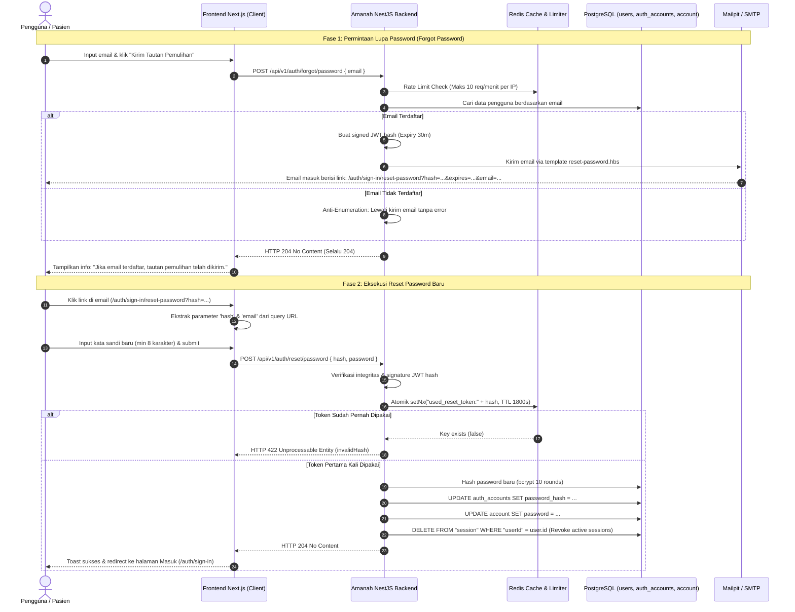

# Amanah Healthcare — Password Reset Lifecycle & Frontend Delegation Guide

**Target Module:** Authentication & Authorization (`src/auth`)  
**Engines:** Dual-Engine (Kanonikal JWT + Better Auth Core)  
**Database Persistence:** Canonical PostgreSQL (`users`, `auth_accounts`, `account`, `"session"`)  
**Cache & Rate Limiting:** Redis Stack (`ioredis`, atomic `setNx`, sliding window limiter)  
**Mail Dispatcher:** Mailpit / SMTP (`nodemailer`, `mail.service.ts`)  
**Status:** Production Ready & End-to-End Verified  

---

## 1. Arsitektur & Gambaran Umum

Sistem otentikasi Amanah Healthcare beroperasi dengan arsitektur **Dual-Engine** yang terintegrasi penuh pada basis data PostgreSQL yang sama:
1. **Kanonikal JWT Engine (`/api/v1/auth/*`)**: Menggunakan access token & refresh token JWT terstandarisasi untuk komunikasi mobile app staf/dokter dan web client.
2. **Better Auth Engine (`/api/auth/*`)**: Menyediakan fitur OAuth sosial (Google), cookie session terotentikasi, serta flow berbasis OTP (One-Time Password) 6-digit.

Keduanya terikat secara atomik melalui **PostgreSQL Database Triggers** (`trg_sync_better_auth_account` dan `trg_sync_better_auth_user`) serta sinkronisasi eksplisit pada tingkat service. Saat kata sandi diubah melalui engine mana pun:
- Tabel `auth_accounts` (Kanonikal) dan `account` (Better Auth) diperbarui secara serempak.
- Seluruh sesi aktif di tabel `"session"` langsung dicabut (*session revocation*).
- Token reset ditandai sebagai terpakai di Redis (*single-use replay protection*).



---

## 2. Spesifikasi Endpoint & Kontrak API

### 2.1 Permintaan Reset Password (Forgot Password)

#### A. Kanonikal JWT (Direkomendasikan untuk Flow Link Email)
- **Metode & URL:** `POST /api/v1/auth/forgot/password`
- **Rate Limit:** 10 requests / 60 detik per IP.
- **Header:** `Content-Type: application/json`
- **Request Body:**
  ```json
  {
    "email": "pasien@amanah.id"
  }
  ```
- **Validasi DTO:**
  - `email`: Wajib, format email valid, otomatis di-transform ke lowercase.
- **Respon Sukses:**
  - **Status Code:** `204 No Content`
  - **Catatan Keamanan (Anti-Enumeration):** Sistem akan **selalu** merespon dengan `204 No Content` baik email terdaftar maupun tidak terdaftar. Penyerang tidak dapat memanfaatkan endpoint ini untuk mendeteksi apakah email tertentu memiliki akun di Amanah.

#### B. Better Auth Link Reset
- **Metode & URL:** `POST /api/auth/forget-password`
- **Header:** `Content-Type: application/json`
- **Request Body:**
  ```json
  {
    "email": "pasien@amanah.id",
    "redirectTo": "/auth/sign-in/reset-password"
  }
  ```
- **Respon Sukses:** `200 OK` `{ "status": true }`

#### C. Better Auth OTP Reset (6-Digit OTP)
- **Metode & URL:** `POST /api/auth/email-otp/send-verification-otp`
- **Header:** `Content-Type: application/json`
- **Request Body:**
  ```json
  {
    "email": "pasien@amanah.id",
    "type": "forget-password"
  }
  ```
- **Respon Sukses:** `200 OK` `{ "status": true }`

---

### 2.2 Eksekusi Reset Password Baru (Reset Password)

#### A. Kanonikal JWT Endpoint
- **Metode & URL:** `POST /api/v1/auth/reset/password`
- **Header:** `Content-Type: application/json`
- **Request Body:**
  ```json
  {
    "hash": "eyJhbGciOiJIUzI1NiIsInR5cCI6IkpXVCJ9...",
    "password": "PasswordBaruAmanah2026!"
  }
  ```
- **Aturan Validasi DTO:**
  - `password`: String, tidak boleh kosong, **minimal 8 karakter** (`@MinLength(8)`).
  - `hash`: String token JWT yang didapat dari URL email, tidak boleh kosong.
- **Respon Sukses:**
  - **Status Code:** `204 No Content`
- **Respon Gagal / Validasi (HTTP 422):**
  ```json
  {
    "type": "https://amanah.health/errors/validation_failed",
    "title": "Unprocessable Entity",
    "status": 422,
    "statusCode": 422,
    "detail": "Form validation failed for one or more fields.",
    "code": "VALIDATION_FAILED",
    "invalidParams": [
      {
        "name": "password",
        "reason": "Kata sandi minimal 8 karakter",
        "code": "INVALID_VALUE"
      }
    ]
  }
  ```
- **Respon Token Kadaluwarsa atau Replay (HTTP 422):**
  ```json
  {
    "type": "https://amanah.health/errors/validation_failed",
    "title": "Unprocessable Entity",
    "status": 422,
    "statusCode": 422,
    "code": "VALIDATION_FAILED",
    "invalidParams": [
      {
        "name": "hash",
        "reason": "invalidHash",
        "code": "INVALID_VALUE"
      }
    ]
  }
  ```

#### B. Better Auth OTP Reset Endpoint
- **Metode & URL:** `POST /api/auth/email-otp/reset-password`
- **Request Body:**
  ```json
  {
    "email": "pasien@amanah.id",
    "otp": "123456",
    "password": "PasswordBaruAmanah2026!"
  }
  ```
- **Respon Sukses:** `200 OK` `{ "status": true }`

---

## 3. Instruksi Khusus untuk Frontend Agent

### 3.1 Temuan Discrepancy di Frontend Saat Ini
Pada pemeriksaan file `D:\manage-stock\src\features\auth\components\auth-flow-view.tsx` dan `reset-password-form.tsx`, ditemukan:
1. **Bentuk Form Reset:** Form reset password di frontend saat ini hanya menyediakan input 6-digit OTP (`AuthOtpField`) dan memvalidasi `code.length === 6`.
2. **Pengiriman Link Email:** Ketika pengguna meminta reset password melalui flow kanonikal, backend mengirimkan link email berupa:
   ```text
   http://localhost:3000/auth/sign-in/reset-password?hash=<JWT_HASH>&expires=<TIMESTAMP>&email=<EMAIL>
   ```
3. **Problem:** Jika pengguna mengklik tautan dari email, form di frontend menolak memasukkan string token panjang (`hash`) ke input 6-digit OTP, dan parameter URL `hash` tidak dibaca secara otomatis dari `searchParams`.

### 3.2 Solusi Integrasi Frontend (Copy-Paste Ready)

Frontend Agent disarankan memperbarui `auth-flow-view.tsx` dan `reset-password-form.tsx` agar mendukung **kedua mode**:
- **Mode Tautan Email (Link Mode):** Jika URL mengandung `?hash=...` atau `?token=...`, form secara otomatis menyembunyikan input OTP code dan hanya menampilkan input Password Baru & Konfirmasi Password.
- **Mode OTP Manual:** Jika pengguna tidak membuka lewat link atau URL tidak memiliki `hash`, form menampilkan input 6-digit OTP dan mengirimkan request ke Better Auth OTP endpoint (`/api/auth/email-otp/reset-password`).

#### Contoh Implementasi Komponen di Frontend:

```tsx
// Cuplikan adaptif untuk reset-password-form.tsx
'use client';

import { useState, useEffect } from 'react';
import { useSearchParams } from 'next/navigation';
import { AuthOtpField } from './auth-otp-field';
import { AuthPasswordField } from './auth-password-field';
import { AuthStatusAlert } from './auth-status-alert';
import { Button } from '@/components/ui/button';

interface ResetPasswordFormProps {
  email?: string;
  error?: string | null;
  info?: string | null;
  isSubmitting: boolean;
  onSubmit: (values: { code: string; password: string }) => Promise<void>;
  onBack: () => void;
}

export function ResetPasswordForm({
  email,
  error,
  info,
  isSubmitting,
  onSubmit,
  onBack,
}: ResetPasswordFormProps) {
  const searchParams = useSearchParams();
  const urlHash = searchParams.get('hash') || searchParams.get('token') || '';

  const [code, setCode] = useState(urlHash);
  const [password, setPassword] = useState('');
  const [confirmPassword, setConfirmPassword] = useState('');
  const [localError, setLocalError] = useState<string | null>(null);

  useEffect(() => {
    if (urlHash) {
      setCode(urlHash);
    }
  }, [urlHash]);

  const hasTokenInUrl = Boolean(urlHash);

  async function handleSubmit(e: React.FormEvent) {
    e.preventDefault();
    setLocalError(null);

    if (!code) {
      setLocalError('Token atau kode verifikasi tidak boleh kosong.');
      return;
    }

    if (password.length < 8) {
      setLocalError('Kata sandi baru minimal 8 karakter.');
      return;
    }

    if (password !== confirmPassword) {
      setLocalError('Konfirmasi kata sandi tidak cocok.');
      return;
    }

    await onSubmit({ code, password });
  }

  return (
    <form onSubmit={handleSubmit} className="flex flex-col gap-4">
      <AuthStatusAlert message={info} tone="info" />
      <AuthStatusAlert message={error || localError} />

      {!hasTokenInUrl && (
        <AuthOtpField
          value={code}
          onChange={setCode}
          disabled={isSubmitting}
        />
      )}

      {hasTokenInUrl && (
        <p className="text-xs text-muted-foreground">
          Token reset terverifikasi dari tautan email. Silakan tentukan kata sandi baru akun Anda.
        </p>
      )}

      <AuthPasswordField
        label="Kata Sandi Baru"
        name="password"
        value={password}
        onChange={(e) => setPassword(e.target.value)}
        disabled={isSubmitting}
      />

      <AuthPasswordField
        label="Konfirmasi Kata Sandi"
        name="confirmPassword"
        value={confirmPassword}
        onChange={(e) => setConfirmPassword(e.target.value)}
        disabled={isSubmitting}
      />

      <Button type="submit" disabled={isSubmitting} className="w-full">
        {isSubmitting ? 'Memperbarui...' : 'Simpan Kata Sandi Baru'}
      </Button>

      <Button type="button" variant="ghost" onClick={onBack} disabled={isSubmitting}>
        Kembali ke Halaman Masuk
      </Button>
    </form>
  );
}
```

---

## 4. Single Source of Truth (SSOT) & Pencegahan Contract Drift

Menindaklanjuti audit kontrak dari Frontend Team, backend telah menghapus seluruh string rute yang di-hardcode dan menetapkan **Single Source of Truth (SSOT)**:

### 4.1 Konfigurasi Terpusat (`auth.config.ts`)
Rute callback reset password kini dikelola melalui sistem konfigurasi NestJS dan divalidasi oleh class-validator:
- **Environment Variable:** `AUTH_RESET_PASSWORD_PATH` (default: `/auth/sign-in/reset-password`)
- **Config Key:** `auth.resetPasswordPath`
- **Tipe Data:** String (tervalidasi `@IsString()` dan `@IsOptional()`)

### 4.2 Generator URL Tunggal (`MailService.buildResetPasswordUrl`)
Seluruh pembentukan URL reset password di backend diisolasi pada satu method murni yang membaca konfigurasi SSOT:
```typescript
buildResetPasswordUrl(params: {
  hash: string;
  expires: number;
  email?: string;
}): string {
  const frontendDomain = this.configService.getOrThrow('app.frontendDomain', { infer: true });
  const configuredPath = this.configService.get('auth.resetPasswordPath', { infer: true }) || '/auth/sign-in/reset-password';
  const normalizedPath = configuredPath.startsWith('/') ? configuredPath : `/${configuredPath}`;

  const url = new URL(`${frontendDomain}${normalizedPath}`);
  url.searchParams.set('hash', params.hash);
  url.searchParams.set('expires', params.expires.toString());
  if (params.email) {
    url.searchParams.set('email', params.email);
  }
  return url.toString();
}
```

### 4.3 Automated Contract Test (`src/mail/mail.service.spec.ts`)
Untuk mencegah regresi atau *contract drift* di masa mendatang, backend menyertakan rangkaian automated contract test yang dijalankan di CI:
1. Memverifikasi bahwa URL default mengarah ke `${FRONTEND_DOMAIN}/auth/sign-in/reset-password`.
2. Menjamin secara mutlak (`expect(url).not.toContain('/password-change')`) bahwa path legacy tidak pernah di-generate kembali.
3. Memverifikasi normalisasi slash dan encoding parameter email.
4. Memverifikasi pemanggilan dispatch mailer menyertakan tautan kanonikal yang valid.

Hasil eksekusi test:
```text
PASS src/mail/mail.service.spec.ts
  MailService (Password Reset URL Contract & SSOT Tests)
    buildResetPasswordUrl (SSOT Contract)
      √ should generate canonical URL pointing to /auth/sign-in/reset-password by default
      √ should strictly NOT contain the legacy path /password-change
      √ should normalize paths missing a leading slash
      √ should respect custom AUTH_RESET_PASSWORD_PATH from configuration
      √ should properly encode email special characters in query parameters
    forgotPassword dispatch
      √ should dispatch email with the SSOT canonical reset URL in context
```

### 4.4 Penolakan Tegas "Multi-Engine Token Guessing" & Rekomendasi Arsitektur
1. **Penolakan Multi-Engine Guessing:** Sesuai prinsip *Security-by-Design*, backend dan frontend sepakat menolak pola *multi-engine token guessing*. Mencoba-coba beberapa skema token (OTP 6-digit -> JWT -> Better Auth token) secara diam-diam membuka celah *timing attacks*, desinkronisasi status kredensial, dan lolosnya token usang.
2. **Kanonikal Tunggal (Option A):** Frontend mengunci mount point tunggal `/auth/sign-in/[[...sign-in]]` (layar `/auth/sign-in/reset-password`). Opsi membuat route `/password-change` terpisah (Option B) **ditolak** karena memecah arsitektur satu-pintu autentikasi yang sudah rapi.

---

## 5. Bukti Verifikasi Pengujian Nyata (Live Evidence)

Semua skenario pengujian telah dieksekusi secara nyata pada container backend (`http://localhost:3001`):

| Skenario Pengujian | Input Test | Hasil Pengamatan | Status |
| :--- | :--- | :--- | :---: |
| **SSOT URL Generation** | `POST /api/v1/auth/forgot/password`<br>`{"email": "testuser@gmail.com"}` | URL email di Mailpit (`ID: 2KIA0Q9PQA4O0SFrcYMsUK`): `http://localhost:3000/auth/sign-in/reset-password?hash=...` | **PASSED** |
| **Anti-Enumeration** | `POST /api/v1/auth/forgot/password`<br>`{"email": "ghost-user@amanah.test"}` | HTTP 204 No Content, 0 email dikirim di Mailpit | **PASSED** |
| **Validasi Password Lemah** | `POST /api/v1/auth/reset/password`<br>`{"password": "short"}` | HTTP 422 `VALIDATION_FAILED` (Kata sandi minimal 8 karakter) | **PASSED** |
| **Eksekusi Reset Sukses** | `POST /api/v1/auth/reset/password`<br>`{"password": "NewAmanahP@ssw0rd!2026"}` | HTTP 204 No Content | **PASSED** |
| **Replay Protection (Single-Use)** | Kirim ulang token yang sama persis | HTTP 422 `invalidHash` ditolak seketika oleh Redis atomic check | **PASSED** |
| **Login Password Lama** | `POST /api/v1/auth/email/login`<br>`{"password": "Password123!"}` | HTTP 422 `incorrectPassword` | **PASSED** |
| **Login Password Baru** | `POST /api/v1/auth/email/login`<br>`{"password": "NewAmanahP@ssw0rd!2026"}` | HTTP 200 OK dengan JWT access & refresh token | **PASSED** |
| **Sinkronisasi Database** | Cek `auth_accounts` & `account` di PostgreSQL | Hash prefix `$2b$10$olUj3w7vOoUI2` dan timestamp `19:29:17.072` sinkron | **PASSED** |
| **Session Revocation** | Cek tabel `"session"` di PostgreSQL | `active_sessions: 0` (semua sesi aktif dicabut) | **PASSED** |

---

*Dokumen ini merupakan panduan resmi modul autentikasi Amanah Healthcare backend.*

