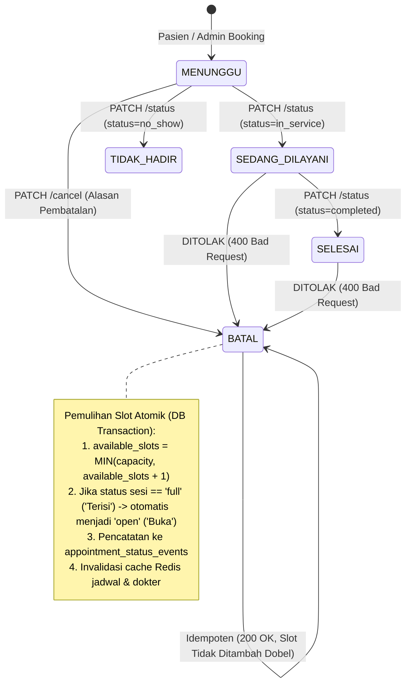

# Web Admin — Spesifikasi Resmi & Changelog: Patient Bookings Roster, Demographic Grid & Appointment Cancellation Lifecycle

**Versi Dokumen:** 1.0.0  
**Target Pembaca:** Tim Frontend Web Admin & Mobile Engineering  
**Backend Service:** Amanah Healthcare Backend v1.2.0  
**Status Resolusi:** IMPLEMENTED, REBUILT IN DOCKER & VERIFIED PASSING E2E (132 / 132 CHECKS)  
**Tanggal:** 24 September 2026  

---

## 1. Executive Summary & Ringkasan Perubahan

Untuk memenuhi kebutuhan operasional klinik pada portal Web Admin dan sinkronisasi lintas platform, Backend Amanah Healthcare telah mengimplementasikan infrastruktur data terpadu untuk:
1. **Showcase Kartu Jadwal Dokter:** Menyediakan metrik sesi praktik mendatang (`jadwal_praktik_mendatang`) yang dievaluasi secara dinamis terhadap waktu riil server, serta metrik akumulasi slot harian (`slot_terisi_akumulasi`, `slot_kapasitas_akumulasi`, `display_akumulasi_slot`).
2. **Endpoint Daftar Pasien Terjadwal Per Sesi (Roster 5-Kolom & Sub-Modal Demografis):** `GET /api/v1/admin/doctor-schedules/:id/sessions/:sessionId/patients` dengan filtering status (`waiting`, `in_service`, `completed`, `cancelled`, `no_show`, `all`) dan pencarian teks (`search` nama pasien / Nomor Rekam Medis).
3. **Endpoint Daftar Pasien Terjadwal Akumulasi Harian Dokter:** `GET /api/v1/admin/doctor-schedules/:id/patients?date=YYYY-MM-DD` yang mengagregasikan seluruh pasien lintas sesi pada tanggal bersangkutan dengan filter `sessionShift`, `status`, dan `search`.
4. **Lifecycle Pembatalan Janji Temu & Pemulihan Slot Atomik:** `PATCH /api/v1/admin/appointments/:appointmentId/cancel` dan `PATCH /api/v1/admin/appointments/:appointmentId/status` dengan penegakan validasi ketat, idempotensi pembatalan, pemulihan kuota slot sesi (`available_slots + 1`), pengembalian status sesi `Terisi` $\to$ `Buka`, dan pencatatan audit log status event.

> [!IMPORTANT]
> Seluruh kontrak di bawah ini bersifat kanonikal dan deterministik. Semua kalkulasi bisnis (agregasi kuota, waktu sesi mendatang, pemulihan slot, dan format tampilan) dikelola 100% oleh backend. Frontend bertindak murni sebagai konsumen data tanpa perlu melakukan kalkulasi manual.

---

## 2. Arsitektur State Machine & Pemulihan Slot (Lifecycle Guard)

Berikut adalah diagram transisi status janji temu (*appointment lifecycle*) beserta konsekuensi atomik terhadap kuota slot sesi praktik:



### Invarian Bisnis Pembatalan:
1. **Pencegahan Pembatalan Ilegal (Guard 400 Bad Request):**
   - Janji temu yang sedang aktif dalam penanganan dokter (`SEDANG_DILAYANI` / `in_service`) atau telah selesai diperiksa (`SELESAI` / `completed`) **DILARANG DIBATALKAN**.
   - Backend melempar `400 Bad Request` dengan kode error `CANNOT_CANCEL_IN_SERVICE` atau `CANNOT_CANCEL_COMPLETED`.
2. **Idempotensi Pembatalan:**
   - Memanggil `PATCH /cancel` pada janji temu yang sudah berstatus `BATAL` (`cancelled`) akan mengembalikan `200 OK` dengan pesan konfirmasi aman tanpa menambah slot dua kali.
3. **Pemulihan Kuota Slot Atomik:**
   - Ketika janji temu berstatus `MENUNGGU` dibatalkan, kuota sesi bertambah 1 (`available_slots + 1`), dibatasi maksimal sebesar kapasitas sesi (`capacity`).
   - Apabila sesi sebelumnya penuh (`status === 'full'` / `'Terisi'`), status sesi otomatis dipulihkan menjadi `'open'` (`'Buka'`).

---

## 3. Spesifikasi Kontrak API Lengkap

### 3.1 Showcase Kartu Jadwal Dokter (Upgrade Endpoint)
* **Endpoint:** `GET /api/v1/admin/doctor-schedules`
* **Autentikasi:** Bearer JWT Token (`role: ADMIN` atau `role: STAF`)
* **Headers:**
  ```http
  Authorization: Bearer <admin_or_staff_token>
  Accept: application/json
  ```
* **Query Parameters:**
  | Parameter | Tipe | Wajib | Keterangan |
  |---|---|---|---|
  | `search` | `string` | Tidak | Pencarian nama dokter atau spesialisasi |
  | `clinicRoomId` | `string` (UUID) | Tidak | Filter berdasarkan ruangan/poliklinik |
  | `page` | `number` | Tidak | Nomor halaman (default: `1`) |
  | `limit` | `number` | Tidak | Jumlah item per halaman (default: `10`) |

* **Struktur Data Tambahan pada Response (`data[*]`):**
  ```json
  {
    "data": [
      {
        "id": "c518facb-372e-4f07-9766-f3eacf54221f",
        "doctor_name": "dr. Ahmadamikom Zikri, Sp.PD",
        "specialization": "Penyakit Dalam",
        "clinic_room_name": "Poli Internis 1",
        "jadwal_praktik_mendatang": {
          "label": "Hari ini, 08:00 - 12:00 WIB",
          "shift": "Pagi",
          "jam_mulai": "08:00",
          "jam_selesai": "12:00",
          "status": "Sedang Berlangsung",
          "is_active_now": true
        },
        "slot_terisi_akumulasi": 14,
        "slot_kapasitas_akumulasi": 24,
        "display_akumulasi_slot": "14 / 24",
        "total_jadwal_mingguan": 4,
        "is_active": true
      }
    ],
    "meta": {
      "page": 1,
      "limit": 10,
      "total_items": 1,
      "total_pages": 1
    }
  }
  ```

---

### 3.2 Daftar Pasien Terjadwal Per Sesi (5-Column Grid & Sub-Modal Demografis)
* **Endpoint:** `GET /api/v1/admin/doctor-schedules/:id/sessions/:sessionId/patients`
* **Path Parameters:**
  * `id` (UUID): ID Praktisi Dokter (`practitioner_id`)
  * `sessionId` (UUID): ID Sesi Praktik (`session_id`)
* **Query Parameters:**
  | Parameter | Tipe | Wajib | Pilihan / Format | Keterangan |
  |---|---|---|---|---|
  | `status` | `string` | Tidak | `waiting`, `in_service`, `completed`, `cancelled`, `no_show`, `all` | Filter status janji temu (default: `all`) |
  | `search` | `string` | Tidak | Teks bebas | Pencarian nama pasien atau Nomor RM |

* **Response Payload (200 OK):**
  ```json
  {
    "session_info": {
      "session_id": "4b68e986-e822-497d-aa53-ee8827725203",
      "practitioner_id": "c518facb-372e-4f07-9766-f3eacf54221f",
      "doctor_name": "dr. Ahmadamikom Zikri, Sp.PD",
      "specialization": "Penyakit Dalam",
      "date": "2026-09-24",
      "day_name": "Kamis",
      "shift": "Pagi",
      "time_range": "08:00 - 12:00",
      "capacity": 8,
      "booked": 3,
      "available": 5,
      "session_status": "Buka"
    },
    "summary": {
      "total_patients": 3,
      "waiting_count": 2,
      "in_service_count": 1,
      "completed_count": 0,
      "cancelled_count": 0,
      "no_show_count": 0
    },
    "patients": [
      {
        "appointment_id": "7f89d012-3456-4abc-9def-0123456789ab",
        "queue_number": "A-01",
        "time_slot": "08:00 - 08:30",
        "status": "MENUNGGU",
        "status_badge": {
          "label": "Menunggu",
          "color": "amber",
          "variant": "warning"
        },
        "chief_complaint": "Pusing berputar dan mual sejak kemarin pagi",
        "clinic_room_name": "Poli Internis 1",
        "is_cancellable": true,
        "is_editable": true,
        "demographics": {
          "patient_id": "89012345-6789-4abc-def0-123456789012",
          "full_name": "Budi Santoso",
          "medical_record_number": "RM-2026-0001",
          "nik": "3171012345670001",
          "gender": "L",
          "gender_label": "Laki-laki",
          "birth_date": "1985-06-15",
          "age": 41,
          "phone_number": "081234567890",
          "email": "budi.santoso@example.com",
          "address": "Jl. Merdeka No. 45, RT 01/RW 02, Jakarta Selatan",
          "guardian_name": "Siti Aminah (Istri)",
          "avatar_url": null,
          "booking_metadata": {
            "created_at": "2026-09-23T10:15:00.000Z",
            "booking_channel": "MOBILE_APP",
            "payment_type": "UMUM",
            "notes": "Pasien baru pertama kali periksa"
          }
        }
      }
    ]
  }
  ```

---

### 3.3 Daftar Pasien Terjadwal Akumulasi Harian Dokter
* **Endpoint:** `GET /api/v1/admin/doctor-schedules/:id/patients`
* **Path Parameters:**
  * `id` (UUID): ID Praktisi Dokter (`practitioner_id`)
* **Query Parameters:**
  | Parameter | Tipe | Wajib | Keterangan |
  |---|---|---|---|
  | `date` | `string` (YYYY-MM-DD) | **Wajib** | Tanggal pemeriksaan (contoh: `2026-09-24`) |
  | `sessionShift` | `string` | Tidak | Filter shift: `Dini Hari`, `Pagi`, `Siang`, `Sore`, `Malam` |
  | `status` | `string` | Tidak | `waiting`, `in_service`, `completed`, `cancelled`, `no_show`, `all` |
  | `search` | `string` | Tidak | Nama pasien atau Nomor Rekam Medis |

* **Response Payload (200 OK):**
  Mengembalikan ringkasan akumulasi seluruh sesi pada tanggal tersebut beserta array pasien terurut nomor antrean per sesi.

---

### 3.4 Pembatalan Janji Temu Pasien oleh Admin (Dengan Slot Recovery)
* **Endpoint:** `PATCH /api/v1/admin/appointments/:appointmentId/cancel`
* **Path Parameters:**
  * `appointmentId` (UUID): ID Janji Temu (`appointment_id`)
* **Request Body (JSON):**
  ```json
  {
    "cancellationReason": "Pasien membatalkan karena ada keperluan mendesak ke luar kota",
    "notifyPatient": true
  }
  ```
  | Field | Tipe | Wajib | Validasi |
  |---|---|---|---|
  | `cancellationReason` | `string` | **Wajib** | Minimal 5 karakter, maksimal 500 karakter |
  | `notifyPatient` | `boolean` | Tidak | Default: `true` (memicu event notifikasi) |

* **Response Sukses (200 OK):**
  ```json
  {
    "statusCode": 200,
    "message": "Janji temu berhasil dibatalkan dan kuota slot sesi telah dipulihkan.",
    "data": {
      "appointment_id": "7f89d012-3456-4abc-9def-0123456789ab",
      "status": "BATAL",
      "cancellation_reason": "Pasien membatalkan karena ada keperluan mendesak ke luar kota",
      "cancelled_at": "2026-09-24T02:15:30.123Z",
      "slot_recovery": {
        "session_id": "4b68e986-e822-497d-aa53-ee8827725203",
        "previous_available_slots": 0,
        "new_available_slots": 1,
        "session_capacity": 8,
        "session_status": "Buka"
      }
    }
  }
  ```

* **Kasus Idempoten (200 OK):**
  Apabila janji temu telah berstatus `BATAL` sebelumnya:
  ```json
  {
    "statusCode": 200,
    "message": "Janji temu sudah dalam status BATAL sebelumnya (idempoten).",
    "data": {
      "appointment_id": "7f89d012-3456-4abc-9def-0123456789ab",
      "status": "BATAL",
      "cancellation_reason": "Alasan pembatalan sebelumnya...",
      "cancelled_at": "2026-09-24T02:10:00.000Z",
      "slot_recovery": null
    }
  }
  ```

* **Kasus Ditolak (400 Bad Request):**
  Jika janji temu sedang dilayani (`SEDANG_DILAYANI`) atau selesai (`SELESAI`):
  ```json
  {
    "statusCode": 400,
    "error": "Bad Request",
    "code": "CANNOT_CANCEL_IN_SERVICE",
    "message": "Janji temu yang sedang dalam pelayanan (SEDANG_DILAYANI) tidak dapat dibatalkan.",
    "timestamp": "2026-09-24T02:15:30.123Z",
    "path": "/api/v1/admin/appointments/7f89d012-3456-4abc-9def-0123456789ab/cancel"
  }
  ```

---

### 3.5 Pembaruan Status Operasional Janji Temu oleh Admin
* **Endpoint:** `PATCH /api/v1/admin/appointments/:appointmentId/status`
* **Path Parameters:**
  * `appointmentId` (UUID): ID Janji Temu
* **Request Body (JSON):**
  ```json
  {
    "status": "in_service",
    "notes": "Pasien telah memasuki poli internis"
  }
  ```
  | Field | Tipe | Wajib | Pilihan / Validasi |
  |---|---|---|---|
  | `status` | `string` | **Wajib** | `waiting`, `in_service`, `completed`, `no_show` |
  | `notes` | `string` | Tidak | Catatan operasional klinik |

* **Response Sukses (200 OK):**
  ```json
  {
    "statusCode": 200,
    "message": "Status janji temu berhasil diperbarui menjadi SEDANG_DILAYANI.",
    "data": {
      "appointment_id": "7f89d012-3456-4abc-9def-0123456789ab",
      "status": "SEDANG_DILAYANI",
      "updated_at": "2026-09-24T02:16:00.000Z"
    }
  }
  ```

---

## 4. Panduan Integrasi State & TanStack Query Keys (Frontend Cache Invalidation)

Agar Web Admin memiliki UI yang reaktif tanpa refresh halaman manual, pasang skema key invalidasi berikut saat mutasi berhasil:

### Query Keys Standar:
* **Daftar Dokter / Kartu Showcase:** `['admin', 'doctor-schedules', { search, clinicRoomId, page, limit }]`
* **Kalender & Sesi Dokter:** `['admin', 'doctor-schedules', doctorId, { month }]`
* **Detail Tanggal Dokter:** `['admin', 'doctor-schedules', doctorId, 'date', date]`
* **Daftar Pasien Per Sesi:** `['admin', 'doctor-schedules', doctorId, 'sessions', sessionId, 'patients', { status, search }]`
* **Daftar Pasien Akumulasi:** `['admin', 'doctor-schedules', doctorId, 'patients', { date, sessionShift, status, search }]`

### Invalidation Trigger pada Mutasi:
1. **Setelah `PATCH /cancel` Sukses:**
   * Invalidate query `['admin', 'doctor-schedules', doctorId, 'sessions', sessionId, 'patients']`
   * Invalidate query `['admin', 'doctor-schedules', doctorId, 'patients']`
   * Invalidate query `['admin', 'doctor-schedules', doctorId, 'date']` (untuk merefleksikan penambahan `available_slots`)
   * Invalidate query `['admin', 'doctor-schedules']` (untuk merefleksikan perubahan `display_akumulasi_slot` pada kartu showcase)
2. **Setelah `PATCH /status` Sukses:**
   * Invalidate query `['admin', 'doctor-schedules', doctorId, 'sessions', sessionId, 'patients']`
   * Invalidate query `['admin', 'doctor-schedules', doctorId, 'patients']`

---

## 5. Ringkasan Pengujian Sistem & Verifikasi

| Pengujian | Target Cakupan | Hasil | Status |
|---|---|---|---|
| Unit Test Controller | `src/modules/appointments/presentation/admin-appointments.controller.spec.ts` | 2 passed / 2 total | **100% PASS** |
| Unit Test Schedule Projection | `src/modules/schedules/domain/schedule-projection.spec.ts` | 7 passed / 7 total | **100% PASS** |
| Unit Test Schedule Repo | `src/modules/schedules/infrastructure/drizzle/schedule.drizzle-repository.spec.ts` | 13 passed / 13 total | **100% PASS** |
| Unit Test Schedule Controllers | `src/modules/schedules/presentation/*.spec.ts` | 26 passed / 26 total | **100% PASS** |
| E2E Security & Roster Suite | `scripts/e2e/test-schedule-v2-security-crud.ps1` (Sections 1 s.d. 11) | 132 passed / 132 total | **100% PASS** |
| Docker Container Rebuild | `amanah-healthcare-backend-api-1` | Recreated & Started (Health 200 OK) | **OPERATIONAL** |
