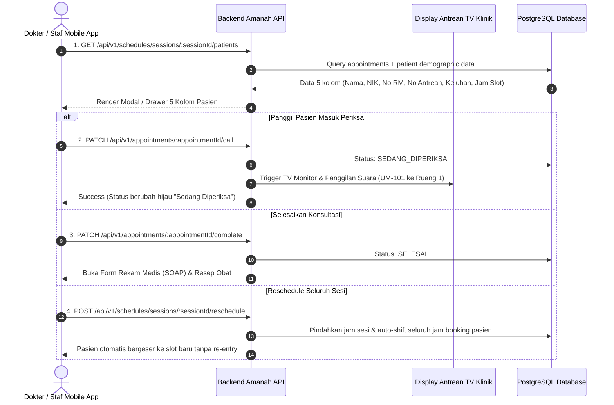

# Amanah Healthcare — Schedule Management API Contract Specification

> **Auto-Generated Manifest for Mobile & Frontend Engineers**  
> **Generation Timestamp:** `2026-09-25T15:06:22.902Z`  
> **Target Base URL:** `http://localhost:3001/api/v1`  
> **Environment:** Docker Production/Dev Container (`amanah-healthcare-backend-api-1`)  
> **Showcase Doctor:** `dr. Ahmadamikom Zikri` (`c518facb-372e-4f07-9766-f3eacf54221f`)  
> **Showcase Session:** `2d0ffab9-2ad8-43b1-9946-0f9fa7eb3ed8`

---

## Ringkasan Eksekutif & Prinsip Arsitektur

Dokumen ini adalah **spesifikasi kontrak API terlengkap** untuk seluruh modul **Schedule Management**, **Referensi Opsi**, **Proyeksi Slot Dinamis**, **Alur Reschedule Otomatis**, dan **Manajemen Pasien Sesi**.

### 1. Prinsip Paritas Mobile & Web Admin (Canonical Parity)
- Dokter di Mobile App dan Admin di Web App menggunakan **endpoint kanonikal bersama** di bawah rute `/api/v1/schedules/...`.
- Dokter memiliki kepemilikan penuh (*ownership guard*) terhadap jadwal praktiknya sendiri.
- Endpoint supervisi khusus `/api/v1/admin/doctor-schedules/...` juga dapat diakses oleh dokter pemilik jadwal tanpa penolakan hak akses (*Doctor Self-Supervision*).

### 2. Otomasi Kalkulasi Slot Dinamis (Dynamic Slot Derivation)
- **Tanpa Hardcoding 6 Jam:** Setiap sesi memiliki durasi per slot berbasis `practitioner.consultationDurationMinutes` (default **30 menit** dari database).
- **Rumus Kapasitas Dinamis:**
  $$\text{Kapasitas Slot} = \frac{\text{Batas Akhir Shift} - \text{Jam Mulai}}{\text{Durasi Konsultasi (30m)}}$$
  *Contoh:* Dokter memulai shift pagi jam `10:00` (batas shift `12:00`) $\rightarrow$ Durasi $120\text{ menit} \div 30\text{ menit} = \mathbf{4\text{ slot}}$. Jam selesai otomatis diproyeksikan ke **`12:00` WIB** (bukan 16:00).
- Jika ada 2 pasien aktif, 2 pasien menempati 2 slot pertama (`10:00-10:30` dan `10:30-11:00`), menyisakan 2 slot terbuka (`availableSlots = 2`).

### 3. Autentikasi & Header Permintaan
Semua request terproteksi wajib menyertakan token JWT pada header HTTP:
```http
Authorization: Bearer <access_token>
Content-Type: application/json
```

---

## Daftar Isi Cepat
1. [1. Master Options & Reference Data](#1-master-options-reference-data)
2. [2. Context, Dynamic Slot Math & Projection](#2-context-dynamic-slot-math-projection)
3. [3. Doctor Schedule CRUD & Calendar View (Mobile & Web)](#3-doctor-schedule-crud-calendar-view-mobile-web)
4. [4. Interactive Patient Flow When Clicking a Schedule](#4-interactive-patient-flow-when-clicking-a-schedule)
5. [5. Patient Actions From Schedule Patient List](#5-patient-actions-from-schedule-patient-list)
6. [6. Reschedule System & Dynamic Slot Simulation](#6-reschedule-system-dynamic-slot-simulation)
7. [7. Admin Doctor Supervision CRUD (Web Admin)](#7-admin-doctor-supervision-crud-web-admin)
8. [Alur Interaktif Saat Mengklik Jadwal yang Ada Pasiennya (Interactive Patient Workflow)](#alur-interaktif-saat-mengklik-jadwal-yang-ada-pasiennya-interactive-patient-workflow)
9. [Panduan Implementasi Mobile Developer (Delegation Sheet)](#panduan-implementasi-mobile-developer-delegation-sheet)

---

## 1. Master Options & Reference Data

### GET `/api/v1/schedules/reference/options`

**Judul:** Master Opsi Konfigurasi Jadwal (Shifts, Status, Intervals)  
**Otorisasi Role:** `ADMIN, STAF, PATIENT (Bearer Token)`  

#### 1. Fungsi & Tujuan Endpoint
Menyediakan referensi resmi shift 24 jam (Dini Hari, Pagi, Siang, Malam), status kanonikal jadwal (OPEN, CLOSED, FULL, LEAVE), dan durasi interval konsultasi.

#### 2. Ekspektasi Implementasi di Sisi Client (Mobile/Web)
Gunakan endpoint ini untuk mengisi dropdown filter status, selector shift praktik, dan opsi durasi konsultasi di mobile app dan web admin.

#### 5. Live Response JSON Payload (HTTP Status: `200`)
```json
{
  "shifts": [
    {
      "id": "EARLY_MORNING",
      "label": "Dini Hari",
      "shift": "early_morning",
      "startTime": "00:00",
      "endTime": "06:00"
    },
    {
      "id": "MORNING",
      "label": "Pagi",
      "shift": "morning",
      "startTime": "06:00",
      "endTime": "12:00"
    },
    {
      "id": "AFTERNOON",
      "label": "Siang",
      "shift": "afternoon",
      "startTime": "12:00",
      "endTime": "18:00"
    },
    {
      "id": "NIGHT",
      "label": "Malam",
      "shift": "night",
      "startTime": "18:00",
      "endTime": "24:00"
    }
  ],
  "statuses": [
    {
      "id": "OPEN",
      "label": "Buka"
    },
    {
      "id": "CLOSED",
      "label": "Tutup"
    }
  ],
  "timeSlotIntervals": [
    30
  ],
  "effectiveConsultationDurationMinutes": 30,
  "durationSource": "CLINIC_CONFIG",
  "durationScope": "clinic-default",
  "canonicalIntervalStatuses": [
    {
      "id": "OPEN",
      "label": "Buka"
    },
    {
      "id": "OCCUPIED",
      "label": "Terisi"
    },
    {
      "id": "CLOSED",
      "label": "Tutup"
    }
  ]
}
```

---

### GET `/api/v1/schedules/reference/rooms?date=2026-09-24&startTime=06:00&endTime=12:00`

**Judul:** Daftar Ruang Praktik Klinik & Status Okupansi Real-time  
**Otorisasi Role:** `ADMIN, STAF, PATIENT (Bearer Token)`  

#### 1. Fungsi & Tujuan Endpoint
Menampilkan seluruh ruangan periksa klinik aktif beserta deteksi otomatis apakah ruangan sedang ditempati dokter lain pada rentang jam yang dipilih.

#### 2. Ekspektasi Implementasi di Sisi Client (Mobile/Web)
Render ruangan sebagai selector pilihan ruang periksa. Jika isOccupied === true, kunci atau beri label merah (Ruang sudah terpakai oleh dr. X).

#### 3. Parameter Query String
```json
{
  "date": "2026-09-24",
  "startTime": "06:00",
  "endTime": "12:00"
}
```

#### 5. Live Response JSON Payload (HTTP Status: `200`)
```json
[
  {
    "id": "590be133-107b-476e-bab3-a3ccd2d875dd",
    "code": "room_kia_1",
    "name": "Ruang KIA 1",
    "location": "Gedung Utama",
    "floor": null,
    "isOccupied": true,
    "occupiedBy": "dr. Rizky Maulana (06:00 - 12:00 WIB)"
  },
  {
    "id": "4c19daa5-0e45-460b-a7c9-d51d33fcd5bc",
    "code": "room_kia_2",
    "name": "Ruang KIA 2",
    "location": "Gedung Utama",
    "floor": null,
    "isOccupied": true,
    "occupiedBy": "Bdn. Laras Wulandari (06:00 - 12:00 WIB)"
  },
  {
    "id": "b77d141b-2fa5-4481-9f47-a5a040faf57a",
    "code": "room_umum_1",
    "name": "Ruang Poli Umum 1",
    "location": "Gedung Utama",
    "floor": null,
    "isOccupied": true,
    "occupiedBy": "Ahmadamikom Zikri (06:00 - 12:00 WIB)"
  },
  {
    "id": "ce282b3b-cb35-484b-bf5a-4b26ae747dc8",
    "code": "room_umum_2",
    "name": "Ruang Poli Umum 2",
    "location": "Gedung Utama",
    "floor": null,
    "isOccupied": true,
    "occupiedBy": "dr. Maya Putri (06:00 - 12:00 WIB)"
  }
]
```

---

### GET `/api/v1/schedules/reference/polikliniks`

**Judul:** Master Unit Poliklinik Aktif  
**Otorisasi Role:** `ADMIN, STAF, PATIENT (Bearer Token)`  

#### 1. Fungsi & Tujuan Endpoint
Menampilkan daftar unit poliklinik klinik yang aktif (Poli Umum, Poli KIA, Gigi, dll.).

#### 2. Ekspektasi Implementasi di Sisi Client (Mobile/Web)
Dropdown unit poli saat dokter/staf menyaring jadwal atau membuat jadwal praktik baru.

#### 5. Live Response JSON Payload (HTTP Status: `200`)
```json
[
  {
    "id": "c4fdf447-ff4a-4298-81a9-24fdd55839c5",
    "code": "front_desk",
    "name": "Front Desk",
    "location": "Gedung Utama"
  },
  {
    "id": "dfb1dd2c-9635-441d-86c2-d117a4ee123d",
    "code": "it_support",
    "name": "IT Support",
    "location": "Gedung Utama"
  },
  {
    "id": "c7df1666-5bb1-4c89-b0f7-9d62a6b96c75",
    "code": "poli_kia",
    "name": "Poli KIA",
    "location": "Gedung Utama"
  },
  {
    "id": "53fa8088-46c8-4611-9dea-99a54f4a45ab",
    "code": "poli_umum",
    "name": "Poli Umum",
    "location": "Gedung Utama"
  }
]
```

---

### GET `/api/v1/admin/doctor-schedules/filter-options`

**Judul:** Master Opsi Filter Supervisi Admin (Poli, Spesialisasi, Status)  
**Otorisasi Role:** `ADMIN, STAF (Bearer Token)`  

#### 1. Fungsi & Tujuan Endpoint
Menyediakan referensi spesialisasi medis, unit poliklinik, dan pilihan status jadwal untuk dropdown toolbar pencarian dashboard admin.

#### 2. Ekspektasi Implementasi di Sisi Client (Mobile/Web)
Inisialisasi form search and filter di halaman manajemen supervisi jadwal web admin.

#### 5. Live Response JSON Payload (HTTP Status: `200`)
```json
{
  "success": true,
  "data": {
    "poliklinik": [
      {
        "id": "c4fdf447-ff4a-4298-81a9-24fdd55839c5",
        "name": "Front Desk",
        "code": "front_desk"
      },
      {
        "id": "dfb1dd2c-9635-441d-86c2-d117a4ee123d",
        "name": "IT Support",
        "code": "it_support"
      },
      {
        "id": "c7df1666-5bb1-4c89-b0f7-9d62a6b96c75",
        "name": "Poli KIA",
        "code": "poli_kia"
      },
      {
        "id": "53fa8088-46c8-4611-9dea-99a54f4a45ab",
        "name": "Poli Umum",
        "code": "poli_umum"
      }
    ],
    "spesialisasi": [
      {
        "id": "2a39817d-5709-4acd-af18-124f1e18c716",
        "name": "Dokter Umum",
        "code": "general_practitioner"
      },
      {
        "id": "cfeeec0a-0f60-4226-b68b-4e0857837ca0",
        "name": "Kesehatan Ibu dan Anak",
        "code": "maternal_child_health"
      }
    ],
    "statuses": [
      {
        "id": "OPEN",
        "label": "Buka"
      },
      {
        "id": "OCCUPIED",
        "label": "Terisi"
      },
      {
        "id": "CLOSED",
        "label": "Tutup"
      }
    ]
  }
}
```

---

### GET `/api/v1/clinical/practitioners?date=2026-09-24`

**Judul:** Daftar Dokter & Ketersediaan Praktik Pasien (Public Booking)  
**Otorisasi Role:** `PUBLIC (Tanpa Autentikasi)`  

#### 1. Fungsi & Tujuan Endpoint
Digunakan oleh aplikasi pasien (Amanah Patient App) untuk melihat daftar dokter yang berpraktik pada tanggal tertentu beserta spesialisasi dan status ketersediaan slotnya.

#### 2. Ekspektasi Implementasi di Sisi Client (Mobile/Web)
Katalog dokter pada fitur reservasi janji temu pasien.

#### 3. Parameter Query String
```json
{
  "date": "2026-09-24"
}
```

#### 5. Live Response JSON Payload (HTTP Status: `200`)
```json
{
  "success": true,
  "data": [
    {
      "id": "c518facb-372e-4f07-9766-f3eacf54221f",
      "name": "Ahmadamikom Zikri",
      "spec": "Poli Umum",
      "avatar": "/api/v1/users/3cb62e10-450b-43e5-aba9-49ec37079ebb/avatar?v=1790174908341",
      "location": "Ruang Poli Umum 1, Gedung Utama",
      "rating": "5.0",
      "tags": [
        "Poli Umum"
      ],
      "schedule": "Senin - Sabtu (07:30 - 17:30)",
      "is_available": true
    },
    {
      "id": "b6306708-d7fe-4af7-818c-b042310573eb",
      "name": "Bdn. Laras Wulandari",
      "spec": "Kesehatan Ibu dan Anak",
      "avatar": "",
      "location": "Ruang KIA 2, Gedung Utama",
      "rating": "4.80",
      "tags": [
        "ramah",
        "berpengalaman"
      ],
      "schedule": "Senin - Sabtu (07:30 - 17:30)",
      "is_available": true
    },
    {
      "id": "2e5b90fd-1ffb-4cdf-aa0c-f13a834a0816",
      "name": "Bdn. Siti Rahmawati",
      "spec": "Kesehatan Ibu dan Anak",
      "avatar": "",
      "location": "Ruang KIA 2, Gedung Utama",
      "rating": "4.80",
      "tags": [
        "ramah",
        "berpengalaman"
      ],
      "schedule": "Senin - Sabtu (07:30 - 17:30)",
      "is_available": true
    },
    {
      "id": "cfc88fab-46f8-4e71-bf72-00858ea0c885",
      "name": "Bdn. Siti Rahmawati",
      "spec": "Kesehatan Ibu dan Anak",
      "avatar": "",
      "location": "Ruang KIA 2, Gedung Utama",
      "rating": "4.80",
      "tags": [
        "ramah",
        "berpengalaman"
      ],
      "schedule": "Senin - Sabtu (07:30 - 17:30)",
      "is_available": true
    },
    {
      "id": "77bbb45a-18df-4311-b2a4-a4b6f22870ca",
      "name": "dr. Ahmad Santoso",
      "spec": "Dokter Umum",
      "avatar": "",
      "location": "Ruang Poli Umum 1, Gedung Utama",
      "rating": "4.80",
      "tags": [
        "ramah",
        "berpengalaman"
      ],
      "schedule": "Senin - Sabtu (07:30 - 17:30)",
      "is_available": true
    },
    {
      "id": "e0d4d8c5-412d-4915-8b4c-b06b9d84ac65",
      "name": "dr. Ahmad Santoso",
      "spec": "Dokter Umum",
      "avatar": "",
      "location": "Ruang Poli Umum 1, Gedung Utama",
      "rating": "4.80",
      "tags": [
        "ramah",
        "berpengalaman"
      ],
      "schedule": "Senin - Sabtu (07:30 - 17:30)",
      "is_available": true
    },
    {
      "id": "ea70f2d2-6471-49da-8797-49b315388687",
      "name": "dr. Maya Putri",
      "spec": "Dokter Umum",
      "avatar": "",
      "location": "Ruang Poli Umum 2, Gedung Utama",
      "rating": "4.80",
      "tags": [
        "ramah",
        "berpengalaman"
      ],
      "schedule": "Senin - Sabtu (07:30 - 17:30)",
      "is_available": true
    },
    {
      "id": "1630952b-4945-4e56-9cd9-f11395076491",
      "name": "dr. Rizky Maulana",
      "spec": "Kesehatan Ibu dan Anak",
      "avatar": "",
      "location": "Ruang KIA 1, Gedung Utama",
      "rating": "4.80",
      "tags": [
        "ramah",
        "berpengalaman"
      ],
      "schedule": "Senin - Sabtu (07:30 - 17:30)",
      "is_available": true
    },
    {
      "id": "c8ea1b11-26c7-47a4-9669-803476114fdb",
      "name": "dr. Zikri Ahmad, Sp.A",
      "spec": "Dokter Umum",
      "avatar": "",
      "location": "Poli Umum, Ruang 101",
      "rating": "5.0",
      "tags": [
        "Dokter Umum"
      ],
      "schedule": "Senin - Sabtu (07:30 - 17:30)",
      "is_available": true
    },
    {
      "id": "7e7d473d-3771-4784-aedf-8e3bafded51c",
      "name": "fadhiilah ahmad zikri",
      "spec": "Dokter Umum",
      "avatar": "/api/v1/users/187b7e82-cf55-4858-854c-bc8ff1e2b5b2/avatar?v=1790106030084",
      "location": "Poli Umum, Ruang 101",
      "rating": "5.0",
      "tags": [
        "Dokter Umum"
      ],
      "schedule": "Senin - Sabtu (07:30 - 17:30)",
      "is_available": true
    },
    {
      "id": "f996d696-30c8-4fcf-ba77-babfd7c36dca",
      "name": "mobile test",
      "spec": "Dokter Umum",
      "avatar": "",
      "location": "Poli Umum, Ruang 101",
      "rating": "5.0",
      "tags": [
        "Dokter Umum"
      ],
      "schedule": "Senin - Sabtu (07:30 - 17:30)",
      "is_available": true
    }
  ]
}
```

---

### GET `/api/v1/schedules/poli/53fa8088-46c8-4611-9dea-99a54f4a45ab?date=2026-09-24`

**Judul:** Jadwal Dokter Aktif Berdasarkan Poliklinik  
**Otorisasi Role:** `ADMIN, STAF, PATIENT (Bearer Token)`  

#### 1. Fungsi & Tujuan Endpoint
Mengambil jadwal dokter yang bertugas di unit poliklinik tertentu pada tanggal spesifik.

#### 2. Ekspektasi Implementasi di Sisi Client (Mobile/Web)
Menampilkan jadwal dokter jaga ketika pasien memilih poliklinik spesifik.

#### 5. Live Response JSON Payload (HTTP Status: `200`)
```json
[
  {
    "id": "2d0ffab9-2ad8-43b1-9946-0f9fa7eb3ed8",
    "staffId": "ae6bc447-677d-407e-a93f-31b9ee333b6b",
    "staffName": "Ahmadamikom Zikri",
    "profession": "Dokter Umum",
    "scheduleDate": "2026-09-24",
    "specificDate": "2026-09-24",
    "poliklinikId": "53fa8088-46c8-4611-9dea-99a54f4a45ab",
    "poliklinikName": "Poli Umum",
    "serviceId": "59c6b882-5a93-487d-945d-fd08d2a7bb82",
    "serviceName": "Pemeriksaan Umum",
    "dayOfWeek": null,
    "session": "PAGI",
    "sessionLabel": "Pagi",
    "sessionShift": "morning",
    "startTime": "06:00",
    "endTime": "12:00",
    "timeRange": "06:00 - 12:00 WIB",
    "roomId": "b77d141b-2fa5-4481-9f47-a5a040faf57a",
    "roomName": "Ruang Poli Umum 1",
    "capacity": 12,
    "availableSlots": 12,
    "bookedPatientCount": 0,
    "status": "OPEN",
    "rawStatus": "open",
    "isAvailable": true,
    "notes": "Factory-generated canonical schedule session",
    "createdAt": "2026-09-25T15:06:04.260Z",
    "updatedAt": "2026-09-25T15:06:04.260Z",
    "doctorId": "c518facb-372e-4f07-9766-f3eacf54221f",
    "practitionerId": "c518facb-372e-4f07-9766-f3eacf54221f",
    "isRescheduleEligible": true,
    "is_reschedule_eligible": true,
    "rescheduleIneligibilityReason": null,
    "reschedule_ineligibility_reason": null,
    "version": "1790348764260"
  },
  {
    "id": "0013c926-5e7a-458a-8f02-d87e1038dfa6",
    "staffId": "debcd9f6-db99-4221-b09c-d306c5a802fc",
    "staffName": "dr. Ahmad Santoso",
    "profession": "Dokter Umum",
    "scheduleDate": "2026-09-24",
    "specificDate": "2026-09-24",
    "poliklinikId": "53fa8088-46c8-4611-9dea-99a54f4a45ab",
    "poliklinikName": "Poli Umum",
    "serviceId": "59c6b882-5a93-487d-945d-fd08d2a7bb82",
    "serviceName": "Pemeriksaan Umum",
    "dayOfWeek": null,
    "session": "SIANG",
    "sessionLabel": "Siang",
    "sessionShift": "afternoon",
    "startTime": "12:00",
    "endTime": "18:00",
    "timeRange": "12:00 - 18:00 WIB",
    "roomId": "b77d141b-2fa5-4481-9f47-a5a040faf57a",
    "roomName": "Ruang Poli Umum 1",
    "capacity": 12,
    "availableSlots": 12,
    "bookedPatientCount": 0,
    "status": "OPEN",
    "rawStatus": "open",
    "isAvailable": true,
    "notes": "Factory-generated canonical schedule session",
    "createdAt": "2026-09-25T15:06:04.260Z",
    "updatedAt": "2026-09-25T15:06:04.260Z",
    "doctorId": "77bbb45a-18df-4311-b2a4-a4b6f22870ca",
    "practitionerId": "77bbb45a-18df-4311-b2a4-a4b6f22870ca",
    "isRescheduleEligible": true,
    "is_reschedule_eligible": true,
    "rescheduleIneligibilityReason": null,
    "reschedule_ineligibility_reason": null,
    "version": "1790348764260"
  },
  {
    "id": "4c283801-2fac-46d1-aa11-09f60d466cbf",
    "staffId": "c83ddf06-96ba-43b4-b751-4c540cd20e12",
    "staffName": "dr. Ahmad Santoso",
    "profession": "Dokter Umum",
    "scheduleDate": "2026-09-24",
    "specificDate": "2026-09-24",
    "poliklinikId": "53fa8088-46c8-4611-9dea-99a54f4a45ab",
    "poliklinikName": "Poli Umum",
    "serviceId": "59c6b882-5a93-487d-945d-fd08d2a7bb82",
    "serviceName": "Pemeriksaan Umum",
    "dayOfWeek": null,
    "session": "MALAM",
    "sessionLabel": "Malam",
    "sessionShift": "night",
    "startTime": "18:00",
    "endTime": "24:00",
    "timeRange": "18:00 - 24:00 WIB",
    "roomId": "b77d141b-2fa5-4481-9f47-a5a040faf57a",
    "roomName": "Ruang Poli Umum 1",
    "capacity": 12,
    "availableSlots": 12,
    "bookedPatientCount": 0,
    "status": "OPEN",
    "rawStatus": "open",
    "isAvailable": true,
    "notes": "Factory-generated canonical schedule session",
    "createdAt": "2026-09-25T15:06:04.260Z",
    "updatedAt": "2026-09-25T15:06:04.260Z",
    "doctorId": "e0d4d8c5-412d-4915-8b4c-b06b9d84ac65",
    "practitionerId": "e0d4d8c5-412d-4915-8b4c-b06b9d84ac65",
    "isRescheduleEligible": true,
    "is_reschedule_eligible": true,
    "rescheduleIneligibilityReason": null,
    "reschedule_ineligibility_reason": null,
    "version": "1790348764260"
  },
  {
    "id": "e18b910f-9584-4b05-9b67-432ee55f14cc",
    "staffId": "5760c4e0-2b47-491e-b411-b4a75e02474c",
    "staffName": "dr. Maya Putri",
    "profession": "Dokter Umum",
    "scheduleDate": "2026-09-24",
    "specificDate": "2026-09-24",
    "poliklinikId": "53fa8088-46c8-4611-9dea-99a54f4a45ab",
    "poliklinikName": "Poli Umum",
    "serviceId": "59c6b882-5a93-487d-945d-fd08d2a7bb82",
    "serviceName": "Pemeriksaan Umum",
    "dayOfWeek": null,
    "session": "PAGI",
    "sessionLabel": "Pagi",
    "sessionShift": "morning",
    "startTime": "06:00",
    "endTime": "12:00",
    "timeRange": "06:00 - 12:00 WIB",
    "roomId": "ce282b3b-cb35-484b-bf5a-4b26ae747dc8",
    "roomName": "Ruang Poli Umum 2",
    "capacity": 12,
    "availableSlots": 12,
    "bookedPatientCount": 0,
    "status": "OPEN",
    "rawStatus": "open",
    "isAvailable": true,
    "notes": "Factory-generated canonical schedule session",
    "createdAt": "2026-09-25T15:06:04.260Z",
    "updatedAt": "2026-09-25T15:06:04.260Z",
    "doctorId": "ea70f2d2-6471-49da-8797-49b315388687",
    "practitionerId": "ea70f2d2-6471-49da-8797-49b315388687",
    "isRescheduleEligible": true,
    "is_reschedule_eligible": true,
    "rescheduleIneligibilityReason": null,
    "reschedule_ineligibility_reason": null,
    "version": "1790348764260"
  },
  {
    "id": "7d802b5e-dba4-4ef1-9129-0b39615b79a1",
    "staffId": "21a4613a-77e6-4f7d-a741-c5a1a8b3a100",
    "staffName": "dr. Zikri Ahmad, Sp.A",
    "profession": "Dokter Spesialis Anak",
    "scheduleDate": "2026-09-24",
    "specificDate": "2026-09-24",
    "poliklinikId": "53fa8088-46c8-4611-9dea-99a54f4a45ab",
    "poliklinikName": "Poli Umum",
    "serviceId": "59c6b882-5a93-487d-945d-fd08d2a7bb82",
    "serviceName": "Pemeriksaan Umum",
    "dayOfWeek": null,
    "session": "DINI_HARI",
    "sessionLabel": "Dini Hari",
    "sessionShift": "early_morning",
    "startTime": "00:00",
    "endTime": "06:00",
    "timeRange": "00:00 - 06:00 WIB",
    "roomId": "b77d141b-2fa5-4481-9f47-a5a040faf57a",
    "roomName": "Ruang Poli Umum 1",
    "capacity": 12,
    "availableSlots": 12,
    "bookedPatientCount": 0,
    "status": "OPEN",
    "rawStatus": "open",
    "isAvailable": true,
    "notes": "Factory-generated canonical schedule session",
    "createdAt": "2026-09-25T15:06:04.260Z",
    "updatedAt": "2026-09-25T15:06:04.260Z",
    "doctorId": "c8ea1b11-26c7-47a4-9669-803476114fdb",
    "practitionerId": "c8ea1b11-26c7-47a4-9669-803476114fdb",
    "isRescheduleEligible": true,
    "is_reschedule_eligible": true,
    "rescheduleIneligibilityReason": null,
    "reschedule_ineligibility_reason": null,
    "version": "1790348764260"
  },
  {
    "id": "795e14a6-0c90-4649-ad8e-541c6d58fec3",
    "staffId": "55fbcc11-1846-4933-aa4f-65b975247730",
    "staffName": "fadhiilah ahmad zikri",
    "profession": "Dokter Umum",
    "scheduleDate": "2026-09-24",
    "specificDate": "2026-09-24",
    "poliklinikId": "53fa8088-46c8-4611-9dea-99a54f4a45ab",
    "poliklinikName": "Poli Umum",
    "serviceId": "59c6b882-5a93-487d-945d-fd08d2a7bb82",
    "serviceName": "Pemeriksaan Umum",
    "dayOfWeek": null,
    "session": "PAGI",
    "sessionLabel": "Pagi",
    "sessionShift": "morning",
    "startTime": "06:00",
    "endTime": "12:00",
    "timeRange": "06:00 - 12:00 WIB",
    "roomId": "b77d141b-2fa5-4481-9f47-a5a040faf57a",
    "roomName": "Ruang Poli Umum 1",
    "capacity": 12,
    "availableSlots": 12,
    "bookedPatientCount": 0,
    "status": "OPEN",
    "rawStatus": "open",
    "isAvailable": true,
    "notes": "Factory-generated canonical schedule session",
    "createdAt": "2026-09-25T15:06:04.260Z",
    "updatedAt": "2026-09-25T15:06:04.260Z",
    "doctorId": "7e7d473d-3771-4784-aedf-8e3bafded51c",
    "practitionerId": "7e7d473d-3771-4784-aedf-8e3bafded51c",
    "isRescheduleEligible": true,
    "is_reschedule_eligible": true,
    "rescheduleIneligibilityReason": null,
    "reschedule_ineligibility_reason": null,
    "version": "1790348764260"
  },
  {
    "id": "ddd81515-30ee-4cfb-a8e7-35bd0aae4bc4",
    "staffId": "12ec44ea-3583-4f53-ba54-a7fdc5ed1a3f",
    "staffName": "mobile test",
    "profession": "Dokter Umum",
    "scheduleDate": "2026-09-24",
    "specificDate": "2026-09-24",
    "poliklinikId": "53fa8088-46c8-4611-9dea-99a54f4a45ab",
    "poliklinikName": "Poli Umum",
    "serviceId": "59c6b882-5a93-487d-945d-fd08d2a7bb82",
    "serviceName": "Pemeriksaan Umum",
    "dayOfWeek": null,
    "session": "SIANG",
    "sessionLabel": "Siang",
    "sessionShift": "afternoon",
    "startTime": "12:00",
    "endTime": "18:00",
    "timeRange": "12:00 - 18:00 WIB",
    "roomId": "b77d141b-2fa5-4481-9f47-a5a040faf57a",
    "roomName": "Ruang Poli Umum 1",
    "capacity": 12,
    "availableSlots": 12,
    "bookedPatientCount": 0,
    "status": "OPEN",
    "rawStatus": "open",
    "isAvailable": true,
    "notes": "Factory-generated canonical schedule session",
    "createdAt": "2026-09-25T15:06:04.260Z",
    "updatedAt": "2026-09-25T15:06:04.260Z",
    "doctorId": "f996d696-30c8-4fcf-ba77-babfd7c36dca",
    "practitionerId": "f996d696-30c8-4fcf-ba77-babfd7c36dca",
    "isRescheduleEligible": true,
    "is_reschedule_eligible": true,
    "rescheduleIneligibilityReason": null,
    "reschedule_ineligibility_reason": null,
    "version": "1790348764260"
  }
]
```

---


## 2. Context, Dynamic Slot Math & Projection

### GET `/api/v1/schedules/form-bootstrap?date=2026-09-24`

**Judul:** Inisialisasi Form Jadwal Dokter 1-Roundtrip (Form Bootstrap)  
**Otorisasi Role:** `STAF, ADMIN (Bearer Token)`  

#### 1. Fungsi & Tujuan Endpoint
Menggantikan 4 pemanggilan HTTP terpisah (/options, /rooms, /polikliniks, /contexts) menjadi 1 roundtrip terpadu saat membuka form Tambah/Edit Jadwal. Menyediakan profil dokter (defaultRoomId, defaultPoliklinikId, consultationDurationMinutes), seluruh ruangan aktif beserta status okupansinya untuk tanggal target, daftar poliklinik aktif, dan 4 shift kanonikal 24 jam beserta jadwal dokter yang telah ada.

#### 2. Ekspektasi Implementasi di Sisi Client (Mobile/Web)
Dipanggil saat drawer/modal Tambah atau Edit Jadwal dibuka. Frontend menginisialisasi form secara instan dengan defaultRoomId dan defaultPoliklinikId tanpa fallback buta ke ruangan pertama.

#### 3. Parameter Query String
```json
{
  "date": "2026-09-24"
}
```

#### 5. Live Response JSON Payload (HTTP Status: `200`)
```json
{
  "success": true,
  "statusCode": 200,
  "message": "Form bootstrap data berhasil dimuat",
  "data": {
    "doctor": {
      "id": "c518facb-372e-4f07-9766-f3eacf54221f",
      "name": "Ahmadamikom Zikri",
      "defaultRoomId": "b77d141b-2fa5-4481-9f47-a5a040faf57a",
      "defaultRoomName": "Ruang Poli Umum 1",
      "defaultPoliklinikId": "53fa8088-46c8-4611-9dea-99a54f4a45ab",
      "defaultPoliklinikName": "Poli Umum",
      "consultationDurationMinutes": 30
    },
    "rooms": [
      {
        "id": "590be133-107b-476e-bab3-a3ccd2d875dd",
        "name": "Ruang KIA 1",
        "code": "room_kia_1",
        "isOccupied": true,
        "occupiedBy": "dr. Rizky Maulana"
      },
      {
        "id": "4c19daa5-0e45-460b-a7c9-d51d33fcd5bc",
        "name": "Ruang KIA 2",
        "code": "room_kia_2",
        "isOccupied": true,
        "occupiedBy": "Bdn. Laras Wulandari"
      },
      {
        "id": "b77d141b-2fa5-4481-9f47-a5a040faf57a",
        "name": "Ruang Poli Umum 1",
        "code": "room_umum_1",
        "isOccupied": true,
        "occupiedBy": "Ahmadamikom Zikri"
      },
      {
        "id": "ce282b3b-cb35-484b-bf5a-4b26ae747dc8",
        "name": "Ruang Poli Umum 2",
        "code": "room_umum_2",
        "isOccupied": true,
        "occupiedBy": "dr. Maya Putri"
      }
    ],
    "polikliniks": [
      {
        "id": "c4fdf447-ff4a-4298-81a9-24fdd55839c5",
        "name": "Front Desk",
        "code": "front_desk"
      },
      {
        "id": "dfb1dd2c-9635-441d-86c2-d117a4ee123d",
        "name": "IT Support",
        "code": "it_support"
      },
      {
        "id": "c7df1666-5bb1-4c89-b0f7-9d62a6b96c75",
        "name": "Poli KIA",
        "code": "poli_kia"
      },
      {
        "id": "53fa8088-46c8-4611-9dea-99a54f4a45ab",
        "name": "Poli Umum",
        "code": "poli_umum"
      }
    ],
    "shifts": [
      {
        "id": "dini_hari",
        "code": "early_morning",
        "name": "Sesi Dini Hari",
        "startTime": "00:00",
        "endTime": "06:00",
        "isPast": true,
        "existingSchedule": null
      },
      {
        "id": "pagi",
        "code": "morning",
        "name": "Sesi Pagi",
        "startTime": "06:00",
        "endTime": "12:00",
        "isPast": true,
        "existingSchedule": {
          "id": "2d0ffab9-2ad8-43b1-9946-0f9fa7eb3ed8",
          "startTime": "06:00",
          "endTime": "12:00",
          "status": "OPEN",
          "roomId": "b77d141b-2fa5-4481-9f47-a5a040faf57a",
          "roomName": "Ruang Poli Umum 1",
          "capacity": 12,
          "availableSlots": 12,
          "notes": "Factory-generated canonical schedule session"
        }
      },
      {
        "id": "siang",
        "code": "afternoon",
        "name": "Sesi Siang",
        "startTime": "12:00",
        "endTime": "18:00",
        "isPast": true,
        "existingSchedule": null
      },
      {
        "id": "malam",
        "code": "night",
        "name": "Sesi Malam",
        "startTime": "18:00",
        "endTime": "24:00",
        "isPast": true,
        "existingSchedule": null
      }
    ]
  }
}
```

---

### GET `/api/v1/schedules/slot-availability?date=2026-09-24&shift=morning&roomId=b77d141b-2fa5-4481-9f47-a5a040faf57a`

**Judul:** SSOT Anti-Collision Slot Grid & Ketersediaan Slot Otomatis (Slot Availability)  
**Otorisasi Role:** `STAF, ADMIN (Bearer Token)`  

#### 1. Fungsi & Tujuan Endpoint
Menghitung matriks ketersediaan slot 30 menit (12 slot per shift 6 jam) secara 100% di backend. Menghilangkan seluruh kalkulasi bentrok di frontend dengan sistem resolusi prioritas: TEMPORAL_PAST (Sudah Selesai), CLOSED_LEAVE (Cuti), PRACTITIONER_OVERLAP (Jadwal Anda), ROOM_OCCUPIED (Nama Dokter Lain), dan AVAILABLE (Tersedia).

#### 2. Ekspektasi Implementasi di Sisi Client (Mobile/Web)
Dipanggil saat tanggal, shift, atau ruangan dipilih pada form. Frontend murni merender array slot sesuai flag isAvailable dan displayLabel tanpa kalkulasi matematika atau logika bentrok lokal.

#### 3. Parameter Query String
```json
{
  "date": "2026-09-24",
  "shift": "morning",
  "roomId": "b77d141b-2fa5-4481-9f47-a5a040faf57a"
}
```

#### 5. Live Response JSON Payload (HTTP Status: `200`)
```json
{
  "success": true,
  "statusCode": 200,
  "message": "Ketersediaan slot berhasil dihitung",
  "data": {
    "date": "2026-09-24",
    "shift": "morning",
    "shiftLabel": "Sesi Pagi",
    "roomId": "b77d141b-2fa5-4481-9f47-a5a040faf57a",
    "roomName": "Ruang Poli Umum 1",
    "boundary": {
      "startTime": "06:00",
      "endTime": "12:00"
    },
    "intervalMinutes": 30,
    "summary": {
      "totalSlots": 12,
      "availableSlots": 0,
      "occupiedSlots": 12
    },
    "slots": [
      {
        "slotIndex": 0,
        "time": "06:00",
        "endTime": "06:30",
        "isAvailable": false,
        "status": "PAST",
        "displayLabel": "Sudah Selesai",
        "conflict": {
          "type": "TEMPORAL_PAST",
          "occupantName": null,
          "reason": "Slot waktu ini telah melewati jam operasional saat ini."
        }
      },
      {
        "slotIndex": 1,
        "time": "06:30",
        "endTime": "07:00",
        "isAvailable": false,
        "status": "PAST",
        "displayLabel": "Sudah Selesai",
        "conflict": {
          "type": "TEMPORAL_PAST",
          "occupantName": null,
          "reason": "Slot waktu ini telah melewati jam operasional saat ini."
        }
      },
      {
        "slotIndex": 2,
        "time": "07:00",
        "endTime": "07:30",
        "isAvailable": false,
        "status": "PAST",
        "displayLabel": "Sudah Selesai",
        "conflict": {
          "type": "TEMPORAL_PAST",
          "occupantName": null,
          "reason": "Slot waktu ini telah melewati jam operasional saat ini."
        }
      },
      {
        "slotIndex": 3,
        "time": "07:30",
        "endTime": "08:00",
        "isAvailable": false,
        "status": "PAST",
        "displayLabel": "Sudah Selesai",
        "conflict": {
          "type": "TEMPORAL_PAST",
          "occupantName": null,
          "reason": "Slot waktu ini telah melewati jam operasional saat ini."
        }
      },
      {
        "slotIndex": 4,
        "time": "08:00",
        "endTime": "08:30",
        "isAvailable": false,
        "status": "PAST",
        "displayLabel": "Sudah Selesai",
        "conflict": {
          "type": "TEMPORAL_PAST",
          "occupantName": null,
          "reason": "Slot waktu ini telah melewati jam operasional saat ini."
        }
      },
      {
        "slotIndex": 5,
        "time": "08:30",
        "endTime": "09:00",
        "isAvailable": false,
        "status": "PAST",
        "displayLabel": "Sudah Selesai",
        "conflict": {
          "type": "TEMPORAL_PAST",
          "occupantName": null,
          "reason": "Slot waktu ini telah melewati jam operasional saat ini."
        }
      },
      {
        "slotIndex": 6,
        "time": "09:00",
        "endTime": "09:30",
        "isAvailable": false,
        "status": "PAST",
        "displayLabel": "Sudah Selesai",
        "conflict": {
          "type": "TEMPORAL_PAST",
          "occupantName": null,
          "reason": "Slot waktu ini telah melewati jam operasional saat ini."
        }
      },
      {
        "slotIndex": 7,
        "time": "09:30",
        "endTime": "10:00",
        "isAvailable": false,
        "status": "PAST",
        "displayLabel": "Sudah Selesai",
        "conflict": {
          "type": "TEMPORAL_PAST",
          "occupantName": null,
          "reason": "Slot waktu ini telah melewati jam operasional saat ini."
        }
      },
      {
        "slotIndex": 8,
        "time": "10:00",
        "endTime": "10:30",
        "isAvailable": false,
        "status": "PAST",
        "displayLabel": "Sudah Selesai",
        "conflict": {
          "type": "TEMPORAL_PAST",
          "occupantName": null,
          "reason": "Slot waktu ini telah melewati jam operasional saat ini."
        }
      },
      {
        "slotIndex": 9,
        "time": "10:30",
        "endTime": "11:00",
        "isAvailable": false,
        "status": "PAST",
        "displayLabel": "Sudah Selesai",
        "conflict": {
          "type": "TEMPORAL_PAST",
          "occupantName": null,
          "reason": "Slot waktu ini telah melewati jam operasional saat ini."
        }
      },
      {
        "slotIndex": 10,
        "time": "11:00",
        "endTime": "11:30",
        "isAvailable": false,
        "status": "PAST",
        "displayLabel": "Sudah Selesai",
        "conflict": {
          "type": "TEMPORAL_PAST",
          "occupantName": null,
          "reason": "Slot waktu ini telah melewati jam operasional saat ini."
        }
      },
      {
        "slotIndex": 11,
        "time": "11:30",
        "endTime": "12:00",
        "isAvailable": false,
        "status": "PAST",
        "displayLabel": "Sudah Selesai",
        "conflict": {
          "type": "TEMPORAL_PAST",
          "occupantName": null,
          "reason": "Slot waktu ini telah melewati jam operasional saat ini."
        }
      }
    ]
  }
}
```

---

### GET `/api/v1/schedules/contexts?date=2026-09-24`

**Judul:** Konteks Siklus 4 Shift & Durasi Efektif Dokter  
**Otorisasi Role:** `STAF, ADMIN (Bearer Token)`  

#### 1. Fungsi & Tujuan Endpoint
Mengembalikan 4 shift siklus 24 jam (Dini Hari 00:00-06:00, Pagi 06:00-12:00, Siang 12:00-18:00, Malam 18:00-24:00) beserta durasi konsultasi efektif dokter dari database (misal 30 menit).

#### 2. Ekspektasi Implementasi di Sisi Client (Mobile/Web)
Menjadi acuan dasar frontend untuk membagi shift kalender dan step durasi slot tanpa hardcode.

#### 3. Parameter Query String
```json
{
  "date": "2026-09-24"
}
```

#### 5. Live Response JSON Payload (HTTP Status: `200`)
```json
[
  {
    "contextId": "early_morning",
    "contextLabel": "Dini Hari",
    "sessionShift": "early_morning",
    "date": "2026-09-24",
    "practitionerId": "c518facb-372e-4f07-9766-f3eacf54221f",
    "boundaryStartTime": "00:00",
    "boundaryEndTime": "06:00",
    "allowedStartPrecisionMinutes": 1,
    "timezone": "Asia/Jakarta",
    "effectiveConsultationDurationMinutes": 30,
    "durationSource": "PRACTITIONER_CONFIG",
    "durationScope": "practitioner-specific",
    "durationEditableByCurrentUser": false
  },
  {
    "contextId": "morning",
    "contextLabel": "Pagi",
    "sessionShift": "morning",
    "date": "2026-09-24",
    "practitionerId": "c518facb-372e-4f07-9766-f3eacf54221f",
    "boundaryStartTime": "06:00",
    "boundaryEndTime": "12:00",
    "allowedStartPrecisionMinutes": 1,
    "timezone": "Asia/Jakarta",
    "effectiveConsultationDurationMinutes": 30,
    "durationSource": "PRACTITIONER_CONFIG",
    "durationScope": "practitioner-specific",
    "durationEditableByCurrentUser": false
  },
  {
    "contextId": "afternoon",
    "contextLabel": "Siang",
    "sessionShift": "afternoon",
    "date": "2026-09-24",
    "practitionerId": "c518facb-372e-4f07-9766-f3eacf54221f",
    "boundaryStartTime": "12:00",
    "boundaryEndTime": "18:00",
    "allowedStartPrecisionMinutes": 1,
    "timezone": "Asia/Jakarta",
    "effectiveConsultationDurationMinutes": 30,
    "durationSource": "PRACTITIONER_CONFIG",
    "durationScope": "practitioner-specific",
    "durationEditableByCurrentUser": false
  },
  {
    "contextId": "night",
    "contextLabel": "Malam",
    "sessionShift": "night",
    "date": "2026-09-24",
    "practitionerId": "c518facb-372e-4f07-9766-f3eacf54221f",
    "boundaryStartTime": "18:00",
    "boundaryEndTime": "24:00",
    "allowedStartPrecisionMinutes": 1,
    "timezone": "Asia/Jakarta",
    "effectiveConsultationDurationMinutes": 30,
    "durationSource": "PRACTITIONER_CONFIG",
    "durationScope": "practitioner-specific",
    "durationEditableByCurrentUser": false
  }
]
```

---

### GET `/api/v1/schedules/projection?date=2026-09-24&startTime=08:00&contextType=morning`

**Judul:** Preview Proyeksi Slot Dinamis Berbasis Jam Mulai Arbitrer  
**Otorisasi Role:** `STAF, ADMIN (Bearer Token)`  

#### 1. Fungsi & Tujuan Endpoint
Menerima tanggal, jam mulai (misal 08:00), dan shift. Backend memproyeksikan seluruh interval 30 menit hingga batas shift tanpa membulatkan jam mulai.

#### 2. Ekspektasi Implementasi di Sisi Client (Mobile/Web)
Live preview slot saat dokter atau admin menggeser time-picker jam mulai praktik.

#### 3. Parameter Query String
```json
{
  "date": "2026-09-24",
  "startTime": "08:00",
  "contextType": "morning"
}
```

#### 5. Live Response JSON Payload (HTTP Status: `422`)
```json
{
  "type": "https://amanah.health/errors/validation_failed",
  "title": "Unprocessable Entity",
  "status": 422,
  "statusCode": 422,
  "detail": "Form validation failed for one or more fields.",
  "message": "Form validation failed for one or more fields.",
  "instance": "/api/v1/schedules/projection?date=2026-09-24&startTime=08:00&contextType=morning",
  "code": "VALIDATION_FAILED",
  "traceId": "15114b25-4ccc-4c85-8405-0cb2582f3c58",
  "timestamp": "2026-09-25T15:06:21.714Z",
  "invalidParams": [
    {
      "name": "scheduleContextId",
      "reason": "scheduleContextId must be a string",
      "code": "INVALID_VALUE"
    }
  ]
}
```

---

### GET `/api/v1/schedules/occupancy-overview?date=2026-09-24`

**Judul:** Anti-Collision Grid: Okupansi Slot Lintas 4 Shift  
**Otorisasi Role:** `STAF, ADMIN (Bearer Token)`  

#### 1. Fungsi & Tujuan Endpoint
Menampilkan matriks 4 shift lengkap dengan status keterisian setiap slot (Buka, Terisi, Tutup) untuk mencegah tabrakan jadwal atau ruangan sebelum submit.

#### 2. Ekspektasi Implementasi di Sisi Client (Mobile/Web)
Visual timeline grid 24 jam pada dashboard dokter / admin.

#### 3. Parameter Query String
```json
{
  "date": "2026-09-24"
}
```

#### 5. Live Response JSON Payload (HTTP Status: `200`)
```json
{
  "success": true,
  "data": {
    "date": "2026-09-24",
    "practitionerId": "c518facb-372e-4f07-9766-f3eacf54221f",
    "practitionerName": "Ahmadamikom Zikri",
    "effectiveConsultationDurationMinutes": 30,
    "roomId": null,
    "roomName": null,
    "isCuti": false,
    "cutiReason": null,
    "summary": {
      "totalShifts": 4,
      "totalSlots": 48,
      "availableSlots": 36,
      "occupiedSlots": 12
    },
    "shifts": [
      {
        "contextId": "early_morning",
        "contextLabel": "Dini Hari",
        "sessionShift": "early_morning",
        "timeRange": "00:00 - 06:00 WIB",
        "boundaryStartTime": "00:00",
        "boundaryEndTime": "06:00",
        "totalSlots": 12,
        "availableSlotsCount": 12,
        "occupiedSlotsCount": 0,
        "slots": [
          {
            "slotIndex": 1,
            "startTime": "00:00",
            "endTime": "00:30",
            "timeRange": "00:00 - 00:30 WIB",
            "isAvailable": true,
            "status": "AVAILABLE",
            "displayLabel": "Tersedia",
            "conflictInfo": null
          },
          {
            "slotIndex": 2,
            "startTime": "00:30",
            "endTime": "01:00",
            "timeRange": "00:30 - 01:00 WIB",
            "isAvailable": true,
            "status": "AVAILABLE",
            "displayLabel": "Tersedia",
            "conflictInfo": null
          },
          {
            "slotIndex": 3,
            "startTime": "01:00",
            "endTime": "01:30",
            "timeRange": "01:00 - 01:30 WIB",
            "isAvailable": true,
            "status": "AVAILABLE",
            "displayLabel": "Tersedia",
            "conflictInfo": null
          },
          {
            "slotIndex": 4,
            "startTime": "01:30",
            "endTime": "02:00",
            "timeRange": "01:30 - 02:00 WIB",
            "isAvailable": true,
            "status": "AVAILABLE",
            "displayLabel": "Tersedia",
            "conflictInfo": null
          },
          {
            "slotIndex": 5,
            "startTime": "02:00",
            "endTime": "02:30",
            "timeRange": "02:00 - 02:30 WIB",
            "isAvailable": true,
            "status": "AVAILABLE",
            "displayLabel": "Tersedia",
            "conflictInfo": null
          },
          {
            "slotIndex": 6,
            "startTime": "02:30",
            "endTime": "03:00",
            "timeRange": "02:30 - 03:00 WIB",
            "isAvailable": true,
            "status": "AVAILABLE",
            "displayLabel": "Tersedia",
            "conflictInfo": null
          },
          {
            "slotIndex": 7,
            "startTime": "03:00",
            "endTime": "03:30",
            "timeRange": "03:00 - 03:30 WIB",
            "isAvailable": true,
            "status": "AVAILABLE",
            "displayLabel": "Tersedia",
            "conflictInfo": null
          },
          {
            "slotIndex": 8,
            "startTime": "03:30",
            "endTime": "04:00",
            "timeRange": "03:30 - 04:00 WIB",
            "isAvailable": true,
            "status": "AVAILABLE",
            "displayLabel": "Tersedia",
            "conflictInfo": null
          },
          {
            "slotIndex": 9,
            "startTime": "04:00",
            "endTime": "04:30",
            "timeRange": "04:00 - 04:30 WIB",
            "isAvailable": true,
            "status": "AVAILABLE",
            "displayLabel": "Tersedia",
            "conflictInfo": null
          },
          {
            "slotIndex": 10,
            "startTime": "04:30",
            "endTime": "05:00",
            "timeRange": "04:30 - 05:00 WIB",
            "isAvailable": true,
            "status": "AVAILABLE",
            "displayLabel": "Tersedia",
            "conflictInfo": null
          },
          {
            "slotIndex": 11,
            "startTime": "05:00",
            "endTime": "05:30",
            "timeRange": "05:00 - 05:30 WIB",
            "isAvailable": true,
            "status": "AVAILABLE",
            "displayLabel": "Tersedia",
            "conflictInfo": null
          },
          {
            "slotIndex": 12,
            "startTime": "05:30",
            "endTime": "06:00",
            "timeRange": "05:30 - 06:00 WIB",
            "isAvailable": true,
            "status": "AVAILABLE",
            "displayLabel": "Tersedia",
            "conflictInfo": null
          }
        ]
      },
      {
        "contextId": "morning",
        "contextLabel": "Pagi",
        "sessionShift": "morning",
        "timeRange": "06:00 - 12:00 WIB",
        "boundaryStartTime": "06:00",
        "boundaryEndTime": "12:00",
        "totalSlots": 12,
        "availableSlotsCount": 0,
        "occupiedSlotsCount": 12,
        "slots": [
          {
            "slotIndex": 1,
            "startTime": "06:00",
            "endTime": "06:30",
            "timeRange": "06:00 - 06:30 WIB",
            "isAvailable": false,
            "status": "OCCUPIED_BY_SELF",
            "displayLabel": "Jadwal Anda (Ruang Poli Umum 1)",
            "conflictInfo": {
              "type": "SELF",
              "message": "Anda telah memiliki jadwal pada jam ini",
              "sessionId": "2d0ffab9-2ad8-43b1-9946-0f9fa7eb3ed8",
              "practitionerId": "c518facb-372e-4f07-9766-f3eacf54221f",
              "practitionerName": "Ahmadamikom Zikri",
              "roomId": "b77d141b-2fa5-4481-9f47-a5a040faf57a",
              "roomName": "Ruang Poli Umum 1"
            }
          },
          {
            "slotIndex": 2,
            "startTime": "06:30",
            "endTime": "07:00",
            "timeRange": "06:30 - 07:00 WIB",
            "isAvailable": false,
            "status": "OCCUPIED_BY_SELF",
            "displayLabel": "Jadwal Anda (Ruang Poli Umum 1)",
            "conflictInfo": {
              "type": "SELF",
              "message": "Anda telah memiliki jadwal pada jam ini",
              "sessionId": "2d0ffab9-2ad8-43b1-9946-0f9fa7eb3ed8",
              "practitionerId": "c518facb-372e-4f07-9766-f3eacf54221f",
              "practitionerName": "Ahmadamikom Zikri",
              "roomId": "b77d141b-2fa5-4481-9f47-a5a040faf57a",
              "roomName": "Ruang Poli Umum 1"
            }
          },
          {
            "slotIndex": 3,
            "startTime": "07:00",
            "endTime": "07:30",
            "timeRange": "07:00 - 07:30 WIB",
            "isAvailable": false,
            "status": "OCCUPIED_BY_SELF",
            "displayLabel": "Jadwal Anda (Ruang Poli Umum 1)",
            "conflictInfo": {
              "type": "SELF",
              "message": "Anda telah memiliki jadwal pada jam ini",
              "sessionId": "2d0ffab9-2ad8-43b1-9946-0f9fa7eb3ed8",
              "practitionerId": "c518facb-372e-4f07-9766-f3eacf54221f",
              "practitionerName": "Ahmadamikom Zikri",
              "roomId": "b77d141b-2fa5-4481-9f47-a5a040faf57a",
              "roomName": "Ruang Poli Umum 1"
            }
          },
          {
            "slotIndex": 4,
            "startTime": "07:30",
            "endTime": "08:00",
            "timeRange": "07:30 - 08:00 WIB",
            "isAvailable": false,
            "status": "OCCUPIED_BY_SELF",
            "displayLabel": "Jadwal Anda (Ruang Poli Umum 1)",
            "conflictInfo": {
              "type": "SELF",
              "message": "Anda telah memiliki jadwal pada jam ini",
              "sessionId": "2d0ffab9-2ad8-43b1-9946-0f9fa7eb3ed8",
              "practitionerId": "c518facb-372e-4f07-9766-f3eacf54221f",
              "practitionerName": "Ahmadamikom Zikri",
              "roomId": "b77d141b-2fa5-4481-9f47-a5a040faf57a",
              "roomName": "Ruang Poli Umum 1"
            }
          },
          {
            "slotIndex": 5,
            "startTime": "08:00",
            "endTime": "08:30",
            "timeRange": "08:00 - 08:30 WIB",
            "isAvailable": false,
            "status": "OCCUPIED_BY_SELF",
            "displayLabel": "Jadwal Anda (Ruang Poli Umum 1)",
            "conflictInfo": {
              "type": "SELF",
              "message": "Anda telah memiliki jadwal pada jam ini",
              "sessionId": "2d0ffab9-2ad8-43b1-9946-0f9fa7eb3ed8",
              "practitionerId": "c518facb-372e-4f07-9766-f3eacf54221f",
              "practitionerName": "Ahmadamikom Zikri",
              "roomId": "b77d141b-2fa5-4481-9f47-a5a040faf57a",
              "roomName": "Ruang Poli Umum 1"
            }
          },
          {
            "slotIndex": 6,
            "startTime": "08:30",
            "endTime": "09:00",
            "timeRange": "08:30 - 09:00 WIB",
            "isAvailable": false,
            "status": "OCCUPIED_BY_SELF",
            "displayLabel": "Jadwal Anda (Ruang Poli Umum 1)",
            "conflictInfo": {
              "type": "SELF",
              "message": "Anda telah memiliki jadwal pada jam ini",
              "sessionId": "2d0ffab9-2ad8-43b1-9946-0f9fa7eb3ed8",
              "practitionerId": "c518facb-372e-4f07-9766-f3eacf54221f",
              "practitionerName": "Ahmadamikom Zikri",
              "roomId": "b77d141b-2fa5-4481-9f47-a5a040faf57a",
              "roomName": "Ruang Poli Umum 1"
            }
          },
          {
            "slotIndex": 7,
            "startTime": "09:00",
            "endTime": "09:30",
            "timeRange": "09:00 - 09:30 WIB",
            "isAvailable": false,
            "status": "OCCUPIED_BY_SELF",
            "displayLabel": "Jadwal Anda (Ruang Poli Umum 1)",
            "conflictInfo": {
              "type": "SELF",
              "message": "Anda telah memiliki jadwal pada jam ini",
              "sessionId": "2d0ffab9-2ad8-43b1-9946-0f9fa7eb3ed8",
              "practitionerId": "c518facb-372e-4f07-9766-f3eacf54221f",
              "practitionerName": "Ahmadamikom Zikri",
              "roomId": "b77d141b-2fa5-4481-9f47-a5a040faf57a",
              "roomName": "Ruang Poli Umum 1"
            }
          },
          {
            "slotIndex": 8,
            "startTime": "09:30",
            "endTime": "10:00",
            "timeRange": "09:30 - 10:00 WIB",
            "isAvailable": false,
            "status": "OCCUPIED_BY_SELF",
            "displayLabel": "Jadwal Anda (Ruang Poli Umum 1)",
            "conflictInfo": {
              "type": "SELF",
              "message": "Anda telah memiliki jadwal pada jam ini",
              "sessionId": "2d0ffab9-2ad8-43b1-9946-0f9fa7eb3ed8",
              "practitionerId": "c518facb-372e-4f07-9766-f3eacf54221f",
              "practitionerName": "Ahmadamikom Zikri",
              "roomId": "b77d141b-2fa5-4481-9f47-a5a040faf57a",
              "roomName": "Ruang Poli Umum 1"
            }
          },
          {
            "slotIndex": 9,
            "startTime": "10:00",
            "endTime": "10:30",
            "timeRange": "10:00 - 10:30 WIB",
            "isAvailable": false,
            "status": "OCCUPIED_BY_SELF",
            "displayLabel": "Jadwal Anda (Ruang Poli Umum 1)",
            "conflictInfo": {
              "type": "SELF",
              "message": "Anda telah memiliki jadwal pada jam ini",
              "sessionId": "2d0ffab9-2ad8-43b1-9946-0f9fa7eb3ed8",
              "practitionerId": "c518facb-372e-4f07-9766-f3eacf54221f",
              "practitionerName": "Ahmadamikom Zikri",
              "roomId": "b77d141b-2fa5-4481-9f47-a5a040faf57a",
              "roomName": "Ruang Poli Umum 1"
            }
          },
          {
            "slotIndex": 10,
            "startTime": "10:30",
            "endTime": "11:00",
            "timeRange": "10:30 - 11:00 WIB",
            "isAvailable": false,
            "status": "OCCUPIED_BY_SELF",
            "displayLabel": "Jadwal Anda (Ruang Poli Umum 1)",
            "conflictInfo": {
              "type": "SELF",
              "message": "Anda telah memiliki jadwal pada jam ini",
              "sessionId": "2d0ffab9-2ad8-43b1-9946-0f9fa7eb3ed8",
              "practitionerId": "c518facb-372e-4f07-9766-f3eacf54221f",
              "practitionerName": "Ahmadamikom Zikri",
              "roomId": "b77d141b-2fa5-4481-9f47-a5a040faf57a",
              "roomName": "Ruang Poli Umum 1"
            }
          },
          {
            "slotIndex": 11,
            "startTime": "11:00",
            "endTime": "11:30",
            "timeRange": "11:00 - 11:30 WIB",
            "isAvailable": false,
            "status": "OCCUPIED_BY_SELF",
            "displayLabel": "Jadwal Anda (Ruang Poli Umum 1)",
            "conflictInfo": {
              "type": "SELF",
              "message": "Anda telah memiliki jadwal pada jam ini",
              "sessionId": "2d0ffab9-2ad8-43b1-9946-0f9fa7eb3ed8",
              "practitionerId": "c518facb-372e-4f07-9766-f3eacf54221f",
              "practitionerName": "Ahmadamikom Zikri",
              "roomId": "b77d141b-2fa5-4481-9f47-a5a040faf57a",
              "roomName": "Ruang Poli Umum 1"
            }
          },
          {
            "slotIndex": 12,
            "startTime": "11:30",
            "endTime": "12:00",
            "timeRange": "11:30 - 12:00 WIB",
            "isAvailable": false,
            "status": "OCCUPIED_BY_SELF",
            "displayLabel": "Jadwal Anda (Ruang Poli Umum 1)",
            "conflictInfo": {
              "type": "SELF",
              "message": "Anda telah memiliki jadwal pada jam ini",
              "sessionId": "2d0ffab9-2ad8-43b1-9946-0f9fa7eb3ed8",
              "practitionerId": "c518facb-372e-4f07-9766-f3eacf54221f",
              "practitionerName": "Ahmadamikom Zikri",
              "roomId": "b77d141b-2fa5-4481-9f47-a5a040faf57a",
              "roomName": "Ruang Poli Umum 1"
            }
          }
        ]
      },
      {
        "contextId": "afternoon",
        "contextLabel": "Siang",
        "sessionShift": "afternoon",
        "timeRange": "12:00 - 18:00 WIB",
        "boundaryStartTime": "12:00",
        "boundaryEndTime": "18:00",
        "totalSlots": 12,
        "availableSlotsCount": 12,
        "occupiedSlotsCount": 0,
        "slots": [
          {
            "slotIndex": 1,
            "startTime": "12:00",
            "endTime": "12:30",
            "timeRange": "12:00 - 12:30 WIB",
            "isAvailable": true,
            "status": "AVAILABLE",
            "displayLabel": "Tersedia",
            "conflictInfo": null
          },
          {
            "slotIndex": 2,
            "startTime": "12:30",
            "endTime": "13:00",
            "timeRange": "12:30 - 13:00 WIB",
            "isAvailable": true,
            "status": "AVAILABLE",
            "displayLabel": "Tersedia",
            "conflictInfo": null
          },
          {
            "slotIndex": 3,
            "startTime": "13:00",
            "endTime": "13:30",
            "timeRange": "13:00 - 13:30 WIB",
            "isAvailable": true,
            "status": "AVAILABLE",
            "displayLabel": "Tersedia",
            "conflictInfo": null
          },
          {
            "slotIndex": 4,
            "startTime": "13:30",
            "endTime": "14:00",
            "timeRange": "13:30 - 14:00 WIB",
            "isAvailable": true,
            "status": "AVAILABLE",
            "displayLabel": "Tersedia",
            "conflictInfo": null
          },
          {
            "slotIndex": 5,
            "startTime": "14:00",
            "endTime": "14:30",
            "timeRange": "14:00 - 14:30 WIB",
            "isAvailable": true,
            "status": "AVAILABLE",
            "displayLabel": "Tersedia",
            "conflictInfo": null
          },
          {
            "slotIndex": 6,
            "startTime": "14:30",
            "endTime": "15:00",
            "timeRange": "14:30 - 15:00 WIB",
            "isAvailable": true,
            "status": "AVAILABLE",
            "displayLabel": "Tersedia",
            "conflictInfo": null
          },
          {
            "slotIndex": 7,
            "startTime": "15:00",
            "endTime": "15:30",
            "timeRange": "15:00 - 15:30 WIB",
            "isAvailable": true,
            "status": "AVAILABLE",
            "displayLabel": "Tersedia",
            "conflictInfo": null
          },
          {
            "slotIndex": 8,
            "startTime": "15:30",
            "endTime": "16:00",
            "timeRange": "15:30 - 16:00 WIB",
            "isAvailable": true,
            "status": "AVAILABLE",
            "displayLabel": "Tersedia",
            "conflictInfo": null
          },
          {
            "slotIndex": 9,
            "startTime": "16:00",
            "endTime": "16:30",
            "timeRange": "16:00 - 16:30 WIB",
            "isAvailable": true,
            "status": "AVAILABLE",
            "displayLabel": "Tersedia",
            "conflictInfo": null
          },
          {
            "slotIndex": 10,
            "startTime": "16:30",
            "endTime": "17:00",
            "timeRange": "16:30 - 17:00 WIB",
            "isAvailable": true,
            "status": "AVAILABLE",
            "displayLabel": "Tersedia",
            "conflictInfo": null
          },
          {
            "slotIndex": 11,
            "startTime": "17:00",
            "endTime": "17:30",
            "timeRange": "17:00 - 17:30 WIB",
            "isAvailable": true,
            "status": "AVAILABLE",
            "displayLabel": "Tersedia",
            "conflictInfo": null
          },
          {
            "slotIndex": 12,
            "startTime": "17:30",
            "endTime": "18:00",
            "timeRange": "17:30 - 18:00 WIB",
            "isAvailable": true,
            "status": "AVAILABLE",
            "displayLabel": "Tersedia",
            "conflictInfo": null
          }
        ]
      },
      {
        "contextId": "night",
        "contextLabel": "Malam",
        "sessionShift": "night",
        "timeRange": "18:00 - 24:00 WIB",
        "boundaryStartTime": "18:00",
        "boundaryEndTime": "24:00",
        "totalSlots": 12,
        "availableSlotsCount": 12,
        "occupiedSlotsCount": 0,
        "slots": [
          {
            "slotIndex": 1,
            "startTime": "18:00",
            "endTime": "18:30",
            "timeRange": "18:00 - 18:30 WIB",
            "isAvailable": true,
            "status": "AVAILABLE",
            "displayLabel": "Tersedia",
            "conflictInfo": null
          },
          {
            "slotIndex": 2,
            "startTime": "18:30",
            "endTime": "19:00",
            "timeRange": "18:30 - 19:00 WIB",
            "isAvailable": true,
            "status": "AVAILABLE",
            "displayLabel": "Tersedia",
            "conflictInfo": null
          },
          {
            "slotIndex": 3,
            "startTime": "19:00",
            "endTime": "19:30",
            "timeRange": "19:00 - 19:30 WIB",
            "isAvailable": true,
            "status": "AVAILABLE",
            "displayLabel": "Tersedia",
            "conflictInfo": null
          },
          {
            "slotIndex": 4,
            "startTime": "19:30",
            "endTime": "20:00",
            "timeRange": "19:30 - 20:00 WIB",
            "isAvailable": true,
            "status": "AVAILABLE",
            "displayLabel": "Tersedia",
            "conflictInfo": null
          },
          {
            "slotIndex": 5,
            "startTime": "20:00",
            "endTime": "20:30",
            "timeRange": "20:00 - 20:30 WIB",
            "isAvailable": true,
            "status": "AVAILABLE",
            "displayLabel": "Tersedia",
            "conflictInfo": null
          },
          {
            "slotIndex": 6,
            "startTime": "20:30",
            "endTime": "21:00",
            "timeRange": "20:30 - 21:00 WIB",
            "isAvailable": true,
            "status": "AVAILABLE",
            "displayLabel": "Tersedia",
            "conflictInfo": null
          },
          {
            "slotIndex": 7,
            "startTime": "21:00",
            "endTime": "21:30",
            "timeRange": "21:00 - 21:30 WIB",
            "isAvailable": true,
            "status": "AVAILABLE",
            "displayLabel": "Tersedia",
            "conflictInfo": null
          },
          {
            "slotIndex": 8,
            "startTime": "21:30",
            "endTime": "22:00",
            "timeRange": "21:30 - 22:00 WIB",
            "isAvailable": true,
            "status": "AVAILABLE",
            "displayLabel": "Tersedia",
            "conflictInfo": null
          },
          {
            "slotIndex": 9,
            "startTime": "22:00",
            "endTime": "22:30",
            "timeRange": "22:00 - 22:30 WIB",
            "isAvailable": true,
            "status": "AVAILABLE",
            "displayLabel": "Tersedia",
            "conflictInfo": null
          },
          {
            "slotIndex": 10,
            "startTime": "22:30",
            "endTime": "23:00",
            "timeRange": "22:30 - 23:00 WIB",
            "isAvailable": true,
            "status": "AVAILABLE",
            "displayLabel": "Tersedia",
            "conflictInfo": null
          },
          {
            "slotIndex": 11,
            "startTime": "23:00",
            "endTime": "23:30",
            "timeRange": "23:00 - 23:30 WIB",
            "isAvailable": true,
            "status": "AVAILABLE",
            "displayLabel": "Tersedia",
            "conflictInfo": null
          },
          {
            "slotIndex": 12,
            "startTime": "23:30",
            "endTime": "24:00",
            "timeRange": "23:30 - 24:00 WIB",
            "isAvailable": true,
            "status": "AVAILABLE",
            "displayLabel": "Tersedia",
            "conflictInfo": null
          }
        ]
      }
    ]
  }
}
```

---


## 3. Doctor Schedule CRUD & Calendar View (Mobile & Web)

### GET `/api/v1/schedules/my-schedules?date=2026-09-24`

**Judul:** Melihat Jadwal Praktik Dokter yang Sedang Login  
**Otorisasi Role:** `STAF, ADMIN (Bearer Token)`  

#### 1. Fungsi & Tujuan Endpoint
Endpoint utama Mobile App dokter. Menampilkan seluruh sesi dinas dokter login lengkap dengan kapasitas dinamis, slot tersedia, jumlah pasien booked, dan flag kelayakan reschedule.

#### 2. Ekspektasi Implementasi di Sisi Client (Mobile/Web)
Home screen / agenda tab aplikasi mobile dokter.

#### 3. Parameter Query String
```json
{
  "date": "2026-09-24"
}
```

#### 5. Live Response JSON Payload (HTTP Status: `200`)
```json
[
  {
    "id": "2d0ffab9-2ad8-43b1-9946-0f9fa7eb3ed8",
    "staffId": "ae6bc447-677d-407e-a93f-31b9ee333b6b",
    "staffName": "Ahmadamikom Zikri",
    "profession": "Dokter Umum",
    "scheduleDate": "2026-09-24",
    "specificDate": "2026-09-24",
    "poliklinikId": "53fa8088-46c8-4611-9dea-99a54f4a45ab",
    "poliklinikName": "Poli Umum",
    "serviceId": "59c6b882-5a93-487d-945d-fd08d2a7bb82",
    "serviceName": "Pemeriksaan Umum",
    "dayOfWeek": null,
    "session": "PAGI",
    "sessionLabel": "Pagi",
    "sessionShift": "morning",
    "startTime": "06:00",
    "endTime": "12:00",
    "timeRange": "06:00 - 12:00 WIB",
    "roomId": "b77d141b-2fa5-4481-9f47-a5a040faf57a",
    "roomName": "Ruang Poli Umum 1",
    "capacity": 12,
    "availableSlots": 12,
    "bookedPatientCount": 0,
    "status": "OPEN",
    "rawStatus": "open",
    "isAvailable": true,
    "notes": "Factory-generated canonical schedule session",
    "createdAt": "2026-09-25T15:06:04.260Z",
    "updatedAt": "2026-09-25T15:06:04.260Z",
    "doctorId": "c518facb-372e-4f07-9766-f3eacf54221f",
    "practitionerId": "c518facb-372e-4f07-9766-f3eacf54221f",
    "isRescheduleEligible": true,
    "is_reschedule_eligible": true,
    "rescheduleIneligibilityReason": null,
    "reschedule_ineligibility_reason": null,
    "version": "1790348764260"
  }
]
```

---

### GET `/api/v1/schedules/calendar-summary?month=2026-09`

**Judul:** Ringkasan Kalender Bulanan Dokter (Monthly Dot Markers)  
**Otorisasi Role:** `STAF, ADMIN (Bearer Token)`  

#### 1. Fungsi & Tujuan Endpoint
Mengembalikan rekap per tanggal dalam 1 bulan kalender: status buka/tutup, status cuti dokter, total kuota, dan akumulasi pasien.

#### 2. Ekspektasi Implementasi di Sisi Client (Mobile/Web)
Komponen kalender bulanan mobile app untuk menampilkan badge titik (dots) status dinas/cuti/penuh di setiap tanggal.

#### 3. Parameter Query String
```json
{
  "month": "2026-09"
}
```

#### 5. Live Response JSON Payload (HTTP Status: `200`)
```json
{
  "month": "2026-09",
  "days": [
    {
      "date": "2026-09-01",
      "hasSchedule": false,
      "isCuti": false,
      "cutiReason": null,
      "sessionCount": 0,
      "targetQuota": 0,
      "bookedPatientCount": 0,
      "capacityPercentage": 0,
      "status": "CLOSED",
      "isClosed": true,
      "notes": null
    },
    {
      "date": "2026-09-02",
      "hasSchedule": false,
      "isCuti": false,
      "cutiReason": null,
      "sessionCount": 0,
      "targetQuota": 0,
      "bookedPatientCount": 0,
      "capacityPercentage": 0,
      "status": "CLOSED",
      "isClosed": true,
      "notes": null
    },
    {
      "date": "2026-09-03",
      "hasSchedule": false,
      "isCuti": false,
      "cutiReason": null,
      "sessionCount": 0,
      "targetQuota": 0,
      "bookedPatientCount": 0,
      "capacityPercentage": 0,
      "status": "CLOSED",
      "isClosed": true,
      "notes": null
    },
    {
      "date": "2026-09-04",
      "hasSchedule": false,
      "isCuti": false,
      "cutiReason": null,
      "sessionCount": 0,
      "targetQuota": 0,
      "bookedPatientCount": 0,
      "capacityPercentage": 0,
      "status": "CLOSED",
      "isClosed": true,
      "notes": null
    },
    {
      "date": "2026-09-05",
      "hasSchedule": false,
      "isCuti": false,
      "cutiReason": null,
      "sessionCount": 0,
      "targetQuota": 0,
      "bookedPatientCount": 0,
      "capacityPercentage": 0,
      "status": "CLOSED",
      "isClosed": true,
      "notes": null
    },
    {
      "date": "2026-09-06",
      "hasSchedule": false,
      "isCuti": false,
      "cutiReason": null,
      "sessionCount": 0,
      "targetQuota": 0,
      "bookedPatientCount": 0,
      "capacityPercentage": 0,
      "status": "CLOSED",
      "isClosed": true,
      "notes": null
    },
    {
      "date": "2026-09-07",
      "hasSchedule": false,
      "isCuti": false,
      "cutiReason": null,
      "sessionCount": 0,
      "targetQuota": 0,
      "bookedPatientCount": 0,
      "capacityPercentage": 0,
      "status": "CLOSED",
      "isClosed": true,
      "notes": null
    },
    {
      "date": "2026-09-08",
      "hasSchedule": false,
      "isCuti": false,
      "cutiReason": null,
      "sessionCount": 0,
      "targetQuota": 0,
      "bookedPatientCount": 0,
      "capacityPercentage": 0,
      "status": "CLOSED",
      "isClosed": true,
      "notes": null
    },
    {
      "date": "2026-09-09",
      "hasSchedule": false,
      "isCuti": false,
      "cutiReason": null,
      "sessionCount": 0,
      "targetQuota": 0,
      "bookedPatientCount": 0,
      "capacityPercentage": 0,
      "status": "CLOSED",
      "isClosed": true,
      "notes": null
    },
    {
      "date": "2026-09-10",
      "hasSchedule": false,
      "isCuti": false,
      "cutiReason": null,
      "sessionCount": 0,
      "targetQuota": 0,
      "bookedPatientCount": 0,
      "capacityPercentage": 0,
      "status": "CLOSED",
      "isClosed": true,
      "notes": null
    },
    {
      "date": "2026-09-11",
      "hasSchedule": false,
      "isCuti": false,
      "cutiReason": null,
      "sessionCount": 0,
      "targetQuota": 0,
      "bookedPatientCount": 0,
      "capacityPercentage": 0,
      "status": "CLOSED",
      "isClosed": true,
      "notes": null
    },
    {
      "date": "2026-09-12",
      "hasSchedule": false,
      "isCuti": false,
      "cutiReason": null,
      "sessionCount": 0,
      "targetQuota": 0,
      "bookedPatientCount": 0,
      "capacityPercentage": 0,
      "status": "CLOSED",
      "isClosed": true,
      "notes": null
    },
    {
      "date": "2026-09-13",
      "hasSchedule": false,
      "isCuti": false,
      "cutiReason": null,
      "sessionCount": 0,
      "targetQuota": 0,
      "bookedPatientCount": 0,
      "capacityPercentage": 0,
      "status": "CLOSED",
      "isClosed": true,
      "notes": null
    },
    {
      "date": "2026-09-14",
      "hasSchedule": false,
      "isCuti": false,
      "cutiReason": null,
      "sessionCount": 0,
      "targetQuota": 0,
      "bookedPatientCount": 0,
      "capacityPercentage": 0,
      "status": "CLOSED",
      "isClosed": true,
      "notes": null
    },
    {
      "date": "2026-09-15",
      "hasSchedule": false,
      "isCuti": false,
      "cutiReason": null,
      "sessionCount": 0,
      "targetQuota": 0,
      "bookedPatientCount": 0,
      "capacityPercentage": 0,
      "status": "CLOSED",
      "isClosed": true,
      "notes": null
    },
    {
      "date": "2026-09-16",
      "hasSchedule": false,
      "isCuti": false,
      "cutiReason": null,
      "sessionCount": 0,
      "targetQuota": 0,
      "bookedPatientCount": 0,
      "capacityPercentage": 0,
      "status": "CLOSED",
      "isClosed": true,
      "notes": null
    },
    {
      "date": "2026-09-17",
      "hasSchedule": false,
      "isCuti": false,
      "cutiReason": null,
      "sessionCount": 0,
      "targetQuota": 0,
      "bookedPatientCount": 0,
      "capacityPercentage": 0,
      "status": "CLOSED",
      "isClosed": true,
      "notes": null
    },
    {
      "date": "2026-09-18",
      "hasSchedule": false,
      "isCuti": false,
      "cutiReason": null,
      "sessionCount": 0,
      "targetQuota": 0,
      "bookedPatientCount": 0,
      "capacityPercentage": 0,
      "status": "CLOSED",
      "isClosed": true,
      "notes": null
    },
    {
      "date": "2026-09-19",
      "hasSchedule": false,
      "isCuti": false,
      "cutiReason": null,
      "sessionCount": 0,
      "targetQuota": 0,
      "bookedPatientCount": 0,
      "capacityPercentage": 0,
      "status": "CLOSED",
      "isClosed": true,
      "notes": null
    },
    {
      "date": "2026-09-20",
      "hasSchedule": false,
      "isCuti": false,
      "cutiReason": null,
      "sessionCount": 0,
      "targetQuota": 0,
      "bookedPatientCount": 0,
      "capacityPercentage": 0,
      "status": "CLOSED",
      "isClosed": true,
      "notes": null
    },
    {
      "date": "2026-09-21",
      "hasSchedule": false,
      "isCuti": false,
      "cutiReason": null,
      "sessionCount": 0,
      "targetQuota": 0,
      "bookedPatientCount": 0,
      "capacityPercentage": 0,
      "status": "CLOSED",
      "isClosed": true,
      "notes": null
    },
    {
      "date": "2026-09-22",
      "hasSchedule": false,
      "isCuti": false,
      "cutiReason": null,
      "sessionCount": 0,
      "targetQuota": 0,
      "bookedPatientCount": 0,
      "capacityPercentage": 0,
      "status": "CLOSED",
      "isClosed": true,
      "notes": null
    },
    {
      "date": "2026-09-23",
      "hasSchedule": false,
      "isCuti": false,
      "cutiReason": null,
      "sessionCount": 0,
      "targetQuota": 0,
      "bookedPatientCount": 0,
      "capacityPercentage": 0,
      "status": "CLOSED",
      "isClosed": true,
      "notes": null
    },
    {
      "date": "2026-09-24",
      "hasSchedule": true,
      "isCuti": false,
      "cutiReason": null,
      "sessionCount": 1,
      "targetQuota": 8,
      "bookedPatientCount": 0,
      "capacityPercentage": 0,
      "status": "OPEN",
      "isClosed": false,
      "notes": null
    },
    {
      "date": "2026-09-25",
      "hasSchedule": true,
      "isCuti": false,
      "cutiReason": null,
      "sessionCount": 2,
      "targetQuota": 8,
      "bookedPatientCount": 2,
      "capacityPercentage": 25,
      "status": "OPEN",
      "isClosed": false,
      "notes": null
    },
    {
      "date": "2026-09-26",
      "hasSchedule": true,
      "isCuti": false,
      "cutiReason": null,
      "sessionCount": 1,
      "targetQuota": 8,
      "bookedPatientCount": 0,
      "capacityPercentage": 0,
      "status": "OPEN",
      "isClosed": false,
      "notes": null
    },
    {
      "date": "2026-09-27",
      "hasSchedule": false,
      "isCuti": false,
      "cutiReason": null,
      "sessionCount": 0,
      "targetQuota": 0,
      "bookedPatientCount": 0,
      "capacityPercentage": 0,
      "status": "CLOSED",
      "isClosed": true,
      "notes": null
    },
    {
      "date": "2026-09-28",
      "hasSchedule": false,
      "isCuti": false,
      "cutiReason": null,
      "sessionCount": 0,
      "targetQuota": 0,
      "bookedPatientCount": 0,
      "capacityPercentage": 0,
      "status": "CLOSED",
      "isClosed": true,
      "notes": null
    },
    {
      "date": "2026-09-29",
      "hasSchedule": false,
      "isCuti": false,
      "cutiReason": null,
      "sessionCount": 0,
      "targetQuota": 0,
      "bookedPatientCount": 0,
      "capacityPercentage": 0,
      "status": "CLOSED",
      "isClosed": true,
      "notes": null
    },
    {
      "date": "2026-09-30",
      "hasSchedule": false,
      "isCuti": false,
      "cutiReason": null,
      "sessionCount": 0,
      "targetQuota": 0,
      "bookedPatientCount": 0,
      "capacityPercentage": 0,
      "status": "CLOSED",
      "isClosed": true,
      "notes": null
    }
  ]
}
```

---

### GET `/api/v1/schedules/day-settings?date=2026-09-24`

**Judul:** Pengaturan Target Kuota & Cuti Harian Dokter (Get)  
**Otorisasi Role:** `STAF, ADMIN (Bearer Token)`  

#### 1. Fungsi & Tujuan Endpoint
Melihat konfigurasi kuota target harian dan status cuti dokter pada tanggal tertentu.

#### 2. Ekspektasi Implementasi di Sisi Client (Mobile/Web)
Modal setting hari praktik di mobile app dokter.

#### 3. Parameter Query String
```json
{
  "date": "2026-09-24"
}
```

#### 5. Live Response JSON Payload (HTTP Status: `200`)
```json
{
  "practitionerId": "c518facb-372e-4f07-9766-f3eacf54221f",
  "scheduleDate": "2026-09-24",
  "targetQuota": 8,
  "isCuti": false,
  "cutiReason": null,
  "totalBookedPatients": 0,
  "capacityPercentage": 0
}
```

---

### PUT `/api/v1/schedules/day-settings`

**Judul:** Simpan / Perbarui Pengaturan Kuota & Cuti Harian Dokter (Upsert)  
**Otorisasi Role:** `STAF, ADMIN (Bearer Token)`  

#### 1. Fungsi & Tujuan Endpoint
Dokter menetapkan target kuota pasien hariannya sendiri atau mengajukan status cuti pada tanggal tertentu.

#### 2. Ekspektasi Implementasi di Sisi Client (Mobile/Web)
Tombol simpan pada modal pengaturan harian mobile app.

#### 4. Request Body Payload (JSON)
```json
{
  "date": "2026-10-15",
  "targetQuota": 15,
  "isCuti": false,
  "cutiReason": null
}
```

#### 5. Live Response JSON Payload (HTTP Status: `200`)
```json
{
  "id": "1054dcb2-1c74-45fe-a1df-41e11dee3839",
  "practitionerId": "c518facb-372e-4f07-9766-f3eacf54221f",
  "scheduleDate": "2026-10-15",
  "targetQuota": 15,
  "isCuti": false,
  "cutiReason": null,
  "totalBookedPatients": 0,
  "capacityPercentage": 0
}
```

---

### PATCH `/api/v1/schedules/days/2026-10-15`

**Judul:** Tutup / Buka Seluruh Jadwal pada Hari Tertentu (Cascading Toggle)  
**Otorisasi Role:** `STAF, ADMIN (Bearer Token)`  

#### 1. Fungsi & Tujuan Endpoint
Menonaktifkan (CLOSED) atau mengaktifkan kembali (OPEN) seluruh sesi praktik dokter pada tanggal kalender tertentu secara cascading.

#### 2. Ekspektasi Implementasi di Sisi Client (Mobile/Web)
Switch toggle Buka/Tutup Praktik Hari Ini di mobile app.

#### 4. Request Body Payload (JSON)
```json
{
  "status": "CLOSED",
  "notes": "Klinik tutup untuk pelatihan internal staf medis"
}
```

#### 5. Live Response JSON Payload (HTTP Status: `200`)
```json
{
  "success": true,
  "message": "Jadwal hari berhasil ditutup dan seluruh sesi dinonaktifkan (pasien aktif dibatalkan secara soft delete)",
  "data": {
    "date": "2026-10-15",
    "status": "CLOSED",
    "notes": "Klinik tutup untuk pelatihan internal staf medis",
    "affectedSessionsCount": 0,
    "cancelledAppointmentsCount": 0
  }
}
```

---

### POST `/api/v1/schedules/availability`

**Judul:** Buat Sesi Jadwal Otomatis (Tanpa Input Jam Selesai Manual)  
**Otorisasi Role:** `STAF, ADMIN (Bearer Token)`  

#### 1. Fungsi & Tujuan Endpoint
Menerima tanggal, shift, dan jam mulai. Backend otomatis menghitung jam selesai, kapasitas slot dinamis, dan mencegah bentrok ruangan.

#### 2. Ekspektasi Implementasi di Sisi Client (Mobile/Web)
Form Cepat Tambah Jadwal di aplikasi dokter: dokter cukup pilih jam mulai dan ruangan, backend yang mengurus hitungan durasinya.

#### 4. Request Body Payload (JSON)
```json
{
  "date": "2026-10-20",
  "scheduleContextId": "morning",
  "startTime": "08:00",
  "roomId": "b77d141b-2fa5-4481-9f47-a5a040faf57a",
  "poliklinikId": "53fa8088-46c8-4611-9dea-99a54f4a45ab"
}
```

#### 5. Live Response JSON Payload (HTTP Status: `201`)
```json
{
  "schedule": {
    "id": "9637df02-e37e-4424-8b7b-6f254001d06d",
    "staffId": "ae6bc447-677d-407e-a93f-31b9ee333b6b",
    "staffName": "Ahmadamikom Zikri",
    "profession": "Dokter Umum",
    "scheduleDate": "2026-10-20",
    "specificDate": "2026-10-20",
    "poliklinikId": "53fa8088-46c8-4611-9dea-99a54f4a45ab",
    "poliklinikName": "Poli Umum",
    "serviceId": null,
    "serviceName": null,
    "dayOfWeek": null,
    "session": "PAGI",
    "sessionLabel": "Pagi",
    "sessionShift": "morning",
    "startTime": "08:00",
    "endTime": "08:30",
    "timeRange": "08:00 - 08:30 WIB",
    "roomId": "b77d141b-2fa5-4481-9f47-a5a040faf57a",
    "roomName": "Ruang Poli Umum 1",
    "capacity": 1,
    "availableSlots": 1,
    "bookedPatientCount": 0,
    "status": "OPEN",
    "rawStatus": "open",
    "isAvailable": true,
    "notes": null,
    "createdAt": "2026-09-25T15:06:22.007Z",
    "updatedAt": "2026-09-25T15:06:22.007Z",
    "doctorId": "c518facb-372e-4f07-9766-f3eacf54221f",
    "practitionerId": "c518facb-372e-4f07-9766-f3eacf54221f",
    "isRescheduleEligible": true,
    "is_reschedule_eligible": true,
    "rescheduleIneligibilityReason": null,
    "reschedule_ineligibility_reason": null,
    "version": "1790348782007"
  },
  "projection": {
    "scheduleId": "9637df02-e37e-4424-8b7b-6f254001d06d",
    "practitionerId": "c518facb-372e-4f07-9766-f3eacf54221f",
    "date": "2026-10-20",
    "scheduleContextId": "morning",
    "contextLabel": "Pagi",
    "selectedStartTime": "08:00",
    "boundaryStartTime": "06:00",
    "boundaryEndTime": "08:30",
    "shiftBoundary": {
      "startTime": "06:00",
      "endTime": "08:30"
    },
    "projectedEndTime": "08:30",
    "effectiveConsultationDurationMinutes": 30,
    "durationSource": "PRACTITIONER_CONFIG",
    "durationScope": "practitioner-specific",
    "durationEditableByCurrentUser": false,
    "allowedStartPrecisionMinutes": 1,
    "timezone": "Asia/Jakarta",
    "capacity": 1,
    "remainingShiftSlots": 7,
    "intervals": [
      {
        "intervalId": "9637df02-e37e-4424-8b7b-6f254001d06d:08:00-08:30",
        "intervalIndex": 1,
        "startTime": "08:00",
        "endTime": "08:30",
        "status": "OPEN",
        "displayLabel": "Buka",
        "isOccupied": false
      }
    ],
    "version": "1790348782007",
    "updatedAt": "2026-09-25 22:06:22.007983+07"
  }
}
```

---

### GET `/api/v1/schedules?page=1&limit=5&poliklinikId=53fa8088-46c8-4611-9dea-99a54f4a45ab`

**Judul:** Daftar Jadwal Seluruh Poliklinik dengan Pagination & Filter  
**Otorisasi Role:** `ADMIN, STAF, PATIENT (Bearer Token)`  

#### 1. Fungsi & Tujuan Endpoint
Mengambil jadwal praktik klinik terpaginasi dengan filter poliklinik, dokter, atau tanggal.

#### 2. Ekspektasi Implementasi di Sisi Client (Mobile/Web)
Tabel jadwal poliklinik di web dashboard atau pencarian jadwal di aplikasi pasien.

#### 3. Parameter Query String
```json
{
  "page": "1",
  "limit": "5",
  "poliklinikId": "53fa8088-46c8-4611-9dea-99a54f4a45ab"
}
```

#### 5. Live Response JSON Payload (HTTP Status: `200`)
```json
[
  {
    "id": "9637df02-e37e-4424-8b7b-6f254001d06d",
    "staffId": "ae6bc447-677d-407e-a93f-31b9ee333b6b",
    "staffName": "Ahmadamikom Zikri",
    "profession": "Dokter Umum",
    "scheduleDate": "2026-10-20",
    "specificDate": "2026-10-20",
    "poliklinikId": "53fa8088-46c8-4611-9dea-99a54f4a45ab",
    "poliklinikName": "Poli Umum",
    "serviceId": null,
    "serviceName": null,
    "dayOfWeek": null,
    "session": "PAGI",
    "sessionLabel": "Pagi",
    "sessionShift": "morning",
    "startTime": "08:00",
    "endTime": "08:30",
    "timeRange": "08:00 - 08:30 WIB",
    "roomId": "b77d141b-2fa5-4481-9f47-a5a040faf57a",
    "roomName": "Ruang Poli Umum 1",
    "capacity": 1,
    "availableSlots": 1,
    "bookedPatientCount": 0,
    "status": "OPEN",
    "rawStatus": "open",
    "isAvailable": true,
    "notes": null,
    "createdAt": "2026-09-25T15:06:22.007Z",
    "updatedAt": "2026-09-25T15:06:22.007Z",
    "doctorId": "c518facb-372e-4f07-9766-f3eacf54221f",
    "practitionerId": "c518facb-372e-4f07-9766-f3eacf54221f",
    "isRescheduleEligible": true,
    "is_reschedule_eligible": true,
    "rescheduleIneligibilityReason": null,
    "reschedule_ineligibility_reason": null,
    "version": "1790348782007"
  },
  {
    "id": "b59bf90f-196d-41b3-9905-ef45684d0582",
    "staffId": "12ec44ea-3583-4f53-ba54-a7fdc5ed1a3f",
    "staffName": "mobile test",
    "profession": "Dokter Umum",
    "scheduleDate": "2026-09-26",
    "specificDate": "2026-09-26",
    "poliklinikId": "53fa8088-46c8-4611-9dea-99a54f4a45ab",
    "poliklinikName": "Poli Umum",
    "serviceId": "59c6b882-5a93-487d-945d-fd08d2a7bb82",
    "serviceName": "Pemeriksaan Umum",
    "dayOfWeek": null,
    "session": "DINI_HARI",
    "sessionLabel": "Dini Hari",
    "sessionShift": "early_morning",
    "startTime": "00:00",
    "endTime": "06:00",
    "timeRange": "00:00 - 06:00 WIB",
    "roomId": "b77d141b-2fa5-4481-9f47-a5a040faf57a",
    "roomName": "Ruang Poli Umum 1",
    "capacity": 12,
    "availableSlots": 12,
    "bookedPatientCount": 0,
    "status": "OPEN",
    "rawStatus": "open",
    "isAvailable": true,
    "notes": "Factory-generated canonical schedule session",
    "createdAt": "2026-09-25T15:06:04.260Z",
    "updatedAt": "2026-09-25T15:06:04.260Z",
    "doctorId": "f996d696-30c8-4fcf-ba77-babfd7c36dca",
    "practitionerId": "f996d696-30c8-4fcf-ba77-babfd7c36dca",
    "isRescheduleEligible": true,
    "is_reschedule_eligible": true,
    "rescheduleIneligibilityReason": null,
    "reschedule_ineligibility_reason": null,
    "version": "1790348764260"
  },
  {
    "id": "126d14ed-cd89-484a-aae1-2447d7430bd2",
    "staffId": "debcd9f6-db99-4221-b09c-d306c5a802fc",
    "staffName": "dr. Ahmad Santoso",
    "profession": "Dokter Umum",
    "scheduleDate": "2026-09-26",
    "specificDate": "2026-09-26",
    "poliklinikId": "53fa8088-46c8-4611-9dea-99a54f4a45ab",
    "poliklinikName": "Poli Umum",
    "serviceId": "59c6b882-5a93-487d-945d-fd08d2a7bb82",
    "serviceName": "Pemeriksaan Umum",
    "dayOfWeek": null,
    "session": "DINI_HARI",
    "sessionLabel": "Dini Hari",
    "sessionShift": "early_morning",
    "startTime": "00:00",
    "endTime": "06:00",
    "timeRange": "00:00 - 06:00 WIB",
    "roomId": "b77d141b-2fa5-4481-9f47-a5a040faf57a",
    "roomName": "Ruang Poli Umum 1",
    "capacity": 12,
    "availableSlots": 12,
    "bookedPatientCount": 0,
    "status": "OPEN",
    "rawStatus": "open",
    "isAvailable": true,
    "notes": "Factory-generated canonical schedule session",
    "createdAt": "2026-09-25T15:06:04.260Z",
    "updatedAt": "2026-09-25T15:06:04.260Z",
    "doctorId": "77bbb45a-18df-4311-b2a4-a4b6f22870ca",
    "practitionerId": "77bbb45a-18df-4311-b2a4-a4b6f22870ca",
    "isRescheduleEligible": true,
    "is_reschedule_eligible": true,
    "rescheduleIneligibilityReason": null,
    "reschedule_ineligibility_reason": null,
    "version": "1790348764260"
  }
]
```

---

### GET `/api/v1/schedules/2d0ffab9-2ad8-43b1-9946-0f9fa7eb3ed8`

**Judul:** Detail Sesi Jadwal Praktik Berdasarkan ID  
**Otorisasi Role:** `ADMIN, STAF, PATIENT (Bearer Token)`  

#### 1. Fungsi & Tujuan Endpoint
Mengambil informasi lengkap satu sesi jadwal dokter.

#### 2. Ekspektasi Implementasi di Sisi Client (Mobile/Web)
Halaman rincian sesi jadwal di mobile app.

#### 5. Live Response JSON Payload (HTTP Status: `200`)
```json
{
  "id": "2d0ffab9-2ad8-43b1-9946-0f9fa7eb3ed8",
  "staffId": "ae6bc447-677d-407e-a93f-31b9ee333b6b",
  "staffName": "Ahmadamikom Zikri",
  "profession": "Dokter Umum",
  "scheduleDate": "2026-09-24",
  "specificDate": "2026-09-24",
  "poliklinikId": "53fa8088-46c8-4611-9dea-99a54f4a45ab",
  "poliklinikName": "Poli Umum",
  "serviceId": "59c6b882-5a93-487d-945d-fd08d2a7bb82",
  "serviceName": "Pemeriksaan Umum",
  "dayOfWeek": null,
  "session": "PAGI",
  "sessionLabel": "Pagi",
  "sessionShift": "morning",
  "startTime": "06:00",
  "endTime": "12:00",
  "timeRange": "06:00 - 12:00 WIB",
  "roomId": "b77d141b-2fa5-4481-9f47-a5a040faf57a",
  "roomName": "Ruang Poli Umum 1",
  "capacity": 12,
  "availableSlots": 12,
  "bookedPatientCount": 0,
  "status": "OPEN",
  "rawStatus": "open",
  "isAvailable": true,
  "notes": "Factory-generated canonical schedule session",
  "createdAt": "2026-09-25T15:06:04.260Z",
  "updatedAt": "2026-09-25T15:06:04.260Z",
  "doctorId": "c518facb-372e-4f07-9766-f3eacf54221f",
  "practitionerId": "c518facb-372e-4f07-9766-f3eacf54221f",
  "isRescheduleEligible": true,
  "is_reschedule_eligible": true,
  "rescheduleIneligibilityReason": null,
  "reschedule_ineligibility_reason": null,
  "version": "1790348764260"
}
```

---

### PATCH `/api/v1/schedules/2d0ffab9-2ad8-43b1-9946-0f9fa7eb3ed8/availability`

**Judul:** Toggle Ketersediaan Penerimaan Pasien pada Sesi  
**Otorisasi Role:** `STAF, ADMIN (Bearer Token)`  

#### 1. Fungsi & Tujuan Endpoint
Mengaktifkan atau menonaktifkan penerimaan antrean pasien baru pada sesi jadwal terkait secara instan.

#### 2. Ekspektasi Implementasi di Sisi Client (Mobile/Web)
Switch toggle "Terima Pendaftaran Pasien" di mobile app.

#### 4. Request Body Payload (JSON)
```json
{
  "isAvailable": true
}
```

#### 5. Live Response JSON Payload (HTTP Status: `200`)
```json
{
  "id": "2d0ffab9-2ad8-43b1-9946-0f9fa7eb3ed8",
  "staffId": "ae6bc447-677d-407e-a93f-31b9ee333b6b",
  "staffName": "Ahmadamikom Zikri",
  "profession": "Dokter Umum",
  "scheduleDate": "2026-09-24",
  "specificDate": "2026-09-24",
  "poliklinikId": "53fa8088-46c8-4611-9dea-99a54f4a45ab",
  "poliklinikName": "Poli Umum",
  "serviceId": "59c6b882-5a93-487d-945d-fd08d2a7bb82",
  "serviceName": "Pemeriksaan Umum",
  "dayOfWeek": null,
  "session": "PAGI",
  "sessionLabel": "Pagi",
  "sessionShift": "morning",
  "startTime": "06:00",
  "endTime": "12:00",
  "timeRange": "06:00 - 12:00 WIB",
  "roomId": "b77d141b-2fa5-4481-9f47-a5a040faf57a",
  "roomName": "Ruang Poli Umum 1",
  "capacity": 12,
  "availableSlots": 12,
  "bookedPatientCount": 0,
  "status": "OPEN",
  "rawStatus": "open",
  "isAvailable": true,
  "notes": "Factory-generated canonical schedule session",
  "createdAt": "2026-09-25T15:06:04.260Z",
  "updatedAt": "2026-09-25T15:06:22.101Z",
  "doctorId": "c518facb-372e-4f07-9766-f3eacf54221f",
  "practitionerId": "c518facb-372e-4f07-9766-f3eacf54221f",
  "isRescheduleEligible": true,
  "is_reschedule_eligible": true,
  "rescheduleIneligibilityReason": null,
  "reschedule_ineligibility_reason": null,
  "version": "1790348782101"
}
```

---

### POST `/api/v1/schedules`

**Judul:** Buat Jadwal Praktik Standar (Custom Time & Capacity)  
**Otorisasi Role:** `STAF, ADMIN (Bearer Token)`  

#### 1. Fungsi & Tujuan Endpoint
Membuat jadwal praktik custom dengan menentukan jam mulai, jam selesai, dan kapasitas secara spesifik.

#### 2. Ekspektasi Implementasi di Sisi Client (Mobile/Web)
Form custom jadwal di web admin atau mobile dokter.

#### 4. Request Body Payload (JSON)
```json
{
  "poliklinikId": "53fa8088-46c8-4611-9dea-99a54f4a45ab",
  "serviceId": "59c6b882-5a93-487d-945d-fd08d2a7bb82",
  "roomId": "b77d141b-2fa5-4481-9f47-a5a040faf57a",
  "date": "2026-10-22",
  "session": "PAGI",
  "startTime": "07:00",
  "endTime": "09:00",
  "capacity": 4,
  "notes": "Jadwal sementara uji otomasi"
}
```

#### 5. Live Response JSON Payload (HTTP Status: `201`)
```json
{
  "id": "082efbc6-60d6-4afc-8fec-f2bc4c9e8501",
  "staffId": "ae6bc447-677d-407e-a93f-31b9ee333b6b",
  "staffName": "Ahmadamikom Zikri",
  "profession": "Dokter Umum",
  "scheduleDate": "2026-10-22",
  "specificDate": "2026-10-22",
  "poliklinikId": "53fa8088-46c8-4611-9dea-99a54f4a45ab",
  "poliklinikName": "Poli Umum",
  "serviceId": "59c6b882-5a93-487d-945d-fd08d2a7bb82",
  "serviceName": "Pemeriksaan Umum",
  "dayOfWeek": null,
  "session": "PAGI",
  "sessionLabel": "Pagi",
  "sessionShift": "morning",
  "startTime": "07:00",
  "endTime": "09:00",
  "timeRange": "07:00 - 09:00 WIB",
  "roomId": "b77d141b-2fa5-4481-9f47-a5a040faf57a",
  "roomName": "Ruang Poli Umum 1",
  "capacity": 4,
  "availableSlots": 4,
  "bookedPatientCount": 0,
  "status": "OPEN",
  "rawStatus": "open",
  "isAvailable": true,
  "notes": "Jadwal sementara uji otomasi",
  "createdAt": "2026-09-25T15:06:22.137Z",
  "updatedAt": "2026-09-25T15:06:22.137Z",
  "doctorId": "c518facb-372e-4f07-9766-f3eacf54221f",
  "practitionerId": "c518facb-372e-4f07-9766-f3eacf54221f",
  "isRescheduleEligible": true,
  "is_reschedule_eligible": true,
  "rescheduleIneligibilityReason": null,
  "reschedule_ineligibility_reason": null,
  "version": "1790348782137"
}
```

---

### PATCH `/api/v1/schedules/082efbc6-60d6-4afc-8fec-f2bc4c9e8501`

**Judul:** Update Informasi Sesi Jadwal Praktik  
**Otorisasi Role:** `STAF, ADMIN (Bearer Token)`  

#### 1. Fungsi & Tujuan Endpoint
Mengubah jam mulai, jam selesai, kuota kapasitas, atau catatan jadwal praktik.

#### 2. Ekspektasi Implementasi di Sisi Client (Mobile/Web)
Form edit sesi jadwal di mobile app.

#### 4. Request Body Payload (JSON)
```json
{
  "startTime": "07:30",
  "endTime": "09:30",
  "capacity": 4,
  "notes": "Jadwal diperbarui via otomasi"
}
```

#### 5. Live Response JSON Payload (HTTP Status: `200`)
```json
{
  "id": "082efbc6-60d6-4afc-8fec-f2bc4c9e8501",
  "staffId": "ae6bc447-677d-407e-a93f-31b9ee333b6b",
  "staffName": "Ahmadamikom Zikri",
  "profession": "Dokter Umum",
  "scheduleDate": "2026-10-22",
  "specificDate": "2026-10-22",
  "poliklinikId": "53fa8088-46c8-4611-9dea-99a54f4a45ab",
  "poliklinikName": "Poli Umum",
  "serviceId": "59c6b882-5a93-487d-945d-fd08d2a7bb82",
  "serviceName": "Pemeriksaan Umum",
  "dayOfWeek": null,
  "session": "PAGI",
  "sessionLabel": "Pagi",
  "sessionShift": "morning",
  "startTime": "07:30",
  "endTime": "09:30",
  "timeRange": "07:30 - 09:30 WIB",
  "roomId": "b77d141b-2fa5-4481-9f47-a5a040faf57a",
  "roomName": "Ruang Poli Umum 1",
  "capacity": 4,
  "availableSlots": 4,
  "bookedPatientCount": 0,
  "status": "OPEN",
  "rawStatus": "open",
  "isAvailable": true,
  "notes": "Jadwal diperbarui via otomasi",
  "createdAt": "2026-09-25T15:06:22.137Z",
  "updatedAt": "2026-09-25T15:06:22.188Z",
  "doctorId": "c518facb-372e-4f07-9766-f3eacf54221f",
  "practitionerId": "c518facb-372e-4f07-9766-f3eacf54221f",
  "isRescheduleEligible": true,
  "is_reschedule_eligible": true,
  "rescheduleIneligibilityReason": null,
  "reschedule_ineligibility_reason": null,
  "version": "1790348782188"
}
```

---

### DELETE `/api/v1/schedules/082efbc6-60d6-4afc-8fec-f2bc4c9e8501`

**Judul:** Hapus Sesi Jadwal Praktik Bebas Pasien  
**Otorisasi Role:** `STAF, ADMIN (Bearer Token)`  

#### 1. Fungsi & Tujuan Endpoint
Menghapus sesi jadwal yang belum memiliki pasien terdaftar. Jadwal yang memiliki pasien aktif dilindungi dan ditolak.

#### 2. Ekspektasi Implementasi di Sisi Client (Mobile/Web)
Tombol hapus jadwal di mobile app.

#### 5. Live Response JSON Payload (HTTP Status: `204`)
```json
{
  "message": "Schedule deleted successfully (HTTP 204 No Content)"
}
```

---


## 4. Interactive Patient Flow When Clicking a Schedule

### GET `/api/v1/schedules/sessions/2d0ffab9-2ad8-43b1-9946-0f9fa7eb3ed8/patients`

**Judul:** Daftar Lengkap Pasien Sesi Terpilih (5 Kolom Demografis & Antrean)  
**Otorisasi Role:** `STAF, ADMIN (Bearer Token) - CANONICAL MOBILE & ADMIN ROUTE`  

#### 1. Fungsi & Tujuan Endpoint
Dipanggil saat dokter mengklik kartu sesi jadwal di Mobile App. Mengembalikan daftar seluruh pasien terdaftar lengkap dengan 5 kolom demografis: Nama, NIK 16 digit, No. Rekam Medis (RM), Nomor Antrean, Jam Slot Konsultasi, Keluhan Klinis, Kontak Darurat / Wali, dan Status Kunjungan.

#### 2. Ekspektasi Implementasi di Sisi Client (Mobile/Web)
Tampilkan dalam bentuk Drawer/Modal/Bottom Sheet "Daftar Pasien Sesi Ini" dengan tombol aksi klinis di setiap baris pasien (Panggil, Periksa, Selesai).

#### 5. Live Response JSON Payload (HTTP Status: `200`)
```json
{
  "success": true,
  "data": {
    "sessionId": "2d0ffab9-2ad8-43b1-9946-0f9fa7eb3ed8",
    "sessionLabel": "Pagi",
    "shift": "Pagi",
    "scheduleDate": "2026-09-24",
    "startTime": "06:00",
    "endTime": "12:00",
    "capacity": 12,
    "availableSlots": 12,
    "bookedCount": 0,
    "clinicRoom": {
      "id": "b77d141b-2fa5-4481-9f47-a5a040faf57a",
      "name": "Ruang Poli Umum 1",
      "floor": null
    },
    "patients": []
  }
}
```

---

### GET `/api/v1/schedules/booked-patients?date=2026-09-24`

**Judul:** Daftar Pasien Terdaftar Dokter Berdasarkan Tanggal Praktik  
**Otorisasi Role:** `STAF, ADMIN (Bearer Token)`  

#### 1. Fungsi & Tujuan Endpoint
Mengambil seluruh pasien yang mendaftar ke dokter login pada tanggal tertentu (akumulasi semua sesi).

#### 2. Ekspektasi Implementasi di Sisi Client (Mobile/Web)
Tab "Pasien Hari Ini" di mobile app dokter.

#### 3. Parameter Query String
```json
{
  "date": "2026-09-24"
}
```

#### 5. Live Response JSON Payload (HTTP Status: `200`)
```json
[]
```

---

### GET `/api/v1/schedules/2d0ffab9-2ad8-43b1-9946-0f9fa7eb3ed8/booked-patients`

**Judul:** Daftar Pasien Booking Berdasarkan ID Jadwal Spesifik  
**Otorisasi Role:** `STAF, ADMIN (Bearer Token)`  

#### 1. Fungsi & Tujuan Endpoint
Mengambil pasien yang memesan janji temu pada sesi spesifik.

#### 2. Ekspektasi Implementasi di Sisi Client (Mobile/Web)
Sub-list pasien per kartu jadwal.

#### 5. Live Response JSON Payload (HTTP Status: `200`)
```json
[]
```

---

### GET `/api/v1/admin/doctor-schedules/c518facb-372e-4f07-9766-f3eacf54221f/sessions/2d0ffab9-2ad8-43b1-9946-0f9fa7eb3ed8/patients`

**Judul:** Daftar Pasien Sesi Dokter (Supervisi Web Admin & Paritas Staf)  
**Otorisasi Role:** `ADMIN, STAF (Bearer Token)`  

#### 1. Fungsi & Tujuan Endpoint
Rute admin untuk menampilkan data pasien sesi dokter lengkap dengan 5 kolom demografis.

#### 2. Ekspektasi Implementasi di Sisi Client (Mobile/Web)
Modal tabel pasien supervisi di dashboard web admin.

#### 5. Live Response JSON Payload (HTTP Status: `200`)
```json
{
  "success": true,
  "data": {
    "sessionId": "2d0ffab9-2ad8-43b1-9946-0f9fa7eb3ed8",
    "sessionLabel": "Pagi",
    "shift": "Pagi",
    "scheduleDate": "2026-09-24",
    "startTime": "06:00",
    "endTime": "12:00",
    "capacity": 12,
    "availableSlots": 12,
    "bookedCount": 0,
    "clinicRoom": {
      "id": "b77d141b-2fa5-4481-9f47-a5a040faf57a",
      "name": "Ruang Poli Umum 1",
      "floor": null
    },
    "patients": []
  }
}
```

---

### GET `/api/v1/admin/doctor-schedules/c518facb-372e-4f07-9766-f3eacf54221f/patients?date=2026-09-24`

**Judul:** Akumulasi Seluruh Pasien Dokter 4 Sesi Harian (Admin)  
**Otorisasi Role:** `ADMIN, STAF (Bearer Token)`  

#### 1. Fungsi & Tujuan Endpoint
Menampilkan rekap total kapasitas, slot terisi, sisa slot, dan daftar pasien per sesi sepanjang 4 shift harian.

#### 2. Ekspektasi Implementasi di Sisi Client (Mobile/Web)
Halaman audit harian pasien dokter di web admin.

#### 3. Parameter Query String
```json
{
  "date": "2026-09-24"
}
```

#### 5. Live Response JSON Payload (HTTP Status: `200`)
```json
{
  "success": true,
  "data": {
    "doctorId": "c518facb-372e-4f07-9766-f3eacf54221f",
    "doctorName": "Ahmadamikom Zikri",
    "date": "2026-09-24",
    "accumulatedCapacity": 12,
    "accumulatedBookedCount": 0,
    "accumulatedAvailableSlots": 12,
    "sessions": [
      {
        "sessionId": "2d0ffab9-2ad8-43b1-9946-0f9fa7eb3ed8",
        "sessionLabel": "Pagi",
        "shift": "Pagi",
        "startTime": "06:00",
        "endTime": "12:00",
        "capacity": 12,
        "availableSlots": 12,
        "bookedCount": 0,
        "patients": []
      }
    ]
  }
}
```

---


## 5. Patient Actions From Schedule Patient List

### GET `/api/v1/appointments/queue/daily?poliklinikId=53fa8088-46c8-4611-9dea-99a54f4a45ab&date=2026-09-24`

**Judul:** Monitor Antrean Harian Poliklinik (Staff / Doctor Queue Desk)  
**Otorisasi Role:** `STAF, ADMIN (Bearer Token)`  

#### 1. Fungsi & Tujuan Endpoint
Digunakan oleh dokter dan perawat untuk memantau status antrean harian poliklinik secara terintegrasi dengan jadwal sesi.

#### 2. Ekspektasi Implementasi di Sisi Client (Mobile/Web)
Panel meja antrean dokter & perawat poli.

#### 3. Parameter Query String
```json
{
  "poliklinikId": "53fa8088-46c8-4611-9dea-99a54f4a45ab",
  "date": "2026-09-24"
}
```

#### 5. Live Response JSON Payload (HTTP Status: `200`)
```json
[]
```

---

### GET `/api/v1/appointments/queue/display?date=2026-09-24&poliklinikId=53fa8088-46c8-4611-9dea-99a54f4a45ab`

**Judul:** Display Antrean TV Ruang Tunggu Poliklinik (Public Real-time)  
**Otorisasi Role:** `PUBLIC (Tanpa Autentikasi)`  

#### 1. Fungsi & Tujuan Endpoint
Menyediakan feed data untuk monitor TV ruang tunggu pasien, menampilkan nomor antrean yang sedang dipanggil ke ruang dokter.

#### 2. Ekspektasi Implementasi di Sisi Client (Mobile/Web)
Smart TV display monitor di ruang tunggu klinik.

#### 3. Parameter Query String
```json
{
  "date": "2026-09-24",
  "poliklinikId": "53fa8088-46c8-4611-9dea-99a54f4a45ab"
}
```

#### 5. Live Response JSON Payload (HTTP Status: `200`)
```json
{
  "date": "2026-09-24",
  "poliklinikId": "53fa8088-46c8-4611-9dea-99a54f4a45ab",
  "currentTicket": null,
  "nextTickets": [],
  "statistics": {
    "totalQueue": 0,
    "waiting": 0,
    "inService": 0,
    "completed": 0
  }
}
```

---

### PATCH `/api/v1/appointments/0662657e-61fb-429f-a968-3e4b37f40776/call`

**Judul:** Aksi 1: Panggil Pasien Masuk ke Ruang Periksa (Call Patient)  
**Otorisasi Role:** `STAF (Bearer Token)`  

#### 1. Fungsi & Tujuan Endpoint
Dokter memanggil pasien berikutnya sesuai nomor antrean. Mengubah status kunjungan menjadi SEDANG_DIPERIKSA dan otomatis memperbarui display TV ruang tunggu.

#### 2. Ekspektasi Implementasi di Sisi Client (Mobile/Web)
Tombol hijau "Panggil Pasien" pada baris pasien di mobile app dokter.

#### 5. Live Response JSON Payload (HTTP Status: `404`)
```json
{
  "type": "https://amanah.health/errors/not_found",
  "title": "Not Found",
  "status": 404,
  "statusCode": 404,
  "detail": "Kunjungan dengan ID 0662657e-61fb-429f-a968-3e4b37f40776 tidak ditemukan",
  "message": "Kunjungan dengan ID 0662657e-61fb-429f-a968-3e4b37f40776 tidak ditemukan",
  "instance": "/api/v1/appointments/0662657e-61fb-429f-a968-3e4b37f40776/call",
  "code": "NOT_FOUND",
  "traceId": "aa1c3b1f-4e39-425d-9e36-005c8be8d497",
  "timestamp": "2026-09-25T15:06:22.586Z"
}
```

> [!NOTE]
> Aksi ini meng-update TV monitor dan mengirim notifikasi push ke aplikasi pasien.

---

### PATCH `/api/v1/appointments/0662657e-61fb-429f-a968-3e4b37f40776/complete`

**Judul:** Aksi 2: Selesaikan Pemeriksaan Pasien (Complete Consultation)  
**Otorisasi Role:** `STAF (Bearer Token)`  

#### 1. Fungsi & Tujuan Endpoint
Dokter menyelesaikan konsultasi setelah mencatat rekam medis. Status kunjungan berubah menjadi SELESAI.

#### 2. Ekspektasi Implementasi di Sisi Client (Mobile/Web)
Tombol "Selesai Periksa" di akhir sesi konsultasi mobile app.

#### 5. Live Response JSON Payload (HTTP Status: `404`)
```json
{
  "type": "https://amanah.health/errors/not_found",
  "title": "Not Found",
  "status": 404,
  "statusCode": 404,
  "detail": "Kunjungan dengan ID 0662657e-61fb-429f-a968-3e4b37f40776 tidak ditemukan",
  "message": "Kunjungan dengan ID 0662657e-61fb-429f-a968-3e4b37f40776 tidak ditemukan",
  "instance": "/api/v1/appointments/0662657e-61fb-429f-a968-3e4b37f40776/complete",
  "code": "NOT_FOUND",
  "traceId": "339416ec-b35f-47c0-879c-49e9afdfdd02",
  "timestamp": "2026-09-25T15:06:22.603Z"
}
```

> [!NOTE]
> Memicu alur pengisian resep obat / pembayaran kasir.

---

### PATCH `/api/v1/appointments/0662657e-61fb-429f-a968-3e4b37f40776/cancel`

**Judul:** Aksi 3: Batalkan Janji Temu Pasien (Cancel Appointment)  
**Otorisasi Role:** `STAF, ADMIN, PATIENT (Bearer Token)`  

#### 1. Fungsi & Tujuan Endpoint
Membatalkan nomor antrean pasien dengan menyertakan alasan pembatalan. Kuota sesi otomatis dipulihkan.

#### 2. Ekspektasi Implementasi di Sisi Client (Mobile/Web)
Menu opsi "Batalkan Kunjungan" dengan pop-up input alasan pembatalan.

#### 4. Request Body Payload (JSON)
```json
{
  "reason": "Pasien meminta pembatalan karena ada keperluan mendesak"
}
```

#### 5. Live Response JSON Payload (HTTP Status: `200`)
```json
{
  "success": true,
  "message": "Janji temu berhasil dibatalkan",
  "data": {
    "appointmentId": "0662657e-61fb-429f-a968-3e4b37f40776",
    "status": "BATAL",
    "cancellationReason": "Pasien meminta pembatalan karena ada keperluan mendesak"
  }
}
```

---


## 6. Reschedule System & Dynamic Slot Simulation

### GET `/api/v1/schedules/sessions/2d0ffab9-2ad8-43b1-9946-0f9fa7eb3ed8/reschedule-eligibility?targetDate=2026-09-26&targetStartTime=08:30`

**Judul:** Pre-check Kelayakan Reschedule Sesi & Simulasi Slot Otomatis (08:30 -> 09:00 Otomatis Backend)  
**Otorisasi Role:** `STAF, ADMIN (Bearer Token) - CANONICAL MOBILE & ADMIN ROUTE`  

#### 1. Fungsi & Tujuan Endpoint
Memeriksa apakah sesi asal eligible untuk di-reschedule. Client (Mobile Flutter / Web Admin) TIDAK PERNAH mengirim targetEndTime. Backend secara 100% otomatis menghitung projectedEndTime menggunakan durasi konsultasi dokter dari database (08:30 + 30m = 09:00) via ScheduleSlotFactory.calculateSessionTiming, serta memvalidasi ketersediaan ruangan dan cuti dokter.

#### 2. Ekspektasi Implementasi di Sisi Client (Mobile/Web)
Jalankan pre-check secara otomatis saat dokter mengubah tanggal/jam mulai di dialog Reschedule. Client tidak mengirim targetEndTime.

#### 3. Parameter Query String
```json
{
  "targetDate": "2026-09-26",
  "targetStartTime": "08:30"
}
```

#### 5. Live Response JSON Payload (HTTP Status: `200`)
```json
{
  "success": true,
  "data": {
    "sessionId": "2d0ffab9-2ad8-43b1-9946-0f9fa7eb3ed8",
    "practitionerId": "c518facb-372e-4f07-9766-f3eacf54221f",
    "practitionerName": "Ahmadamikom Zikri",
    "isEligible": false,
    "sourceSession": {
      "id": "2d0ffab9-2ad8-43b1-9946-0f9fa7eb3ed8",
      "scheduleDate": "2026-09-24",
      "startTime": "06:00",
      "endTime": "12:00",
      "timeRange": "06:00 - 12:00 WIB",
      "status": "open",
      "statusLabel": "OPEN",
      "sessionLabel": "Pagi",
      "sessionShift": "morning",
      "roomName": "Ruang Poli Umum 1, Gedung Utama",
      "activeAppointmentsCount": 0,
      "isSourceEligible": true,
      "rejectionReason": null
    },
    "targetValidation": {
      "evaluated": true,
      "targetDate": "2026-09-26",
      "targetStartTime": "08:30",
      "projectedEndTime": "09:00",
      "targetRoomId": "b77d141b-2fa5-4481-9f47-a5a040faf57a",
      "targetRoomName": "Ruang Poli Umum 1, Gedung Utama",
      "isTargetEligible": false,
      "conflictCode": "ROOM_ALREADY_OCCUPIED",
      "conflictMessage": "Ruang Poli Umum 1 sudah dijadwalkan untuk dr. Ahmad Santoso pada jam 06:00 - 12:00 WIB.",
      "conflictMetadata": {
        "conflictingSessionId": "2684c932-a8c0-4121-9498-8a67dd207f3e",
        "scheduleDate": "2026-09-26",
        "startTime": "06:00",
        "endTime": "12:00",
        "timeRange": "06:00 - 12:00 WIB",
        "roomId": "b77d141b-2fa5-4481-9f47-a5a040faf57a",
        "roomName": "Ruang Poli Umum 1",
        "occupiedBy": "dr. Ahmad Santoso"
      }
    },
    "actionableGuidance": "Ruang Poli Umum 1 sudah dijadwalkan untuk dr. Ahmad Santoso pada jam 06:00 - 12:00 WIB."
  }
}
```

---

### GET `/api/v1/schedules/sessions/2d0ffab9-2ad8-43b1-9946-0f9fa7eb3ed8/reschedule-eligibility?targetDate=2026-09-26&targetStartTime=10:00&targetRoomId=590be133-107b-476e-bab3-a3ccd2d875dd`

**Judul:** Pre-check Reschedule Slot Tersedia Tanpa Bentrok (10:00 -> 10:30 Otomatis Backend)  
**Otorisasi Role:** `STAF, ADMIN (Bearer Token)`  

#### 1. Fungsi & Tujuan Endpoint
Simulasi validasi pada ruangan yang tersedia (Ruang KIA 1). Backend menghitung waktu selesai 10:30 otomatis dari jam mulai 10:00 (+30m durasi dokter) dan mengembalikan isEligible: true.

#### 2. Ekspektasi Implementasi di Sisi Client (Mobile/Web)
Dipanggil otomatis saat dokter memilih ruangan alternatif pada dialog reschedule. Client tidak mengirim targetEndTime.

#### 3. Parameter Query String
```json
{
  "targetDate": "2026-09-26",
  "targetStartTime": "10:00",
  "targetRoomId": "590be133-107b-476e-bab3-a3ccd2d875dd"
}
```

#### 5. Live Response JSON Payload (HTTP Status: `200`)
```json
{
  "success": true,
  "data": {
    "sessionId": "2d0ffab9-2ad8-43b1-9946-0f9fa7eb3ed8",
    "practitionerId": "c518facb-372e-4f07-9766-f3eacf54221f",
    "practitionerName": "Ahmadamikom Zikri",
    "isEligible": true,
    "sourceSession": {
      "id": "2d0ffab9-2ad8-43b1-9946-0f9fa7eb3ed8",
      "scheduleDate": "2026-09-24",
      "startTime": "06:00",
      "endTime": "12:00",
      "timeRange": "06:00 - 12:00 WIB",
      "status": "open",
      "statusLabel": "OPEN",
      "sessionLabel": "Pagi",
      "sessionShift": "morning",
      "roomName": "Ruang Poli Umum 1, Gedung Utama",
      "activeAppointmentsCount": 0,
      "isSourceEligible": true,
      "rejectionReason": null
    },
    "targetValidation": {
      "evaluated": true,
      "targetDate": "2026-09-26",
      "targetStartTime": "10:00",
      "projectedEndTime": "10:30",
      "targetRoomId": "590be133-107b-476e-bab3-a3ccd2d875dd",
      "targetRoomName": "Ruang KIA 1, Gedung Utama",
      "isTargetEligible": true,
      "conflictCode": null,
      "conflictMessage": null,
      "conflictMetadata": null
    },
    "actionableGuidance": "Sesi dan target waktu memenuhi syarat untuk di-reschedule. Silakan lanjutkan konfirmasi."
  }
}
```

---

### POST `/api/v1/schedules/sessions/2d0ffab9-2ad8-43b1-9946-0f9fa7eb3ed8/reschedule`

**Judul:** Eksekusi Reschedule Sesi & Auto-Shift Pasien Aktif (Mobile & Admin)  
**Otorisasi Role:** `STAF, ADMIN (Bearer Token) - CANONICAL MOBILE & ADMIN ROUTE`  

#### 1. Fungsi & Tujuan Endpoint
Memindahkan sesi jadwal praktik dokter ke tanggal/jam baru secara atomik di database: memperbarui sesi jadwal, menghitung ulang kuota & slot secara dinamis dari database, dan otomatis menggeser jam janji temu seluruh pasien aktif ke slot baru tanpa re-entry manual. Client tidak mengirim targetEndTime.

#### 2. Ekspektasi Implementasi di Sisi Client (Mobile/Web)
Tombol "Konfirmasi Pindahkan Jadwal" pada dialog reschedule mobile app.

#### 4. Request Body Payload (JSON)
```json
{
  "targetDate": "2026-09-27",
  "targetStartTime": "08:00",
  "targetRoomId": "b77d141b-2fa5-4481-9f47-a5a040faf57a",
  "rescheduleActiveAppointments": true,
  "reason": "Dokter menghadiri konferensi medis pagi hari"
}
```

#### 5. Live Response JSON Payload (HTTP Status: `200`)
```json
{
  "success": true,
  "message": "Jadwal dokter berhasil dijadwalkan ulang (rescheduled)",
  "data": {
    "sessionId": "2d0ffab9-2ad8-43b1-9946-0f9fa7eb3ed8",
    "practitionerId": "c518facb-372e-4f07-9766-f3eacf54221f",
    "previousSchedule": {
      "date": "2026-09-25",
      "startTime": "06:00",
      "endTime": "12:00",
      "roomId": "b77d141b-2fa5-4481-9f47-a5a040faf57a"
    },
    "rescheduledSchedule": {
      "id": "2d0ffab9-2ad8-43b1-9946-0f9fa7eb3ed8",
      "scheduleDate": "2026-09-27",
      "startTime": "08:00",
      "endTime": "08:30",
      "timeRange": "08:00 - 08:30 WIB",
      "sessionLabel": "Pagi",
      "sessionShift": "morning",
      "capacity": 1,
      "availableSlots": 0,
      "status": "open",
      "roomId": "b77d141b-2fa5-4481-9f47-a5a040faf57a",
      "notes": "[RESCHEDULED] Dokter menghadiri konferensi medis pagi hari"
    },
    "rescheduledAppointmentsCount": 1,
    "projection": {
      "capacity": 1,
      "projectedEndTime": "08:30",
      "effectiveConsultationDurationMinutes": 30
    }
  }
}
```

> [!NOTE]
> Client tidak mengirim targetEndTime; backend secara otomatis menghitung jam selesai dari durasi dokter (08:00 -> 08:30). Seluruh pasien aktif otomatis menerima slot baru.

---


## 7. Admin Doctor Supervision CRUD (Web Admin)

### GET `/api/v1/admin/doctor-schedules?page=1&limit=5`

**Judul:** Supervisi Seluruh Jadwal Dokter (Admin Dashboard Overview)  
**Otorisasi Role:** `ADMIN (Bearer Token)`  

#### 1. Fungsi & Tujuan Endpoint
Menampilkan daftar seluruh dokter klinik beserta agregasi total kapasitas, slot terisi, sisa kuota, dan status operasional.

#### 2. Ekspektasi Implementasi di Sisi Client (Mobile/Web)
Tabel utama manajemen jadwal dokter pada web dashboard admin.

#### 5. Live Response JSON Payload (HTTP Status: `200`)
```json
{
  "success": true,
  "data": {
    "doctors": [
      {
        "id": "c518facb-372e-4f07-9766-f3eacf54221f",
        "practitioner_id": "c518facb-372e-4f07-9766-f3eacf54221f",
        "nama_dokter": "Ahmadamikom Zikri",
        "spesialisasi": "Poli Umum",
        "status_dokter": "OPEN",
        "email": "zikriahmadamikom@gmail.com",
        "nomor_telepon": null,
        "ruang_praktik": "Ruang Poli Umum 1, Gedung Utama",
        "tanggal_praktik": "Jumat, 25 Sep 2026",
        "avatar": "/api/v1/users/3cb62e10-450b-43e5-aba9-49ec37079ebb/avatar?v=1790174908341",
        "slot_tersedia": 22,
        "kapasitas_per_hari": 24,
        "jadwal_hari_ini": "06:00 - 18:00",
        "jadwal_praktik_mendatang": "Siang (12:00 - 18:00) - Selesai",
        "slot_terisi_akumulasi": 2,
        "slot_kapasitas_akumulasi": 24,
        "display_akumulasi_slot": "2 / 24",
        "status_jadwal": "OPEN",
        "bulan_jadwal": "September 2026",
        "is_cuti": false,
        "cuti_reason": null,
        "cuti_start": null,
        "cuti_end": null,
        "sesi_harian": [
          {
            "id": "e64662b7-fc2e-4a92-9843-c6a3298beb74",
            "nama_sesi": "Pagi",
            "jam_mulai": "06:00",
            "jam_selesai": "12:00",
            "waktu": "06:00 - 12:00",
            "kuota_pasien": 12,
            "slot_tersedia": 10,
            "pasien_terdaftar": 2,
            "display_slot": "2 / 12",
            "status_sesi": "OPEN",
            "ruang": "Ruang Poli Umum 1, Gedung Utama",
            "is_reschedule_eligible": true,
            "reschedule_ineligibility_reason": null
          },
          {
            "id": "6f240165-9227-434b-8f79-69395fcf4b9a",
            "nama_sesi": "Siang",
            "jam_mulai": "12:00",
            "jam_selesai": "18:00",
            "waktu": "12:00 - 18:00",
            "kuota_pasien": 12,
            "slot_tersedia": 12,
            "pasien_terdaftar": 0,
            "display_slot": "0 / 12",
            "status_sesi": "OPEN",
            "ruang": "Ruang Poli Umum 1, Gedung Utama",
            "is_reschedule_eligible": true,
            "reschedule_ineligibility_reason": null
          }
        ]
      },
      {
        "id": "b6306708-d7fe-4af7-818c-b042310573eb",
        "practitioner_id": "b6306708-d7fe-4af7-818c-b042310573eb",
        "nama_dokter": "Bdn. Laras Wulandari",
        "spesialisasi": "Kesehatan Ibu dan Anak",
        "status_dokter": "OPEN",
        "email": "bidan.laras@amanah-healthcare.test",
        "nomor_telepon": "6281200000006",
        "ruang_praktik": "Ruang KIA 2, Gedung Utama",
        "tanggal_praktik": "Jumat, 25 Sep 2026",
        "avatar": "",
        "slot_tersedia": 24,
        "kapasitas_per_hari": 24,
        "jadwal_hari_ini": "06:00 - 18:00",
        "jadwal_praktik_mendatang": "Siang (12:00 - 18:00) - Selesai",
        "slot_terisi_akumulasi": 0,
        "slot_kapasitas_akumulasi": 24,
        "display_akumulasi_slot": "0 / 24",
        "status_jadwal": "OPEN",
        "bulan_jadwal": "September 2026",
        "is_cuti": false,
        "cuti_reason": null,
        "cuti_start": null,
        "cuti_end": null,
        "sesi_harian": [
          {
            "id": "6f57dbb7-01a4-4dbc-8738-989ca137b021",
            "nama_sesi": "Pagi",
            "jam_mulai": "06:00",
            "jam_selesai": "12:00",
            "waktu": "06:00 - 12:00",
            "kuota_pasien": 12,
            "slot_tersedia": 12,
            "pasien_terdaftar": 0,
            "display_slot": "0 / 12",
            "status_sesi": "OPEN",
            "ruang": "Ruang KIA 2, Gedung Utama",
            "is_reschedule_eligible": true,
            "reschedule_ineligibility_reason": null
          },
          {
            "id": "b3fefe55-8e33-46ff-a085-8229f8f60bab",
            "nama_sesi": "Siang",
            "jam_mulai": "12:00",
            "jam_selesai": "18:00",
            "waktu": "12:00 - 18:00",
            "kuota_pasien": 12,
            "slot_tersedia": 12,
            "pasien_terdaftar": 0,
            "display_slot": "0 / 12",
            "status_sesi": "OPEN",
            "ruang": "Ruang KIA 2, Gedung Utama",
            "is_reschedule_eligible": true,
            "reschedule_ineligibility_reason": null
          }
        ]
      },
      {
        "id": "2e5b90fd-1ffb-4cdf-aa0c-f13a834a0816",
        "practitioner_id": "2e5b90fd-1ffb-4cdf-aa0c-f13a834a0816",
        "nama_dokter": "Bdn. Siti Rahmawati",
        "spesialisasi": "Kesehatan Ibu dan Anak",
        "status_dokter": "OPEN",
        "email": "bidan.siti@amanah-healthcare.test",
        "nomor_telepon": "6281200000005",
        "ruang_praktik": "Ruang KIA 2, Gedung Utama",
        "tanggal_praktik": "Jumat, 25 Sep 2026",
        "avatar": "",
        "slot_tersedia": 24,
        "kapasitas_per_hari": 24,
        "jadwal_hari_ini": "12:00 - 24:00",
        "jadwal_praktik_mendatang": "Malam (18:00 - 24:00) - Sedang Berlangsung",
        "slot_terisi_akumulasi": 0,
        "slot_kapasitas_akumulasi": 24,
        "display_akumulasi_slot": "0 / 24",
        "status_jadwal": "OPEN",
        "bulan_jadwal": "September 2026",
        "is_cuti": false,
        "cuti_reason": null,
        "cuti_start": null,
        "cuti_end": null,
        "sesi_harian": [
          {
            "id": "66ec52b7-4ce6-4adb-aeb5-25645af07139",
            "nama_sesi": "Siang",
            "jam_mulai": "12:00",
            "jam_selesai": "18:00",
            "waktu": "12:00 - 18:00",
            "kuota_pasien": 12,
            "slot_tersedia": 12,
            "pasien_terdaftar": 0,
            "display_slot": "0 / 12",
            "status_sesi": "OPEN",
            "ruang": "Ruang KIA 2, Gedung Utama",
            "is_reschedule_eligible": true,
            "reschedule_ineligibility_reason": null
          },
          {
            "id": "85425694-95a5-440e-990a-508c3e136d70",
            "nama_sesi": "Malam",
            "jam_mulai": "18:00",
            "jam_selesai": "24:00",
            "waktu": "18:00 - 24:00",
            "kuota_pasien": 12,
            "slot_tersedia": 12,
            "pasien_terdaftar": 0,
            "display_slot": "0 / 12",
            "status_sesi": "OPEN",
            "ruang": "Ruang KIA 2, Gedung Utama",
            "is_reschedule_eligible": true,
            "reschedule_ineligibility_reason": null
          }
        ]
      },
      {
        "id": "cfc88fab-46f8-4e71-bf72-00858ea0c885",
        "practitioner_id": "cfc88fab-46f8-4e71-bf72-00858ea0c885",
        "nama_dokter": "Bdn. Siti Rahmawati",
        "spesialisasi": "Kesehatan Ibu dan Anak",
        "status_dokter": "OPEN",
        "email": "bidan@amanah.com",
        "nomor_telepon": "6281298765432",
        "ruang_praktik": "Ruang KIA 2, Gedung Utama",
        "tanggal_praktik": "Jumat, 25 Sep 2026",
        "avatar": "",
        "slot_tersedia": 24,
        "kapasitas_per_hari": 24,
        "jadwal_hari_ini": "00:00 - 24:00",
        "jadwal_praktik_mendatang": "Malam (18:00 - 24:00) - Sedang Berlangsung",
        "slot_terisi_akumulasi": 0,
        "slot_kapasitas_akumulasi": 24,
        "display_akumulasi_slot": "0 / 24",
        "status_jadwal": "OPEN",
        "bulan_jadwal": "September 2026",
        "is_cuti": false,
        "cuti_reason": null,
        "cuti_start": null,
        "cuti_end": null,
        "sesi_harian": [
          {
            "id": "40c0651f-5b40-4eed-b040-5d7a2a9f1914",
            "nama_sesi": "Dini Hari",
            "jam_mulai": "00:00",
            "jam_selesai": "06:00",
            "waktu": "00:00 - 06:00",
            "kuota_pasien": 12,
            "slot_tersedia": 12,
            "pasien_terdaftar": 0,
            "display_slot": "0 / 12",
            "status_sesi": "OPEN",
            "ruang": "Ruang KIA 2, Gedung Utama",
            "is_reschedule_eligible": true,
            "reschedule_ineligibility_reason": null
          },
          {
            "id": "0d41ea38-6589-4803-8fea-304a8e06b0d9",
            "nama_sesi": "Malam",
            "jam_mulai": "18:00",
            "jam_selesai": "24:00",
            "waktu": "18:00 - 24:00",
            "kuota_pasien": 12,
            "slot_tersedia": 12,
            "pasien_terdaftar": 0,
            "display_slot": "0 / 12",
            "status_sesi": "OPEN",
            "ruang": "Ruang KIA 2, Gedung Utama",
            "is_reschedule_eligible": true,
            "reschedule_ineligibility_reason": null
          }
        ]
      },
      {
        "id": "77bbb45a-18df-4311-b2a4-a4b6f22870ca",
        "practitioner_id": "77bbb45a-18df-4311-b2a4-a4b6f22870ca",
        "nama_dokter": "dr. Ahmad Santoso",
        "spesialisasi": "Dokter Umum",
        "status_dokter": "OPEN",
        "email": "dokter@amanah.com",
        "nomor_telepon": "6281234567890",
        "ruang_praktik": "Ruang Poli Umum 1, Gedung Utama",
        "tanggal_praktik": "Jumat, 25 Sep 2026",
        "avatar": "",
        "slot_tersedia": 24,
        "kapasitas_per_hari": 24,
        "jadwal_hari_ini": "12:00 - 24:00",
        "jadwal_praktik_mendatang": "Malam (18:00 - 24:00) - Sedang Berlangsung",
        "slot_terisi_akumulasi": 0,
        "slot_kapasitas_akumulasi": 24,
        "display_akumulasi_slot": "0 / 24",
        "status_jadwal": "OPEN",
        "bulan_jadwal": "September 2026",
        "is_cuti": false,
        "cuti_reason": null,
        "cuti_start": null,
        "cuti_end": null,
        "sesi_harian": [
          {
            "id": "1fc5eee5-8520-4349-bcd8-318a8b9b96ef",
            "nama_sesi": "Siang",
            "jam_mulai": "12:00",
            "jam_selesai": "18:00",
            "waktu": "12:00 - 18:00",
            "kuota_pasien": 12,
            "slot_tersedia": 12,
            "pasien_terdaftar": 0,
            "display_slot": "0 / 12",
            "status_sesi": "OPEN",
            "ruang": "Ruang Poli Umum 1, Gedung Utama",
            "is_reschedule_eligible": true,
            "reschedule_ineligibility_reason": null
          },
          {
            "id": "baaa0e16-f137-461f-8463-c3d6b5a54947",
            "nama_sesi": "Malam",
            "jam_mulai": "18:00",
            "jam_selesai": "24:00",
            "waktu": "18:00 - 24:00",
            "kuota_pasien": 12,
            "slot_tersedia": 12,
            "pasien_terdaftar": 0,
            "display_slot": "0 / 12",
            "status_sesi": "OPEN",
            "ruang": "Ruang Poli Umum 1, Gedung Utama",
            "is_reschedule_eligible": true,
            "reschedule_ineligibility_reason": null
          }
        ]
      }
    ],
    "meta": {
      "page": 1,
      "limit": 5,
      "total_doctors": 11,
      "total_pages": 3
    }
  }
}
```

---

### GET `/api/v1/admin/doctor-schedules/c518facb-372e-4f07-9766-f3eacf54221f?month=2026-09`

**Judul:** Detail Jadwal Dokter & Matriks Bulanan 24 Jam (Admin)  
**Otorisasi Role:** `ADMIN, STAF (Bearer Token)`  

#### 1. Fungsi & Tujuan Endpoint
Menampilkan kalender bulanan dokter, daftar sesi per shift, dan detail jam operasional.

#### 2. Ekspektasi Implementasi di Sisi Client (Mobile/Web)
Halaman detail jadwal dokter di web admin.

#### 3. Parameter Query String
```json
{
  "month": "2026-09"
}
```

#### 5. Live Response JSON Payload (HTTP Status: `200`)
```json
{
  "success": true,
  "data": {
    "id": "c518facb-372e-4f07-9766-f3eacf54221f",
    "practitioner_id": "c518facb-372e-4f07-9766-f3eacf54221f",
    "nama_dokter": "Ahmadamikom Zikri",
    "spesialisasi": "Poli Umum",
    "status_dokter": "OPEN",
    "email": "zikriahmadamikom@gmail.com",
    "nomor_telepon": null,
    "ruang_praktik": "Ruang Poli Umum 1, Gedung Utama",
    "avatar": "/api/v1/users/3cb62e10-450b-43e5-aba9-49ec37079ebb/avatar?v=1790174908341",
    "slot_tersedia": 22,
    "kapasitas_per_hari": 24,
    "bulan_jadwal": "September 2026",
    "is_cuti": false,
    "cuti_reason": null,
    "cuti_start": null,
    "cuti_end": null,
    "monthly_schedule": [
      {
        "day": 1,
        "date": "2026-09-01",
        "status": "CLOSED",
        "notes": null,
        "dayStatus": "EMPTY",
        "statusLabel": "Kosong",
        "badgeVariant": "neutral",
        "activeSessions": 0,
        "totalCapacity": 0,
        "bookedPatients": 0,
        "isClickable": true
      },
      {
        "day": 2,
        "date": "2026-09-02",
        "status": "CLOSED",
        "notes": null,
        "dayStatus": "EMPTY",
        "statusLabel": "Kosong",
        "badgeVariant": "neutral",
        "activeSessions": 0,
        "totalCapacity": 0,
        "bookedPatients": 0,
        "isClickable": true
      },
      {
        "day": 3,
        "date": "2026-09-03",
        "status": "CLOSED",
        "notes": null,
        "dayStatus": "EMPTY",
        "statusLabel": "Kosong",
        "badgeVariant": "neutral",
        "activeSessions": 0,
        "totalCapacity": 0,
        "bookedPatients": 0,
        "isClickable": true
      },
      {
        "day": 4,
        "date": "2026-09-04",
        "status": "CLOSED",
        "notes": null,
        "dayStatus": "EMPTY",
        "statusLabel": "Kosong",
        "badgeVariant": "neutral",
        "activeSessions": 0,
        "totalCapacity": 0,
        "bookedPatients": 0,
        "isClickable": true
      },
      {
        "day": 5,
        "date": "2026-09-05",
        "status": "CLOSED",
        "notes": null,
        "dayStatus": "EMPTY",
        "statusLabel": "Kosong",
        "badgeVariant": "neutral",
        "activeSessions": 0,
        "totalCapacity": 0,
        "bookedPatients": 0,
        "isClickable": true
      },
      {
        "day": 6,
        "date": "2026-09-06",
        "status": "CLOSED",
        "notes": null,
        "dayStatus": "EMPTY",
        "statusLabel": "Kosong",
        "badgeVariant": "neutral",
        "activeSessions": 0,
        "totalCapacity": 0,
        "bookedPatients": 0,
        "isClickable": true
      },
      {
        "day": 7,
        "date": "2026-09-07",
        "status": "CLOSED",
        "notes": null,
        "dayStatus": "EMPTY",
        "statusLabel": "Kosong",
        "badgeVariant": "neutral",
        "activeSessions": 0,
        "totalCapacity": 0,
        "bookedPatients": 0,
        "isClickable": true
      },
      {
        "day": 8,
        "date": "2026-09-08",
        "status": "CLOSED",
        "notes": null,
        "dayStatus": "EMPTY",
        "statusLabel": "Kosong",
        "badgeVariant": "neutral",
        "activeSessions": 0,
        "totalCapacity": 0,
        "bookedPatients": 0,
        "isClickable": true
      },
      {
        "day": 9,
        "date": "2026-09-09",
        "status": "CLOSED",
        "notes": null,
        "dayStatus": "EMPTY",
        "statusLabel": "Kosong",
        "badgeVariant": "neutral",
        "activeSessions": 0,
        "totalCapacity": 0,
        "bookedPatients": 0,
        "isClickable": true
      },
      {
        "day": 10,
        "date": "2026-09-10",
        "status": "CLOSED",
        "notes": null,
        "dayStatus": "EMPTY",
        "statusLabel": "Kosong",
        "badgeVariant": "neutral",
        "activeSessions": 0,
        "totalCapacity": 0,
        "bookedPatients": 0,
        "isClickable": true
      },
      {
        "day": 11,
        "date": "2026-09-11",
        "status": "CLOSED",
        "notes": null,
        "dayStatus": "EMPTY",
        "statusLabel": "Kosong",
        "badgeVariant": "neutral",
        "activeSessions": 0,
        "totalCapacity": 0,
        "bookedPatients": 0,
        "isClickable": true
      },
      {
        "day": 12,
        "date": "2026-09-12",
        "status": "CLOSED",
        "notes": null,
        "dayStatus": "EMPTY",
        "statusLabel": "Kosong",
        "badgeVariant": "neutral",
        "activeSessions": 0,
        "totalCapacity": 0,
        "bookedPatients": 0,
        "isClickable": true
      },
      {
        "day": 13,
        "date": "2026-09-13",
        "status": "CLOSED",
        "notes": null,
        "dayStatus": "EMPTY",
        "statusLabel": "Kosong",
        "badgeVariant": "neutral",
        "activeSessions": 0,
        "totalCapacity": 0,
        "bookedPatients": 0,
        "isClickable": true
      },
      {
        "day": 14,
        "date": "2026-09-14",
        "status": "CLOSED",
        "notes": null,
        "dayStatus": "EMPTY",
        "statusLabel": "Kosong",
        "badgeVariant": "neutral",
        "activeSessions": 0,
        "totalCapacity": 0,
        "bookedPatients": 0,
        "isClickable": true
      },
      {
        "day": 15,
        "date": "2026-09-15",
        "status": "CLOSED",
        "notes": null,
        "dayStatus": "EMPTY",
        "statusLabel": "Kosong",
        "badgeVariant": "neutral",
        "activeSessions": 0,
        "totalCapacity": 0,
        "bookedPatients": 0,
        "isClickable": true
      },
      {
        "day": 16,
        "date": "2026-09-16",
        "status": "CLOSED",
        "notes": null,
        "dayStatus": "EMPTY",
        "statusLabel": "Kosong",
        "badgeVariant": "neutral",
        "activeSessions": 0,
        "totalCapacity": 0,
        "bookedPatients": 0,
        "isClickable": true
      },
      {
        "day": 17,
        "date": "2026-09-17",
        "status": "CLOSED",
        "notes": null,
        "dayStatus": "EMPTY",
        "statusLabel": "Kosong",
        "badgeVariant": "neutral",
        "activeSessions": 0,
        "totalCapacity": 0,
        "bookedPatients": 0,
        "isClickable": true
      },
      {
        "day": 18,
        "date": "2026-09-18",
        "status": "CLOSED",
        "notes": null,
        "dayStatus": "EMPTY",
        "statusLabel": "Kosong",
        "badgeVariant": "neutral",
        "activeSessions": 0,
        "totalCapacity": 0,
        "bookedPatients": 0,
        "isClickable": true
      },
      {
        "day": 19,
        "date": "2026-09-19",
        "status": "CLOSED",
        "notes": null,
        "dayStatus": "EMPTY",
        "statusLabel": "Kosong",
        "badgeVariant": "neutral",
        "activeSessions": 0,
        "totalCapacity": 0,
        "bookedPatients": 0,
        "isClickable": true
      },
      {
        "day": 20,
        "date": "2026-09-20",
        "status": "CLOSED",
        "notes": null,
        "dayStatus": "EMPTY",
        "statusLabel": "Kosong",
        "badgeVariant": "neutral",
        "activeSessions": 0,
        "totalCapacity": 0,
        "bookedPatients": 0,
        "isClickable": true
      },
      {
        "day": 21,
        "date": "2026-09-21",
        "status": "CLOSED",
        "notes": null,
        "dayStatus": "EMPTY",
        "statusLabel": "Kosong",
        "badgeVariant": "neutral",
        "activeSessions": 0,
        "totalCapacity": 0,
        "bookedPatients": 0,
        "isClickable": true
      },
      {
        "day": 22,
        "date": "2026-09-22",
        "status": "CLOSED",
        "notes": null,
        "dayStatus": "EMPTY",
        "statusLabel": "Kosong",
        "badgeVariant": "neutral",
        "activeSessions": 0,
        "totalCapacity": 0,
        "bookedPatients": 0,
        "isClickable": true
      },
      {
        "day": 23,
        "date": "2026-09-23",
        "status": "CLOSED",
        "notes": null,
        "dayStatus": "EMPTY",
        "statusLabel": "Kosong",
        "badgeVariant": "neutral",
        "activeSessions": 0,
        "totalCapacity": 0,
        "bookedPatients": 0,
        "isClickable": true
      },
      {
        "day": 24,
        "date": "2026-09-24",
        "status": "OPEN",
        "notes": null,
        "dayStatus": "OPEN",
        "statusLabel": "Buka",
        "badgeVariant": "success",
        "activeSessions": 1,
        "totalCapacity": 12,
        "bookedPatients": 0,
        "isClickable": true
      },
      {
        "day": 25,
        "date": "2026-09-25",
        "status": "OPEN",
        "notes": null,
        "dayStatus": "OPEN",
        "statusLabel": "Buka",
        "badgeVariant": "success",
        "activeSessions": 2,
        "totalCapacity": 24,
        "bookedPatients": 2,
        "isClickable": true
      },
      {
        "day": 26,
        "date": "2026-09-26",
        "status": "OPEN",
        "notes": null,
        "dayStatus": "OPEN",
        "statusLabel": "Buka",
        "badgeVariant": "success",
        "activeSessions": 1,
        "totalCapacity": 12,
        "bookedPatients": 0,
        "isClickable": true
      },
      {
        "day": 27,
        "date": "2026-09-27",
        "status": "CLOSED",
        "notes": null,
        "dayStatus": "EMPTY",
        "statusLabel": "Kosong",
        "badgeVariant": "neutral",
        "activeSessions": 0,
        "totalCapacity": 0,
        "bookedPatients": 0,
        "isClickable": true
      },
      {
        "day": 28,
        "date": "2026-09-28",
        "status": "CLOSED",
        "notes": null,
        "dayStatus": "EMPTY",
        "statusLabel": "Kosong",
        "badgeVariant": "neutral",
        "activeSessions": 0,
        "totalCapacity": 0,
        "bookedPatients": 0,
        "isClickable": true
      },
      {
        "day": 29,
        "date": "2026-09-29",
        "status": "CLOSED",
        "notes": null,
        "dayStatus": "EMPTY",
        "statusLabel": "Kosong",
        "badgeVariant": "neutral",
        "activeSessions": 0,
        "totalCapacity": 0,
        "bookedPatients": 0,
        "isClickable": true
      },
      {
        "day": 30,
        "date": "2026-09-30",
        "status": "CLOSED",
        "notes": null,
        "dayStatus": "EMPTY",
        "statusLabel": "Kosong",
        "badgeVariant": "neutral",
        "activeSessions": 0,
        "totalCapacity": 0,
        "bookedPatients": 0,
        "isClickable": true
      }
    ],
    "sesi_harian": [
      {
        "id": "e64662b7-fc2e-4a92-9843-c6a3298beb74",
        "nama_sesi": "Pagi",
        "jam_mulai": "06:00",
        "jam_selesai": "12:00",
        "waktu": "06:00 - 12:00",
        "kuota_pasien": 12,
        "slot_tersedia": 10,
        "pasien_terdaftar": 2,
        "display_slot": "2 / 12",
        "status_sesi": "OPEN",
        "ruang": "Ruang Poli Umum 1, Gedung Utama",
        "is_reschedule_eligible": true,
        "reschedule_ineligibility_reason": null
      },
      {
        "id": "6f240165-9227-434b-8f79-69395fcf4b9a",
        "nama_sesi": "Siang",
        "jam_mulai": "12:00",
        "jam_selesai": "18:00",
        "waktu": "12:00 - 18:00",
        "kuota_pasien": 12,
        "slot_tersedia": 12,
        "pasien_terdaftar": 0,
        "display_slot": "0 / 12",
        "status_sesi": "OPEN",
        "ruang": "Ruang Poli Umum 1, Gedung Utama",
        "is_reschedule_eligible": true,
        "reschedule_ineligibility_reason": null
      }
    ],
    "timeline_intervals": [
      {
        "intervalId": "early_morning:00:00-00:30",
        "slotId": "early_morning:00:00-00:30",
        "intervalIndex": 1,
        "slotIndex": 1,
        "timeStart": "00:00",
        "timeEnd": "00:30",
        "startTime": "00:00",
        "endTime": "00:30",
        "status": "CLOSED",
        "displayLabel": "Belum Terisi",
        "isOccupied": false,
        "temporalState": "PAST",
        "availabilityState": "UNSCHEDULED",
        "effectiveStatus": "UNSCHEDULED",
        "isSelectable": false,
        "timeRange": "00:00 - 00:30 WIB",
        "uiStatus": "UNSCHEDULED_PAST",
        "uiLabel": "Belum Terjadwal",
        "uiSubLabel": "00:30",
        "uiVariant": "neutral_disabled",
        "isClickable": false,
        "actionType": "NONE",
        "sessionId": null,
        "patientInfo": null,
        "rescheduleInfo": null,
        "closureInfo": null
      },
      {
        "intervalId": "early_morning:00:30-01:00",
        "slotId": "early_morning:00:30-01:00",
        "intervalIndex": 2,
        "slotIndex": 2,
        "timeStart": "00:30",
        "timeEnd": "01:00",
        "startTime": "00:30",
        "endTime": "01:00",
        "status": "CLOSED",
        "displayLabel": "Belum Terisi",
        "isOccupied": false,
        "temporalState": "PAST",
        "availabilityState": "UNSCHEDULED",
        "effectiveStatus": "UNSCHEDULED",
        "isSelectable": false,
        "timeRange": "00:30 - 01:00 WIB",
        "uiStatus": "UNSCHEDULED_PAST",
        "uiLabel": "Belum Terjadwal",
        "uiSubLabel": "01:00",
        "uiVariant": "neutral_disabled",
        "isClickable": false,
        "actionType": "NONE",
        "sessionId": null,
        "patientInfo": null,
        "rescheduleInfo": null,
        "closureInfo": null
      },
      {
        "intervalId": "early_morning:01:00-01:30",
        "slotId": "early_morning:01:00-01:30",
        "intervalIndex": 3,
        "slotIndex": 3,
        "timeStart": "01:00",
        "timeEnd": "01:30",
        "startTime": "01:00",
        "endTime": "01:30",
        "status": "CLOSED",
        "displayLabel": "Belum Terisi",
        "isOccupied": false,
        "temporalState": "PAST",
        "availabilityState": "UNSCHEDULED",
        "effectiveStatus": "UNSCHEDULED",
        "isSelectable": false,
        "timeRange": "01:00 - 01:30 WIB",
        "uiStatus": "UNSCHEDULED_PAST",
        "uiLabel": "Belum Terjadwal",
        "uiSubLabel": "01:30",
        "uiVariant": "neutral_disabled",
        "isClickable": false,
        "actionType": "NONE",
        "sessionId": null,
        "patientInfo": null,
        "rescheduleInfo": null,
        "closureInfo": null
      },
      {
        "intervalId": "early_morning:01:30-02:00",
        "slotId": "early_morning:01:30-02:00",
        "intervalIndex": 4,
        "slotIndex": 4,
        "timeStart": "01:30",
        "timeEnd": "02:00",
        "startTime": "01:30",
        "endTime": "02:00",
        "status": "CLOSED",
        "displayLabel": "Belum Terisi",
        "isOccupied": false,
        "temporalState": "PAST",
        "availabilityState": "UNSCHEDULED",
        "effectiveStatus": "UNSCHEDULED",
        "isSelectable": false,
        "timeRange": "01:30 - 02:00 WIB",
        "uiStatus": "UNSCHEDULED_PAST",
        "uiLabel": "Belum Terjadwal",
        "uiSubLabel": "02:00",
        "uiVariant": "neutral_disabled",
        "isClickable": false,
        "actionType": "NONE",
        "sessionId": null,
        "patientInfo": null,
        "rescheduleInfo": null,
        "closureInfo": null
      },
      {
        "intervalId": "early_morning:02:00-02:30",
        "slotId": "early_morning:02:00-02:30",
        "intervalIndex": 5,
        "slotIndex": 5,
        "timeStart": "02:00",
        "timeEnd": "02:30",
        "startTime": "02:00",
        "endTime": "02:30",
        "status": "CLOSED",
        "displayLabel": "Belum Terisi",
        "isOccupied": false,
        "temporalState": "PAST",
        "availabilityState": "UNSCHEDULED",
        "effectiveStatus": "UNSCHEDULED",
        "isSelectable": false,
        "timeRange": "02:00 - 02:30 WIB",
        "uiStatus": "UNSCHEDULED_PAST",
        "uiLabel": "Belum Terjadwal",
        "uiSubLabel": "02:30",
        "uiVariant": "neutral_disabled",
        "isClickable": false,
        "actionType": "NONE",
        "sessionId": null,
        "patientInfo": null,
        "rescheduleInfo": null,
        "closureInfo": null
      },
      {
        "intervalId": "early_morning:02:30-03:00",
        "slotId": "early_morning:02:30-03:00",
        "intervalIndex": 6,
        "slotIndex": 6,
        "timeStart": "02:30",
        "timeEnd": "03:00",
        "startTime": "02:30",
        "endTime": "03:00",
        "status": "CLOSED",
        "displayLabel": "Belum Terisi",
        "isOccupied": false,
        "temporalState": "PAST",
        "availabilityState": "UNSCHEDULED",
        "effectiveStatus": "UNSCHEDULED",
        "isSelectable": false,
        "timeRange": "02:30 - 03:00 WIB",
        "uiStatus": "UNSCHEDULED_PAST",
        "uiLabel": "Belum Terjadwal",
        "uiSubLabel": "03:00",
        "uiVariant": "neutral_disabled",
        "isClickable": false,
        "actionType": "NONE",
        "sessionId": null,
        "patientInfo": null,
        "rescheduleInfo": null,
        "closureInfo": null
      },
      {
        "intervalId": "early_morning:03:00-03:30",
        "slotId": "early_morning:03:00-03:30",
        "intervalIndex": 7,
        "slotIndex": 7,
        "timeStart": "03:00",
        "timeEnd": "03:30",
        "startTime": "03:00",
        "endTime": "03:30",
        "status": "CLOSED",
        "displayLabel": "Belum Terisi",
        "isOccupied": false,
        "temporalState": "PAST",
        "availabilityState": "UNSCHEDULED",
        "effectiveStatus": "UNSCHEDULED",
        "isSelectable": false,
        "timeRange": "03:00 - 03:30 WIB",
        "uiStatus": "UNSCHEDULED_PAST",
        "uiLabel": "Belum Terjadwal",
        "uiSubLabel": "03:30",
        "uiVariant": "neutral_disabled",
        "isClickable": false,
        "actionType": "NONE",
        "sessionId": null,
        "patientInfo": null,
        "rescheduleInfo": null,
        "closureInfo": null
      },
      {
        "intervalId": "early_morning:03:30-04:00",
        "slotId": "early_morning:03:30-04:00",
        "intervalIndex": 8,
        "slotIndex": 8,
        "timeStart": "03:30",
        "timeEnd": "04:00",
        "startTime": "03:30",
        "endTime": "04:00",
        "status": "CLOSED",
        "displayLabel": "Belum Terisi",
        "isOccupied": false,
        "temporalState": "PAST",
        "availabilityState": "UNSCHEDULED",
        "effectiveStatus": "UNSCHEDULED",
        "isSelectable": false,
        "timeRange": "03:30 - 04:00 WIB",
        "uiStatus": "UNSCHEDULED_PAST",
        "uiLabel": "Belum Terjadwal",
        "uiSubLabel": "04:00",
        "uiVariant": "neutral_disabled",
        "isClickable": false,
        "actionType": "NONE",
        "sessionId": null,
        "patientInfo": null,
        "rescheduleInfo": null,
        "closureInfo": null
      },
      {
        "intervalId": "early_morning:04:00-04:30",
        "slotId": "early_morning:04:00-04:30",
        "intervalIndex": 9,
        "slotIndex": 9,
        "timeStart": "04:00",
        "timeEnd": "04:30",
        "startTime": "04:00",
        "endTime": "04:30",
        "status": "CLOSED",
        "displayLabel": "Belum Terisi",
        "isOccupied": false,
        "temporalState": "PAST",
        "availabilityState": "UNSCHEDULED",
        "effectiveStatus": "UNSCHEDULED",
        "isSelectable": false,
        "timeRange": "04:00 - 04:30 WIB",
        "uiStatus": "UNSCHEDULED_PAST",
        "uiLabel": "Belum Terjadwal",
        "uiSubLabel": "04:30",
        "uiVariant": "neutral_disabled",
        "isClickable": false,
        "actionType": "NONE",
        "sessionId": null,
        "patientInfo": null,
        "rescheduleInfo": null,
        "closureInfo": null
      },
      {
        "intervalId": "early_morning:04:30-05:00",
        "slotId": "early_morning:04:30-05:00",
        "intervalIndex": 10,
        "slotIndex": 10,
        "timeStart": "04:30",
        "timeEnd": "05:00",
        "startTime": "04:30",
        "endTime": "05:00",
        "status": "CLOSED",
        "displayLabel": "Belum Terisi",
        "isOccupied": false,
        "temporalState": "PAST",
        "availabilityState": "UNSCHEDULED",
        "effectiveStatus": "UNSCHEDULED",
        "isSelectable": false,
        "timeRange": "04:30 - 05:00 WIB",
        "uiStatus": "UNSCHEDULED_PAST",
        "uiLabel": "Belum Terjadwal",
        "uiSubLabel": "05:00",
        "uiVariant": "neutral_disabled",
        "isClickable": false,
        "actionType": "NONE",
        "sessionId": null,
        "patientInfo": null,
        "rescheduleInfo": null,
        "closureInfo": null
      },
      {
        "intervalId": "early_morning:05:00-05:30",
        "slotId": "early_morning:05:00-05:30",
        "intervalIndex": 11,
        "slotIndex": 11,
        "timeStart": "05:00",
        "timeEnd": "05:30",
        "startTime": "05:00",
        "endTime": "05:30",
        "status": "CLOSED",
        "displayLabel": "Belum Terisi",
        "isOccupied": false,
        "temporalState": "PAST",
        "availabilityState": "UNSCHEDULED",
        "effectiveStatus": "UNSCHEDULED",
        "isSelectable": false,
        "timeRange": "05:00 - 05:30 WIB",
        "uiStatus": "UNSCHEDULED_PAST",
        "uiLabel": "Belum Terjadwal",
        "uiSubLabel": "05:30",
        "uiVariant": "neutral_disabled",
        "isClickable": false,
        "actionType": "NONE",
        "sessionId": null,
        "patientInfo": null,
        "rescheduleInfo": null,
        "closureInfo": null
      },
      {
        "intervalId": "early_morning:05:30-06:00",
        "slotId": "early_morning:05:30-06:00",
        "intervalIndex": 12,
        "slotIndex": 12,
        "timeStart": "05:30",
        "timeEnd": "06:00",
        "startTime": "05:30",
        "endTime": "06:00",
        "status": "CLOSED",
        "displayLabel": "Belum Terisi",
        "isOccupied": false,
        "temporalState": "PAST",
        "availabilityState": "UNSCHEDULED",
        "effectiveStatus": "UNSCHEDULED",
        "isSelectable": false,
        "timeRange": "05:30 - 06:00 WIB",
        "uiStatus": "UNSCHEDULED_PAST",
        "uiLabel": "Belum Terjadwal",
        "uiSubLabel": "06:00",
        "uiVariant": "neutral_disabled",
        "isClickable": false,
        "actionType": "NONE",
        "sessionId": null,
        "patientInfo": null,
        "rescheduleInfo": null,
        "closureInfo": null
      },
      {
        "intervalId": "morning:06:00-06:30",
        "slotId": "morning:06:00-06:30",
        "intervalIndex": 1,
        "slotIndex": 1,
        "timeStart": "06:00",
        "timeEnd": "06:30",
        "startTime": "06:00",
        "endTime": "06:30",
        "status": "CLOSED",
        "displayLabel": "Kadaluarsa",
        "isOccupied": false,
        "temporalState": "PAST",
        "availabilityState": "AVAILABLE",
        "effectiveStatus": "EXPIRED",
        "isSelectable": false,
        "timeRange": "06:00 - 06:30 WIB",
        "uiStatus": "COMPLETED",
        "uiLabel": "Selesai",
        "uiSubLabel": "06:30",
        "uiVariant": "muted_gray",
        "isClickable": true,
        "actionType": "VIEW_SESSION",
        "sessionId": "e64662b7-fc2e-4a92-9843-c6a3298beb74",
        "patientInfo": null,
        "rescheduleInfo": null,
        "closureInfo": null
      },
      {
        "intervalId": "morning:06:30-07:00",
        "slotId": "morning:06:30-07:00",
        "intervalIndex": 2,
        "slotIndex": 2,
        "timeStart": "06:30",
        "timeEnd": "07:00",
        "startTime": "06:30",
        "endTime": "07:00",
        "status": "CLOSED",
        "displayLabel": "Kadaluarsa",
        "isOccupied": false,
        "temporalState": "PAST",
        "availabilityState": "AVAILABLE",
        "effectiveStatus": "EXPIRED",
        "isSelectable": false,
        "timeRange": "06:30 - 07:00 WIB",
        "uiStatus": "COMPLETED",
        "uiLabel": "Selesai",
        "uiSubLabel": "07:00",
        "uiVariant": "muted_gray",
        "isClickable": true,
        "actionType": "VIEW_SESSION",
        "sessionId": "e64662b7-fc2e-4a92-9843-c6a3298beb74",
        "patientInfo": null,
        "rescheduleInfo": null,
        "closureInfo": null
      },
      {
        "intervalId": "morning:07:00-07:30",
        "slotId": "morning:07:00-07:30",
        "intervalIndex": 3,
        "slotIndex": 3,
        "timeStart": "07:00",
        "timeEnd": "07:30",
        "startTime": "07:00",
        "endTime": "07:30",
        "status": "CLOSED",
        "displayLabel": "Kadaluarsa",
        "isOccupied": false,
        "temporalState": "PAST",
        "availabilityState": "AVAILABLE",
        "effectiveStatus": "EXPIRED",
        "isSelectable": false,
        "timeRange": "07:00 - 07:30 WIB",
        "uiStatus": "COMPLETED",
        "uiLabel": "Selesai",
        "uiSubLabel": "07:30",
        "uiVariant": "muted_gray",
        "isClickable": true,
        "actionType": "VIEW_SESSION",
        "sessionId": "e64662b7-fc2e-4a92-9843-c6a3298beb74",
        "patientInfo": null,
        "rescheduleInfo": null,
        "closureInfo": null
      },
      {
        "intervalId": "morning:07:30-08:00",
        "slotId": "morning:07:30-08:00",
        "intervalIndex": 4,
        "slotIndex": 4,
        "timeStart": "07:30",
        "timeEnd": "08:00",
        "startTime": "07:30",
        "endTime": "08:00",
        "status": "CLOSED",
        "displayLabel": "Kadaluarsa",
        "isOccupied": false,
        "temporalState": "PAST",
        "availabilityState": "AVAILABLE",
        "effectiveStatus": "EXPIRED",
        "isSelectable": false,
        "timeRange": "07:30 - 08:00 WIB",
        "uiStatus": "COMPLETED",
        "uiLabel": "Selesai",
        "uiSubLabel": "08:00",
        "uiVariant": "muted_gray",
        "isClickable": true,
        "actionType": "VIEW_SESSION",
        "sessionId": "e64662b7-fc2e-4a92-9843-c6a3298beb74",
        "patientInfo": null,
        "rescheduleInfo": null,
        "closureInfo": null
      },
      {
        "intervalId": "morning:08:00-08:30",
        "slotId": "morning:08:00-08:30",
        "intervalIndex": 5,
        "slotIndex": 5,
        "timeStart": "08:00",
        "timeEnd": "08:30",
        "startTime": "08:00",
        "endTime": "08:30",
        "status": "CLOSED",
        "displayLabel": "Kadaluarsa",
        "isOccupied": true,
        "appointmentRef": {
          "appointmentId": "2b22bd5e-53f6-4623-9d86-7fecb89afad0",
          "queueNumber": "UM-101",
          "status": "booked"
        },
        "temporalState": "PAST",
        "availabilityState": "OCCUPIED",
        "effectiveStatus": "EXPIRED",
        "isSelectable": false,
        "timeRange": "08:00 - 08:30 WIB",
        "uiStatus": "COMPLETED",
        "uiLabel": "Selesai: Dewi Lestari",
        "uiSubLabel": "08:30",
        "uiVariant": "muted_gray",
        "isClickable": true,
        "actionType": "VIEW_SESSION",
        "sessionId": "e64662b7-fc2e-4a92-9843-c6a3298beb74",
        "patientInfo": {
          "id": "2b22bd5e-53f6-4623-9d86-7fecb89afad0",
          "bookingCode": "BOOK-ZIKRI-TODAY-01",
          "patientId": "ab115dbf-cb8e-4ac8-8764-2586b07ca367",
          "patientName": "Dewi Lestari",
          "queueNumber": "UM-101",
          "status": "booked"
        },
        "rescheduleInfo": null,
        "closureInfo": null,
        "appointment": {
          "id": "2b22bd5e-53f6-4623-9d86-7fecb89afad0",
          "bookingCode": "BOOK-ZIKRI-TODAY-01",
          "patientId": "ab115dbf-cb8e-4ac8-8764-2586b07ca367",
          "patientName": "Dewi Lestari",
          "queueNumber": "UM-101",
          "status": "booked"
        }
      },
      {
        "intervalId": "morning:08:30-09:00",
        "slotId": "morning:08:30-09:00",
        "intervalIndex": 6,
        "slotIndex": 6,
        "timeStart": "08:30",
        "timeEnd": "09:00",
        "startTime": "08:30",
        "endTime": "09:00",
        "status": "CLOSED",
        "displayLabel": "Kadaluarsa",
        "isOccupied": true,
        "appointmentRef": {
          "appointmentId": "f8ec14ea-9130-4098-b697-767b0305d203",
          "queueNumber": "UM-102",
          "status": "waiting"
        },
        "temporalState": "PAST",
        "availabilityState": "OCCUPIED",
        "effectiveStatus": "EXPIRED",
        "isSelectable": false,
        "timeRange": "08:30 - 09:00 WIB",
        "uiStatus": "COMPLETED",
        "uiLabel": "Selesai: Eka Kuswandari",
        "uiSubLabel": "09:00",
        "uiVariant": "muted_gray",
        "isClickable": true,
        "actionType": "VIEW_SESSION",
        "sessionId": "e64662b7-fc2e-4a92-9843-c6a3298beb74",
        "patientInfo": {
          "id": "f8ec14ea-9130-4098-b697-767b0305d203",
          "bookingCode": "BOOK-ZIKRI-TODAY-02",
          "patientId": "54d7a60e-8c91-4b50-b1e0-040b24445d5b",
          "patientName": "Eka Kuswandari",
          "queueNumber": "UM-102",
          "status": "waiting"
        },
        "rescheduleInfo": null,
        "closureInfo": null,
        "appointment": {
          "id": "f8ec14ea-9130-4098-b697-767b0305d203",
          "bookingCode": "BOOK-ZIKRI-TODAY-02",
          "patientId": "54d7a60e-8c91-4b50-b1e0-040b24445d5b",
          "patientName": "Eka Kuswandari",
          "queueNumber": "UM-102",
          "status": "waiting"
        }
      },
      {
        "intervalId": "morning:09:00-09:30",
        "slotId": "morning:09:00-09:30",
        "intervalIndex": 7,
        "slotIndex": 7,
        "timeStart": "09:00",
        "timeEnd": "09:30",
        "startTime": "09:00",
        "endTime": "09:30",
        "status": "CLOSED",
        "displayLabel": "Kadaluarsa",
        "isOccupied": false,
        "temporalState": "PAST",
        "availabilityState": "AVAILABLE",
        "effectiveStatus": "EXPIRED",
        "isSelectable": false,
        "timeRange": "09:00 - 09:30 WIB",
        "uiStatus": "COMPLETED",
        "uiLabel": "Selesai",
        "uiSubLabel": "09:30",
        "uiVariant": "muted_gray",
        "isClickable": true,
        "actionType": "VIEW_SESSION",
        "sessionId": "e64662b7-fc2e-4a92-9843-c6a3298beb74",
        "patientInfo": null,
        "rescheduleInfo": {
          "isRescheduled": true,
          "sourceDate": "2026-09-24",
          "sourceStartTime": "14:00",
          "sourceEndTime": "15:00",
          "sourceRoomId": null,
          "targetDate": "2026-09-25",
          "targetStartTime": "09:00",
          "targetEndTime": "10:00",
          "reasonCode": "DOCTOR_REQUEST",
          "reasonText": "Permohonan reschedule dokter karena seminar"
        },
        "closureInfo": null,
        "reschedule": {
          "isRescheduled": true,
          "sourceDate": "2026-09-24",
          "sourceStartTime": "14:00",
          "sourceEndTime": "15:00",
          "sourceRoomId": null,
          "targetDate": "2026-09-25",
          "targetStartTime": "09:00",
          "targetEndTime": "10:00",
          "reasonCode": "DOCTOR_REQUEST",
          "reasonText": "Permohonan reschedule dokter karena seminar"
        }
      },
      {
        "intervalId": "morning:09:30-10:00",
        "slotId": "morning:09:30-10:00",
        "intervalIndex": 8,
        "slotIndex": 8,
        "timeStart": "09:30",
        "timeEnd": "10:00",
        "startTime": "09:30",
        "endTime": "10:00",
        "status": "CLOSED",
        "displayLabel": "Kadaluarsa",
        "isOccupied": false,
        "temporalState": "PAST",
        "availabilityState": "AVAILABLE",
        "effectiveStatus": "EXPIRED",
        "isSelectable": false,
        "timeRange": "09:30 - 10:00 WIB",
        "uiStatus": "COMPLETED",
        "uiLabel": "Selesai",
        "uiSubLabel": "10:00",
        "uiVariant": "muted_gray",
        "isClickable": true,
        "actionType": "VIEW_SESSION",
        "sessionId": "e64662b7-fc2e-4a92-9843-c6a3298beb74",
        "patientInfo": null,
        "rescheduleInfo": {
          "isRescheduled": true,
          "sourceDate": "2026-09-24",
          "sourceStartTime": "14:00",
          "sourceEndTime": "15:00",
          "sourceRoomId": null,
          "targetDate": "2026-09-25",
          "targetStartTime": "09:00",
          "targetEndTime": "10:00",
          "reasonCode": "DOCTOR_REQUEST",
          "reasonText": "Permohonan reschedule dokter karena seminar"
        },
        "closureInfo": null,
        "reschedule": {
          "isRescheduled": true,
          "sourceDate": "2026-09-24",
          "sourceStartTime": "14:00",
          "sourceEndTime": "15:00",
          "sourceRoomId": null,
          "targetDate": "2026-09-25",
          "targetStartTime": "09:00",
          "targetEndTime": "10:00",
          "reasonCode": "DOCTOR_REQUEST",
          "reasonText": "Permohonan reschedule dokter karena seminar"
        }
      },
      {
        "intervalId": "morning:10:00-10:30",
        "slotId": "morning:10:00-10:30",
        "intervalIndex": 9,
        "slotIndex": 9,
        "timeStart": "10:00",
        "timeEnd": "10:30",
        "startTime": "10:00",
        "endTime": "10:30",
        "status": "CLOSED",
        "displayLabel": "Kadaluarsa",
        "isOccupied": false,
        "temporalState": "PAST",
        "availabilityState": "AVAILABLE",
        "effectiveStatus": "EXPIRED",
        "isSelectable": false,
        "timeRange": "10:00 - 10:30 WIB",
        "uiStatus": "COMPLETED",
        "uiLabel": "Selesai",
        "uiSubLabel": "10:30",
        "uiVariant": "muted_gray",
        "isClickable": true,
        "actionType": "VIEW_SESSION",
        "sessionId": "e64662b7-fc2e-4a92-9843-c6a3298beb74",
        "patientInfo": null,
        "rescheduleInfo": null,
        "closureInfo": null
      },
      {
        "intervalId": "morning:10:30-11:00",
        "slotId": "morning:10:30-11:00",
        "intervalIndex": 10,
        "slotIndex": 10,
        "timeStart": "10:30",
        "timeEnd": "11:00",
        "startTime": "10:30",
        "endTime": "11:00",
        "status": "CLOSED",
        "displayLabel": "Kadaluarsa",
        "isOccupied": false,
        "temporalState": "PAST",
        "availabilityState": "AVAILABLE",
        "effectiveStatus": "EXPIRED",
        "isSelectable": false,
        "timeRange": "10:30 - 11:00 WIB",
        "uiStatus": "COMPLETED",
        "uiLabel": "Selesai",
        "uiSubLabel": "11:00",
        "uiVariant": "muted_gray",
        "isClickable": true,
        "actionType": "VIEW_SESSION",
        "sessionId": "e64662b7-fc2e-4a92-9843-c6a3298beb74",
        "patientInfo": null,
        "rescheduleInfo": null,
        "closureInfo": null
      },
      {
        "intervalId": "morning:11:00-11:30",
        "slotId": "morning:11:00-11:30",
        "intervalIndex": 11,
        "slotIndex": 11,
        "timeStart": "11:00",
        "timeEnd": "11:30",
        "startTime": "11:00",
        "endTime": "11:30",
        "status": "CLOSED",
        "displayLabel": "Tutup",
        "isOccupied": false,
        "closedReason": "SCHEDULE_CLOSED",
        "temporalState": "PAST",
        "availabilityState": "CLOSED",
        "effectiveStatus": "CLOSED",
        "isSelectable": false,
        "timeRange": "11:00 - 11:30 WIB",
        "uiStatus": "CLOSED_CLINIC",
        "uiLabel": "Ditutup: Rapat Koordinasi Komite Medik",
        "uiSubLabel": "11:30",
        "uiVariant": "danger_red",
        "isClickable": true,
        "actionType": "VIEW_SESSION",
        "sessionId": "e64662b7-fc2e-4a92-9843-c6a3298beb74",
        "patientInfo": null,
        "rescheduleInfo": null,
        "closureInfo": {
          "category": "OTHER",
          "reasonCode": "MEETING",
          "reasonText": "Rapat Koordinasi Komite Medik",
          "sourceType": "schedule_closure",
          "sourceId": "a0bd584e-4b96-478f-b911-26dcb5e82dd0"
        },
        "closure": {
          "category": "OTHER",
          "reasonCode": "MEETING",
          "reasonText": "Rapat Koordinasi Komite Medik",
          "sourceType": "schedule_closure",
          "sourceId": "a0bd584e-4b96-478f-b911-26dcb5e82dd0"
        }
      },
      {
        "intervalId": "morning:11:30-12:00",
        "slotId": "morning:11:30-12:00",
        "intervalIndex": 12,
        "slotIndex": 12,
        "timeStart": "11:30",
        "timeEnd": "12:00",
        "startTime": "11:30",
        "endTime": "12:00",
        "status": "CLOSED",
        "displayLabel": "Kadaluarsa",
        "isOccupied": false,
        "temporalState": "PAST",
        "availabilityState": "AVAILABLE",
        "effectiveStatus": "EXPIRED",
        "isSelectable": false,
        "timeRange": "11:30 - 12:00 WIB",
        "uiStatus": "COMPLETED",
        "uiLabel": "Selesai",
        "uiSubLabel": "12:00",
        "uiVariant": "muted_gray",
        "isClickable": true,
        "actionType": "VIEW_SESSION",
        "sessionId": "e64662b7-fc2e-4a92-9843-c6a3298beb74",
        "patientInfo": null,
        "rescheduleInfo": null,
        "closureInfo": null
      },
      {
        "intervalId": "afternoon:12:00-12:30",
        "slotId": "afternoon:12:00-12:30",
        "intervalIndex": 1,
        "slotIndex": 1,
        "timeStart": "12:00",
        "timeEnd": "12:30",
        "startTime": "12:00",
        "endTime": "12:30",
        "status": "CLOSED",
        "displayLabel": "Kadaluarsa",
        "isOccupied": false,
        "temporalState": "PAST",
        "availabilityState": "AVAILABLE",
        "effectiveStatus": "EXPIRED",
        "isSelectable": false,
        "timeRange": "12:00 - 12:30 WIB",
        "uiStatus": "COMPLETED",
        "uiLabel": "Selesai",
        "uiSubLabel": "12:30",
        "uiVariant": "muted_gray",
        "isClickable": true,
        "actionType": "VIEW_SESSION",
        "sessionId": "6f240165-9227-434b-8f79-69395fcf4b9a",
        "patientInfo": null,
        "rescheduleInfo": null,
        "closureInfo": null
      },
      {
        "intervalId": "afternoon:12:30-13:00",
        "slotId": "afternoon:12:30-13:00",
        "intervalIndex": 2,
        "slotIndex": 2,
        "timeStart": "12:30",
        "timeEnd": "13:00",
        "startTime": "12:30",
        "endTime": "13:00",
        "status": "CLOSED",
        "displayLabel": "Kadaluarsa",
        "isOccupied": false,
        "temporalState": "PAST",
        "availabilityState": "AVAILABLE",
        "effectiveStatus": "EXPIRED",
        "isSelectable": false,
        "timeRange": "12:30 - 13:00 WIB",
        "uiStatus": "COMPLETED",
        "uiLabel": "Selesai",
        "uiSubLabel": "13:00",
        "uiVariant": "muted_gray",
        "isClickable": true,
        "actionType": "VIEW_SESSION",
        "sessionId": "6f240165-9227-434b-8f79-69395fcf4b9a",
        "patientInfo": null,
        "rescheduleInfo": null,
        "closureInfo": null
      },
      {
        "intervalId": "afternoon:13:00-13:30",
        "slotId": "afternoon:13:00-13:30",
        "intervalIndex": 3,
        "slotIndex": 3,
        "timeStart": "13:00",
        "timeEnd": "13:30",
        "startTime": "13:00",
        "endTime": "13:30",
        "status": "CLOSED",
        "displayLabel": "Kadaluarsa",
        "isOccupied": false,
        "temporalState": "PAST",
        "availabilityState": "AVAILABLE",
        "effectiveStatus": "EXPIRED",
        "isSelectable": false,
        "timeRange": "13:00 - 13:30 WIB",
        "uiStatus": "COMPLETED",
        "uiLabel": "Selesai",
        "uiSubLabel": "13:30",
        "uiVariant": "muted_gray",
        "isClickable": true,
        "actionType": "VIEW_SESSION",
        "sessionId": "6f240165-9227-434b-8f79-69395fcf4b9a",
        "patientInfo": null,
        "rescheduleInfo": null,
        "closureInfo": null
      },
      {
        "intervalId": "afternoon:13:30-14:00",
        "slotId": "afternoon:13:30-14:00",
        "intervalIndex": 4,
        "slotIndex": 4,
        "timeStart": "13:30",
        "timeEnd": "14:00",
        "startTime": "13:30",
        "endTime": "14:00",
        "status": "CLOSED",
        "displayLabel": "Kadaluarsa",
        "isOccupied": false,
        "temporalState": "PAST",
        "availabilityState": "AVAILABLE",
        "effectiveStatus": "EXPIRED",
        "isSelectable": false,
        "timeRange": "13:30 - 14:00 WIB",
        "uiStatus": "COMPLETED",
        "uiLabel": "Selesai",
        "uiSubLabel": "14:00",
        "uiVariant": "muted_gray",
        "isClickable": true,
        "actionType": "VIEW_SESSION",
        "sessionId": "6f240165-9227-434b-8f79-69395fcf4b9a",
        "patientInfo": null,
        "rescheduleInfo": null,
        "closureInfo": null
      },
      {
        "intervalId": "afternoon:14:00-14:30",
        "slotId": "afternoon:14:00-14:30",
        "intervalIndex": 5,
        "slotIndex": 5,
        "timeStart": "14:00",
        "timeEnd": "14:30",
        "startTime": "14:00",
        "endTime": "14:30",
        "status": "CLOSED",
        "displayLabel": "Kadaluarsa",
        "isOccupied": false,
        "temporalState": "PAST",
        "availabilityState": "AVAILABLE",
        "effectiveStatus": "EXPIRED",
        "isSelectable": false,
        "timeRange": "14:00 - 14:30 WIB",
        "uiStatus": "COMPLETED",
        "uiLabel": "Selesai",
        "uiSubLabel": "14:30",
        "uiVariant": "muted_gray",
        "isClickable": true,
        "actionType": "VIEW_SESSION",
        "sessionId": "6f240165-9227-434b-8f79-69395fcf4b9a",
        "patientInfo": null,
        "rescheduleInfo": null,
        "closureInfo": null
      },
      {
        "intervalId": "afternoon:14:30-15:00",
        "slotId": "afternoon:14:30-15:00",
        "intervalIndex": 6,
        "slotIndex": 6,
        "timeStart": "14:30",
        "timeEnd": "15:00",
        "startTime": "14:30",
        "endTime": "15:00",
        "status": "CLOSED",
        "displayLabel": "Kadaluarsa",
        "isOccupied": false,
        "temporalState": "PAST",
        "availabilityState": "AVAILABLE",
        "effectiveStatus": "EXPIRED",
        "isSelectable": false,
        "timeRange": "14:30 - 15:00 WIB",
        "uiStatus": "COMPLETED",
        "uiLabel": "Selesai",
        "uiSubLabel": "15:00",
        "uiVariant": "muted_gray",
        "isClickable": true,
        "actionType": "VIEW_SESSION",
        "sessionId": "6f240165-9227-434b-8f79-69395fcf4b9a",
        "patientInfo": null,
        "rescheduleInfo": null,
        "closureInfo": null
      },
      {
        "intervalId": "afternoon:15:00-15:30",
        "slotId": "afternoon:15:00-15:30",
        "intervalIndex": 7,
        "slotIndex": 7,
        "timeStart": "15:00",
        "timeEnd": "15:30",
        "startTime": "15:00",
        "endTime": "15:30",
        "status": "CLOSED",
        "displayLabel": "Kadaluarsa",
        "isOccupied": false,
        "temporalState": "PAST",
        "availabilityState": "AVAILABLE",
        "effectiveStatus": "EXPIRED",
        "isSelectable": false,
        "timeRange": "15:00 - 15:30 WIB",
        "uiStatus": "COMPLETED",
        "uiLabel": "Selesai",
        "uiSubLabel": "15:30",
        "uiVariant": "muted_gray",
        "isClickable": true,
        "actionType": "VIEW_SESSION",
        "sessionId": "6f240165-9227-434b-8f79-69395fcf4b9a",
        "patientInfo": null,
        "rescheduleInfo": null,
        "closureInfo": null
      },
      {
        "intervalId": "afternoon:15:30-16:00",
        "slotId": "afternoon:15:30-16:00",
        "intervalIndex": 8,
        "slotIndex": 8,
        "timeStart": "15:30",
        "timeEnd": "16:00",
        "startTime": "15:30",
        "endTime": "16:00",
        "status": "CLOSED",
        "displayLabel": "Kadaluarsa",
        "isOccupied": false,
        "temporalState": "PAST",
        "availabilityState": "AVAILABLE",
        "effectiveStatus": "EXPIRED",
        "isSelectable": false,
        "timeRange": "15:30 - 16:00 WIB",
        "uiStatus": "COMPLETED",
        "uiLabel": "Selesai",
        "uiSubLabel": "16:00",
        "uiVariant": "muted_gray",
        "isClickable": true,
        "actionType": "VIEW_SESSION",
        "sessionId": "6f240165-9227-434b-8f79-69395fcf4b9a",
        "patientInfo": null,
        "rescheduleInfo": null,
        "closureInfo": null
      },
      {
        "intervalId": "afternoon:16:00-16:30",
        "slotId": "afternoon:16:00-16:30",
        "intervalIndex": 9,
        "slotIndex": 9,
        "timeStart": "16:00",
        "timeEnd": "16:30",
        "startTime": "16:00",
        "endTime": "16:30",
        "status": "CLOSED",
        "displayLabel": "Kadaluarsa",
        "isOccupied": false,
        "temporalState": "PAST",
        "availabilityState": "AVAILABLE",
        "effectiveStatus": "EXPIRED",
        "isSelectable": false,
        "timeRange": "16:00 - 16:30 WIB",
        "uiStatus": "COMPLETED",
        "uiLabel": "Selesai",
        "uiSubLabel": "16:30",
        "uiVariant": "muted_gray",
        "isClickable": true,
        "actionType": "VIEW_SESSION",
        "sessionId": "6f240165-9227-434b-8f79-69395fcf4b9a",
        "patientInfo": null,
        "rescheduleInfo": null,
        "closureInfo": null
      },
      {
        "intervalId": "afternoon:16:30-17:00",
        "slotId": "afternoon:16:30-17:00",
        "intervalIndex": 10,
        "slotIndex": 10,
        "timeStart": "16:30",
        "timeEnd": "17:00",
        "startTime": "16:30",
        "endTime": "17:00",
        "status": "CLOSED",
        "displayLabel": "Kadaluarsa",
        "isOccupied": false,
        "temporalState": "PAST",
        "availabilityState": "AVAILABLE",
        "effectiveStatus": "EXPIRED",
        "isSelectable": false,
        "timeRange": "16:30 - 17:00 WIB",
        "uiStatus": "COMPLETED",
        "uiLabel": "Selesai",
        "uiSubLabel": "17:00",
        "uiVariant": "muted_gray",
        "isClickable": true,
        "actionType": "VIEW_SESSION",
        "sessionId": "6f240165-9227-434b-8f79-69395fcf4b9a",
        "patientInfo": null,
        "rescheduleInfo": null,
        "closureInfo": null
      },
      {
        "intervalId": "afternoon:17:00-17:30",
        "slotId": "afternoon:17:00-17:30",
        "intervalIndex": 11,
        "slotIndex": 11,
        "timeStart": "17:00",
        "timeEnd": "17:30",
        "startTime": "17:00",
        "endTime": "17:30",
        "status": "CLOSED",
        "displayLabel": "Kadaluarsa",
        "isOccupied": false,
        "temporalState": "PAST",
        "availabilityState": "AVAILABLE",
        "effectiveStatus": "EXPIRED",
        "isSelectable": false,
        "timeRange": "17:00 - 17:30 WIB",
        "uiStatus": "COMPLETED",
        "uiLabel": "Selesai",
        "uiSubLabel": "17:30",
        "uiVariant": "muted_gray",
        "isClickable": true,
        "actionType": "VIEW_SESSION",
        "sessionId": "6f240165-9227-434b-8f79-69395fcf4b9a",
        "patientInfo": null,
        "rescheduleInfo": null,
        "closureInfo": null
      },
      {
        "intervalId": "afternoon:17:30-18:00",
        "slotId": "afternoon:17:30-18:00",
        "intervalIndex": 12,
        "slotIndex": 12,
        "timeStart": "17:30",
        "timeEnd": "18:00",
        "startTime": "17:30",
        "endTime": "18:00",
        "status": "CLOSED",
        "displayLabel": "Kadaluarsa",
        "isOccupied": false,
        "temporalState": "PAST",
        "availabilityState": "AVAILABLE",
        "effectiveStatus": "EXPIRED",
        "isSelectable": false,
        "timeRange": "17:30 - 18:00 WIB",
        "uiStatus": "COMPLETED",
        "uiLabel": "Selesai",
        "uiSubLabel": "18:00",
        "uiVariant": "muted_gray",
        "isClickable": true,
        "actionType": "VIEW_SESSION",
        "sessionId": "6f240165-9227-434b-8f79-69395fcf4b9a",
        "patientInfo": null,
        "rescheduleInfo": null,
        "closureInfo": null
      },
      {
        "intervalId": "night:18:00-18:30",
        "slotId": "night:18:00-18:30",
        "intervalIndex": 1,
        "slotIndex": 1,
        "timeStart": "18:00",
        "timeEnd": "18:30",
        "startTime": "18:00",
        "endTime": "18:30",
        "status": "CLOSED",
        "displayLabel": "Belum Terisi",
        "isOccupied": false,
        "temporalState": "PAST",
        "availabilityState": "UNSCHEDULED",
        "effectiveStatus": "UNSCHEDULED",
        "isSelectable": false,
        "timeRange": "18:00 - 18:30 WIB",
        "uiStatus": "UNSCHEDULED_PAST",
        "uiLabel": "Belum Terjadwal",
        "uiSubLabel": "18:30",
        "uiVariant": "neutral_disabled",
        "isClickable": false,
        "actionType": "NONE",
        "sessionId": null,
        "patientInfo": null,
        "rescheduleInfo": null,
        "closureInfo": null
      },
      {
        "intervalId": "night:18:30-19:00",
        "slotId": "night:18:30-19:00",
        "intervalIndex": 2,
        "slotIndex": 2,
        "timeStart": "18:30",
        "timeEnd": "19:00",
        "startTime": "18:30",
        "endTime": "19:00",
        "status": "CLOSED",
        "displayLabel": "Belum Terisi",
        "isOccupied": false,
        "temporalState": "PAST",
        "availabilityState": "UNSCHEDULED",
        "effectiveStatus": "UNSCHEDULED",
        "isSelectable": false,
        "timeRange": "18:30 - 19:00 WIB",
        "uiStatus": "UNSCHEDULED_PAST",
        "uiLabel": "Belum Terjadwal",
        "uiSubLabel": "19:00",
        "uiVariant": "neutral_disabled",
        "isClickable": false,
        "actionType": "NONE",
        "sessionId": null,
        "patientInfo": null,
        "rescheduleInfo": null,
        "closureInfo": null
      },
      {
        "intervalId": "night:19:00-19:30",
        "slotId": "night:19:00-19:30",
        "intervalIndex": 3,
        "slotIndex": 3,
        "timeStart": "19:00",
        "timeEnd": "19:30",
        "startTime": "19:00",
        "endTime": "19:30",
        "status": "CLOSED",
        "displayLabel": "Belum Terisi",
        "isOccupied": false,
        "temporalState": "PAST",
        "availabilityState": "UNSCHEDULED",
        "effectiveStatus": "UNSCHEDULED",
        "isSelectable": false,
        "timeRange": "19:00 - 19:30 WIB",
        "uiStatus": "UNSCHEDULED_PAST",
        "uiLabel": "Belum Terjadwal",
        "uiSubLabel": "19:30",
        "uiVariant": "neutral_disabled",
        "isClickable": false,
        "actionType": "NONE",
        "sessionId": null,
        "patientInfo": null,
        "rescheduleInfo": null,
        "closureInfo": null
      },
      {
        "intervalId": "night:19:30-20:00",
        "slotId": "night:19:30-20:00",
        "intervalIndex": 4,
        "slotIndex": 4,
        "timeStart": "19:30",
        "timeEnd": "20:00",
        "startTime": "19:30",
        "endTime": "20:00",
        "status": "CLOSED",
        "displayLabel": "Belum Terisi",
        "isOccupied": false,
        "temporalState": "PAST",
        "availabilityState": "UNSCHEDULED",
        "effectiveStatus": "UNSCHEDULED",
        "isSelectable": false,
        "timeRange": "19:30 - 20:00 WIB",
        "uiStatus": "UNSCHEDULED_PAST",
        "uiLabel": "Belum Terjadwal",
        "uiSubLabel": "20:00",
        "uiVariant": "neutral_disabled",
        "isClickable": false,
        "actionType": "NONE",
        "sessionId": null,
        "patientInfo": null,
        "rescheduleInfo": null,
        "closureInfo": null
      },
      {
        "intervalId": "night:20:00-20:30",
        "slotId": "night:20:00-20:30",
        "intervalIndex": 5,
        "slotIndex": 5,
        "timeStart": "20:00",
        "timeEnd": "20:30",
        "startTime": "20:00",
        "endTime": "20:30",
        "status": "CLOSED",
        "displayLabel": "Belum Terisi",
        "isOccupied": false,
        "temporalState": "PAST",
        "availabilityState": "UNSCHEDULED",
        "effectiveStatus": "UNSCHEDULED",
        "isSelectable": false,
        "timeRange": "20:00 - 20:30 WIB",
        "uiStatus": "UNSCHEDULED_PAST",
        "uiLabel": "Belum Terjadwal",
        "uiSubLabel": "20:30",
        "uiVariant": "neutral_disabled",
        "isClickable": false,
        "actionType": "NONE",
        "sessionId": null,
        "patientInfo": null,
        "rescheduleInfo": null,
        "closureInfo": null
      },
      {
        "intervalId": "night:20:30-21:00",
        "slotId": "night:20:30-21:00",
        "intervalIndex": 6,
        "slotIndex": 6,
        "timeStart": "20:30",
        "timeEnd": "21:00",
        "startTime": "20:30",
        "endTime": "21:00",
        "status": "CLOSED",
        "displayLabel": "Belum Terisi",
        "isOccupied": false,
        "temporalState": "PAST",
        "availabilityState": "UNSCHEDULED",
        "effectiveStatus": "UNSCHEDULED",
        "isSelectable": false,
        "timeRange": "20:30 - 21:00 WIB",
        "uiStatus": "UNSCHEDULED_PAST",
        "uiLabel": "Belum Terjadwal",
        "uiSubLabel": "21:00",
        "uiVariant": "neutral_disabled",
        "isClickable": false,
        "actionType": "NONE",
        "sessionId": null,
        "patientInfo": null,
        "rescheduleInfo": null,
        "closureInfo": null
      },
      {
        "intervalId": "night:21:00-21:30",
        "slotId": "night:21:00-21:30",
        "intervalIndex": 7,
        "slotIndex": 7,
        "timeStart": "21:00",
        "timeEnd": "21:30",
        "startTime": "21:00",
        "endTime": "21:30",
        "status": "CLOSED",
        "displayLabel": "Belum Terisi",
        "isOccupied": false,
        "temporalState": "PAST",
        "availabilityState": "UNSCHEDULED",
        "effectiveStatus": "UNSCHEDULED",
        "isSelectable": false,
        "timeRange": "21:00 - 21:30 WIB",
        "uiStatus": "UNSCHEDULED_PAST",
        "uiLabel": "Belum Terjadwal",
        "uiSubLabel": "21:30",
        "uiVariant": "neutral_disabled",
        "isClickable": false,
        "actionType": "NONE",
        "sessionId": null,
        "patientInfo": null,
        "rescheduleInfo": null,
        "closureInfo": null
      },
      {
        "intervalId": "night:21:30-22:00",
        "slotId": "night:21:30-22:00",
        "intervalIndex": 8,
        "slotIndex": 8,
        "timeStart": "21:30",
        "timeEnd": "22:00",
        "startTime": "21:30",
        "endTime": "22:00",
        "status": "CLOSED",
        "displayLabel": "Belum Terisi",
        "isOccupied": false,
        "temporalState": "PAST",
        "availabilityState": "UNSCHEDULED",
        "effectiveStatus": "UNSCHEDULED",
        "isSelectable": false,
        "timeRange": "21:30 - 22:00 WIB",
        "uiStatus": "UNSCHEDULED_PAST",
        "uiLabel": "Belum Terjadwal",
        "uiSubLabel": "22:00",
        "uiVariant": "neutral_disabled",
        "isClickable": false,
        "actionType": "NONE",
        "sessionId": null,
        "patientInfo": null,
        "rescheduleInfo": null,
        "closureInfo": null
      },
      {
        "intervalId": "night:22:00-22:30",
        "slotId": "night:22:00-22:30",
        "intervalIndex": 9,
        "slotIndex": 9,
        "timeStart": "22:00",
        "timeEnd": "22:30",
        "startTime": "22:00",
        "endTime": "22:30",
        "status": "CLOSED",
        "displayLabel": "Belum Terisi",
        "isOccupied": false,
        "temporalState": "CURRENT",
        "availabilityState": "UNSCHEDULED",
        "effectiveStatus": "UNSCHEDULED",
        "isSelectable": false,
        "timeRange": "22:00 - 22:30 WIB",
        "uiStatus": "UNSCHEDULED",
        "uiLabel": "Belum Terjadwal",
        "uiSubLabel": "22:30",
        "uiVariant": "dashed_border",
        "isClickable": true,
        "actionType": "ADD_SESSION",
        "sessionId": null,
        "patientInfo": null,
        "rescheduleInfo": null,
        "closureInfo": null
      },
      {
        "intervalId": "night:22:30-23:00",
        "slotId": "night:22:30-23:00",
        "intervalIndex": 10,
        "slotIndex": 10,
        "timeStart": "22:30",
        "timeEnd": "23:00",
        "startTime": "22:30",
        "endTime": "23:00",
        "status": "CLOSED",
        "displayLabel": "Belum Terisi",
        "isOccupied": false,
        "temporalState": "FUTURE",
        "availabilityState": "UNSCHEDULED",
        "effectiveStatus": "UNSCHEDULED",
        "isSelectable": false,
        "timeRange": "22:30 - 23:00 WIB",
        "uiStatus": "UNSCHEDULED",
        "uiLabel": "Belum Terjadwal",
        "uiSubLabel": "23:00",
        "uiVariant": "dashed_border",
        "isClickable": true,
        "actionType": "ADD_SESSION",
        "sessionId": null,
        "patientInfo": null,
        "rescheduleInfo": null,
        "closureInfo": null
      },
      {
        "intervalId": "night:23:00-23:30",
        "slotId": "night:23:00-23:30",
        "intervalIndex": 11,
        "slotIndex": 11,
        "timeStart": "23:00",
        "timeEnd": "23:30",
        "startTime": "23:00",
        "endTime": "23:30",
        "status": "CLOSED",
        "displayLabel": "Belum Terisi",
        "isOccupied": false,
        "temporalState": "FUTURE",
        "availabilityState": "UNSCHEDULED",
        "effectiveStatus": "UNSCHEDULED",
        "isSelectable": false,
        "timeRange": "23:00 - 23:30 WIB",
        "uiStatus": "UNSCHEDULED",
        "uiLabel": "Belum Terjadwal",
        "uiSubLabel": "23:30",
        "uiVariant": "dashed_border",
        "isClickable": true,
        "actionType": "ADD_SESSION",
        "sessionId": null,
        "patientInfo": null,
        "rescheduleInfo": null,
        "closureInfo": null
      },
      {
        "intervalId": "night:23:30-24:00",
        "slotId": "night:23:30-24:00",
        "intervalIndex": 12,
        "slotIndex": 12,
        "timeStart": "23:30",
        "timeEnd": "24:00",
        "startTime": "23:30",
        "endTime": "24:00",
        "status": "CLOSED",
        "displayLabel": "Belum Terisi",
        "isOccupied": false,
        "temporalState": "FUTURE",
        "availabilityState": "UNSCHEDULED",
        "effectiveStatus": "UNSCHEDULED",
        "isSelectable": false,
        "timeRange": "23:30 - 24:00 WIB",
        "uiStatus": "UNSCHEDULED",
        "uiLabel": "Belum Terjadwal",
        "uiSubLabel": "24:00",
        "uiVariant": "dashed_border",
        "isClickable": true,
        "actionType": "ADD_SESSION",
        "sessionId": null,
        "patientInfo": null,
        "rescheduleInfo": null,
        "closureInfo": null
      }
    ],
    "shifts": [
      {
        "contextId": "early_morning",
        "contextLabel": "Dini Hari",
        "shiftId": "early_morning",
        "shiftName": "Dini Hari",
        "timeRange": "00:00 - 06:00 WIB",
        "boundaryStartTime": "00:00",
        "boundaryEndTime": "06:00",
        "intervalMinutes": 30,
        "operationalStatus": "NO_PRACTICE",
        "operationalLabel": "Tidak Ada Praktik",
        "activeSessionsCount": 0,
        "registeredPatientsCount": 0,
        "availableSlotsCount": 0,
        "totalShiftSlots": 12,
        "counts": {
          "total": 12,
          "unscheduled": 12,
          "available": 0,
          "occupied": 0,
          "closed": 0,
          "scheduled": 0,
          "activeBookable": 0,
          "past": 12,
          "current": 0,
          "future": 0
        },
        "metrics": {
          "totalSlots": 12,
          "totalDaySlots": 12,
          "scheduledSlots": 0,
          "unscheduledSlots": 12,
          "availableSlots": 0,
          "completedSlots": 0,
          "occupiedSlots": 0,
          "closedSlots": 0,
          "activeBookableSlots": 0,
          "occupancy": {
            "occupied": 0,
            "capacity": 0,
            "percentage": 0,
            "displayText": "Okupansi Pasien: 0/0 Slot (0%)"
          },
          "patientOccupancy": {
            "occupied": 0,
            "capacity": 0,
            "percentage": 0,
            "displayText": "Okupansi Pasien: 0/0 Slot (0%)"
          },
          "scheduleCoverage": {
            "scheduled": 0,
            "total": 12,
            "percentage": 0,
            "displayText": "Cakupan Jadwal: 0/12 Slot (0%)"
          },
          "unscheduledNotice": "12 slot belum dijadwalkan"
        },
        "summary": {
          "totalSlots": 12,
          "totalDaySlots": 12,
          "scheduledSlots": 0,
          "unscheduledSlots": 12,
          "availableSlots": 0,
          "completedSlots": 0,
          "occupiedSlots": 0,
          "closedSlots": 0,
          "activeBookableSlots": 0,
          "occupancy": {
            "occupied": 0,
            "capacity": 0,
            "percentage": 0,
            "displayText": "Okupansi Pasien: 0/0 Slot (0%)"
          },
          "patientOccupancy": {
            "occupied": 0,
            "capacity": 0,
            "percentage": 0,
            "displayText": "Okupansi Pasien: 0/0 Slot (0%)"
          },
          "scheduleCoverage": {
            "scheduled": 0,
            "total": 12,
            "percentage": 0,
            "displayText": "Cakupan Jadwal: 0/12 Slot (0%)"
          },
          "unscheduledNotice": "12 slot belum dijadwalkan"
        },
        "slots": [
          {
            "intervalId": "early_morning:00:00-00:30",
            "slotId": "early_morning:00:00-00:30",
            "slotIndex": 1,
            "timeStart": "00:00",
            "timeEnd": "00:30",
            "startTime": "00:00",
            "endTime": "00:30",
            "startMinutes": 0,
            "endMinutes": 30,
            "timeRange": "00:00 - 00:30 WIB",
            "temporalState": "PAST",
            "availabilityState": "UNSCHEDULED",
            "effectiveStatus": "UNSCHEDULED",
            "isSelectable": false,
            "uiStatus": "UNSCHEDULED_PAST",
            "uiLabel": "Belum Terjadwal",
            "uiSubLabel": "00:30",
            "uiVariant": "neutral_disabled",
            "isClickable": false,
            "actionType": "NONE",
            "sessionId": null,
            "closureInfo": null,
            "patientInfo": null,
            "rescheduleInfo": null
          },
          {
            "intervalId": "early_morning:00:30-01:00",
            "slotId": "early_morning:00:30-01:00",
            "slotIndex": 2,
            "timeStart": "00:30",
            "timeEnd": "01:00",
            "startTime": "00:30",
            "endTime": "01:00",
            "startMinutes": 30,
            "endMinutes": 60,
            "timeRange": "00:30 - 01:00 WIB",
            "temporalState": "PAST",
            "availabilityState": "UNSCHEDULED",
            "effectiveStatus": "UNSCHEDULED",
            "isSelectable": false,
            "uiStatus": "UNSCHEDULED_PAST",
            "uiLabel": "Belum Terjadwal",
            "uiSubLabel": "01:00",
            "uiVariant": "neutral_disabled",
            "isClickable": false,
            "actionType": "NONE",
            "sessionId": null,
            "closureInfo": null,
            "patientInfo": null,
            "rescheduleInfo": null
          },
          {
            "intervalId": "early_morning:01:00-01:30",
            "slotId": "early_morning:01:00-01:30",
            "slotIndex": 3,
            "timeStart": "01:00",
            "timeEnd": "01:30",
            "startTime": "01:00",
            "endTime": "01:30",
            "startMinutes": 60,
            "endMinutes": 90,
            "timeRange": "01:00 - 01:30 WIB",
            "temporalState": "PAST",
            "availabilityState": "UNSCHEDULED",
            "effectiveStatus": "UNSCHEDULED",
            "isSelectable": false,
            "uiStatus": "UNSCHEDULED_PAST",
            "uiLabel": "Belum Terjadwal",
            "uiSubLabel": "01:30",
            "uiVariant": "neutral_disabled",
            "isClickable": false,
            "actionType": "NONE",
            "sessionId": null,
            "closureInfo": null,
            "patientInfo": null,
            "rescheduleInfo": null
          },
          {
            "intervalId": "early_morning:01:30-02:00",
            "slotId": "early_morning:01:30-02:00",
            "slotIndex": 4,
            "timeStart": "01:30",
            "timeEnd": "02:00",
            "startTime": "01:30",
            "endTime": "02:00",
            "startMinutes": 90,
            "endMinutes": 120,
            "timeRange": "01:30 - 02:00 WIB",
            "temporalState": "PAST",
            "availabilityState": "UNSCHEDULED",
            "effectiveStatus": "UNSCHEDULED",
            "isSelectable": false,
            "uiStatus": "UNSCHEDULED_PAST",
            "uiLabel": "Belum Terjadwal",
            "uiSubLabel": "02:00",
            "uiVariant": "neutral_disabled",
            "isClickable": false,
            "actionType": "NONE",
            "sessionId": null,
            "closureInfo": null,
            "patientInfo": null,
            "rescheduleInfo": null
          },
          {
            "intervalId": "early_morning:02:00-02:30",
            "slotId": "early_morning:02:00-02:30",
            "slotIndex": 5,
            "timeStart": "02:00",
            "timeEnd": "02:30",
            "startTime": "02:00",
            "endTime": "02:30",
            "startMinutes": 120,
            "endMinutes": 150,
            "timeRange": "02:00 - 02:30 WIB",
            "temporalState": "PAST",
            "availabilityState": "UNSCHEDULED",
            "effectiveStatus": "UNSCHEDULED",
            "isSelectable": false,
            "uiStatus": "UNSCHEDULED_PAST",
            "uiLabel": "Belum Terjadwal",
            "uiSubLabel": "02:30",
            "uiVariant": "neutral_disabled",
            "isClickable": false,
            "actionType": "NONE",
            "sessionId": null,
            "closureInfo": null,
            "patientInfo": null,
            "rescheduleInfo": null
          },
          {
            "intervalId": "early_morning:02:30-03:00",
            "slotId": "early_morning:02:30-03:00",
            "slotIndex": 6,
            "timeStart": "02:30",
            "timeEnd": "03:00",
            "startTime": "02:30",
            "endTime": "03:00",
            "startMinutes": 150,
            "endMinutes": 180,
            "timeRange": "02:30 - 03:00 WIB",
            "temporalState": "PAST",
            "availabilityState": "UNSCHEDULED",
            "effectiveStatus": "UNSCHEDULED",
            "isSelectable": false,
            "uiStatus": "UNSCHEDULED_PAST",
            "uiLabel": "Belum Terjadwal",
            "uiSubLabel": "03:00",
            "uiVariant": "neutral_disabled",
            "isClickable": false,
            "actionType": "NONE",
            "sessionId": null,
            "closureInfo": null,
            "patientInfo": null,
            "rescheduleInfo": null
          },
          {
            "intervalId": "early_morning:03:00-03:30",
            "slotId": "early_morning:03:00-03:30",
            "slotIndex": 7,
            "timeStart": "03:00",
            "timeEnd": "03:30",
            "startTime": "03:00",
            "endTime": "03:30",
            "startMinutes": 180,
            "endMinutes": 210,
            "timeRange": "03:00 - 03:30 WIB",
            "temporalState": "PAST",
            "availabilityState": "UNSCHEDULED",
            "effectiveStatus": "UNSCHEDULED",
            "isSelectable": false,
            "uiStatus": "UNSCHEDULED_PAST",
            "uiLabel": "Belum Terjadwal",
            "uiSubLabel": "03:30",
            "uiVariant": "neutral_disabled",
            "isClickable": false,
            "actionType": "NONE",
            "sessionId": null,
            "closureInfo": null,
            "patientInfo": null,
            "rescheduleInfo": null
          },
          {
            "intervalId": "early_morning:03:30-04:00",
            "slotId": "early_morning:03:30-04:00",
            "slotIndex": 8,
            "timeStart": "03:30",
            "timeEnd": "04:00",
            "startTime": "03:30",
            "endTime": "04:00",
            "startMinutes": 210,
            "endMinutes": 240,
            "timeRange": "03:30 - 04:00 WIB",
            "temporalState": "PAST",
            "availabilityState": "UNSCHEDULED",
            "effectiveStatus": "UNSCHEDULED",
            "isSelectable": false,
            "uiStatus": "UNSCHEDULED_PAST",
            "uiLabel": "Belum Terjadwal",
            "uiSubLabel": "04:00",
            "uiVariant": "neutral_disabled",
            "isClickable": false,
            "actionType": "NONE",
            "sessionId": null,
            "closureInfo": null,
            "patientInfo": null,
            "rescheduleInfo": null
          },
          {
            "intervalId": "early_morning:04:00-04:30",
            "slotId": "early_morning:04:00-04:30",
            "slotIndex": 9,
            "timeStart": "04:00",
            "timeEnd": "04:30",
            "startTime": "04:00",
            "endTime": "04:30",
            "startMinutes": 240,
            "endMinutes": 270,
            "timeRange": "04:00 - 04:30 WIB",
            "temporalState": "PAST",
            "availabilityState": "UNSCHEDULED",
            "effectiveStatus": "UNSCHEDULED",
            "isSelectable": false,
            "uiStatus": "UNSCHEDULED_PAST",
            "uiLabel": "Belum Terjadwal",
            "uiSubLabel": "04:30",
            "uiVariant": "neutral_disabled",
            "isClickable": false,
            "actionType": "NONE",
            "sessionId": null,
            "closureInfo": null,
            "patientInfo": null,
            "rescheduleInfo": null
          },
          {
            "intervalId": "early_morning:04:30-05:00",
            "slotId": "early_morning:04:30-05:00",
            "slotIndex": 10,
            "timeStart": "04:30",
            "timeEnd": "05:00",
            "startTime": "04:30",
            "endTime": "05:00",
            "startMinutes": 270,
            "endMinutes": 300,
            "timeRange": "04:30 - 05:00 WIB",
            "temporalState": "PAST",
            "availabilityState": "UNSCHEDULED",
            "effectiveStatus": "UNSCHEDULED",
            "isSelectable": false,
            "uiStatus": "UNSCHEDULED_PAST",
            "uiLabel": "Belum Terjadwal",
            "uiSubLabel": "05:00",
            "uiVariant": "neutral_disabled",
            "isClickable": false,
            "actionType": "NONE",
            "sessionId": null,
            "closureInfo": null,
            "patientInfo": null,
            "rescheduleInfo": null
          },
          {
            "intervalId": "early_morning:05:00-05:30",
            "slotId": "early_morning:05:00-05:30",
            "slotIndex": 11,
            "timeStart": "05:00",
            "timeEnd": "05:30",
            "startTime": "05:00",
            "endTime": "05:30",
            "startMinutes": 300,
            "endMinutes": 330,
            "timeRange": "05:00 - 05:30 WIB",
            "temporalState": "PAST",
            "availabilityState": "UNSCHEDULED",
            "effectiveStatus": "UNSCHEDULED",
            "isSelectable": false,
            "uiStatus": "UNSCHEDULED_PAST",
            "uiLabel": "Belum Terjadwal",
            "uiSubLabel": "05:30",
            "uiVariant": "neutral_disabled",
            "isClickable": false,
            "actionType": "NONE",
            "sessionId": null,
            "closureInfo": null,
            "patientInfo": null,
            "rescheduleInfo": null
          },
          {
            "intervalId": "early_morning:05:30-06:00",
            "slotId": "early_morning:05:30-06:00",
            "slotIndex": 12,
            "timeStart": "05:30",
            "timeEnd": "06:00",
            "startTime": "05:30",
            "endTime": "06:00",
            "startMinutes": 330,
            "endMinutes": 360,
            "timeRange": "05:30 - 06:00 WIB",
            "temporalState": "PAST",
            "availabilityState": "UNSCHEDULED",
            "effectiveStatus": "UNSCHEDULED",
            "isSelectable": false,
            "uiStatus": "UNSCHEDULED_PAST",
            "uiLabel": "Belum Terjadwal",
            "uiSubLabel": "06:00",
            "uiVariant": "neutral_disabled",
            "isClickable": false,
            "actionType": "NONE",
            "sessionId": null,
            "closureInfo": null,
            "patientInfo": null,
            "rescheduleInfo": null
          }
        ]
      },
      {
        "contextId": "morning",
        "contextLabel": "Pagi",
        "shiftId": "morning",
        "shiftName": "Pagi",
        "timeRange": "06:00 - 12:00 WIB",
        "boundaryStartTime": "06:00",
        "boundaryEndTime": "12:00",
        "intervalMinutes": 30,
        "operationalStatus": "ACTIVE",
        "operationalLabel": "9 slot tersedia",
        "activeSessionsCount": 1,
        "registeredPatientsCount": 2,
        "availableSlotsCount": 9,
        "totalShiftSlots": 12,
        "counts": {
          "total": 12,
          "unscheduled": 0,
          "available": 9,
          "occupied": 2,
          "closed": 1,
          "scheduled": 12,
          "activeBookable": 11,
          "past": 12,
          "current": 0,
          "future": 0
        },
        "metrics": {
          "totalSlots": 12,
          "totalDaySlots": 12,
          "scheduledSlots": 12,
          "unscheduledSlots": 0,
          "availableSlots": 9,
          "completedSlots": 11,
          "occupiedSlots": 2,
          "closedSlots": 1,
          "activeBookableSlots": 11,
          "occupancy": {
            "occupied": 2,
            "capacity": 11,
            "percentage": 18.18,
            "displayText": "Okupansi Pasien: 2/11 Slot (18.18%)"
          },
          "patientOccupancy": {
            "occupied": 2,
            "capacity": 11,
            "percentage": 18.18,
            "displayText": "Okupansi Pasien: 2/11 Slot (18.18%)"
          },
          "scheduleCoverage": {
            "scheduled": 12,
            "total": 12,
            "percentage": 100,
            "displayText": "Cakupan Jadwal: 12/12 Slot (100%)"
          },
          "unscheduledNotice": "0 slot belum dijadwalkan"
        },
        "summary": {
          "totalSlots": 12,
          "totalDaySlots": 12,
          "scheduledSlots": 12,
          "unscheduledSlots": 0,
          "availableSlots": 9,
          "completedSlots": 11,
          "occupiedSlots": 2,
          "closedSlots": 1,
          "activeBookableSlots": 11,
          "occupancy": {
            "occupied": 2,
            "capacity": 11,
            "percentage": 18.18,
            "displayText": "Okupansi Pasien: 2/11 Slot (18.18%)"
          },
          "patientOccupancy": {
            "occupied": 2,
            "capacity": 11,
            "percentage": 18.18,
            "displayText": "Okupansi Pasien: 2/11 Slot (18.18%)"
          },
          "scheduleCoverage": {
            "scheduled": 12,
            "total": 12,
            "percentage": 100,
            "displayText": "Cakupan Jadwal: 12/12 Slot (100%)"
          },
          "unscheduledNotice": "0 slot belum dijadwalkan"
        },
        "slots": [
          {
            "intervalId": "morning:06:00-06:30",
            "slotId": "morning:06:00-06:30",
            "slotIndex": 1,
            "timeStart": "06:00",
            "timeEnd": "06:30",
            "startTime": "06:00",
            "endTime": "06:30",
            "startMinutes": 360,
            "endMinutes": 390,
            "timeRange": "06:00 - 06:30 WIB",
            "temporalState": "PAST",
            "availabilityState": "AVAILABLE",
            "effectiveStatus": "EXPIRED",
            "isSelectable": false,
            "uiStatus": "COMPLETED",
            "uiLabel": "Selesai",
            "uiSubLabel": "06:30",
            "uiVariant": "muted_gray",
            "isClickable": true,
            "actionType": "VIEW_SESSION",
            "sessionId": "e64662b7-fc2e-4a92-9843-c6a3298beb74",
            "closureInfo": null,
            "patientInfo": null,
            "rescheduleInfo": null
          },
          {
            "intervalId": "morning:06:30-07:00",
            "slotId": "morning:06:30-07:00",
            "slotIndex": 2,
            "timeStart": "06:30",
            "timeEnd": "07:00",
            "startTime": "06:30",
            "endTime": "07:00",
            "startMinutes": 390,
            "endMinutes": 420,
            "timeRange": "06:30 - 07:00 WIB",
            "temporalState": "PAST",
            "availabilityState": "AVAILABLE",
            "effectiveStatus": "EXPIRED",
            "isSelectable": false,
            "uiStatus": "COMPLETED",
            "uiLabel": "Selesai",
            "uiSubLabel": "07:00",
            "uiVariant": "muted_gray",
            "isClickable": true,
            "actionType": "VIEW_SESSION",
            "sessionId": "e64662b7-fc2e-4a92-9843-c6a3298beb74",
            "closureInfo": null,
            "patientInfo": null,
            "rescheduleInfo": null
          },
          {
            "intervalId": "morning:07:00-07:30",
            "slotId": "morning:07:00-07:30",
            "slotIndex": 3,
            "timeStart": "07:00",
            "timeEnd": "07:30",
            "startTime": "07:00",
            "endTime": "07:30",
            "startMinutes": 420,
            "endMinutes": 450,
            "timeRange": "07:00 - 07:30 WIB",
            "temporalState": "PAST",
            "availabilityState": "AVAILABLE",
            "effectiveStatus": "EXPIRED",
            "isSelectable": false,
            "uiStatus": "COMPLETED",
            "uiLabel": "Selesai",
            "uiSubLabel": "07:30",
            "uiVariant": "muted_gray",
            "isClickable": true,
            "actionType": "VIEW_SESSION",
            "sessionId": "e64662b7-fc2e-4a92-9843-c6a3298beb74",
            "closureInfo": null,
            "patientInfo": null,
            "rescheduleInfo": null
          },
          {
            "intervalId": "morning:07:30-08:00",
            "slotId": "morning:07:30-08:00",
            "slotIndex": 4,
            "timeStart": "07:30",
            "timeEnd": "08:00",
            "startTime": "07:30",
            "endTime": "08:00",
            "startMinutes": 450,
            "endMinutes": 480,
            "timeRange": "07:30 - 08:00 WIB",
            "temporalState": "PAST",
            "availabilityState": "AVAILABLE",
            "effectiveStatus": "EXPIRED",
            "isSelectable": false,
            "uiStatus": "COMPLETED",
            "uiLabel": "Selesai",
            "uiSubLabel": "08:00",
            "uiVariant": "muted_gray",
            "isClickable": true,
            "actionType": "VIEW_SESSION",
            "sessionId": "e64662b7-fc2e-4a92-9843-c6a3298beb74",
            "closureInfo": null,
            "patientInfo": null,
            "rescheduleInfo": null
          },
          {
            "intervalId": "morning:08:00-08:30",
            "slotId": "morning:08:00-08:30",
            "slotIndex": 5,
            "timeStart": "08:00",
            "timeEnd": "08:30",
            "startTime": "08:00",
            "endTime": "08:30",
            "startMinutes": 480,
            "endMinutes": 510,
            "timeRange": "08:00 - 08:30 WIB",
            "temporalState": "PAST",
            "availabilityState": "OCCUPIED",
            "effectiveStatus": "EXPIRED",
            "isSelectable": false,
            "uiStatus": "COMPLETED",
            "uiLabel": "Selesai: Dewi Lestari",
            "uiSubLabel": "08:30",
            "uiVariant": "muted_gray",
            "isClickable": true,
            "actionType": "VIEW_SESSION",
            "sessionId": "e64662b7-fc2e-4a92-9843-c6a3298beb74",
            "closureInfo": null,
            "appointment": {
              "id": "2b22bd5e-53f6-4623-9d86-7fecb89afad0",
              "bookingCode": "BOOK-ZIKRI-TODAY-01",
              "patientId": "ab115dbf-cb8e-4ac8-8764-2586b07ca367",
              "patientName": "Dewi Lestari",
              "queueNumber": "UM-101",
              "status": "booked"
            },
            "patientInfo": {
              "id": "2b22bd5e-53f6-4623-9d86-7fecb89afad0",
              "bookingCode": "BOOK-ZIKRI-TODAY-01",
              "patientId": "ab115dbf-cb8e-4ac8-8764-2586b07ca367",
              "patientName": "Dewi Lestari",
              "queueNumber": "UM-101",
              "status": "booked"
            },
            "rescheduleInfo": null
          },
          {
            "intervalId": "morning:08:30-09:00",
            "slotId": "morning:08:30-09:00",
            "slotIndex": 6,
            "timeStart": "08:30",
            "timeEnd": "09:00",
            "startTime": "08:30",
            "endTime": "09:00",
            "startMinutes": 510,
            "endMinutes": 540,
            "timeRange": "08:30 - 09:00 WIB",
            "temporalState": "PAST",
            "availabilityState": "OCCUPIED",
            "effectiveStatus": "EXPIRED",
            "isSelectable": false,
            "uiStatus": "COMPLETED",
            "uiLabel": "Selesai: Eka Kuswandari",
            "uiSubLabel": "09:00",
            "uiVariant": "muted_gray",
            "isClickable": true,
            "actionType": "VIEW_SESSION",
            "sessionId": "e64662b7-fc2e-4a92-9843-c6a3298beb74",
            "closureInfo": null,
            "appointment": {
              "id": "f8ec14ea-9130-4098-b697-767b0305d203",
              "bookingCode": "BOOK-ZIKRI-TODAY-02",
              "patientId": "54d7a60e-8c91-4b50-b1e0-040b24445d5b",
              "patientName": "Eka Kuswandari",
              "queueNumber": "UM-102",
              "status": "waiting"
            },
            "patientInfo": {
              "id": "f8ec14ea-9130-4098-b697-767b0305d203",
              "bookingCode": "BOOK-ZIKRI-TODAY-02",
              "patientId": "54d7a60e-8c91-4b50-b1e0-040b24445d5b",
              "patientName": "Eka Kuswandari",
              "queueNumber": "UM-102",
              "status": "waiting"
            },
            "rescheduleInfo": null
          },
          {
            "intervalId": "morning:09:00-09:30",
            "slotId": "morning:09:00-09:30",
            "slotIndex": 7,
            "timeStart": "09:00",
            "timeEnd": "09:30",
            "startTime": "09:00",
            "endTime": "09:30",
            "startMinutes": 540,
            "endMinutes": 570,
            "timeRange": "09:00 - 09:30 WIB",
            "temporalState": "PAST",
            "availabilityState": "AVAILABLE",
            "effectiveStatus": "EXPIRED",
            "isSelectable": false,
            "uiStatus": "COMPLETED",
            "uiLabel": "Selesai",
            "uiSubLabel": "09:30",
            "uiVariant": "muted_gray",
            "isClickable": true,
            "actionType": "VIEW_SESSION",
            "sessionId": "e64662b7-fc2e-4a92-9843-c6a3298beb74",
            "closureInfo": null,
            "patientInfo": null,
            "reschedule": {
              "isRescheduled": true,
              "sourceDate": "2026-09-24",
              "sourceStartTime": "14:00",
              "sourceEndTime": "15:00",
              "sourceRoomId": null,
              "targetDate": "2026-09-25",
              "targetStartTime": "09:00",
              "targetEndTime": "10:00",
              "reasonCode": "DOCTOR_REQUEST",
              "reasonText": "Permohonan reschedule dokter karena seminar"
            },
            "rescheduleInfo": {
              "isRescheduled": true,
              "sourceDate": "2026-09-24",
              "sourceStartTime": "14:00",
              "sourceEndTime": "15:00",
              "sourceRoomId": null,
              "targetDate": "2026-09-25",
              "targetStartTime": "09:00",
              "targetEndTime": "10:00",
              "reasonCode": "DOCTOR_REQUEST",
              "reasonText": "Permohonan reschedule dokter karena seminar"
            }
          },
          {
            "intervalId": "morning:09:30-10:00",
            "slotId": "morning:09:30-10:00",
            "slotIndex": 8,
            "timeStart": "09:30",
            "timeEnd": "10:00",
            "startTime": "09:30",
            "endTime": "10:00",
            "startMinutes": 570,
            "endMinutes": 600,
            "timeRange": "09:30 - 10:00 WIB",
            "temporalState": "PAST",
            "availabilityState": "AVAILABLE",
            "effectiveStatus": "EXPIRED",
            "isSelectable": false,
            "uiStatus": "COMPLETED",
            "uiLabel": "Selesai",
            "uiSubLabel": "10:00",
            "uiVariant": "muted_gray",
            "isClickable": true,
            "actionType": "VIEW_SESSION",
            "sessionId": "e64662b7-fc2e-4a92-9843-c6a3298beb74",
            "closureInfo": null,
            "patientInfo": null,
            "reschedule": {
              "isRescheduled": true,
              "sourceDate": "2026-09-24",
              "sourceStartTime": "14:00",
              "sourceEndTime": "15:00",
              "sourceRoomId": null,
              "targetDate": "2026-09-25",
              "targetStartTime": "09:00",
              "targetEndTime": "10:00",
              "reasonCode": "DOCTOR_REQUEST",
              "reasonText": "Permohonan reschedule dokter karena seminar"
            },
            "rescheduleInfo": {
              "isRescheduled": true,
              "sourceDate": "2026-09-24",
              "sourceStartTime": "14:00",
              "sourceEndTime": "15:00",
              "sourceRoomId": null,
              "targetDate": "2026-09-25",
              "targetStartTime": "09:00",
              "targetEndTime": "10:00",
              "reasonCode": "DOCTOR_REQUEST",
              "reasonText": "Permohonan reschedule dokter karena seminar"
            }
          },
          {
            "intervalId": "morning:10:00-10:30",
            "slotId": "morning:10:00-10:30",
            "slotIndex": 9,
            "timeStart": "10:00",
            "timeEnd": "10:30",
            "startTime": "10:00",
            "endTime": "10:30",
            "startMinutes": 600,
            "endMinutes": 630,
            "timeRange": "10:00 - 10:30 WIB",
            "temporalState": "PAST",
            "availabilityState": "AVAILABLE",
            "effectiveStatus": "EXPIRED",
            "isSelectable": false,
            "uiStatus": "COMPLETED",
            "uiLabel": "Selesai",
            "uiSubLabel": "10:30",
            "uiVariant": "muted_gray",
            "isClickable": true,
            "actionType": "VIEW_SESSION",
            "sessionId": "e64662b7-fc2e-4a92-9843-c6a3298beb74",
            "closureInfo": null,
            "patientInfo": null,
            "rescheduleInfo": null
          },
          {
            "intervalId": "morning:10:30-11:00",
            "slotId": "morning:10:30-11:00",
            "slotIndex": 10,
            "timeStart": "10:30",
            "timeEnd": "11:00",
            "startTime": "10:30",
            "endTime": "11:00",
            "startMinutes": 630,
            "endMinutes": 660,
            "timeRange": "10:30 - 11:00 WIB",
            "temporalState": "PAST",
            "availabilityState": "AVAILABLE",
            "effectiveStatus": "EXPIRED",
            "isSelectable": false,
            "uiStatus": "COMPLETED",
            "uiLabel": "Selesai",
            "uiSubLabel": "11:00",
            "uiVariant": "muted_gray",
            "isClickable": true,
            "actionType": "VIEW_SESSION",
            "sessionId": "e64662b7-fc2e-4a92-9843-c6a3298beb74",
            "closureInfo": null,
            "patientInfo": null,
            "rescheduleInfo": null
          },
          {
            "intervalId": "morning:11:00-11:30",
            "slotId": "morning:11:00-11:30",
            "slotIndex": 11,
            "timeStart": "11:00",
            "timeEnd": "11:30",
            "startTime": "11:00",
            "endTime": "11:30",
            "startMinutes": 660,
            "endMinutes": 690,
            "timeRange": "11:00 - 11:30 WIB",
            "temporalState": "PAST",
            "availabilityState": "CLOSED",
            "effectiveStatus": "CLOSED",
            "isSelectable": false,
            "uiStatus": "CLOSED_CLINIC",
            "uiLabel": "Ditutup: Rapat Koordinasi Komite Medik",
            "uiSubLabel": "11:30",
            "uiVariant": "danger_red",
            "isClickable": true,
            "actionType": "VIEW_SESSION",
            "sessionId": "e64662b7-fc2e-4a92-9843-c6a3298beb74",
            "closure": {
              "category": "OTHER",
              "reasonCode": "MEETING",
              "reasonText": "Rapat Koordinasi Komite Medik",
              "sourceType": "schedule_closure",
              "sourceId": "a0bd584e-4b96-478f-b911-26dcb5e82dd0"
            },
            "closureInfo": {
              "category": "OTHER",
              "reasonCode": "MEETING",
              "reasonText": "Rapat Koordinasi Komite Medik",
              "sourceType": "schedule_closure",
              "sourceId": "a0bd584e-4b96-478f-b911-26dcb5e82dd0"
            },
            "patientInfo": null,
            "rescheduleInfo": null
          },
          {
            "intervalId": "morning:11:30-12:00",
            "slotId": "morning:11:30-12:00",
            "slotIndex": 12,
            "timeStart": "11:30",
            "timeEnd": "12:00",
            "startTime": "11:30",
            "endTime": "12:00",
            "startMinutes": 690,
            "endMinutes": 720,
            "timeRange": "11:30 - 12:00 WIB",
            "temporalState": "PAST",
            "availabilityState": "AVAILABLE",
            "effectiveStatus": "EXPIRED",
            "isSelectable": false,
            "uiStatus": "COMPLETED",
            "uiLabel": "Selesai",
            "uiSubLabel": "12:00",
            "uiVariant": "muted_gray",
            "isClickable": true,
            "actionType": "VIEW_SESSION",
            "sessionId": "e64662b7-fc2e-4a92-9843-c6a3298beb74",
            "closureInfo": null,
            "patientInfo": null,
            "rescheduleInfo": null
          }
        ]
      },
      {
        "contextId": "afternoon",
        "contextLabel": "Siang",
        "shiftId": "afternoon",
        "shiftName": "Siang",
        "timeRange": "12:00 - 18:00 WIB",
        "boundaryStartTime": "12:00",
        "boundaryEndTime": "18:00",
        "intervalMinutes": 30,
        "operationalStatus": "ACTIVE",
        "operationalLabel": "12 slot tersedia",
        "activeSessionsCount": 1,
        "registeredPatientsCount": 0,
        "availableSlotsCount": 12,
        "totalShiftSlots": 12,
        "counts": {
          "total": 12,
          "unscheduled": 0,
          "available": 12,
          "occupied": 0,
          "closed": 0,
          "scheduled": 12,
          "activeBookable": 12,
          "past": 12,
          "current": 0,
          "future": 0
        },
        "metrics": {
          "totalSlots": 12,
          "totalDaySlots": 12,
          "scheduledSlots": 12,
          "unscheduledSlots": 0,
          "availableSlots": 12,
          "completedSlots": 12,
          "occupiedSlots": 0,
          "closedSlots": 0,
          "activeBookableSlots": 12,
          "occupancy": {
            "occupied": 0,
            "capacity": 12,
            "percentage": 0,
            "displayText": "Okupansi Pasien: 0/12 Slot (0%)"
          },
          "patientOccupancy": {
            "occupied": 0,
            "capacity": 12,
            "percentage": 0,
            "displayText": "Okupansi Pasien: 0/12 Slot (0%)"
          },
          "scheduleCoverage": {
            "scheduled": 12,
            "total": 12,
            "percentage": 100,
            "displayText": "Cakupan Jadwal: 12/12 Slot (100%)"
          },
          "unscheduledNotice": "0 slot belum dijadwalkan"
        },
        "summary": {
          "totalSlots": 12,
          "totalDaySlots": 12,
          "scheduledSlots": 12,
          "unscheduledSlots": 0,
          "availableSlots": 12,
          "completedSlots": 12,
          "occupiedSlots": 0,
          "closedSlots": 0,
          "activeBookableSlots": 12,
          "occupancy": {
            "occupied": 0,
            "capacity": 12,
            "percentage": 0,
            "displayText": "Okupansi Pasien: 0/12 Slot (0%)"
          },
          "patientOccupancy": {
            "occupied": 0,
            "capacity": 12,
            "percentage": 0,
            "displayText": "Okupansi Pasien: 0/12 Slot (0%)"
          },
          "scheduleCoverage": {
            "scheduled": 12,
            "total": 12,
            "percentage": 100,
            "displayText": "Cakupan Jadwal: 12/12 Slot (100%)"
          },
          "unscheduledNotice": "0 slot belum dijadwalkan"
        },
        "slots": [
          {
            "intervalId": "afternoon:12:00-12:30",
            "slotId": "afternoon:12:00-12:30",
            "slotIndex": 1,
            "timeStart": "12:00",
            "timeEnd": "12:30",
            "startTime": "12:00",
            "endTime": "12:30",
            "startMinutes": 720,
            "endMinutes": 750,
            "timeRange": "12:00 - 12:30 WIB",
            "temporalState": "PAST",
            "availabilityState": "AVAILABLE",
            "effectiveStatus": "EXPIRED",
            "isSelectable": false,
            "uiStatus": "COMPLETED",
            "uiLabel": "Selesai",
            "uiSubLabel": "12:30",
            "uiVariant": "muted_gray",
            "isClickable": true,
            "actionType": "VIEW_SESSION",
            "sessionId": "6f240165-9227-434b-8f79-69395fcf4b9a",
            "closureInfo": null,
            "patientInfo": null,
            "rescheduleInfo": null
          },
          {
            "intervalId": "afternoon:12:30-13:00",
            "slotId": "afternoon:12:30-13:00",
            "slotIndex": 2,
            "timeStart": "12:30",
            "timeEnd": "13:00",
            "startTime": "12:30",
            "endTime": "13:00",
            "startMinutes": 750,
            "endMinutes": 780,
            "timeRange": "12:30 - 13:00 WIB",
            "temporalState": "PAST",
            "availabilityState": "AVAILABLE",
            "effectiveStatus": "EXPIRED",
            "isSelectable": false,
            "uiStatus": "COMPLETED",
            "uiLabel": "Selesai",
            "uiSubLabel": "13:00",
            "uiVariant": "muted_gray",
            "isClickable": true,
            "actionType": "VIEW_SESSION",
            "sessionId": "6f240165-9227-434b-8f79-69395fcf4b9a",
            "closureInfo": null,
            "patientInfo": null,
            "rescheduleInfo": null
          },
          {
            "intervalId": "afternoon:13:00-13:30",
            "slotId": "afternoon:13:00-13:30",
            "slotIndex": 3,
            "timeStart": "13:00",
            "timeEnd": "13:30",
            "startTime": "13:00",
            "endTime": "13:30",
            "startMinutes": 780,
            "endMinutes": 810,
            "timeRange": "13:00 - 13:30 WIB",
            "temporalState": "PAST",
            "availabilityState": "AVAILABLE",
            "effectiveStatus": "EXPIRED",
            "isSelectable": false,
            "uiStatus": "COMPLETED",
            "uiLabel": "Selesai",
            "uiSubLabel": "13:30",
            "uiVariant": "muted_gray",
            "isClickable": true,
            "actionType": "VIEW_SESSION",
            "sessionId": "6f240165-9227-434b-8f79-69395fcf4b9a",
            "closureInfo": null,
            "patientInfo": null,
            "rescheduleInfo": null
          },
          {
            "intervalId": "afternoon:13:30-14:00",
            "slotId": "afternoon:13:30-14:00",
            "slotIndex": 4,
            "timeStart": "13:30",
            "timeEnd": "14:00",
            "startTime": "13:30",
            "endTime": "14:00",
            "startMinutes": 810,
            "endMinutes": 840,
            "timeRange": "13:30 - 14:00 WIB",
            "temporalState": "PAST",
            "availabilityState": "AVAILABLE",
            "effectiveStatus": "EXPIRED",
            "isSelectable": false,
            "uiStatus": "COMPLETED",
            "uiLabel": "Selesai",
            "uiSubLabel": "14:00",
            "uiVariant": "muted_gray",
            "isClickable": true,
            "actionType": "VIEW_SESSION",
            "sessionId": "6f240165-9227-434b-8f79-69395fcf4b9a",
            "closureInfo": null,
            "patientInfo": null,
            "rescheduleInfo": null
          },
          {
            "intervalId": "afternoon:14:00-14:30",
            "slotId": "afternoon:14:00-14:30",
            "slotIndex": 5,
            "timeStart": "14:00",
            "timeEnd": "14:30",
            "startTime": "14:00",
            "endTime": "14:30",
            "startMinutes": 840,
            "endMinutes": 870,
            "timeRange": "14:00 - 14:30 WIB",
            "temporalState": "PAST",
            "availabilityState": "AVAILABLE",
            "effectiveStatus": "EXPIRED",
            "isSelectable": false,
            "uiStatus": "COMPLETED",
            "uiLabel": "Selesai",
            "uiSubLabel": "14:30",
            "uiVariant": "muted_gray",
            "isClickable": true,
            "actionType": "VIEW_SESSION",
            "sessionId": "6f240165-9227-434b-8f79-69395fcf4b9a",
            "closureInfo": null,
            "patientInfo": null,
            "rescheduleInfo": null
          },
          {
            "intervalId": "afternoon:14:30-15:00",
            "slotId": "afternoon:14:30-15:00",
            "slotIndex": 6,
            "timeStart": "14:30",
            "timeEnd": "15:00",
            "startTime": "14:30",
            "endTime": "15:00",
            "startMinutes": 870,
            "endMinutes": 900,
            "timeRange": "14:30 - 15:00 WIB",
            "temporalState": "PAST",
            "availabilityState": "AVAILABLE",
            "effectiveStatus": "EXPIRED",
            "isSelectable": false,
            "uiStatus": "COMPLETED",
            "uiLabel": "Selesai",
            "uiSubLabel": "15:00",
            "uiVariant": "muted_gray",
            "isClickable": true,
            "actionType": "VIEW_SESSION",
            "sessionId": "6f240165-9227-434b-8f79-69395fcf4b9a",
            "closureInfo": null,
            "patientInfo": null,
            "rescheduleInfo": null
          },
          {
            "intervalId": "afternoon:15:00-15:30",
            "slotId": "afternoon:15:00-15:30",
            "slotIndex": 7,
            "timeStart": "15:00",
            "timeEnd": "15:30",
            "startTime": "15:00",
            "endTime": "15:30",
            "startMinutes": 900,
            "endMinutes": 930,
            "timeRange": "15:00 - 15:30 WIB",
            "temporalState": "PAST",
            "availabilityState": "AVAILABLE",
            "effectiveStatus": "EXPIRED",
            "isSelectable": false,
            "uiStatus": "COMPLETED",
            "uiLabel": "Selesai",
            "uiSubLabel": "15:30",
            "uiVariant": "muted_gray",
            "isClickable": true,
            "actionType": "VIEW_SESSION",
            "sessionId": "6f240165-9227-434b-8f79-69395fcf4b9a",
            "closureInfo": null,
            "patientInfo": null,
            "rescheduleInfo": null
          },
          {
            "intervalId": "afternoon:15:30-16:00",
            "slotId": "afternoon:15:30-16:00",
            "slotIndex": 8,
            "timeStart": "15:30",
            "timeEnd": "16:00",
            "startTime": "15:30",
            "endTime": "16:00",
            "startMinutes": 930,
            "endMinutes": 960,
            "timeRange": "15:30 - 16:00 WIB",
            "temporalState": "PAST",
            "availabilityState": "AVAILABLE",
            "effectiveStatus": "EXPIRED",
            "isSelectable": false,
            "uiStatus": "COMPLETED",
            "uiLabel": "Selesai",
            "uiSubLabel": "16:00",
            "uiVariant": "muted_gray",
            "isClickable": true,
            "actionType": "VIEW_SESSION",
            "sessionId": "6f240165-9227-434b-8f79-69395fcf4b9a",
            "closureInfo": null,
            "patientInfo": null,
            "rescheduleInfo": null
          },
          {
            "intervalId": "afternoon:16:00-16:30",
            "slotId": "afternoon:16:00-16:30",
            "slotIndex": 9,
            "timeStart": "16:00",
            "timeEnd": "16:30",
            "startTime": "16:00",
            "endTime": "16:30",
            "startMinutes": 960,
            "endMinutes": 990,
            "timeRange": "16:00 - 16:30 WIB",
            "temporalState": "PAST",
            "availabilityState": "AVAILABLE",
            "effectiveStatus": "EXPIRED",
            "isSelectable": false,
            "uiStatus": "COMPLETED",
            "uiLabel": "Selesai",
            "uiSubLabel": "16:30",
            "uiVariant": "muted_gray",
            "isClickable": true,
            "actionType": "VIEW_SESSION",
            "sessionId": "6f240165-9227-434b-8f79-69395fcf4b9a",
            "closureInfo": null,
            "patientInfo": null,
            "rescheduleInfo": null
          },
          {
            "intervalId": "afternoon:16:30-17:00",
            "slotId": "afternoon:16:30-17:00",
            "slotIndex": 10,
            "timeStart": "16:30",
            "timeEnd": "17:00",
            "startTime": "16:30",
            "endTime": "17:00",
            "startMinutes": 990,
            "endMinutes": 1020,
            "timeRange": "16:30 - 17:00 WIB",
            "temporalState": "PAST",
            "availabilityState": "AVAILABLE",
            "effectiveStatus": "EXPIRED",
            "isSelectable": false,
            "uiStatus": "COMPLETED",
            "uiLabel": "Selesai",
            "uiSubLabel": "17:00",
            "uiVariant": "muted_gray",
            "isClickable": true,
            "actionType": "VIEW_SESSION",
            "sessionId": "6f240165-9227-434b-8f79-69395fcf4b9a",
            "closureInfo": null,
            "patientInfo": null,
            "rescheduleInfo": null
          },
          {
            "intervalId": "afternoon:17:00-17:30",
            "slotId": "afternoon:17:00-17:30",
            "slotIndex": 11,
            "timeStart": "17:00",
            "timeEnd": "17:30",
            "startTime": "17:00",
            "endTime": "17:30",
            "startMinutes": 1020,
            "endMinutes": 1050,
            "timeRange": "17:00 - 17:30 WIB",
            "temporalState": "PAST",
            "availabilityState": "AVAILABLE",
            "effectiveStatus": "EXPIRED",
            "isSelectable": false,
            "uiStatus": "COMPLETED",
            "uiLabel": "Selesai",
            "uiSubLabel": "17:30",
            "uiVariant": "muted_gray",
            "isClickable": true,
            "actionType": "VIEW_SESSION",
            "sessionId": "6f240165-9227-434b-8f79-69395fcf4b9a",
            "closureInfo": null,
            "patientInfo": null,
            "rescheduleInfo": null
          },
          {
            "intervalId": "afternoon:17:30-18:00",
            "slotId": "afternoon:17:30-18:00",
            "slotIndex": 12,
            "timeStart": "17:30",
            "timeEnd": "18:00",
            "startTime": "17:30",
            "endTime": "18:00",
            "startMinutes": 1050,
            "endMinutes": 1080,
            "timeRange": "17:30 - 18:00 WIB",
            "temporalState": "PAST",
            "availabilityState": "AVAILABLE",
            "effectiveStatus": "EXPIRED",
            "isSelectable": false,
            "uiStatus": "COMPLETED",
            "uiLabel": "Selesai",
            "uiSubLabel": "18:00",
            "uiVariant": "muted_gray",
            "isClickable": true,
            "actionType": "VIEW_SESSION",
            "sessionId": "6f240165-9227-434b-8f79-69395fcf4b9a",
            "closureInfo": null,
            "patientInfo": null,
            "rescheduleInfo": null
          }
        ]
      },
      {
        "contextId": "night",
        "contextLabel": "Malam",
        "shiftId": "night",
        "shiftName": "Malam",
        "timeRange": "18:00 - 24:00 WIB",
        "boundaryStartTime": "18:00",
        "boundaryEndTime": "24:00",
        "intervalMinutes": 30,
        "operationalStatus": "NO_PRACTICE",
        "operationalLabel": "Tidak Ada Praktik",
        "activeSessionsCount": 0,
        "registeredPatientsCount": 0,
        "availableSlotsCount": 0,
        "totalShiftSlots": 12,
        "counts": {
          "total": 12,
          "unscheduled": 12,
          "available": 0,
          "occupied": 0,
          "closed": 0,
          "scheduled": 0,
          "activeBookable": 0,
          "past": 8,
          "current": 1,
          "future": 3
        },
        "metrics": {
          "totalSlots": 12,
          "totalDaySlots": 12,
          "scheduledSlots": 0,
          "unscheduledSlots": 12,
          "availableSlots": 0,
          "completedSlots": 0,
          "occupiedSlots": 0,
          "closedSlots": 0,
          "activeBookableSlots": 0,
          "occupancy": {
            "occupied": 0,
            "capacity": 0,
            "percentage": 0,
            "displayText": "Okupansi Pasien: 0/0 Slot (0%)"
          },
          "patientOccupancy": {
            "occupied": 0,
            "capacity": 0,
            "percentage": 0,
            "displayText": "Okupansi Pasien: 0/0 Slot (0%)"
          },
          "scheduleCoverage": {
            "scheduled": 0,
            "total": 12,
            "percentage": 0,
            "displayText": "Cakupan Jadwal: 0/12 Slot (0%)"
          },
          "unscheduledNotice": "12 slot belum dijadwalkan"
        },
        "summary": {
          "totalSlots": 12,
          "totalDaySlots": 12,
          "scheduledSlots": 0,
          "unscheduledSlots": 12,
          "availableSlots": 0,
          "completedSlots": 0,
          "occupiedSlots": 0,
          "closedSlots": 0,
          "activeBookableSlots": 0,
          "occupancy": {
            "occupied": 0,
            "capacity": 0,
            "percentage": 0,
            "displayText": "Okupansi Pasien: 0/0 Slot (0%)"
          },
          "patientOccupancy": {
            "occupied": 0,
            "capacity": 0,
            "percentage": 0,
            "displayText": "Okupansi Pasien: 0/0 Slot (0%)"
          },
          "scheduleCoverage": {
            "scheduled": 0,
            "total": 12,
            "percentage": 0,
            "displayText": "Cakupan Jadwal: 0/12 Slot (0%)"
          },
          "unscheduledNotice": "12 slot belum dijadwalkan"
        },
        "slots": [
          {
            "intervalId": "night:18:00-18:30",
            "slotId": "night:18:00-18:30",
            "slotIndex": 1,
            "timeStart": "18:00",
            "timeEnd": "18:30",
            "startTime": "18:00",
            "endTime": "18:30",
            "startMinutes": 1080,
            "endMinutes": 1110,
            "timeRange": "18:00 - 18:30 WIB",
            "temporalState": "PAST",
            "availabilityState": "UNSCHEDULED",
            "effectiveStatus": "UNSCHEDULED",
            "isSelectable": false,
            "uiStatus": "UNSCHEDULED_PAST",
            "uiLabel": "Belum Terjadwal",
            "uiSubLabel": "18:30",
            "uiVariant": "neutral_disabled",
            "isClickable": false,
            "actionType": "NONE",
            "sessionId": null,
            "closureInfo": null,
            "patientInfo": null,
            "rescheduleInfo": null
          },
          {
            "intervalId": "night:18:30-19:00",
            "slotId": "night:18:30-19:00",
            "slotIndex": 2,
            "timeStart": "18:30",
            "timeEnd": "19:00",
            "startTime": "18:30",
            "endTime": "19:00",
            "startMinutes": 1110,
            "endMinutes": 1140,
            "timeRange": "18:30 - 19:00 WIB",
            "temporalState": "PAST",
            "availabilityState": "UNSCHEDULED",
            "effectiveStatus": "UNSCHEDULED",
            "isSelectable": false,
            "uiStatus": "UNSCHEDULED_PAST",
            "uiLabel": "Belum Terjadwal",
            "uiSubLabel": "19:00",
            "uiVariant": "neutral_disabled",
            "isClickable": false,
            "actionType": "NONE",
            "sessionId": null,
            "closureInfo": null,
            "patientInfo": null,
            "rescheduleInfo": null
          },
          {
            "intervalId": "night:19:00-19:30",
            "slotId": "night:19:00-19:30",
            "slotIndex": 3,
            "timeStart": "19:00",
            "timeEnd": "19:30",
            "startTime": "19:00",
            "endTime": "19:30",
            "startMinutes": 1140,
            "endMinutes": 1170,
            "timeRange": "19:00 - 19:30 WIB",
            "temporalState": "PAST",
            "availabilityState": "UNSCHEDULED",
            "effectiveStatus": "UNSCHEDULED",
            "isSelectable": false,
            "uiStatus": "UNSCHEDULED_PAST",
            "uiLabel": "Belum Terjadwal",
            "uiSubLabel": "19:30",
            "uiVariant": "neutral_disabled",
            "isClickable": false,
            "actionType": "NONE",
            "sessionId": null,
            "closureInfo": null,
            "patientInfo": null,
            "rescheduleInfo": null
          },
          {
            "intervalId": "night:19:30-20:00",
            "slotId": "night:19:30-20:00",
            "slotIndex": 4,
            "timeStart": "19:30",
            "timeEnd": "20:00",
            "startTime": "19:30",
            "endTime": "20:00",
            "startMinutes": 1170,
            "endMinutes": 1200,
            "timeRange": "19:30 - 20:00 WIB",
            "temporalState": "PAST",
            "availabilityState": "UNSCHEDULED",
            "effectiveStatus": "UNSCHEDULED",
            "isSelectable": false,
            "uiStatus": "UNSCHEDULED_PAST",
            "uiLabel": "Belum Terjadwal",
            "uiSubLabel": "20:00",
            "uiVariant": "neutral_disabled",
            "isClickable": false,
            "actionType": "NONE",
            "sessionId": null,
            "closureInfo": null,
            "patientInfo": null,
            "rescheduleInfo": null
          },
          {
            "intervalId": "night:20:00-20:30",
            "slotId": "night:20:00-20:30",
            "slotIndex": 5,
            "timeStart": "20:00",
            "timeEnd": "20:30",
            "startTime": "20:00",
            "endTime": "20:30",
            "startMinutes": 1200,
            "endMinutes": 1230,
            "timeRange": "20:00 - 20:30 WIB",
            "temporalState": "PAST",
            "availabilityState": "UNSCHEDULED",
            "effectiveStatus": "UNSCHEDULED",
            "isSelectable": false,
            "uiStatus": "UNSCHEDULED_PAST",
            "uiLabel": "Belum Terjadwal",
            "uiSubLabel": "20:30",
            "uiVariant": "neutral_disabled",
            "isClickable": false,
            "actionType": "NONE",
            "sessionId": null,
            "closureInfo": null,
            "patientInfo": null,
            "rescheduleInfo": null
          },
          {
            "intervalId": "night:20:30-21:00",
            "slotId": "night:20:30-21:00",
            "slotIndex": 6,
            "timeStart": "20:30",
            "timeEnd": "21:00",
            "startTime": "20:30",
            "endTime": "21:00",
            "startMinutes": 1230,
            "endMinutes": 1260,
            "timeRange": "20:30 - 21:00 WIB",
            "temporalState": "PAST",
            "availabilityState": "UNSCHEDULED",
            "effectiveStatus": "UNSCHEDULED",
            "isSelectable": false,
            "uiStatus": "UNSCHEDULED_PAST",
            "uiLabel": "Belum Terjadwal",
            "uiSubLabel": "21:00",
            "uiVariant": "neutral_disabled",
            "isClickable": false,
            "actionType": "NONE",
            "sessionId": null,
            "closureInfo": null,
            "patientInfo": null,
            "rescheduleInfo": null
          },
          {
            "intervalId": "night:21:00-21:30",
            "slotId": "night:21:00-21:30",
            "slotIndex": 7,
            "timeStart": "21:00",
            "timeEnd": "21:30",
            "startTime": "21:00",
            "endTime": "21:30",
            "startMinutes": 1260,
            "endMinutes": 1290,
            "timeRange": "21:00 - 21:30 WIB",
            "temporalState": "PAST",
            "availabilityState": "UNSCHEDULED",
            "effectiveStatus": "UNSCHEDULED",
            "isSelectable": false,
            "uiStatus": "UNSCHEDULED_PAST",
            "uiLabel": "Belum Terjadwal",
            "uiSubLabel": "21:30",
            "uiVariant": "neutral_disabled",
            "isClickable": false,
            "actionType": "NONE",
            "sessionId": null,
            "closureInfo": null,
            "patientInfo": null,
            "rescheduleInfo": null
          },
          {
            "intervalId": "night:21:30-22:00",
            "slotId": "night:21:30-22:00",
            "slotIndex": 8,
            "timeStart": "21:30",
            "timeEnd": "22:00",
            "startTime": "21:30",
            "endTime": "22:00",
            "startMinutes": 1290,
            "endMinutes": 1320,
            "timeRange": "21:30 - 22:00 WIB",
            "temporalState": "PAST",
            "availabilityState": "UNSCHEDULED",
            "effectiveStatus": "UNSCHEDULED",
            "isSelectable": false,
            "uiStatus": "UNSCHEDULED_PAST",
            "uiLabel": "Belum Terjadwal",
            "uiSubLabel": "22:00",
            "uiVariant": "neutral_disabled",
            "isClickable": false,
            "actionType": "NONE",
            "sessionId": null,
            "closureInfo": null,
            "patientInfo": null,
            "rescheduleInfo": null
          },
          {
            "intervalId": "night:22:00-22:30",
            "slotId": "night:22:00-22:30",
            "slotIndex": 9,
            "timeStart": "22:00",
            "timeEnd": "22:30",
            "startTime": "22:00",
            "endTime": "22:30",
            "startMinutes": 1320,
            "endMinutes": 1350,
            "timeRange": "22:00 - 22:30 WIB",
            "temporalState": "CURRENT",
            "availabilityState": "UNSCHEDULED",
            "effectiveStatus": "UNSCHEDULED",
            "isSelectable": false,
            "uiStatus": "UNSCHEDULED",
            "uiLabel": "Belum Terjadwal",
            "uiSubLabel": "22:30",
            "uiVariant": "dashed_border",
            "isClickable": true,
            "actionType": "ADD_SESSION",
            "sessionId": null,
            "closureInfo": null,
            "patientInfo": null,
            "rescheduleInfo": null
          },
          {
            "intervalId": "night:22:30-23:00",
            "slotId": "night:22:30-23:00",
            "slotIndex": 10,
            "timeStart": "22:30",
            "timeEnd": "23:00",
            "startTime": "22:30",
            "endTime": "23:00",
            "startMinutes": 1350,
            "endMinutes": 1380,
            "timeRange": "22:30 - 23:00 WIB",
            "temporalState": "FUTURE",
            "availabilityState": "UNSCHEDULED",
            "effectiveStatus": "UNSCHEDULED",
            "isSelectable": false,
            "uiStatus": "UNSCHEDULED",
            "uiLabel": "Belum Terjadwal",
            "uiSubLabel": "23:00",
            "uiVariant": "dashed_border",
            "isClickable": true,
            "actionType": "ADD_SESSION",
            "sessionId": null,
            "closureInfo": null,
            "patientInfo": null,
            "rescheduleInfo": null
          },
          {
            "intervalId": "night:23:00-23:30",
            "slotId": "night:23:00-23:30",
            "slotIndex": 11,
            "timeStart": "23:00",
            "timeEnd": "23:30",
            "startTime": "23:00",
            "endTime": "23:30",
            "startMinutes": 1380,
            "endMinutes": 1410,
            "timeRange": "23:00 - 23:30 WIB",
            "temporalState": "FUTURE",
            "availabilityState": "UNSCHEDULED",
            "effectiveStatus": "UNSCHEDULED",
            "isSelectable": false,
            "uiStatus": "UNSCHEDULED",
            "uiLabel": "Belum Terjadwal",
            "uiSubLabel": "23:30",
            "uiVariant": "dashed_border",
            "isClickable": true,
            "actionType": "ADD_SESSION",
            "sessionId": null,
            "closureInfo": null,
            "patientInfo": null,
            "rescheduleInfo": null
          },
          {
            "intervalId": "night:23:30-24:00",
            "slotId": "night:23:30-24:00",
            "slotIndex": 12,
            "timeStart": "23:30",
            "timeEnd": "24:00",
            "startTime": "23:30",
            "endTime": "24:00",
            "startMinutes": 1410,
            "endMinutes": 1440,
            "timeRange": "23:30 - 24:00 WIB",
            "temporalState": "FUTURE",
            "availabilityState": "UNSCHEDULED",
            "effectiveStatus": "UNSCHEDULED",
            "isSelectable": false,
            "uiStatus": "UNSCHEDULED",
            "uiLabel": "Belum Terjadwal",
            "uiSubLabel": "24:00",
            "uiVariant": "dashed_border",
            "isClickable": true,
            "actionType": "ADD_SESSION",
            "sessionId": null,
            "closureInfo": null,
            "patientInfo": null,
            "rescheduleInfo": null
          }
        ]
      }
    ],
    "context_projections": [
      {
        "contextId": "early_morning",
        "contextLabel": "Dini Hari",
        "shiftId": "early_morning",
        "shiftName": "Dini Hari",
        "timeRange": "00:00 - 06:00 WIB",
        "boundaryStartTime": "00:00",
        "boundaryEndTime": "06:00",
        "intervalMinutes": 30,
        "operationalStatus": "NO_PRACTICE",
        "operationalLabel": "Tidak Ada Praktik",
        "activeSessionsCount": 0,
        "registeredPatientsCount": 0,
        "availableSlotsCount": 0,
        "totalShiftSlots": 12,
        "counts": {
          "total": 12,
          "unscheduled": 12,
          "available": 0,
          "occupied": 0,
          "closed": 0,
          "scheduled": 0,
          "activeBookable": 0,
          "past": 12,
          "current": 0,
          "future": 0
        },
        "metrics": {
          "totalSlots": 12,
          "totalDaySlots": 12,
          "scheduledSlots": 0,
          "unscheduledSlots": 12,
          "availableSlots": 0,
          "completedSlots": 0,
          "occupiedSlots": 0,
          "closedSlots": 0,
          "activeBookableSlots": 0,
          "occupancy": {
            "occupied": 0,
            "capacity": 0,
            "percentage": 0,
            "displayText": "Okupansi Pasien: 0/0 Slot (0%)"
          },
          "patientOccupancy": {
            "occupied": 0,
            "capacity": 0,
            "percentage": 0,
            "displayText": "Okupansi Pasien: 0/0 Slot (0%)"
          },
          "scheduleCoverage": {
            "scheduled": 0,
            "total": 12,
            "percentage": 0,
            "displayText": "Cakupan Jadwal: 0/12 Slot (0%)"
          },
          "unscheduledNotice": "12 slot belum dijadwalkan"
        },
        "summary": {
          "totalSlots": 12,
          "totalDaySlots": 12,
          "scheduledSlots": 0,
          "unscheduledSlots": 12,
          "availableSlots": 0,
          "completedSlots": 0,
          "occupiedSlots": 0,
          "closedSlots": 0,
          "activeBookableSlots": 0,
          "occupancy": {
            "occupied": 0,
            "capacity": 0,
            "percentage": 0,
            "displayText": "Okupansi Pasien: 0/0 Slot (0%)"
          },
          "patientOccupancy": {
            "occupied": 0,
            "capacity": 0,
            "percentage": 0,
            "displayText": "Okupansi Pasien: 0/0 Slot (0%)"
          },
          "scheduleCoverage": {
            "scheduled": 0,
            "total": 12,
            "percentage": 0,
            "displayText": "Cakupan Jadwal: 0/12 Slot (0%)"
          },
          "unscheduledNotice": "12 slot belum dijadwalkan"
        },
        "slots": [
          {
            "intervalId": "early_morning:00:00-00:30",
            "slotId": "early_morning:00:00-00:30",
            "slotIndex": 1,
            "timeStart": "00:00",
            "timeEnd": "00:30",
            "startTime": "00:00",
            "endTime": "00:30",
            "startMinutes": 0,
            "endMinutes": 30,
            "timeRange": "00:00 - 00:30 WIB",
            "temporalState": "PAST",
            "availabilityState": "UNSCHEDULED",
            "effectiveStatus": "UNSCHEDULED",
            "isSelectable": false,
            "uiStatus": "UNSCHEDULED_PAST",
            "uiLabel": "Belum Terjadwal",
            "uiSubLabel": "00:30",
            "uiVariant": "neutral_disabled",
            "isClickable": false,
            "actionType": "NONE",
            "sessionId": null,
            "closureInfo": null,
            "patientInfo": null,
            "rescheduleInfo": null
          },
          {
            "intervalId": "early_morning:00:30-01:00",
            "slotId": "early_morning:00:30-01:00",
            "slotIndex": 2,
            "timeStart": "00:30",
            "timeEnd": "01:00",
            "startTime": "00:30",
            "endTime": "01:00",
            "startMinutes": 30,
            "endMinutes": 60,
            "timeRange": "00:30 - 01:00 WIB",
            "temporalState": "PAST",
            "availabilityState": "UNSCHEDULED",
            "effectiveStatus": "UNSCHEDULED",
            "isSelectable": false,
            "uiStatus": "UNSCHEDULED_PAST",
            "uiLabel": "Belum Terjadwal",
            "uiSubLabel": "01:00",
            "uiVariant": "neutral_disabled",
            "isClickable": false,
            "actionType": "NONE",
            "sessionId": null,
            "closureInfo": null,
            "patientInfo": null,
            "rescheduleInfo": null
          },
          {
            "intervalId": "early_morning:01:00-01:30",
            "slotId": "early_morning:01:00-01:30",
            "slotIndex": 3,
            "timeStart": "01:00",
            "timeEnd": "01:30",
            "startTime": "01:00",
            "endTime": "01:30",
            "startMinutes": 60,
            "endMinutes": 90,
            "timeRange": "01:00 - 01:30 WIB",
            "temporalState": "PAST",
            "availabilityState": "UNSCHEDULED",
            "effectiveStatus": "UNSCHEDULED",
            "isSelectable": false,
            "uiStatus": "UNSCHEDULED_PAST",
            "uiLabel": "Belum Terjadwal",
            "uiSubLabel": "01:30",
            "uiVariant": "neutral_disabled",
            "isClickable": false,
            "actionType": "NONE",
            "sessionId": null,
            "closureInfo": null,
            "patientInfo": null,
            "rescheduleInfo": null
          },
          {
            "intervalId": "early_morning:01:30-02:00",
            "slotId": "early_morning:01:30-02:00",
            "slotIndex": 4,
            "timeStart": "01:30",
            "timeEnd": "02:00",
            "startTime": "01:30",
            "endTime": "02:00",
            "startMinutes": 90,
            "endMinutes": 120,
            "timeRange": "01:30 - 02:00 WIB",
            "temporalState": "PAST",
            "availabilityState": "UNSCHEDULED",
            "effectiveStatus": "UNSCHEDULED",
            "isSelectable": false,
            "uiStatus": "UNSCHEDULED_PAST",
            "uiLabel": "Belum Terjadwal",
            "uiSubLabel": "02:00",
            "uiVariant": "neutral_disabled",
            "isClickable": false,
            "actionType": "NONE",
            "sessionId": null,
            "closureInfo": null,
            "patientInfo": null,
            "rescheduleInfo": null
          },
          {
            "intervalId": "early_morning:02:00-02:30",
            "slotId": "early_morning:02:00-02:30",
            "slotIndex": 5,
            "timeStart": "02:00",
            "timeEnd": "02:30",
            "startTime": "02:00",
            "endTime": "02:30",
            "startMinutes": 120,
            "endMinutes": 150,
            "timeRange": "02:00 - 02:30 WIB",
            "temporalState": "PAST",
            "availabilityState": "UNSCHEDULED",
            "effectiveStatus": "UNSCHEDULED",
            "isSelectable": false,
            "uiStatus": "UNSCHEDULED_PAST",
            "uiLabel": "Belum Terjadwal",
            "uiSubLabel": "02:30",
            "uiVariant": "neutral_disabled",
            "isClickable": false,
            "actionType": "NONE",
            "sessionId": null,
            "closureInfo": null,
            "patientInfo": null,
            "rescheduleInfo": null
          },
          {
            "intervalId": "early_morning:02:30-03:00",
            "slotId": "early_morning:02:30-03:00",
            "slotIndex": 6,
            "timeStart": "02:30",
            "timeEnd": "03:00",
            "startTime": "02:30",
            "endTime": "03:00",
            "startMinutes": 150,
            "endMinutes": 180,
            "timeRange": "02:30 - 03:00 WIB",
            "temporalState": "PAST",
            "availabilityState": "UNSCHEDULED",
            "effectiveStatus": "UNSCHEDULED",
            "isSelectable": false,
            "uiStatus": "UNSCHEDULED_PAST",
            "uiLabel": "Belum Terjadwal",
            "uiSubLabel": "03:00",
            "uiVariant": "neutral_disabled",
            "isClickable": false,
            "actionType": "NONE",
            "sessionId": null,
            "closureInfo": null,
            "patientInfo": null,
            "rescheduleInfo": null
          },
          {
            "intervalId": "early_morning:03:00-03:30",
            "slotId": "early_morning:03:00-03:30",
            "slotIndex": 7,
            "timeStart": "03:00",
            "timeEnd": "03:30",
            "startTime": "03:00",
            "endTime": "03:30",
            "startMinutes": 180,
            "endMinutes": 210,
            "timeRange": "03:00 - 03:30 WIB",
            "temporalState": "PAST",
            "availabilityState": "UNSCHEDULED",
            "effectiveStatus": "UNSCHEDULED",
            "isSelectable": false,
            "uiStatus": "UNSCHEDULED_PAST",
            "uiLabel": "Belum Terjadwal",
            "uiSubLabel": "03:30",
            "uiVariant": "neutral_disabled",
            "isClickable": false,
            "actionType": "NONE",
            "sessionId": null,
            "closureInfo": null,
            "patientInfo": null,
            "rescheduleInfo": null
          },
          {
            "intervalId": "early_morning:03:30-04:00",
            "slotId": "early_morning:03:30-04:00",
            "slotIndex": 8,
            "timeStart": "03:30",
            "timeEnd": "04:00",
            "startTime": "03:30",
            "endTime": "04:00",
            "startMinutes": 210,
            "endMinutes": 240,
            "timeRange": "03:30 - 04:00 WIB",
            "temporalState": "PAST",
            "availabilityState": "UNSCHEDULED",
            "effectiveStatus": "UNSCHEDULED",
            "isSelectable": false,
            "uiStatus": "UNSCHEDULED_PAST",
            "uiLabel": "Belum Terjadwal",
            "uiSubLabel": "04:00",
            "uiVariant": "neutral_disabled",
            "isClickable": false,
            "actionType": "NONE",
            "sessionId": null,
            "closureInfo": null,
            "patientInfo": null,
            "rescheduleInfo": null
          },
          {
            "intervalId": "early_morning:04:00-04:30",
            "slotId": "early_morning:04:00-04:30",
            "slotIndex": 9,
            "timeStart": "04:00",
            "timeEnd": "04:30",
            "startTime": "04:00",
            "endTime": "04:30",
            "startMinutes": 240,
            "endMinutes": 270,
            "timeRange": "04:00 - 04:30 WIB",
            "temporalState": "PAST",
            "availabilityState": "UNSCHEDULED",
            "effectiveStatus": "UNSCHEDULED",
            "isSelectable": false,
            "uiStatus": "UNSCHEDULED_PAST",
            "uiLabel": "Belum Terjadwal",
            "uiSubLabel": "04:30",
            "uiVariant": "neutral_disabled",
            "isClickable": false,
            "actionType": "NONE",
            "sessionId": null,
            "closureInfo": null,
            "patientInfo": null,
            "rescheduleInfo": null
          },
          {
            "intervalId": "early_morning:04:30-05:00",
            "slotId": "early_morning:04:30-05:00",
            "slotIndex": 10,
            "timeStart": "04:30",
            "timeEnd": "05:00",
            "startTime": "04:30",
            "endTime": "05:00",
            "startMinutes": 270,
            "endMinutes": 300,
            "timeRange": "04:30 - 05:00 WIB",
            "temporalState": "PAST",
            "availabilityState": "UNSCHEDULED",
            "effectiveStatus": "UNSCHEDULED",
            "isSelectable": false,
            "uiStatus": "UNSCHEDULED_PAST",
            "uiLabel": "Belum Terjadwal",
            "uiSubLabel": "05:00",
            "uiVariant": "neutral_disabled",
            "isClickable": false,
            "actionType": "NONE",
            "sessionId": null,
            "closureInfo": null,
            "patientInfo": null,
            "rescheduleInfo": null
          },
          {
            "intervalId": "early_morning:05:00-05:30",
            "slotId": "early_morning:05:00-05:30",
            "slotIndex": 11,
            "timeStart": "05:00",
            "timeEnd": "05:30",
            "startTime": "05:00",
            "endTime": "05:30",
            "startMinutes": 300,
            "endMinutes": 330,
            "timeRange": "05:00 - 05:30 WIB",
            "temporalState": "PAST",
            "availabilityState": "UNSCHEDULED",
            "effectiveStatus": "UNSCHEDULED",
            "isSelectable": false,
            "uiStatus": "UNSCHEDULED_PAST",
            "uiLabel": "Belum Terjadwal",
            "uiSubLabel": "05:30",
            "uiVariant": "neutral_disabled",
            "isClickable": false,
            "actionType": "NONE",
            "sessionId": null,
            "closureInfo": null,
            "patientInfo": null,
            "rescheduleInfo": null
          },
          {
            "intervalId": "early_morning:05:30-06:00",
            "slotId": "early_morning:05:30-06:00",
            "slotIndex": 12,
            "timeStart": "05:30",
            "timeEnd": "06:00",
            "startTime": "05:30",
            "endTime": "06:00",
            "startMinutes": 330,
            "endMinutes": 360,
            "timeRange": "05:30 - 06:00 WIB",
            "temporalState": "PAST",
            "availabilityState": "UNSCHEDULED",
            "effectiveStatus": "UNSCHEDULED",
            "isSelectable": false,
            "uiStatus": "UNSCHEDULED_PAST",
            "uiLabel": "Belum Terjadwal",
            "uiSubLabel": "06:00",
            "uiVariant": "neutral_disabled",
            "isClickable": false,
            "actionType": "NONE",
            "sessionId": null,
            "closureInfo": null,
            "patientInfo": null,
            "rescheduleInfo": null
          }
        ]
      },
      {
        "contextId": "morning",
        "contextLabel": "Pagi",
        "shiftId": "morning",
        "shiftName": "Pagi",
        "timeRange": "06:00 - 12:00 WIB",
        "boundaryStartTime": "06:00",
        "boundaryEndTime": "12:00",
        "intervalMinutes": 30,
        "operationalStatus": "ACTIVE",
        "operationalLabel": "9 slot tersedia",
        "activeSessionsCount": 1,
        "registeredPatientsCount": 2,
        "availableSlotsCount": 9,
        "totalShiftSlots": 12,
        "counts": {
          "total": 12,
          "unscheduled": 0,
          "available": 9,
          "occupied": 2,
          "closed": 1,
          "scheduled": 12,
          "activeBookable": 11,
          "past": 12,
          "current": 0,
          "future": 0
        },
        "metrics": {
          "totalSlots": 12,
          "totalDaySlots": 12,
          "scheduledSlots": 12,
          "unscheduledSlots": 0,
          "availableSlots": 9,
          "completedSlots": 11,
          "occupiedSlots": 2,
          "closedSlots": 1,
          "activeBookableSlots": 11,
          "occupancy": {
            "occupied": 2,
            "capacity": 11,
            "percentage": 18.18,
            "displayText": "Okupansi Pasien: 2/11 Slot (18.18%)"
          },
          "patientOccupancy": {
            "occupied": 2,
            "capacity": 11,
            "percentage": 18.18,
            "displayText": "Okupansi Pasien: 2/11 Slot (18.18%)"
          },
          "scheduleCoverage": {
            "scheduled": 12,
            "total": 12,
            "percentage": 100,
            "displayText": "Cakupan Jadwal: 12/12 Slot (100%)"
          },
          "unscheduledNotice": "0 slot belum dijadwalkan"
        },
        "summary": {
          "totalSlots": 12,
          "totalDaySlots": 12,
          "scheduledSlots": 12,
          "unscheduledSlots": 0,
          "availableSlots": 9,
          "completedSlots": 11,
          "occupiedSlots": 2,
          "closedSlots": 1,
          "activeBookableSlots": 11,
          "occupancy": {
            "occupied": 2,
            "capacity": 11,
            "percentage": 18.18,
            "displayText": "Okupansi Pasien: 2/11 Slot (18.18%)"
          },
          "patientOccupancy": {
            "occupied": 2,
            "capacity": 11,
            "percentage": 18.18,
            "displayText": "Okupansi Pasien: 2/11 Slot (18.18%)"
          },
          "scheduleCoverage": {
            "scheduled": 12,
            "total": 12,
            "percentage": 100,
            "displayText": "Cakupan Jadwal: 12/12 Slot (100%)"
          },
          "unscheduledNotice": "0 slot belum dijadwalkan"
        },
        "slots": [
          {
            "intervalId": "morning:06:00-06:30",
            "slotId": "morning:06:00-06:30",
            "slotIndex": 1,
            "timeStart": "06:00",
            "timeEnd": "06:30",
            "startTime": "06:00",
            "endTime": "06:30",
            "startMinutes": 360,
            "endMinutes": 390,
            "timeRange": "06:00 - 06:30 WIB",
            "temporalState": "PAST",
            "availabilityState": "AVAILABLE",
            "effectiveStatus": "EXPIRED",
            "isSelectable": false,
            "uiStatus": "COMPLETED",
            "uiLabel": "Selesai",
            "uiSubLabel": "06:30",
            "uiVariant": "muted_gray",
            "isClickable": true,
            "actionType": "VIEW_SESSION",
            "sessionId": "e64662b7-fc2e-4a92-9843-c6a3298beb74",
            "closureInfo": null,
            "patientInfo": null,
            "rescheduleInfo": null
          },
          {
            "intervalId": "morning:06:30-07:00",
            "slotId": "morning:06:30-07:00",
            "slotIndex": 2,
            "timeStart": "06:30",
            "timeEnd": "07:00",
            "startTime": "06:30",
            "endTime": "07:00",
            "startMinutes": 390,
            "endMinutes": 420,
            "timeRange": "06:30 - 07:00 WIB",
            "temporalState": "PAST",
            "availabilityState": "AVAILABLE",
            "effectiveStatus": "EXPIRED",
            "isSelectable": false,
            "uiStatus": "COMPLETED",
            "uiLabel": "Selesai",
            "uiSubLabel": "07:00",
            "uiVariant": "muted_gray",
            "isClickable": true,
            "actionType": "VIEW_SESSION",
            "sessionId": "e64662b7-fc2e-4a92-9843-c6a3298beb74",
            "closureInfo": null,
            "patientInfo": null,
            "rescheduleInfo": null
          },
          {
            "intervalId": "morning:07:00-07:30",
            "slotId": "morning:07:00-07:30",
            "slotIndex": 3,
            "timeStart": "07:00",
            "timeEnd": "07:30",
            "startTime": "07:00",
            "endTime": "07:30",
            "startMinutes": 420,
            "endMinutes": 450,
            "timeRange": "07:00 - 07:30 WIB",
            "temporalState": "PAST",
            "availabilityState": "AVAILABLE",
            "effectiveStatus": "EXPIRED",
            "isSelectable": false,
            "uiStatus": "COMPLETED",
            "uiLabel": "Selesai",
            "uiSubLabel": "07:30",
            "uiVariant": "muted_gray",
            "isClickable": true,
            "actionType": "VIEW_SESSION",
            "sessionId": "e64662b7-fc2e-4a92-9843-c6a3298beb74",
            "closureInfo": null,
            "patientInfo": null,
            "rescheduleInfo": null
          },
          {
            "intervalId": "morning:07:30-08:00",
            "slotId": "morning:07:30-08:00",
            "slotIndex": 4,
            "timeStart": "07:30",
            "timeEnd": "08:00",
            "startTime": "07:30",
            "endTime": "08:00",
            "startMinutes": 450,
            "endMinutes": 480,
            "timeRange": "07:30 - 08:00 WIB",
            "temporalState": "PAST",
            "availabilityState": "AVAILABLE",
            "effectiveStatus": "EXPIRED",
            "isSelectable": false,
            "uiStatus": "COMPLETED",
            "uiLabel": "Selesai",
            "uiSubLabel": "08:00",
            "uiVariant": "muted_gray",
            "isClickable": true,
            "actionType": "VIEW_SESSION",
            "sessionId": "e64662b7-fc2e-4a92-9843-c6a3298beb74",
            "closureInfo": null,
            "patientInfo": null,
            "rescheduleInfo": null
          },
          {
            "intervalId": "morning:08:00-08:30",
            "slotId": "morning:08:00-08:30",
            "slotIndex": 5,
            "timeStart": "08:00",
            "timeEnd": "08:30",
            "startTime": "08:00",
            "endTime": "08:30",
            "startMinutes": 480,
            "endMinutes": 510,
            "timeRange": "08:00 - 08:30 WIB",
            "temporalState": "PAST",
            "availabilityState": "OCCUPIED",
            "effectiveStatus": "EXPIRED",
            "isSelectable": false,
            "uiStatus": "COMPLETED",
            "uiLabel": "Selesai: Dewi Lestari",
            "uiSubLabel": "08:30",
            "uiVariant": "muted_gray",
            "isClickable": true,
            "actionType": "VIEW_SESSION",
            "sessionId": "e64662b7-fc2e-4a92-9843-c6a3298beb74",
            "closureInfo": null,
            "appointment": {
              "id": "2b22bd5e-53f6-4623-9d86-7fecb89afad0",
              "bookingCode": "BOOK-ZIKRI-TODAY-01",
              "patientId": "ab115dbf-cb8e-4ac8-8764-2586b07ca367",
              "patientName": "Dewi Lestari",
              "queueNumber": "UM-101",
              "status": "booked"
            },
            "patientInfo": {
              "id": "2b22bd5e-53f6-4623-9d86-7fecb89afad0",
              "bookingCode": "BOOK-ZIKRI-TODAY-01",
              "patientId": "ab115dbf-cb8e-4ac8-8764-2586b07ca367",
              "patientName": "Dewi Lestari",
              "queueNumber": "UM-101",
              "status": "booked"
            },
            "rescheduleInfo": null
          },
          {
            "intervalId": "morning:08:30-09:00",
            "slotId": "morning:08:30-09:00",
            "slotIndex": 6,
            "timeStart": "08:30",
            "timeEnd": "09:00",
            "startTime": "08:30",
            "endTime": "09:00",
            "startMinutes": 510,
            "endMinutes": 540,
            "timeRange": "08:30 - 09:00 WIB",
            "temporalState": "PAST",
            "availabilityState": "OCCUPIED",
            "effectiveStatus": "EXPIRED",
            "isSelectable": false,
            "uiStatus": "COMPLETED",
            "uiLabel": "Selesai: Eka Kuswandari",
            "uiSubLabel": "09:00",
            "uiVariant": "muted_gray",
            "isClickable": true,
            "actionType": "VIEW_SESSION",
            "sessionId": "e64662b7-fc2e-4a92-9843-c6a3298beb74",
            "closureInfo": null,
            "appointment": {
              "id": "f8ec14ea-9130-4098-b697-767b0305d203",
              "bookingCode": "BOOK-ZIKRI-TODAY-02",
              "patientId": "54d7a60e-8c91-4b50-b1e0-040b24445d5b",
              "patientName": "Eka Kuswandari",
              "queueNumber": "UM-102",
              "status": "waiting"
            },
            "patientInfo": {
              "id": "f8ec14ea-9130-4098-b697-767b0305d203",
              "bookingCode": "BOOK-ZIKRI-TODAY-02",
              "patientId": "54d7a60e-8c91-4b50-b1e0-040b24445d5b",
              "patientName": "Eka Kuswandari",
              "queueNumber": "UM-102",
              "status": "waiting"
            },
            "rescheduleInfo": null
          },
          {
            "intervalId": "morning:09:00-09:30",
            "slotId": "morning:09:00-09:30",
            "slotIndex": 7,
            "timeStart": "09:00",
            "timeEnd": "09:30",
            "startTime": "09:00",
            "endTime": "09:30",
            "startMinutes": 540,
            "endMinutes": 570,
            "timeRange": "09:00 - 09:30 WIB",
            "temporalState": "PAST",
            "availabilityState": "AVAILABLE",
            "effectiveStatus": "EXPIRED",
            "isSelectable": false,
            "uiStatus": "COMPLETED",
            "uiLabel": "Selesai",
            "uiSubLabel": "09:30",
            "uiVariant": "muted_gray",
            "isClickable": true,
            "actionType": "VIEW_SESSION",
            "sessionId": "e64662b7-fc2e-4a92-9843-c6a3298beb74",
            "closureInfo": null,
            "patientInfo": null,
            "reschedule": {
              "isRescheduled": true,
              "sourceDate": "2026-09-24",
              "sourceStartTime": "14:00",
              "sourceEndTime": "15:00",
              "sourceRoomId": null,
              "targetDate": "2026-09-25",
              "targetStartTime": "09:00",
              "targetEndTime": "10:00",
              "reasonCode": "DOCTOR_REQUEST",
              "reasonText": "Permohonan reschedule dokter karena seminar"
            },
            "rescheduleInfo": {
              "isRescheduled": true,
              "sourceDate": "2026-09-24",
              "sourceStartTime": "14:00",
              "sourceEndTime": "15:00",
              "sourceRoomId": null,
              "targetDate": "2026-09-25",
              "targetStartTime": "09:00",
              "targetEndTime": "10:00",
              "reasonCode": "DOCTOR_REQUEST",
              "reasonText": "Permohonan reschedule dokter karena seminar"
            }
          },
          {
            "intervalId": "morning:09:30-10:00",
            "slotId": "morning:09:30-10:00",
            "slotIndex": 8,
            "timeStart": "09:30",
            "timeEnd": "10:00",
            "startTime": "09:30",
            "endTime": "10:00",
            "startMinutes": 570,
            "endMinutes": 600,
            "timeRange": "09:30 - 10:00 WIB",
            "temporalState": "PAST",
            "availabilityState": "AVAILABLE",
            "effectiveStatus": "EXPIRED",
            "isSelectable": false,
            "uiStatus": "COMPLETED",
            "uiLabel": "Selesai",
            "uiSubLabel": "10:00",
            "uiVariant": "muted_gray",
            "isClickable": true,
            "actionType": "VIEW_SESSION",
            "sessionId": "e64662b7-fc2e-4a92-9843-c6a3298beb74",
            "closureInfo": null,
            "patientInfo": null,
            "reschedule": {
              "isRescheduled": true,
              "sourceDate": "2026-09-24",
              "sourceStartTime": "14:00",
              "sourceEndTime": "15:00",
              "sourceRoomId": null,
              "targetDate": "2026-09-25",
              "targetStartTime": "09:00",
              "targetEndTime": "10:00",
              "reasonCode": "DOCTOR_REQUEST",
              "reasonText": "Permohonan reschedule dokter karena seminar"
            },
            "rescheduleInfo": {
              "isRescheduled": true,
              "sourceDate": "2026-09-24",
              "sourceStartTime": "14:00",
              "sourceEndTime": "15:00",
              "sourceRoomId": null,
              "targetDate": "2026-09-25",
              "targetStartTime": "09:00",
              "targetEndTime": "10:00",
              "reasonCode": "DOCTOR_REQUEST",
              "reasonText": "Permohonan reschedule dokter karena seminar"
            }
          },
          {
            "intervalId": "morning:10:00-10:30",
            "slotId": "morning:10:00-10:30",
            "slotIndex": 9,
            "timeStart": "10:00",
            "timeEnd": "10:30",
            "startTime": "10:00",
            "endTime": "10:30",
            "startMinutes": 600,
            "endMinutes": 630,
            "timeRange": "10:00 - 10:30 WIB",
            "temporalState": "PAST",
            "availabilityState": "AVAILABLE",
            "effectiveStatus": "EXPIRED",
            "isSelectable": false,
            "uiStatus": "COMPLETED",
            "uiLabel": "Selesai",
            "uiSubLabel": "10:30",
            "uiVariant": "muted_gray",
            "isClickable": true,
            "actionType": "VIEW_SESSION",
            "sessionId": "e64662b7-fc2e-4a92-9843-c6a3298beb74",
            "closureInfo": null,
            "patientInfo": null,
            "rescheduleInfo": null
          },
          {
            "intervalId": "morning:10:30-11:00",
            "slotId": "morning:10:30-11:00",
            "slotIndex": 10,
            "timeStart": "10:30",
            "timeEnd": "11:00",
            "startTime": "10:30",
            "endTime": "11:00",
            "startMinutes": 630,
            "endMinutes": 660,
            "timeRange": "10:30 - 11:00 WIB",
            "temporalState": "PAST",
            "availabilityState": "AVAILABLE",
            "effectiveStatus": "EXPIRED",
            "isSelectable": false,
            "uiStatus": "COMPLETED",
            "uiLabel": "Selesai",
            "uiSubLabel": "11:00",
            "uiVariant": "muted_gray",
            "isClickable": true,
            "actionType": "VIEW_SESSION",
            "sessionId": "e64662b7-fc2e-4a92-9843-c6a3298beb74",
            "closureInfo": null,
            "patientInfo": null,
            "rescheduleInfo": null
          },
          {
            "intervalId": "morning:11:00-11:30",
            "slotId": "morning:11:00-11:30",
            "slotIndex": 11,
            "timeStart": "11:00",
            "timeEnd": "11:30",
            "startTime": "11:00",
            "endTime": "11:30",
            "startMinutes": 660,
            "endMinutes": 690,
            "timeRange": "11:00 - 11:30 WIB",
            "temporalState": "PAST",
            "availabilityState": "CLOSED",
            "effectiveStatus": "CLOSED",
            "isSelectable": false,
            "uiStatus": "CLOSED_CLINIC",
            "uiLabel": "Ditutup: Rapat Koordinasi Komite Medik",
            "uiSubLabel": "11:30",
            "uiVariant": "danger_red",
            "isClickable": true,
            "actionType": "VIEW_SESSION",
            "sessionId": "e64662b7-fc2e-4a92-9843-c6a3298beb74",
            "closure": {
              "category": "OTHER",
              "reasonCode": "MEETING",
              "reasonText": "Rapat Koordinasi Komite Medik",
              "sourceType": "schedule_closure",
              "sourceId": "a0bd584e-4b96-478f-b911-26dcb5e82dd0"
            },
            "closureInfo": {
              "category": "OTHER",
              "reasonCode": "MEETING",
              "reasonText": "Rapat Koordinasi Komite Medik",
              "sourceType": "schedule_closure",
              "sourceId": "a0bd584e-4b96-478f-b911-26dcb5e82dd0"
            },
            "patientInfo": null,
            "rescheduleInfo": null
          },
          {
            "intervalId": "morning:11:30-12:00",
            "slotId": "morning:11:30-12:00",
            "slotIndex": 12,
            "timeStart": "11:30",
            "timeEnd": "12:00",
            "startTime": "11:30",
            "endTime": "12:00",
            "startMinutes": 690,
            "endMinutes": 720,
            "timeRange": "11:30 - 12:00 WIB",
            "temporalState": "PAST",
            "availabilityState": "AVAILABLE",
            "effectiveStatus": "EXPIRED",
            "isSelectable": false,
            "uiStatus": "COMPLETED",
            "uiLabel": "Selesai",
            "uiSubLabel": "12:00",
            "uiVariant": "muted_gray",
            "isClickable": true,
            "actionType": "VIEW_SESSION",
            "sessionId": "e64662b7-fc2e-4a92-9843-c6a3298beb74",
            "closureInfo": null,
            "patientInfo": null,
            "rescheduleInfo": null
          }
        ]
      },
      {
        "contextId": "afternoon",
        "contextLabel": "Siang",
        "shiftId": "afternoon",
        "shiftName": "Siang",
        "timeRange": "12:00 - 18:00 WIB",
        "boundaryStartTime": "12:00",
        "boundaryEndTime": "18:00",
        "intervalMinutes": 30,
        "operationalStatus": "ACTIVE",
        "operationalLabel": "12 slot tersedia",
        "activeSessionsCount": 1,
        "registeredPatientsCount": 0,
        "availableSlotsCount": 12,
        "totalShiftSlots": 12,
        "counts": {
          "total": 12,
          "unscheduled": 0,
          "available": 12,
          "occupied": 0,
          "closed": 0,
          "scheduled": 12,
          "activeBookable": 12,
          "past": 12,
          "current": 0,
          "future": 0
        },
        "metrics": {
          "totalSlots": 12,
          "totalDaySlots": 12,
          "scheduledSlots": 12,
          "unscheduledSlots": 0,
          "availableSlots": 12,
          "completedSlots": 12,
          "occupiedSlots": 0,
          "closedSlots": 0,
          "activeBookableSlots": 12,
          "occupancy": {
            "occupied": 0,
            "capacity": 12,
            "percentage": 0,
            "displayText": "Okupansi Pasien: 0/12 Slot (0%)"
          },
          "patientOccupancy": {
            "occupied": 0,
            "capacity": 12,
            "percentage": 0,
            "displayText": "Okupansi Pasien: 0/12 Slot (0%)"
          },
          "scheduleCoverage": {
            "scheduled": 12,
            "total": 12,
            "percentage": 100,
            "displayText": "Cakupan Jadwal: 12/12 Slot (100%)"
          },
          "unscheduledNotice": "0 slot belum dijadwalkan"
        },
        "summary": {
          "totalSlots": 12,
          "totalDaySlots": 12,
          "scheduledSlots": 12,
          "unscheduledSlots": 0,
          "availableSlots": 12,
          "completedSlots": 12,
          "occupiedSlots": 0,
          "closedSlots": 0,
          "activeBookableSlots": 12,
          "occupancy": {
            "occupied": 0,
            "capacity": 12,
            "percentage": 0,
            "displayText": "Okupansi Pasien: 0/12 Slot (0%)"
          },
          "patientOccupancy": {
            "occupied": 0,
            "capacity": 12,
            "percentage": 0,
            "displayText": "Okupansi Pasien: 0/12 Slot (0%)"
          },
          "scheduleCoverage": {
            "scheduled": 12,
            "total": 12,
            "percentage": 100,
            "displayText": "Cakupan Jadwal: 12/12 Slot (100%)"
          },
          "unscheduledNotice": "0 slot belum dijadwalkan"
        },
        "slots": [
          {
            "intervalId": "afternoon:12:00-12:30",
            "slotId": "afternoon:12:00-12:30",
            "slotIndex": 1,
            "timeStart": "12:00",
            "timeEnd": "12:30",
            "startTime": "12:00",
            "endTime": "12:30",
            "startMinutes": 720,
            "endMinutes": 750,
            "timeRange": "12:00 - 12:30 WIB",
            "temporalState": "PAST",
            "availabilityState": "AVAILABLE",
            "effectiveStatus": "EXPIRED",
            "isSelectable": false,
            "uiStatus": "COMPLETED",
            "uiLabel": "Selesai",
            "uiSubLabel": "12:30",
            "uiVariant": "muted_gray",
            "isClickable": true,
            "actionType": "VIEW_SESSION",
            "sessionId": "6f240165-9227-434b-8f79-69395fcf4b9a",
            "closureInfo": null,
            "patientInfo": null,
            "rescheduleInfo": null
          },
          {
            "intervalId": "afternoon:12:30-13:00",
            "slotId": "afternoon:12:30-13:00",
            "slotIndex": 2,
            "timeStart": "12:30",
            "timeEnd": "13:00",
            "startTime": "12:30",
            "endTime": "13:00",
            "startMinutes": 750,
            "endMinutes": 780,
            "timeRange": "12:30 - 13:00 WIB",
            "temporalState": "PAST",
            "availabilityState": "AVAILABLE",
            "effectiveStatus": "EXPIRED",
            "isSelectable": false,
            "uiStatus": "COMPLETED",
            "uiLabel": "Selesai",
            "uiSubLabel": "13:00",
            "uiVariant": "muted_gray",
            "isClickable": true,
            "actionType": "VIEW_SESSION",
            "sessionId": "6f240165-9227-434b-8f79-69395fcf4b9a",
            "closureInfo": null,
            "patientInfo": null,
            "rescheduleInfo": null
          },
          {
            "intervalId": "afternoon:13:00-13:30",
            "slotId": "afternoon:13:00-13:30",
            "slotIndex": 3,
            "timeStart": "13:00",
            "timeEnd": "13:30",
            "startTime": "13:00",
            "endTime": "13:30",
            "startMinutes": 780,
            "endMinutes": 810,
            "timeRange": "13:00 - 13:30 WIB",
            "temporalState": "PAST",
            "availabilityState": "AVAILABLE",
            "effectiveStatus": "EXPIRED",
            "isSelectable": false,
            "uiStatus": "COMPLETED",
            "uiLabel": "Selesai",
            "uiSubLabel": "13:30",
            "uiVariant": "muted_gray",
            "isClickable": true,
            "actionType": "VIEW_SESSION",
            "sessionId": "6f240165-9227-434b-8f79-69395fcf4b9a",
            "closureInfo": null,
            "patientInfo": null,
            "rescheduleInfo": null
          },
          {
            "intervalId": "afternoon:13:30-14:00",
            "slotId": "afternoon:13:30-14:00",
            "slotIndex": 4,
            "timeStart": "13:30",
            "timeEnd": "14:00",
            "startTime": "13:30",
            "endTime": "14:00",
            "startMinutes": 810,
            "endMinutes": 840,
            "timeRange": "13:30 - 14:00 WIB",
            "temporalState": "PAST",
            "availabilityState": "AVAILABLE",
            "effectiveStatus": "EXPIRED",
            "isSelectable": false,
            "uiStatus": "COMPLETED",
            "uiLabel": "Selesai",
            "uiSubLabel": "14:00",
            "uiVariant": "muted_gray",
            "isClickable": true,
            "actionType": "VIEW_SESSION",
            "sessionId": "6f240165-9227-434b-8f79-69395fcf4b9a",
            "closureInfo": null,
            "patientInfo": null,
            "rescheduleInfo": null
          },
          {
            "intervalId": "afternoon:14:00-14:30",
            "slotId": "afternoon:14:00-14:30",
            "slotIndex": 5,
            "timeStart": "14:00",
            "timeEnd": "14:30",
            "startTime": "14:00",
            "endTime": "14:30",
            "startMinutes": 840,
            "endMinutes": 870,
            "timeRange": "14:00 - 14:30 WIB",
            "temporalState": "PAST",
            "availabilityState": "AVAILABLE",
            "effectiveStatus": "EXPIRED",
            "isSelectable": false,
            "uiStatus": "COMPLETED",
            "uiLabel": "Selesai",
            "uiSubLabel": "14:30",
            "uiVariant": "muted_gray",
            "isClickable": true,
            "actionType": "VIEW_SESSION",
            "sessionId": "6f240165-9227-434b-8f79-69395fcf4b9a",
            "closureInfo": null,
            "patientInfo": null,
            "rescheduleInfo": null
          },
          {
            "intervalId": "afternoon:14:30-15:00",
            "slotId": "afternoon:14:30-15:00",
            "slotIndex": 6,
            "timeStart": "14:30",
            "timeEnd": "15:00",
            "startTime": "14:30",
            "endTime": "15:00",
            "startMinutes": 870,
            "endMinutes": 900,
            "timeRange": "14:30 - 15:00 WIB",
            "temporalState": "PAST",
            "availabilityState": "AVAILABLE",
            "effectiveStatus": "EXPIRED",
            "isSelectable": false,
            "uiStatus": "COMPLETED",
            "uiLabel": "Selesai",
            "uiSubLabel": "15:00",
            "uiVariant": "muted_gray",
            "isClickable": true,
            "actionType": "VIEW_SESSION",
            "sessionId": "6f240165-9227-434b-8f79-69395fcf4b9a",
            "closureInfo": null,
            "patientInfo": null,
            "rescheduleInfo": null
          },
          {
            "intervalId": "afternoon:15:00-15:30",
            "slotId": "afternoon:15:00-15:30",
            "slotIndex": 7,
            "timeStart": "15:00",
            "timeEnd": "15:30",
            "startTime": "15:00",
            "endTime": "15:30",
            "startMinutes": 900,
            "endMinutes": 930,
            "timeRange": "15:00 - 15:30 WIB",
            "temporalState": "PAST",
            "availabilityState": "AVAILABLE",
            "effectiveStatus": "EXPIRED",
            "isSelectable": false,
            "uiStatus": "COMPLETED",
            "uiLabel": "Selesai",
            "uiSubLabel": "15:30",
            "uiVariant": "muted_gray",
            "isClickable": true,
            "actionType": "VIEW_SESSION",
            "sessionId": "6f240165-9227-434b-8f79-69395fcf4b9a",
            "closureInfo": null,
            "patientInfo": null,
            "rescheduleInfo": null
          },
          {
            "intervalId": "afternoon:15:30-16:00",
            "slotId": "afternoon:15:30-16:00",
            "slotIndex": 8,
            "timeStart": "15:30",
            "timeEnd": "16:00",
            "startTime": "15:30",
            "endTime": "16:00",
            "startMinutes": 930,
            "endMinutes": 960,
            "timeRange": "15:30 - 16:00 WIB",
            "temporalState": "PAST",
            "availabilityState": "AVAILABLE",
            "effectiveStatus": "EXPIRED",
            "isSelectable": false,
            "uiStatus": "COMPLETED",
            "uiLabel": "Selesai",
            "uiSubLabel": "16:00",
            "uiVariant": "muted_gray",
            "isClickable": true,
            "actionType": "VIEW_SESSION",
            "sessionId": "6f240165-9227-434b-8f79-69395fcf4b9a",
            "closureInfo": null,
            "patientInfo": null,
            "rescheduleInfo": null
          },
          {
            "intervalId": "afternoon:16:00-16:30",
            "slotId": "afternoon:16:00-16:30",
            "slotIndex": 9,
            "timeStart": "16:00",
            "timeEnd": "16:30",
            "startTime": "16:00",
            "endTime": "16:30",
            "startMinutes": 960,
            "endMinutes": 990,
            "timeRange": "16:00 - 16:30 WIB",
            "temporalState": "PAST",
            "availabilityState": "AVAILABLE",
            "effectiveStatus": "EXPIRED",
            "isSelectable": false,
            "uiStatus": "COMPLETED",
            "uiLabel": "Selesai",
            "uiSubLabel": "16:30",
            "uiVariant": "muted_gray",
            "isClickable": true,
            "actionType": "VIEW_SESSION",
            "sessionId": "6f240165-9227-434b-8f79-69395fcf4b9a",
            "closureInfo": null,
            "patientInfo": null,
            "rescheduleInfo": null
          },
          {
            "intervalId": "afternoon:16:30-17:00",
            "slotId": "afternoon:16:30-17:00",
            "slotIndex": 10,
            "timeStart": "16:30",
            "timeEnd": "17:00",
            "startTime": "16:30",
            "endTime": "17:00",
            "startMinutes": 990,
            "endMinutes": 1020,
            "timeRange": "16:30 - 17:00 WIB",
            "temporalState": "PAST",
            "availabilityState": "AVAILABLE",
            "effectiveStatus": "EXPIRED",
            "isSelectable": false,
            "uiStatus": "COMPLETED",
            "uiLabel": "Selesai",
            "uiSubLabel": "17:00",
            "uiVariant": "muted_gray",
            "isClickable": true,
            "actionType": "VIEW_SESSION",
            "sessionId": "6f240165-9227-434b-8f79-69395fcf4b9a",
            "closureInfo": null,
            "patientInfo": null,
            "rescheduleInfo": null
          },
          {
            "intervalId": "afternoon:17:00-17:30",
            "slotId": "afternoon:17:00-17:30",
            "slotIndex": 11,
            "timeStart": "17:00",
            "timeEnd": "17:30",
            "startTime": "17:00",
            "endTime": "17:30",
            "startMinutes": 1020,
            "endMinutes": 1050,
            "timeRange": "17:00 - 17:30 WIB",
            "temporalState": "PAST",
            "availabilityState": "AVAILABLE",
            "effectiveStatus": "EXPIRED",
            "isSelectable": false,
            "uiStatus": "COMPLETED",
            "uiLabel": "Selesai",
            "uiSubLabel": "17:30",
            "uiVariant": "muted_gray",
            "isClickable": true,
            "actionType": "VIEW_SESSION",
            "sessionId": "6f240165-9227-434b-8f79-69395fcf4b9a",
            "closureInfo": null,
            "patientInfo": null,
            "rescheduleInfo": null
          },
          {
            "intervalId": "afternoon:17:30-18:00",
            "slotId": "afternoon:17:30-18:00",
            "slotIndex": 12,
            "timeStart": "17:30",
            "timeEnd": "18:00",
            "startTime": "17:30",
            "endTime": "18:00",
            "startMinutes": 1050,
            "endMinutes": 1080,
            "timeRange": "17:30 - 18:00 WIB",
            "temporalState": "PAST",
            "availabilityState": "AVAILABLE",
            "effectiveStatus": "EXPIRED",
            "isSelectable": false,
            "uiStatus": "COMPLETED",
            "uiLabel": "Selesai",
            "uiSubLabel": "18:00",
            "uiVariant": "muted_gray",
            "isClickable": true,
            "actionType": "VIEW_SESSION",
            "sessionId": "6f240165-9227-434b-8f79-69395fcf4b9a",
            "closureInfo": null,
            "patientInfo": null,
            "rescheduleInfo": null
          }
        ]
      },
      {
        "contextId": "night",
        "contextLabel": "Malam",
        "shiftId": "night",
        "shiftName": "Malam",
        "timeRange": "18:00 - 24:00 WIB",
        "boundaryStartTime": "18:00",
        "boundaryEndTime": "24:00",
        "intervalMinutes": 30,
        "operationalStatus": "NO_PRACTICE",
        "operationalLabel": "Tidak Ada Praktik",
        "activeSessionsCount": 0,
        "registeredPatientsCount": 0,
        "availableSlotsCount": 0,
        "totalShiftSlots": 12,
        "counts": {
          "total": 12,
          "unscheduled": 12,
          "available": 0,
          "occupied": 0,
          "closed": 0,
          "scheduled": 0,
          "activeBookable": 0,
          "past": 8,
          "current": 1,
          "future": 3
        },
        "metrics": {
          "totalSlots": 12,
          "totalDaySlots": 12,
          "scheduledSlots": 0,
          "unscheduledSlots": 12,
          "availableSlots": 0,
          "completedSlots": 0,
          "occupiedSlots": 0,
          "closedSlots": 0,
          "activeBookableSlots": 0,
          "occupancy": {
            "occupied": 0,
            "capacity": 0,
            "percentage": 0,
            "displayText": "Okupansi Pasien: 0/0 Slot (0%)"
          },
          "patientOccupancy": {
            "occupied": 0,
            "capacity": 0,
            "percentage": 0,
            "displayText": "Okupansi Pasien: 0/0 Slot (0%)"
          },
          "scheduleCoverage": {
            "scheduled": 0,
            "total": 12,
            "percentage": 0,
            "displayText": "Cakupan Jadwal: 0/12 Slot (0%)"
          },
          "unscheduledNotice": "12 slot belum dijadwalkan"
        },
        "summary": {
          "totalSlots": 12,
          "totalDaySlots": 12,
          "scheduledSlots": 0,
          "unscheduledSlots": 12,
          "availableSlots": 0,
          "completedSlots": 0,
          "occupiedSlots": 0,
          "closedSlots": 0,
          "activeBookableSlots": 0,
          "occupancy": {
            "occupied": 0,
            "capacity": 0,
            "percentage": 0,
            "displayText": "Okupansi Pasien: 0/0 Slot (0%)"
          },
          "patientOccupancy": {
            "occupied": 0,
            "capacity": 0,
            "percentage": 0,
            "displayText": "Okupansi Pasien: 0/0 Slot (0%)"
          },
          "scheduleCoverage": {
            "scheduled": 0,
            "total": 12,
            "percentage": 0,
            "displayText": "Cakupan Jadwal: 0/12 Slot (0%)"
          },
          "unscheduledNotice": "12 slot belum dijadwalkan"
        },
        "slots": [
          {
            "intervalId": "night:18:00-18:30",
            "slotId": "night:18:00-18:30",
            "slotIndex": 1,
            "timeStart": "18:00",
            "timeEnd": "18:30",
            "startTime": "18:00",
            "endTime": "18:30",
            "startMinutes": 1080,
            "endMinutes": 1110,
            "timeRange": "18:00 - 18:30 WIB",
            "temporalState": "PAST",
            "availabilityState": "UNSCHEDULED",
            "effectiveStatus": "UNSCHEDULED",
            "isSelectable": false,
            "uiStatus": "UNSCHEDULED_PAST",
            "uiLabel": "Belum Terjadwal",
            "uiSubLabel": "18:30",
            "uiVariant": "neutral_disabled",
            "isClickable": false,
            "actionType": "NONE",
            "sessionId": null,
            "closureInfo": null,
            "patientInfo": null,
            "rescheduleInfo": null
          },
          {
            "intervalId": "night:18:30-19:00",
            "slotId": "night:18:30-19:00",
            "slotIndex": 2,
            "timeStart": "18:30",
            "timeEnd": "19:00",
            "startTime": "18:30",
            "endTime": "19:00",
            "startMinutes": 1110,
            "endMinutes": 1140,
            "timeRange": "18:30 - 19:00 WIB",
            "temporalState": "PAST",
            "availabilityState": "UNSCHEDULED",
            "effectiveStatus": "UNSCHEDULED",
            "isSelectable": false,
            "uiStatus": "UNSCHEDULED_PAST",
            "uiLabel": "Belum Terjadwal",
            "uiSubLabel": "19:00",
            "uiVariant": "neutral_disabled",
            "isClickable": false,
            "actionType": "NONE",
            "sessionId": null,
            "closureInfo": null,
            "patientInfo": null,
            "rescheduleInfo": null
          },
          {
            "intervalId": "night:19:00-19:30",
            "slotId": "night:19:00-19:30",
            "slotIndex": 3,
            "timeStart": "19:00",
            "timeEnd": "19:30",
            "startTime": "19:00",
            "endTime": "19:30",
            "startMinutes": 1140,
            "endMinutes": 1170,
            "timeRange": "19:00 - 19:30 WIB",
            "temporalState": "PAST",
            "availabilityState": "UNSCHEDULED",
            "effectiveStatus": "UNSCHEDULED",
            "isSelectable": false,
            "uiStatus": "UNSCHEDULED_PAST",
            "uiLabel": "Belum Terjadwal",
            "uiSubLabel": "19:30",
            "uiVariant": "neutral_disabled",
            "isClickable": false,
            "actionType": "NONE",
            "sessionId": null,
            "closureInfo": null,
            "patientInfo": null,
            "rescheduleInfo": null
          },
          {
            "intervalId": "night:19:30-20:00",
            "slotId": "night:19:30-20:00",
            "slotIndex": 4,
            "timeStart": "19:30",
            "timeEnd": "20:00",
            "startTime": "19:30",
            "endTime": "20:00",
            "startMinutes": 1170,
            "endMinutes": 1200,
            "timeRange": "19:30 - 20:00 WIB",
            "temporalState": "PAST",
            "availabilityState": "UNSCHEDULED",
            "effectiveStatus": "UNSCHEDULED",
            "isSelectable": false,
            "uiStatus": "UNSCHEDULED_PAST",
            "uiLabel": "Belum Terjadwal",
            "uiSubLabel": "20:00",
            "uiVariant": "neutral_disabled",
            "isClickable": false,
            "actionType": "NONE",
            "sessionId": null,
            "closureInfo": null,
            "patientInfo": null,
            "rescheduleInfo": null
          },
          {
            "intervalId": "night:20:00-20:30",
            "slotId": "night:20:00-20:30",
            "slotIndex": 5,
            "timeStart": "20:00",
            "timeEnd": "20:30",
            "startTime": "20:00",
            "endTime": "20:30",
            "startMinutes": 1200,
            "endMinutes": 1230,
            "timeRange": "20:00 - 20:30 WIB",
            "temporalState": "PAST",
            "availabilityState": "UNSCHEDULED",
            "effectiveStatus": "UNSCHEDULED",
            "isSelectable": false,
            "uiStatus": "UNSCHEDULED_PAST",
            "uiLabel": "Belum Terjadwal",
            "uiSubLabel": "20:30",
            "uiVariant": "neutral_disabled",
            "isClickable": false,
            "actionType": "NONE",
            "sessionId": null,
            "closureInfo": null,
            "patientInfo": null,
            "rescheduleInfo": null
          },
          {
            "intervalId": "night:20:30-21:00",
            "slotId": "night:20:30-21:00",
            "slotIndex": 6,
            "timeStart": "20:30",
            "timeEnd": "21:00",
            "startTime": "20:30",
            "endTime": "21:00",
            "startMinutes": 1230,
            "endMinutes": 1260,
            "timeRange": "20:30 - 21:00 WIB",
            "temporalState": "PAST",
            "availabilityState": "UNSCHEDULED",
            "effectiveStatus": "UNSCHEDULED",
            "isSelectable": false,
            "uiStatus": "UNSCHEDULED_PAST",
            "uiLabel": "Belum Terjadwal",
            "uiSubLabel": "21:00",
            "uiVariant": "neutral_disabled",
            "isClickable": false,
            "actionType": "NONE",
            "sessionId": null,
            "closureInfo": null,
            "patientInfo": null,
            "rescheduleInfo": null
          },
          {
            "intervalId": "night:21:00-21:30",
            "slotId": "night:21:00-21:30",
            "slotIndex": 7,
            "timeStart": "21:00",
            "timeEnd": "21:30",
            "startTime": "21:00",
            "endTime": "21:30",
            "startMinutes": 1260,
            "endMinutes": 1290,
            "timeRange": "21:00 - 21:30 WIB",
            "temporalState": "PAST",
            "availabilityState": "UNSCHEDULED",
            "effectiveStatus": "UNSCHEDULED",
            "isSelectable": false,
            "uiStatus": "UNSCHEDULED_PAST",
            "uiLabel": "Belum Terjadwal",
            "uiSubLabel": "21:30",
            "uiVariant": "neutral_disabled",
            "isClickable": false,
            "actionType": "NONE",
            "sessionId": null,
            "closureInfo": null,
            "patientInfo": null,
            "rescheduleInfo": null
          },
          {
            "intervalId": "night:21:30-22:00",
            "slotId": "night:21:30-22:00",
            "slotIndex": 8,
            "timeStart": "21:30",
            "timeEnd": "22:00",
            "startTime": "21:30",
            "endTime": "22:00",
            "startMinutes": 1290,
            "endMinutes": 1320,
            "timeRange": "21:30 - 22:00 WIB",
            "temporalState": "PAST",
            "availabilityState": "UNSCHEDULED",
            "effectiveStatus": "UNSCHEDULED",
            "isSelectable": false,
            "uiStatus": "UNSCHEDULED_PAST",
            "uiLabel": "Belum Terjadwal",
            "uiSubLabel": "22:00",
            "uiVariant": "neutral_disabled",
            "isClickable": false,
            "actionType": "NONE",
            "sessionId": null,
            "closureInfo": null,
            "patientInfo": null,
            "rescheduleInfo": null
          },
          {
            "intervalId": "night:22:00-22:30",
            "slotId": "night:22:00-22:30",
            "slotIndex": 9,
            "timeStart": "22:00",
            "timeEnd": "22:30",
            "startTime": "22:00",
            "endTime": "22:30",
            "startMinutes": 1320,
            "endMinutes": 1350,
            "timeRange": "22:00 - 22:30 WIB",
            "temporalState": "CURRENT",
            "availabilityState": "UNSCHEDULED",
            "effectiveStatus": "UNSCHEDULED",
            "isSelectable": false,
            "uiStatus": "UNSCHEDULED",
            "uiLabel": "Belum Terjadwal",
            "uiSubLabel": "22:30",
            "uiVariant": "dashed_border",
            "isClickable": true,
            "actionType": "ADD_SESSION",
            "sessionId": null,
            "closureInfo": null,
            "patientInfo": null,
            "rescheduleInfo": null
          },
          {
            "intervalId": "night:22:30-23:00",
            "slotId": "night:22:30-23:00",
            "slotIndex": 10,
            "timeStart": "22:30",
            "timeEnd": "23:00",
            "startTime": "22:30",
            "endTime": "23:00",
            "startMinutes": 1350,
            "endMinutes": 1380,
            "timeRange": "22:30 - 23:00 WIB",
            "temporalState": "FUTURE",
            "availabilityState": "UNSCHEDULED",
            "effectiveStatus": "UNSCHEDULED",
            "isSelectable": false,
            "uiStatus": "UNSCHEDULED",
            "uiLabel": "Belum Terjadwal",
            "uiSubLabel": "23:00",
            "uiVariant": "dashed_border",
            "isClickable": true,
            "actionType": "ADD_SESSION",
            "sessionId": null,
            "closureInfo": null,
            "patientInfo": null,
            "rescheduleInfo": null
          },
          {
            "intervalId": "night:23:00-23:30",
            "slotId": "night:23:00-23:30",
            "slotIndex": 11,
            "timeStart": "23:00",
            "timeEnd": "23:30",
            "startTime": "23:00",
            "endTime": "23:30",
            "startMinutes": 1380,
            "endMinutes": 1410,
            "timeRange": "23:00 - 23:30 WIB",
            "temporalState": "FUTURE",
            "availabilityState": "UNSCHEDULED",
            "effectiveStatus": "UNSCHEDULED",
            "isSelectable": false,
            "uiStatus": "UNSCHEDULED",
            "uiLabel": "Belum Terjadwal",
            "uiSubLabel": "23:30",
            "uiVariant": "dashed_border",
            "isClickable": true,
            "actionType": "ADD_SESSION",
            "sessionId": null,
            "closureInfo": null,
            "patientInfo": null,
            "rescheduleInfo": null
          },
          {
            "intervalId": "night:23:30-24:00",
            "slotId": "night:23:30-24:00",
            "slotIndex": 12,
            "timeStart": "23:30",
            "timeEnd": "24:00",
            "startTime": "23:30",
            "endTime": "24:00",
            "startMinutes": 1410,
            "endMinutes": 1440,
            "timeRange": "23:30 - 24:00 WIB",
            "temporalState": "FUTURE",
            "availabilityState": "UNSCHEDULED",
            "effectiveStatus": "UNSCHEDULED",
            "isSelectable": false,
            "uiStatus": "UNSCHEDULED",
            "uiLabel": "Belum Terjadwal",
            "uiSubLabel": "24:00",
            "uiVariant": "dashed_border",
            "isClickable": true,
            "actionType": "ADD_SESSION",
            "sessionId": null,
            "closureInfo": null,
            "patientInfo": null,
            "rescheduleInfo": null
          }
        ]
      }
    ],
    "metrics": {
      "totalSlots": 48,
      "totalDaySlots": 48,
      "scheduledSlots": 24,
      "unscheduledSlots": 24,
      "availableSlots": 21,
      "completedSlots": 23,
      "occupiedSlots": 2,
      "closedSlots": 1,
      "activeBookableSlots": 23,
      "occupancy": {
        "occupied": 2,
        "capacity": 23,
        "percentage": 8.7,
        "displayText": "Okupansi Pasien: 2/23 Slot (8.7%)"
      },
      "patientOccupancy": {
        "occupied": 2,
        "capacity": 23,
        "percentage": 8.7,
        "displayText": "Okupansi Pasien: 2/23 Slot (8.7%)"
      },
      "scheduleCoverage": {
        "scheduled": 24,
        "total": 48,
        "percentage": 50,
        "displayText": "Cakupan Jadwal: 24/48 Slot (50%)"
      },
      "unscheduledNotice": "24 slot belum dijadwalkan"
    },
    "summary": {
      "totalSlots": 48,
      "totalDaySlots": 48,
      "scheduledSlots": 24,
      "unscheduledSlots": 24,
      "availableSlots": 21,
      "completedSlots": 23,
      "occupiedSlots": 2,
      "closedSlots": 1,
      "activeBookableSlots": 23,
      "occupancy": {
        "occupied": 2,
        "capacity": 23,
        "percentage": 8.7,
        "displayText": "Okupansi Pasien: 2/23 Slot (8.7%)"
      },
      "patientOccupancy": {
        "occupied": 2,
        "capacity": 23,
        "percentage": 8.7,
        "displayText": "Okupansi Pasien: 2/23 Slot (8.7%)"
      },
      "scheduleCoverage": {
        "scheduled": 24,
        "total": 48,
        "percentage": 50,
        "displayText": "Cakupan Jadwal: 24/48 Slot (50%)"
      },
      "unscheduledNotice": "24 slot belum dijadwalkan"
    }
  }
}
```

---

### PATCH `/api/v1/admin/doctor-schedules/c518facb-372e-4f07-9766-f3eacf54221f/duration`

**Judul:** Admin Atur Kebijakan Durasi Konsultasi Dokter (Duration Policy)  
**Otorisasi Role:** `ADMIN (Bearer Token)`  

#### 1. Fungsi & Tujuan Endpoint
Admin mengatur durasi standar konsultasi per pasien untuk dokter tertentu (misal 30 menit). Nilai ini menjadi SSOT kalkulasi slot dinamis di seluruh sistem.

#### 2. Ekspektasi Implementasi di Sisi Client (Mobile/Web)
Form pengaturan profil praktik dokter di admin.

#### 4. Request Body Payload (JSON)
```json
{
  "consultationDurationMinutes": 30,
  "startPrecisionMinutes": 1
}
```

#### 5. Live Response JSON Payload (HTTP Status: `200`)
```json
[
  {
    "contextId": "early_morning",
    "contextLabel": "Dini Hari",
    "sessionShift": "early_morning",
    "date": "2026-09-25",
    "practitionerId": "c518facb-372e-4f07-9766-f3eacf54221f",
    "boundaryStartTime": "00:00",
    "boundaryEndTime": "06:00",
    "allowedStartPrecisionMinutes": 1,
    "timezone": "Asia/Jakarta",
    "effectiveConsultationDurationMinutes": 30,
    "durationSource": "PRACTITIONER_CONFIG",
    "durationScope": "practitioner-specific",
    "durationEditableByCurrentUser": true
  },
  {
    "contextId": "morning",
    "contextLabel": "Pagi",
    "sessionShift": "morning",
    "date": "2026-09-25",
    "practitionerId": "c518facb-372e-4f07-9766-f3eacf54221f",
    "boundaryStartTime": "06:00",
    "boundaryEndTime": "12:00",
    "allowedStartPrecisionMinutes": 1,
    "timezone": "Asia/Jakarta",
    "effectiveConsultationDurationMinutes": 30,
    "durationSource": "PRACTITIONER_CONFIG",
    "durationScope": "practitioner-specific",
    "durationEditableByCurrentUser": true
  },
  {
    "contextId": "afternoon",
    "contextLabel": "Siang",
    "sessionShift": "afternoon",
    "date": "2026-09-25",
    "practitionerId": "c518facb-372e-4f07-9766-f3eacf54221f",
    "boundaryStartTime": "12:00",
    "boundaryEndTime": "18:00",
    "allowedStartPrecisionMinutes": 1,
    "timezone": "Asia/Jakarta",
    "effectiveConsultationDurationMinutes": 30,
    "durationSource": "PRACTITIONER_CONFIG",
    "durationScope": "practitioner-specific",
    "durationEditableByCurrentUser": true
  },
  {
    "contextId": "night",
    "contextLabel": "Malam",
    "sessionShift": "night",
    "date": "2026-09-25",
    "practitionerId": "c518facb-372e-4f07-9766-f3eacf54221f",
    "boundaryStartTime": "18:00",
    "boundaryEndTime": "24:00",
    "allowedStartPrecisionMinutes": 1,
    "timezone": "Asia/Jakarta",
    "effectiveConsultationDurationMinutes": 30,
    "durationSource": "PRACTITIONER_CONFIG",
    "durationScope": "practitioner-specific",
    "durationEditableByCurrentUser": true
  }
]
```

---

### DELETE `/api/v1/admin/doctor-schedules/c518facb-372e-4f07-9766-f3eacf54221f/sessions/2d0ffab9-2ad8-43b1-9946-0f9fa7eb3ed8`

**Judul:** Penghapusan Sesi Jadwal oleh Admin (Proteksi Audit Klinis - 403 Forbidden)  
**Otorisasi Role:** `ADMIN (Bearer Token)`  

#### 1. Fungsi & Tujuan Endpoint
Penghapusan jadwal dokter oleh admin sengaja dinonaktifkan (HTTP 403 Forbidden) demi menjaga jejak audit rekam medis pasien. Admin diarahkan melakukan Reschedule atau menutup sesi (CLOSED).

#### 2. Ekspektasi Implementasi di Sisi Client (Mobile/Web)
Jika admin mencoba menghapus jadwal di web, backend menolak dengan instruksi jelas untuk menggunakan Reschedule.

#### 5. Live Response JSON Payload (HTTP Status: `403`)
```json
{
  "type": "https://amanah.health/errors/admin_schedule_deletion_prohibited",
  "title": "Forbidden",
  "status": 403,
  "statusCode": 403,
  "detail": "Admin tidak diizinkan menghapus sesi jadwal dokter demi integritas data dan riwayat rekam medis klinis. Silakan nonaktifkan sesi dengan status CLOSED atau lakukan Reschedule.",
  "message": "Admin tidak diizinkan menghapus sesi jadwal dokter demi integritas data dan riwayat rekam medis klinis. Silakan nonaktifkan sesi dengan status CLOSED atau lakukan Reschedule.",
  "instance": "/api/v1/admin/doctor-schedules/c518facb-372e-4f07-9766-f3eacf54221f/sessions/2d0ffab9-2ad8-43b1-9946-0f9fa7eb3ed8",
  "code": "ADMIN_SCHEDULE_DELETION_PROHIBITED",
  "traceId": "5cd8534e-559b-4464-8827-650c05065de7",
  "timestamp": "2026-09-25T15:06:22.897Z"
}
```

> [!NOTE]
> Proteksi integritas data medis klinik.

---


## Alur Interaktif Saat Mengklik Jadwal yang Ada Pasiennya (Interactive Patient Workflow)

Ketika Dokter atau Staf mengklik kartu jadwal praktik di Mobile App atau Web Admin yang memiliki pasien terdaftar (`activeAppointmentsCount > 0`), alur berikut yang terjadi:



### Struktur Data 5 Kolom yang Ditampilkan Mobile App:
Setiap item pasien dalam array respon menyajikan data lengkap:
1. **Identitas Pasien:**
   - Nama Lengkap (`patientName`)
   - NIK 16 Digit (`nik`)
   - Nomor Rekam Medis (`noRm` e.g. `RM-2026-0001`)
   - Jenis Kelamin (`gender`)
   - Tanggal Lahir & Usia (`dateOfBirth`)
2. **Keluhan Klinis:**
   - Keluhan Utama (`complaint` e.g. `Demam tinggi 3 hari dan pusing hebat`)
3. **Data Antrean & Ruangan:**
   - Nomor Antrean (`queueNumber` e.g. `UM-101`)
   - Estimasi Jam Slot (`timeRange` e.g. `08:00 - 08:30 WIB`)
   - Nama Ruangan (`roomName` e.g. `Ruang Poli Umum 1, Gedung Utama`)
4. **Kontak Darurat / Penanggung Jawab:**
   - Nama Wali (`guardianName`)
   - No. Telepon Wali (`guardianPhone`)
   - Hubungan (`guardianRelationship`)
5. **Metadata Janji Temu:**
   - Metode Pembayaran (`paymentMethod` e.g. `Tunai / BPJS / Asuransi`)
   - Status Kunjungan (`status`: `CONFIRMED`, `WAITING`, `IN_PROGRESS`, `COMPLETED`, `CANCELLED`)

---

## Panduan Implementasi Mobile Developer (Delegation Sheet)

Untuk mendelegasikan dokumen ini ke tim Mobile Engineer (Flutter/React Native):

| Komponen Mobile | Endpoint yang Dipanggil | User Action |
|---|---|---|
| **Form Bootstrap (Tambah/Edit)** | `GET /schedules/form-bootstrap?date=YYYY-MM-DD` | Buka modal form tambah / edit, muat data dokter, default ruangan, poliklinik, dan shift dalam 1 roundtrip. |
| **Anti-Collision Slot Grid** | `GET /schedules/slot-availability?date=YYYY-MM-DD&shift=morning&roomId=UUID` | Pilih shift/ruangan, render 12 slot 30 menit 100% siap render tanpa kalkulasi bentrok di client. |
| **Agenda Hari Ini (Home)** | `GET /schedules/my-schedules` | Membuka tab home, melihat sesi pagi & siang beserta sisa slot. |
| **Kalender Bulanan** | `GET /schedules/calendar-summary?month=YYYY-MM` | Geser bulan di kalender, render dot marker (hijau/merah/kuning). |
| **Drawer Daftar Pasien** | `GET /schedules/sessions/:sessionId/patients` | Klik kartu jadwal yang ada pasiennya. Tampilkan 5 kolom pasien. |
| **Tombol Panggil Pasien** | `PATCH /appointments/:id/call` | Klik icon pengeras suara / "Panggil". Pasien dipanggil ke TV monitor. |
| **Tombol Selesai Periksa** | `PATCH /appointments/:id/complete` | Klik checklist "Selesai". Lanjut input rekam medis pasien. |
| **Dialog Reschedule Jadwal** | `GET /schedules/sessions/:sessionId/reschedule-eligibility` | Pilih tanggal & jam baru. Validasi real-time kelayakan pindah. |
| **Konfirmasi Pindah Jadwal** | `POST /schedules/sessions/:sessionId/reschedule` | Klik "Pindahkan". Seluruh pasien aktif ikut bergeser otomatis. |
| **Setting Kuota & Cuti** | `PUT /schedules/day-settings` | Atur target kuota harian atau ajukan cuti tanggal tertentu. |

---

### Kode Error Standar (Domain Exceptions)
- `ROOM_ALREADY_OCCUPIED` (409): Ruangan yang dipilih sudah dipakai dokter lain pada jam tersebut.
- `START_OUTSIDE_BOUNDARY` (422): Jam mulai berada di luar batas operasional shift.
- `INSUFFICIENT_SLOTS_FOR_ACTIVE_APPOINTMENTS` (422): Kapasitas jam baru tidak cukup menampung pasien aktif yang ada.
- `DATE_CLOSED` (409): Dokter tercatat sedang cuti pada tanggal target.
- `SESSION_NOT_ELIGIBLE_FOR_RESCHEDULE` (422): Sesi berstatus TUTUP tidak dapat di-reschedule.
