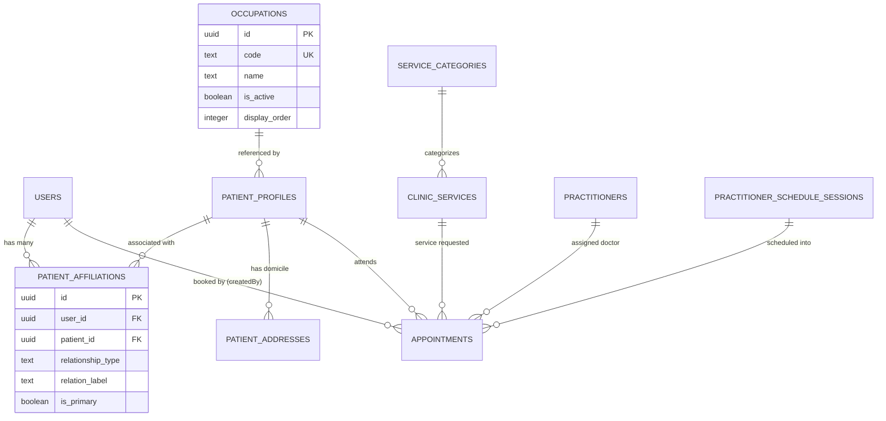

# [Plan] Patient Affiliations, On-Demand Form & Expanded Clinic Services

> **For agentic workers:** REQUIRED SUB-SKILL: Use superpowers:subagent-driven-development (recommended) or superpowers:executing-plans to implement this plan task-by-task. Steps use checkbox (`- [ ]`) syntax for tracking.

**Goal:** Implement the on-demand patient demographic registration, patient affiliations/associations (User $\rightarrow$ multiple patient records), master occupations, complete 2-category clinical services (Umum & Kebidanan), patient schedule booking options, and appointment reschedule/cancel lifecycle with full Docker, migration, and E2E verification.

**Architecture:** 
1. **Decoupled Standalone Patient Domain:** Patients exist independently of authentication. User accounts link to patients via `patient_affiliations` (supporting self, parent, child, friend, etc.).
2. **Database-Driven Master References:** Master `occupations` and `service_categories` with 18 specialized clinic services eliminate frontend hardcoding.
3. **Transport-Agnostic Booking & Reschedule Engine:** Schedule query yields 4-shift availability with simple `isDisabled` flags; Appointments engine handles atomic seat reallocation, slot restoration, and real-time push notifications.

**Tech Stack:** NestJS, Drizzle ORM, PostgreSQL, Redis, Socket.IO, Biome, Bun, Docker.

**Spec:** [feature-spec/form-service-patient/user-story.md](file:///D:/Amanah-healthcare-backend/feature-spec/form-service-patient/user-story.md)

## Global Constraints
- Maximum 500 lines of code per file (strict limit).
- Single Source of Truth (SSOT) and Separation of Concerns (SoC) — no God objects.
- No frontend hardcoding: all occupations, categories, services, and durations are database-driven.
- Biome formatting and linting compliance (`bun run format` and `bun run lint:fix`).
- All code changes verified with automated tests and end-to-end PowerShell verification scripts.

---

## Component Architecture & Data Flow



---

## Tasks

### Task 1: Database Schema & Migration for Patient Affiliations and Occupations

**Files:**
- Create: `src/database/migrations/0014_patient_affiliations_and_occupations.sql`
- Modify: `src/database/schema/amanah.schema.ts`
- Modify: `src/database/schema/amanah.relations.ts`
- Modify: `src/database/migrations/meta/_journal.json`

**Interfaces:**
- Consumes: `users`, `patientProfiles`, `patientAddresses` from `amanah.schema.ts`.
- Produces: `occupations`, `patientAffiliations` tables and Drizzle relations.

- [ ] **Step 1: Define `occupations` and `patientAffiliations` in `amanah.schema.ts`**

Add table definitions:
```typescript
export const occupations = pgTable(
  'occupations',
  {
    id: uuid().defaultRandom().primaryKey().notNull(),
    code: text().notNull(),
    name: text().notNull(),
    isActive: boolean('is_active').default(true).notNull(),
    displayOrder: integer('display_order').default(0).notNull(),
    createdAt: timestamp('created_at', { withTimezone: true, mode: 'string' }).defaultNow().notNull(),
    updatedAt: timestamp('updated_at', { withTimezone: true, mode: 'string' }).defaultNow().notNull(),
  },
  (table) => [unique('occupations_code_key').on(table.code)],
);

export const patientAffiliations = pgTable(
  'patient_affiliations',
  {
    id: uuid().defaultRandom().primaryKey().notNull(),
    userId: uuid('user_id').notNull().references(() => users.id, { onDelete: 'cascade' }),
    patientId: uuid('patient_id').notNull().references(() => patientProfiles.id, { onDelete: 'cascade' }),
    relationshipType: text('relationship_type').default('self').notNull(),
    relationLabel: text('relation_label'),
    isPrimary: boolean('is_primary').default(false).notNull(),
    createdAt: timestamp('created_at', { withTimezone: true, mode: 'string' }).defaultNow().notNull(),
    updatedAt: timestamp('updated_at', { withTimezone: true, mode: 'string' }).defaultNow().notNull(),
  },
  (table) => [
    unique('patient_affiliations_user_patient_unique').on(table.userId, table.patientId),
    index('patient_affiliations_user_id_idx').on(table.userId),
    index('patient_affiliations_patient_id_idx').on(table.patientId),
  ],
);
```
Remove `unique('patient_profiles_user_id_key').on(table.userId)` from `patientProfiles` to allow multiple affiliations per user and standalone patient profiles.

- [ ] **Step 2: Update relations in `amanah.relations.ts`**

Add relations:
```typescript
export const patientAffiliationsRelations = relations(patientAffiliations, ({ one }) => ({
  user: one(users, { fields: [patientAffiliations.userId], references: [users.id] }),
  patientProfile: one(patientProfiles, { fields: [patientAffiliations.patientId], references: [patientProfiles.id] }),
}));

export const usersRelations = relations(users, ({ many }) => ({
  patientAffiliations: many(patientAffiliations),
  // existing relations...
}));

export const patientProfilesRelations = relations(patientProfiles, ({ many, one }) => ({
  patientAffiliations: many(patientAffiliations),
  occupationRef: one(occupations, { fields: [patientProfiles.occupationId], references: [occupations.id] }),
  // existing relations...
}));
```

- [ ] **Step 3: Create SQL migration `0014_patient_affiliations_and_occupations.sql`**

Draft idempotent migration SQL:
```sql
CREATE TABLE IF NOT EXISTS "occupations" (
  "id" uuid PRIMARY KEY DEFAULT gen_random_uuid() NOT NULL,
  "code" text NOT NULL UNIQUE,
  "name" text NOT NULL,
  "is_active" boolean DEFAULT true NOT NULL,
  "display_order" integer DEFAULT 0 NOT NULL,
  "created_at" timestamp with time zone DEFAULT now() NOT NULL,
  "updated_at" timestamp with time zone DEFAULT now() NOT NULL
);

ALTER TABLE "patient_profiles" DROP CONSTRAINT IF EXISTS "patient_profiles_user_id_key";
ALTER TABLE "patient_profiles" ADD COLUMN IF NOT EXISTS "occupation_id" uuid REFERENCES "occupations"("id") ON DELETE SET NULL;

CREATE TABLE IF NOT EXISTS "patient_affiliations" (
  "id" uuid PRIMARY KEY DEFAULT gen_random_uuid() NOT NULL,
  "user_id" uuid NOT NULL REFERENCES "users"("id") ON DELETE CASCADE,
  "patient_id" uuid NOT NULL REFERENCES "patient_profiles"("id") ON DELETE CASCADE,
  "relationship_type" text DEFAULT 'self' NOT NULL,
  "relation_label" text,
  "is_primary" boolean DEFAULT false NOT NULL,
  "created_at" timestamp with time zone DEFAULT now() NOT NULL,
  "updated_at" timestamp with time zone DEFAULT now() NOT NULL,
  CONSTRAINT "patient_affiliations_user_patient_unique" UNIQUE ("user_id", "patient_id")
);

CREATE INDEX IF NOT EXISTS "patient_affiliations_user_id_idx" ON "patient_affiliations" ("user_id");
CREATE INDEX IF NOT EXISTS "patient_affiliations_patient_id_idx" ON "patient_affiliations" ("patient_id");

-- Backfill existing single-patient users into affiliations
INSERT INTO "patient_affiliations" ("user_id", "patient_id", "relationship_type", "relation_label", "is_primary")
SELECT "user_id", "id", 'self', 'Saya Sendiri', true
FROM "patient_profiles"
WHERE "user_id" IS NOT NULL
ON CONFLICT ("user_id", "patient_id") DO NOTHING;
```

Update `src/database/migrations/meta/_journal.json` with entry `0014_patient_affiliations_and_occupations`.

- [ ] **Step 4: Execute migration against PostgreSQL container**

Run: `docker exec -i amanah-healthcare-backend-postgres-1 psql -U postgres -d amanah_healthcare < src/database/migrations/0014_patient_affiliations_and_occupations.sql`
Expected: `CREATE TABLE`, `ALTER TABLE`, `INSERT 0 N`.

---

### Task 2: Master Seeder Updates (Occupations, 2 Service Categories, 18 Services)

**Files:**
- Modify: `src/database/seeds/drizzle/seed.ts`

**Interfaces:**
- Consumes: `occupations`, `serviceCategories`, `clinicServices`, `clinicServiceComplaints` tables.
- Produces: 12 standardized Indonesian occupations, 2 service categories (`layanan_umum`, `layanan_kebidanan`), 18 specialized services with complaint options.

- [ ] **Step 1: Add Occupations Master Seeder in `seed.ts`**

Insert master occupation records:
```typescript
const standardOccupations = [
  ['pns_tni_polri', 'PNS / TNI / Polri', 1],
  ['karyawan_swasta', 'Karyawan Swasta', 2],
  ['wiraswasta', 'Wiraswasta / Pedagang', 3],
  ['petani_peternak', 'Petani / Peternak', 4],
  ['nelayan', 'Nelayan', 5],
  ['pelajar_mahasiswa', 'Pelajar / Mahasiswa', 6],
  ['ibu_rumah_tangga', 'Ibu Rumah Tangga', 7],
  ['pensiunan', 'Pensiunan', 8],
  ['guru_dosen', 'Guru / Dosen', 9],
  ['tenaga_medis', 'Dokter / Tenaga Kesehatan', 10],
  ['buruh', 'Buruh Harian Lepas', 11],
  ['belum_tidak_bekerja', 'Belum / Tidak Bekerja', 12],
  ['lainnya', 'Lainnya', 13],
] as const;

for (const [code, name, order] of standardOccupations) {
  await queryOne({
    client,
    text: `
      INSERT INTO occupations (code, name, display_order, is_active)
      VALUES ($1, $2, $3, true)
      ON CONFLICT (code) DO UPDATE
      SET name = EXCLUDED.name, display_order = EXCLUDED.display_order, is_active = true, updated_at = now()
    `,
    values: [code, name, order],
  });
}
```

- [ ] **Step 2: Seed the 2 Service Categories and 18 Specialized Services in `seed.ts`**

1. Categories:
   - `layanan_umum`: "Layanan Umum"
   - `layanan_kebidanan`: "Layanan Kebidanan"
2. Services under `layanan_umum`:
   - `usg_umum`: "USG Umum"
   - `pemeriksaan_umum`: "Pemeriksaan Umum"
   - `pengobatan_keluhan_ringan`: "Pengobatan Keluhan Ringan"
   - `cek_tekanan_darah`: "Cek Tekanan Darah"
   - `ecg`: "Elektrokardiogram (ECG)"
   - `pemeriksaan_laboratorium`: "Pemeriksaan Laboratorium"
   - `nebulizer`: "Terapi Nebulizer"
   - `pemeriksaan_kehamilan_umum`: "Pemeriksaan Kehamilan Umum"
   - `konsultasi_kesehatan`: "Konsultasi Kesehatan"
   - `surat_keterangan_kesehatan`: "Surat Keterangan Kesehatan"
3. Services under `layanan_kebidanan`:
   - `persalinan`: "Persalinan Normal"
   - `pemeriksaan_kehamilan_bidan`: "Pemeriksaan Kehamilan & ANC"
   - `perawatan_nifas`: "Perawatan Masa Nifas (PNC)"
   - `keluarga_berencana`: "Pelayanan KB & Kontrasepsi"
   - `vaginal_toilet`: "Vaginal Toilet / Tindakan Khusus"
   - `imunisasi`: "Imunisasi Bayi & Balita"
   - `tumbuh_kembang_anak`: "Deteksi Tumbuh Kembang Anak"
   - `konsultasi_kesehatan_reproduksi`: "Konsultasi Kesehatan Reproduksi"

- [ ] **Step 3: Run seeder script**

Run: `bun run seed:drizzle`
Expected: Seed process completes without errors, populating all 18 services, 2 categories, and occupations.

---

### Task 3: Refactor Patient Repository & Mapper (< 500 LOC Enforcement)

**Files:**
- Create: `src/modules/patients/infrastructure/drizzle/patient-record.mapper.ts`
- Modify: `src/modules/patients/infrastructure/drizzle/patient.drizzle-repository.ts`

**Interfaces:**
- Consumes: Raw Drizzle queries on `patientProfiles`, `patientAddresses`, `patientEmergencyContacts`.
- Produces: `mapRecordToEntity(record: any): PatientEntity`. Drops file line count from 563 to ~320 lines.

- [ ] **Step 1: Extract mapper into `patient-record.mapper.ts`**

Implement `mapRecordToEntity` in standalone mapper file:
```typescript
import { PatientEntity } from '../../domain/entities/patient.entity';

export function mapPatientRecordToEntity(record: any): PatientEntity {
  let bloodTypeDisplay = 'Belum Tahu';
  if (record.bloodType && record.bloodType !== 'unknown') {
    bloodTypeDisplay = record.bloodType.toUpperCase();
  }

  const primaryAddress =
    record.patientAddresses?.find((a: any) => a.isPrimary) ||
    record.patientAddresses?.[0];
  const primaryEmergency = record.patientEmergencyContacts?.[0];

  return {
    id: record.id,
    userId: record.userId || '',
    medicalRecordNumber: record.medicalRecordNumber,
    nik: record.nationalIdEncrypted || record.nationalIdHash || '',
    fullName: record.fullName,
    gender: record.gender === 'female' ? 'Perempuan' : 'Laki-laki',
    birthPlace: record.birthPlace || '',
    birthDate: typeof record.birthDate === 'string' ? record.birthDate : record.birthDate?.toISOString?.()?.slice(0, 10) || '',
    bloodType: bloodTypeDisplay,
    namaIbuKandung: record.motherName || null,
    pekerjaan: record.occupation || null,
    phoneNumber: record.phone || '',
    address: primaryAddress?.fullAddress || '',
    alamatDetail: primaryAddress?.line1 || null,
    provinsi: primaryAddress?.provinceName || null,
    provinsiId: primaryAddress?.provinceCode || null,
    kabupaten: primaryAddress?.regencyName || null,
    kabupatenId: primaryAddress?.regencyCode || null,
    kecamatan: primaryAddress?.districtName || null,
    kecamatanId: primaryAddress?.districtCode || null,
    kelurahan: primaryAddress?.villageName || null,
    kelurahanId: primaryAddress?.villageCode || null,
    addressDetail: primaryAddress ? { ...primaryAddress } : null,
    emergencyContactName: primaryEmergency?.name || null,
    emergencyContactPhone: primaryEmergency?.phone || null,
    emergencyContactRelationship: primaryEmergency?.relationship || null,
    emergencyContactDetail: primaryEmergency ? { ...primaryEmergency } : null,
    allergies: record.patientAllergies || [],
    medicalHistory: record.medicalHistorySummary || null,
    avatarUrl: record.avatarUrl || null,
    status: record.status || 'active',
    createdAt: new Date(record.createdAt),
    updatedAt: new Date(record.updatedAt),
  };
}
```

- [ ] **Step 2: Update `patient.drizzle-repository.ts` to use `mapPatientRecordToEntity`**

Import and use the standalone mapper. Confirm line count is reduced under 350 lines.

- [ ] **Step 3: Run existing patient unit tests**

Run: `bun test src/modules/patients`
Expected: All existing tests pass cleanly.

---

### Task 4: Patient Affiliation Domain & Drizzle Repository

**Files:**
- Create: `src/modules/patients/domain/entities/patient-affiliation.entity.ts`
- Create: `src/modules/patients/domain/repositories/patient-affiliation.repository.ts`
- Create: `src/modules/patients/infrastructure/drizzle/patient-affiliation.drizzle-repository.ts`

**Interfaces:**
- Consumes: `users`, `patientProfiles`, `patientAffiliations`, `patientAddresses` tables.
- Produces: `PatientAffiliationRepository` interface with `findByUserId`, `findById`, `createWithPatient`, `update`, `disaffiliate`.

- [ ] **Step 1: Create `patient-affiliation.entity.ts`**

```typescript
import { PatientEntity } from './patient.entity';

export interface PatientAffiliationEntity {
  id: string;
  userId: string;
  patientId: string;
  relationshipType: 'self' | 'parent' | 'child' | 'spouse' | 'relative' | 'friend' | 'other';
  relationLabel: string;
  isPrimary: boolean;
  patient?: PatientEntity;
  createdAt: Date;
  updatedAt: Date;
}
```

- [ ] **Step 2: Create `patient-affiliation.repository.ts`**

```typescript
import { PatientAffiliationEntity } from '../entities/patient-affiliation.entity';
import { CreatePatientAffiliationDto } from '../../presentation/dto/create-patient-affiliation.dto';

export const PATIENT_AFFILIATION_REPOSITORY = Symbol('PATIENT_AFFILIATION_REPOSITORY');

export interface PatientAffiliationRepository {
  findByUserId(userId: string): Promise<PatientAffiliationEntity[]>;
  findById(id: string): Promise<PatientAffiliationEntity | null>;
  createWithPatient(userId: string, dto: CreatePatientAffiliationDto): Promise<PatientAffiliationEntity>;
  associateExistingPatient(userId: string, patientId: string, relationshipType: string, relationLabel?: string): Promise<PatientAffiliationEntity>;
  updateAffiliation(id: string, relationshipType?: string, relationLabel?: string, isPrimary?: boolean): Promise<PatientAffiliationEntity>;
  disaffiliate(userId: string, affiliationId: string): Promise<boolean>;
  getOccupations(): Promise<Array<{ id: string; code: string; name: string; displayOrder: number }>>;
}
```

- [ ] **Step 3: Implement `patient-affiliation.drizzle-repository.ts`**

Implement repository under 300 LOC:
- Handles auto-generating MRN (`RM-YYYYMM-XXXX`).
- Inserts `patientProfiles`, `patientAddresses`, and `patientAffiliations` atomically inside a Drizzle transaction.
- Returns fully populated `PatientAffiliationEntity` with attached `patient` entity.

---

### Task 5: Patient Affiliation Presentation Layer (REST Endpoints & DTOs)

**Files:**
- Create: `src/modules/patients/presentation/dto/create-patient-affiliation.dto.ts`
- Create: `src/modules/patients/presentation/dto/update-patient-affiliation.dto.ts`
- Create: `src/modules/patients/presentation/patient-affiliations.controller.ts`
- Create: `src/modules/patients/presentation/patient-affiliations.controller.spec.ts`
- Modify: `src/modules/patients/patients.module.ts`

**Interfaces:**
- Endpoints:
  - `GET /api/v1/patients/reference/occupations`
  - `GET /api/v1/patients/affiliations`
  - `POST /api/v1/patients/affiliations`
  - `GET /api/v1/patients/affiliations/:id`
  - `PATCH /api/v1/patients/affiliations/:id`
  - `DELETE /api/v1/patients/affiliations/:id`

- [ ] **Step 1: Create DTOs with validation rules**

Create `create-patient-affiliation.dto.ts`:
- Demographics: `fullName` (required), `nik` (16 digits), `motherName`, `birthPlace`, `birthDate` (ISO format), `gender` ('Laki-laki' | 'Perempuan'), `bloodType` ('A' | 'B' | 'AB' | 'O' | 'Belum Tahu'), `occupationId` (optional UUID), `pekerjaan` (text), `phoneNumber`.
- Domicile: `provinsi`, `provinsiId`, `kabupaten`, `kabupatenId`, `kecamatan`, `kecamatanId`, `kelurahan`, `kelurahanId`, `alamatDetail`.
- Affiliation: `relationshipType` ('self' | 'parent' | 'child' | 'spouse' | 'friend' | 'other'), `relationLabel` (optional text), `isPrimary` (boolean default false).

- [ ] **Step 2: Create `patient-affiliations.controller.ts`**

Implement controller with OpenAPI decorators and role protection (`@Roles('PATIENT', 'STAF', 'ADMIN')`).

- [ ] **Step 3: Register repository & controller in `patients.module.ts`**

Export `PATIENT_AFFILIATION_REPOSITORY` and providers.

- [ ] **Step 4: Write unit test in `patient-affiliations.controller.spec.ts`**

Test listing affiliations, creating on-demand patient, and fetching occupations.
Run: `bun test src/modules/patients/presentation/patient-affiliations.controller.spec.ts`
Expected: 100% tests pass.

---

### Task 6: Schedule Booking Options Endpoint (`GET /api/v1/schedules/booking-options`)

**Files:**
- Create: `src/modules/schedules/presentation/dto/patient-booking-options-query.dto.ts`
- Modify: `src/modules/schedules/presentation/schedules.controller.ts`
- Modify: `src/modules/schedules/infrastructure/drizzle/schedule.drizzle-repository.ts`

**Interfaces:**
- Consumes: `poliklinikId` (UUID), `date` (YYYY-MM-DD), `staffId?` (UUID).
- Produces: 4 shifts (`PAGI`, `SIANG`, `SORE`, `MALAM`) with `isDisabled` boolean, remaining available capacity, and active practicing doctors.

- [ ] **Step 1: Create `patient-booking-options-query.dto.ts`**

```typescript
export class PatientBookingOptionsQueryDto {
  @IsUUID()
  poliklinikId: string;

  @IsDateString()
  date: string;

  @IsOptional()
  @IsUUID()
  staffId?: string;
}
```

- [ ] **Step 2: Add repository method `getPatientBookingOptions`**

Evaluates practitioner schedule sessions for the target date and clinic unit:
- Evaluates 4 shifts:
  - `PAGI`: 06:00 - 12:00
  - `SIANG`: 12:00 - 18:00
  - `SORE`: 15:00 - 18:00 (or MALAM 18:00 - 24:00)
  - `MALAM`: 18:00 - 24:00
  - `DINI_HARI`: 00:00 - 06:00
- If no doctor is scheduled or `availableSlots == 0`, marks `isDisabled = true`.
- Returns simplified UI contract so frontend doesn't need to perform any filtering logic.

- [ ] **Step 3: Expose `@Get('booking-options')` in `schedules.controller.ts`**

Allow roles `@Roles('PATIENT', 'STAF', 'ADMIN')`.

- [ ] **Step 4: Run schedule tests**

Run: `bun test src/modules/schedules`
Expected: Existing and new tests pass.

---

### Task 7: Patient Appointment Cards & Reschedule Integration

**Files:**
- Modify: `src/modules/appointments/presentation/appointments.controller.ts`
- Modify: `src/modules/appointments/application/appointments.service.ts`
- Modify: `src/modules/appointments/infrastructure/drizzle/appointment.drizzle-repository.ts`
- Modify: `src/modules/appointments/appointments.notifications.ts`

**Interfaces:**
- `GET /api/v1/appointments/me`: Returns cards for all appointments created by this user or matching affiliated patient IDs.
- `GET /api/v1/appointments/:id/reschedule-options`: Returns available sessions with vacant slots for that doctor/poli.
- `POST /api/v1/appointments/:id/reschedule`: Reallocates appointment to a new session, emits `appointment.rescheduled.v1`.
- `PATCH /api/v1/appointments/:id/cancel`: Restores doctor session quota (+1) and emits notification.

- [ ] **Step 1: Update `getMyAppointments` in `appointments.controller.ts` & `appointments.service.ts`**

Support querying by `user.id` (`createdBy` OR affiliated patient IDs):
```typescript
async findMyPatientAppointments(userId: string): Promise<AppointmentEntity[]> {
  const affiliations = await this.affiliationRepo.findByUserId(userId);
  const patientIds = affiliations.map(a => a.patientId);
  return this.appointmentRepo.findByCreatedOrPatientIds(userId, patientIds);
}
```

- [ ] **Step 2: Implement Reschedule Endpoints**

- `GET /api/v1/appointments/:id/reschedule-options`
- `POST /api/v1/appointments/:id/reschedule`:
  Takes `{ newSessionId: string, newDate: string, reason?: string }`.
  Atomically restores available slot in old session and decrements slot in new session.

- [ ] **Step 3: Register Notification Rule in `appointments.notifications.ts`**

Add rule for `APPOINTMENT_EVENTS.RESCHEDULED`:
```typescript
this.registry.registerRule({
  eventType: 'appointment.rescheduled.v1',
  category: 'appointment',
  defaultChannels: ['in_app'],
  resolveRecipients: (payload: any) => payload.patientUserId,
  titleTemplate: 'Jadwal Janji Temu Diubah (Rescheduled)',
  bodyTemplate: (payload: any) =>
    `Jadwal janji temu Anda di ${payload.poliklinikName} telah dialihkan ke tanggal ${payload.newDate} sesi ${payload.newSession}.`,
  isUrgent: true,
  badgeIcon: 'calendar',
  resolveSource: (payload: any) => ({ sourceType: 'appointment', sourceId: payload.appointmentId }),
});
```

- [ ] **Step 4: Run appointments unit test suite**

Run: `bun test src/modules/appointments`
Expected: 100% tests pass.

---

### Task 8: Verification, Biome Linter, Docker Rebuild & E2E Script

**Files:**
- Create: `scripts/e2e/test-patient-affiliations-and-booking.ps1`

- [ ] **Step 1: Run Biome format and lint check**

Run: `bun run format && bun run lint:fix`
Expected: Zero lint violations.

- [ ] **Step 2: Build NestJS application**

Run: `bun run build`
Expected: Exit code 0, dist folder generated.

- [ ] **Step 3: Deploy to Docker Container**

Run: `docker cp dist amanah-healthcare-backend-api-1:/usr/src/app/ && docker restart amanah-healthcare-backend-api-1`
Verify: `curl -s http://127.0.0.1:3001/health/ready` returns 200 OK.

- [ ] **Step 4: Execute comprehensive E2E PowerShell script**

Run: `powershell -ExecutionPolicy Bypass -File scripts\e2e\test-patient-affiliations-and-booking.ps1`
Verifies:
1. Fetching master occupations (`GET /patients/reference/occupations`).
2. Creating an on-demand affiliated patient ("Ibu Aminah") with 17 demographic & domicile fields.
3. Listing patient affiliations (`GET /patients/affiliations`).
4. Checking available schedule booking options (`GET /schedules/booking-options`).
5. Booking appointment for the affiliated patient.
6. Viewing appointment cards in `GET /appointments/me`.
7. Performing Reschedule & Cancel with slot recovery.

---

### Task 9: Backend API Changelog Documentation

**Files:**
- Create: `docs/api-changelog/2026-09-27-patient-affiliations-and-on-demand-booking.md`

- [ ] **Step 1: Write API Changelog adhering to `AGENTS.md` protocol**

Document:
- New Endpoints (`/patients/reference/occupations`, `/patients/affiliations`, `/schedules/booking-options`, `/appointments/:id/reschedule`).
- Data contract shapes and TypeScript/Dart interfaces for frontend integration.
- Clear guidelines on what frontend must render and what frontend MUST NOT calculate.

---

## Verification Plan

### Automated Tests
```powershell
# 1. Run unit test suites
bun test src/modules/patients
bun test src/modules/appointments
bun test src/modules/schedules

# 2. Run Biome linter
bun run lint

# 3. Compile project
bun run build

# 4. Run end-to-end integration test
powershell -ExecutionPolicy Bypass -File scripts\e2e\test-patient-affiliations-and-booking.ps1
```

### Manual Verification
- Execute `scripts\e2e\simulate-flutter-ahmad-amikom.ps1 -Scenario all` to confirm backward compatibility of all existing real patient simulations.
