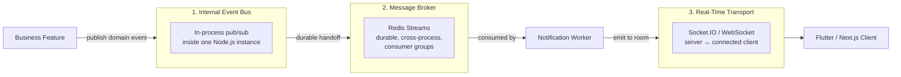
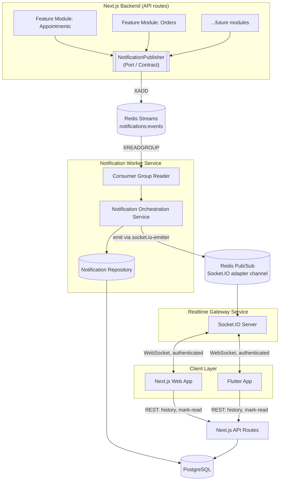

# Real-Time Notification Architecture — Paradigm & System Design

**Document 1 of 4 — Architectural Source of Truth**
Companion documents: `02-flutter-notifications.md`, `03-nextjs-web-notifications.md`, `04-backend-notifications.md`

---

## 1. Purpose and Scope

This document establishes the architectural paradigm for the notification system independently of any specific UI technology. Flutter and Next.js are treated purely as *presentation-layer consumers* of a contract defined here. Nothing in this document should need to change if the mobile client were rewritten in a different framework, or if the web client were replaced entirely — that independence is the point.

Everything downstream (Documents 2–4) references the vocabulary, boundaries, and technology decisions made here. If a term is used elsewhere without redefinition, its definition lives in this document.

---

## 2. The Architectural Paradigm: Event-Driven Architecture (EDA)

The paradigm you're describing — "something happened, tell whoever cares, without the thing that happened needing to know who cares" — is called **Event-Driven Architecture (EDA)**. It is the standard industry pattern for notification systems at every scale, from a single monolith to Netflix/Uber-scale distributed systems. The specific variant used here combines three well-established patterns:

- **Publish/Subscribe (Pub/Sub)** — producers and consumers are decoupled through an intermediary; a producer never holds a reference to its consumers.
- **Ports and Adapters (Hexagonal Architecture)** — business logic depends on abstractions ("ports"), and concrete technologies plug in as "adapters" behind those abstractions. This is *the* pattern that satisfies your "plug-and-play, replaceable infrastructure" requirement.
- **Domain Events** (from Domain-Driven Design) — a fact that has already happened in the business domain, expressed as an immutable record (`AppointmentConfirmed`, not `ConfirmAppointment`). Events describe the past; commands describe an intent for the future. The notification system reacts only to events, never issues commands into business modules.

### 2.1 Core Vocabulary

| Term | Definition | Where it lives in this system |
|---|---|---|
| **Domain Event** | An immutable fact that occurred inside a business module (e.g. `appointment.confirmed`). | Produced by feature modules (Appointments, Orders, etc.) |
| **Publisher** | The code that emits an event. Does not know or care who — if anyone — is listening. | Business modules, via the `NotificationPublisher` port |
| **Event Bus** | The *logical* in-application mechanism that lets publishers and subscribers find each other without a direct reference. | Abstraction implemented by an in-process emitter (single instance) plus Redis Streams (cross-process) — see §3 |
| **Message Broker** | External infrastructure that durably transports messages **between backend services/processes**. | Redis Streams — see §3.2 |
| **Subscriber / Consumer** | Code that reacts to an event. Multiple subscribers can react to the same event independently. | The Notification Orchestration Service (Document 4, §6) |
| **Real-Time Transport** | The mechanism that pushes data from a live server process to a live, connected client (mobile/web). **Not** the same thing as a message broker — see §3.3. | Socket.IO over WebSocket, via a dedicated Realtime Gateway |
| **Fire-and-Forget** | The publisher completes its own operation and returns immediately after emitting the event; it does not wait for, or know the outcome of, any subscriber's processing. | How every business module talks to notifications |
| **Asynchronous Processing** | Work that happens outside the request/response cycle that triggered it. Notification creation and delivery never block the business operation that caused them. | The entire pipeline after `publish()` is called |
| **Subscription (client-side)** | A live client (Flutter/web) declaring "push events for this user to me while I'm connected." | Established over the Socket.IO connection after authentication |
| **Idempotency** | Processing the same event twice produces the same end state as processing it once — no duplicates. | Enforced via a unique constraint on the notifications table |

---

## 3. Three Layers That Must Never Be Confused

This is the single most important architectural distinction in the whole system, and the one most teams get wrong by treating "message queue" and "push to the browser" as the same problem. They are not. Three genuinely different responsibilities exist, each solved by a different mechanism:



| Layer | Question it answers | Lives between | Technology chosen |
|---|---|---|---|
| **Internal Event Bus** | "How does one part of the backend process tell another part of the *same* process that something happened?" | Two modules in the same Node.js process | Lightweight in-process emitter (typed wrapper over `EventEmitter`) |
| **Message Broker** | "How does one *service* durably tell another *service* something happened, surviving restarts and process boundaries?" | The API process and the Notification Worker process (separate containers) | **Redis Streams** |
| **Real-Time Transport** | "How does a running server push data to a specific, currently-connected phone or browser tab, right now?" | The Notification Worker/Gateway and an open socket held by a device | **Socket.IO over WebSocket** |

A message broker has no concept of "a connected browser tab." A WebSocket connection has no concept of "durability across a restart." Conflating them leads to either a fragile system (trying to make WebSockets durable) or an over-engineered one (trying to route push notifications through Kafka consumer groups). Keeping them as three distinct, individually-replaceable components is what makes the "adapter" requirement in your brief achievable.

---

## 4. High-Level System Diagram



Five independently deployable/replaceable units result from this diagram: the **API application**, the **Notification Worker**, the **Realtime Gateway**, **Redis**, and **PostgreSQL**. Document 4 maps these onto Docker services in detail.

---

## 5. End-to-End Lifecycle of a Notification

Walking the exact sequence you asked for, using "a doctor confirms an appointment" as the concrete example:

```mermaid
sequenceDiagram
    participant Actor as Doctor (Actor)
    participant Feature as Appointments Module
    participant Bus as NotificationPublisher (Port)
    participant Stream as Redis Streams
    participant Worker as Notification Worker
    participant DB as PostgreSQL
    participant PubSub as Socket.IO Redis Adapter
    participant GW as Realtime Gateway
    participant Client as Flutter / Next.js Client

    Actor->>Feature: Confirms appointment
    Feature->>Feature: Executes business use case
    Feature->>Bus: publish(AppointmentConfirmed event) — fire and forget
    Feature-->>Actor: HTTP 200 (business op already complete)
    Bus->>Stream: XADD notifications:events
    Worker->>Stream: XREADGROUP (consumer group)
    Worker->>Worker: Resolve recipient + channels via Notification Rules Registry
    Worker->>DB: INSERT notification (idempotency_key UNIQUE)
    DB-->>Worker: OK (or conflict = already processed, skip)
    Worker->>PubSub: emit to room "user:{recipientId}"
    PubSub->>GW: Delivered to any connected gateway instance
    alt Client currently connected
        GW->>Client: WebSocket push (real-time)
        Client->>Client: Update local state (unread++, prepend to list)
    else Client offline / not connected
        Note over GW,Client: Nothing to push — no error, no retry needed
    end
    Client->>Client: (later) Reconnects or opens app
    Client->>Worker: (via REST) GET /api/notifications?unread=true
    Worker-->>Client: Persisted notifications, incl. anything missed
    Actor->>Client: User opens/reads notification
    Client->>Worker: PATCH /api/notifications/:id/read
    Worker->>DB: UPDATE read_at
    Worker->>PubSub: emit "read" sync event (other devices update too)
```

Key properties of this flow that are easy to miss but essential to get right:

1. **The business request never waits on notification delivery.** The HTTP response to "confirm appointment" returns as soon as the appointment is confirmed and the event is handed to Redis Streams — typically single-digit milliseconds. Everything after that is fully asynchronous.
2. **Persistence happens before real-time push, not after.** The notification exists durably in Postgres *before* anyone tries to push it over a socket. This is what makes "recipient was offline" a non-event rather than a failure case — there's nothing to retry, because the data was never lost in the first place.
3. **The real-time push is a convenience/latency-optimization, not the source of truth.** The REST history endpoint is the source of truth. This single design decision eliminates most of the hard problems (offline delivery, missed-message recovery, reconnection gaps) that teams otherwise solve with complex broker-level guarantees.

---

## 6. The Decoupling Model: Ports and Adapters

### 6.1 The Notification Contract (the Port)

Every business feature talks to exactly one thing:

```typescript
interface DomainEvent<TPayload = Record<string, unknown>> {
  eventId: string;       // UUID, generated by the publisher
  type: string;          // "appointment.confirmed", "order.shipped", etc.
  module: string;        // "appointments", "orders" — for provenance, not routing logic
  occurredAt: string;    // ISO-8601 timestamp
  payload: TPayload;     // whatever the feature wants to carry; opaque to the notification core
}

interface NotificationPublisher {
  publish<T>(event: DomainEvent<T>): Promise<void>;
}
```

That's the entire surface area a feature developer needs to learn. No WebSockets, no broker client, no database schema, no retry logic, no knowledge of Flutter or Next.js. This directly satisfies the "a feature should only need to say: an event occurred, this is the type, this is the payload" requirement.

### 6.2 The Notification Rules Registry — how "plug-and-play" actually works

A tension exists in every notification system: the core notification engine must stay domain-agnostic (it shouldn't import code from the Appointments module), yet it still needs to know *who* should receive an `appointment.confirmed` event and *which channels* to use. The mechanism that resolves this tension without violating decoupling is a **registry each feature module populates at its own bootstrap time** — the notification core never reaches out to a feature; the feature reaches in, once, when it initializes:

```typescript
// inside the Appointments module's own bootstrap file
notificationRegistry.register("appointment.confirmed", {
  defaultChannels: ["in_app", "push"],
  resolveRecipient: (payload) => payload.patientId,
  // Optional: a small template reference, not full rendering logic
  titleTemplate: "Your appointment is confirmed",
});
```

The Notification Orchestration Service (Document 4) only ever calls `registry.get(event.type)` — it has zero compile-time or runtime dependency on the Appointments module's internals. This is what makes Feature Y's future integration a one-file addition rather than a redesign: Feature Y registers its own event types the same way, and the core notification pipeline requires no changes.

### 6.3 Adapters

| Concern | Port (interface) | Adapter (concrete implementation) | Replaceable with |
|---|---|---|---|
| Durable event handoff | `EventTransport` | Redis Streams adapter | RabbitMQ, Kafka, SQS |
| Notification persistence | `NotificationRepository` | PostgreSQL (Prisma/Drizzle) adapter | Any SQL/NoSQL store |
| In-app real-time delivery | `DeliveryChannelAdapter` (`channel: "in_app"`) | Socket.IO Redis-emitter adapter | Pusher, Ably, raw WS |
| Push delivery (future) | `DeliveryChannelAdapter` (`channel: "push"`) | FCM/APNs adapter | OneSignal, etc. |
| Email delivery (future) | `DeliveryChannelAdapter` (`channel: "email"`) | SMTP/Resend adapter | SES, Postmark |

Business logic (feature modules) never imports any row in the right-hand column. Only the notification infrastructure layer does.

---

## 7. Technology Selection and Rationale

### 7.1 Message broker: Redis Streams — not Kafka, not RabbitMQ

| Criterion | Kafka | RabbitMQ | **Redis Streams (chosen)** |
|---|---|---|---|
| Operational footprint | Heavy (ZooKeeper/KRaft, brokers, partitions to plan) | Moderate (its own clustering/HA story) | Minimal — Redis is almost certainly already in this stack for caching/sessions |
| Fits current event volume | Massively over-provisioned for a notification pipeline at this scale | Reasonable, but adds an entirely new piece of infrastructure to operate and monitor | Right-sized |
| Durability + consumer groups (needed for at-least-once) | Yes | Yes | **Yes** — `XADD`/`XREADGROUP`/`XACK`/`XCLAIM` give the same at-least-once guarantee |
| Replay / inspect history | Yes (core feature) | Limited | Yes, within stream retention (`XRANGE`) |
| License / cost | Free/OSS (Apache) | Free/OSS | Free/OSS |
| When to actually reconsider | High-throughput event *streaming/analytics*, multiple independent downstream teams consuming the same firehose, strict partition-ordering at scale | Complex routing topologies (topic/fanout/direct exchanges), very high message-rate queuing with many independent producers/consumers | — |

**Decision: Redis Streams.** It provides the exact guarantee needed — at-least-once delivery to a durable, replayable log with consumer-group semantics — without introducing a second piece of stateful infrastructure to operate, back up, and monitor. If event volume or routing complexity grows substantially (e.g., dozens of independent consumer services each needing different event subsets with complex topic routing), RabbitMQ is the natural next step; if it grows into high-throughput event streaming/analytics territory, Kafka is the natural next step. Neither is warranted by the requirements as stated, and introducing either now would be complexity added against a need that doesn't yet exist — exactly what you asked this document to avoid.

### 7.2 Real-time transport: WebSockets (via Socket.IO) — not raw WebSockets, not SSE-only

| Criterion | Server-Sent Events (SSE) | Raw WebSocket | **Socket.IO (chosen)** |
|---|---|---|---|
| Direction | Server → client only | Bidirectional | Bidirectional |
| Built-in reconnection | Manual (`EventSource` reconnects, but no backoff/state help) | Fully manual | **Built-in**, with exponential backoff |
| Rooms / per-user targeting | Manual bookkeeping | Manual bookkeeping | **Built-in** (`socket.join(room)`) |
| Horizontal scaling across gateway replicas | Manual | Manual | **Built-in** via `@socket.io/redis-adapter` |
| Fallback transport if WS blocked | N/A | None | HTTP long-polling fallback |
| Client library maturity (Flutter + Web) | Partial | Good | **Excellent on both platforms** |
| License | N/A (browser API) | N/A | Free/OSS (MIT) |

**Decision: Socket.IO.** The system needs per-user targeted delivery (rooms), reconnection handling on flaky mobile networks, and a consistent client experience across Flutter and Next.js — all of which Socket.IO provides out of the box as a mature, free, open-source library rather than something this architecture would otherwise have to build by hand on top of raw WebSockets. Read/unread acknowledgements could theoretically flow the same direction as SSE, but since the same transport already needs to exist for connection-state signaling (join room, heartbeat), a single bidirectional channel is simpler than running two transports.

*(If a future requirement is strictly server-to-client, no reconnection complexity, and extremely simple infrastructure — e.g. a public status-page style feed — SSE remains a legitimate lighter-weight option for that specific channel. It is not chosen here because the requirements include authenticated, per-user, bidirectional, reconnection-resilient delivery.)*

### 7.3 Persistence: PostgreSQL

Relational, because notifications have clear structure (recipient, type, status, timestamps) that benefits from constraints (the idempotency uniqueness guarantee in §8.1 specifically requires a real unique constraint, not an eventually-consistent document store), while the `payload` remains a `JSONB` column for the parts that must stay generic across arbitrary future feature payloads. Full schema is in Document 4, §7.

---

## 8. Reliability Model

### 8.1 At-least-once delivery and idempotency

Redis Streams consumer groups guarantee **at-least-once** processing: if the Notification Worker crashes after reading a message but before acknowledging it (`XACK`), that message remains in the group's Pending Entries List and will be redelivered (via `XCLAIM` after a timeout) to another worker instance. This means the same domain event can legitimately be processed twice. The system is made safe against this by:

- Every persisted notification row carries a unique `idempotency_key` (derived deterministically from `eventId + recipientId + type`).
- The insert is `INSERT ... ON CONFLICT (idempotency_key) DO NOTHING`.
- Reprocessing the same event therefore either creates the notification once, or silently no-ops on the second attempt — no duplicate rows, no duplicate pushes.

### 8.2 Offline recipients / lost connections

There is no special-case logic for this. Because persistence happens before delivery (§5), an offline recipient simply means the real-time push step has no active socket to deliver to — the Realtime Gateway checks room membership, finds it empty, and does nothing further. No retry queue is needed for in-app delivery specifically because the data was never at risk of being lost. When the client reconnects (or the app is opened for the first time that day), it calls the history endpoint and receives everything, in order, that it missed.

### 8.3 Reconnection and reconciliation pattern ("push is a hint, REST is truth")

This is the governing principle for both client documents (2 and 3): **never treat the real-time channel as authoritative.** Its only job is to reduce latency when the client happens to be connected. On every reconnect event, the client is expected to reconcile against the REST endpoint (fetch unread / fetch-since-last-seen-timestamp), which is guaranteed correct because it reads directly from the persisted source of truth.

### 8.4 Delivery failures for external channels (push/email — future)

Unlike in-app delivery, push (FCM/APNs) and email genuinely can fail at the third-party provider. Those channel adapters run through a retry-capable job queue (BullMQ on Redis) with exponential backoff and a bounded number of attempts, after which the job moves to a dead-letter queue for observability rather than being silently dropped. Full detail in Document 4, §11.

---

## 9. Persistence Model (Summary)

The full column-level schema lives in Document 4. At this architectural level, the governing constraint is: **the notifications table stores facts *about* a notification, never a copy of the business entity that caused it.** An `appointment.confirmed` notification stores a reference (`reference_type="appointment", reference_id=<uuid>`) and whatever minimal display payload is needed (`{"doctorName": "...", "scheduledAt": "..."}`) — never the full appointment record. If the UI needs more than that minimal payload, it fetches the referenced entity from its own domain endpoint. This is what keeps the schema generic across every current and future feature module rather than accumulating feature-specific columns.

---

## 10. Scalability and Observability

- **API application**: stateless, scales horizontally trivially (no session affinity required for the REST surface).
- **Notification Worker**: a single logical Redis Streams **consumer group** allows multiple worker replicas to share the workload safely — each stream entry is delivered to exactly one consumer within the group, so scaling workers out increases throughput without duplicating processing.
- **Realtime Gateway**: scales horizontally using `@socket.io/redis-adapter`, so a room broadcast issued from anywhere reaches sockets connected to *any* gateway replica, not just the one that issued it.
- **Observability**: every domain event's `eventId` is propagated as a correlation ID through Streams entry → notification row → Socket.IO emit → structured log lines, so a single event's journey through all five services can be traced end to end. Prometheus-style counters (`events_published_total`, `notifications_created_total`, `delivery_failures_total`, `socket_connections_gauge`) and Redis Streams consumer-lag monitoring (`XINFO GROUPS`) give operational visibility into backlog and health. Full detail in Document 4, §13.

---

## 11. Summary: The Integration Experience This Architecture Delivers

For any feature module, today or in six months:

```typescript
await notificationPublisher.publish({
  eventId: crypto.randomUUID(),
  type: "order.shipped",
  module: "orders",
  occurredAt: new Date().toISOString(),
  payload: { orderId, trackingNumber, customerId },
});
```

…plus a one-time registry entry at module bootstrap declaring the recipient resolver and default channels. Everything else — durability, persistence, real-time delivery, offline handling, retries, deduplication, read-state, and reaching both Flutter and Next.js — is owned entirely by the notification subsystem and requires zero changes for a new feature to adopt it.
